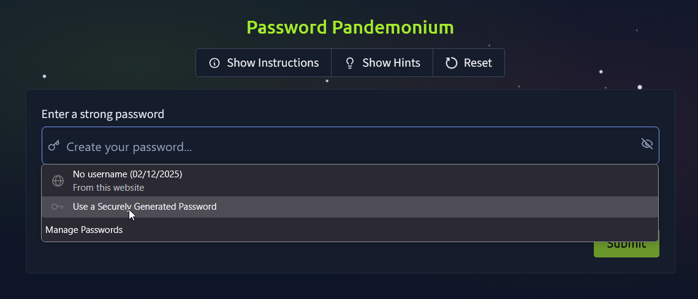

Hello everyone, and welcome back to the blog! In this post, I’ll be sharing how I tackled the Advent of Cyber 2025 **Preparation Track** and walking you through the steps I took to solve each challenge.

## Challenge 1 — Password Pandemonium

### Description

As you log into your new TBFC workstation, an alert pops up:

*“Weak passwords detected on 73 TBFC accounts!”*

Even McSkidy’s password, `P@ssw0rd123`, has been flagged. Before gaining full access, you’ll need to prove your password prowess.

Strong passwords are one of the simplest yet most effective defences against cyber attacks.

**Objective:**

Create a password that passes all system checks and isn’t found in the leaked password list.

**Steps:**

1. Enter a password with at least 12 characters.
2. Include uppercase, lowercase, numbers, and symbols.
3. Ensure it isn’t in the breach database.

### Solution

When you first open the challenge site, you’ll immediately see a pop-up warning: **“Weak password detected.”** That’s our cue—the challenge requires us to create a secure password that meets all the listed criteria. To make things simple, I used Firefox’s built-in password generator to create a strong, compliant password.

Once the password meets every requirement, all that’s left is to hit **Submit**.

And just like that—**BOOM!** We’ve secured our first flag.

### Flag

`THM{StrongStart}`

## Challenge 2 — The Suspicious Chocolate.exe

### Description

A shiny USB labelled **“SOCMAS Party Playlist”** appears on your desk. Inside is a mysterious file called `chocolate.exe`.

It looks festive, but who sent it?

In this challenge, you’ll scan the file using a simulated VirusTotal tool to decide whether it’s safe or malicious.

Checking suspicious files is a crucial skill for every defender.

**Objective:**

Determine if `chocolate.exe` is safe or infected.

**Steps:**

1. Click the “Scan” Button.
2. Review the scan report (49 clean results, 1 malicious).
3. Decide correctly whether the file is safe or dangerous.

### Solution

When we open the website, we’re greeted with a simulated **VirusTotal-like** tool for scanning suspicious files. To begin, simply click the **Scan** button.

After running the scan, the tool displays the results. The file `chocolate.exe` is flagged as malicious and identified as containing a **MalhareTrojan**, referenced under the code **`ML-2025-011`**.

All we need to do next is submit the scan report as *malicious*—and just like that, we obtain the flag.

### Flag

`THM{NotSoSweet}`

## Challenge 3 — Welcome to the AttackBox!

### Description

You step into TBFC’s **AttackBox**, a secure virtual environment built for training. The system hums quietly, waiting for your first command.

This is where defenders learn, break, and rebuild safely. Getting 
comfortable with the command line is your first step toward cyber 
mastery.

**Objective:**

Find and read the hidden welcome message inside your AttackBox.

**Steps:**

1. Use `ls` to list files.
2. Use `cd challenges/` to change directories.
3. Use `cat welcome.txt` to read the text file.

### Solution

When we open the website, it displays a terminal-style interface. From there, we just need to follow the steps provided in the challenge description to retrieve the flag.

### Flag

`THM{Ready2Hack}` 

## Challenge 4 — The CMD Conundrum

### Description

McSkidy’s workstation shows signs of tampering, suspicious files moved, logs wiped, and a strange folder named `mystery_data`.

It’s time to use the **Windows Command Prompt** to uncover what’s hidden.

Learning these commands helps you investigate systems and find what the GUI can’t.

**Objective:**

Find the hidden flag file using Windows commands.

**Steps:**

1. Use `dir` to list visible files.
2. Try `dir /a` to reveal hidden ones.
3. Use `type hidden_flag.txt` to read the flag.

### Solution

When we open the website, we’re presented with an interface that resembles a Windows Command Prompt. Just like in the previous challenge, all we need to do is follow the steps provided in the task description. You’ll notice a folder named **mystery_data**—navigate into that directory and run `dir /a` to reveal any hidden files. Once you do that, the flag will appear.

### Flag

`THM{WhereIsMcSkidy}`

## Challenge 5 — Linux Lore

### Description

TBFC’s delivery drones are glitching, dropping eggs instead of presents! McSkidy’s last login came from a Linux server, and something in his account might explain why.

Linux powers most servers worldwide, and knowing how to search within it is a must for any defender.

**Objective:**

Locate McSkidy’s hidden message in his Linux home directory.

**Steps:**

1. Use `cd /home/mcskidy/` to enter his folder.
2. Run `ls -la` to show all files.
3. Use `cat .secret_message` to reveal the flag.

### Solution

The solution is straightforward—just follow the steps listed in the challenge description. Running `ls -la` will reveal any hidden files, and from there, you’ll be able to obtain the flag.

### Flag

`THM{TrustNoBunny}`

## Challenge 6 — The Leak in the List

### Description

Rumours swirl that TBFC’s data has been leaked. Emails are bouncing, and the staff are panicking.

McSkidy suspects his account might have been part of a breach.

Defenders often use tools like **Have I Been Pwned** to check for compromised accounts. Early detection can stop an attack from spreading.

**Objective:**

Check if McSkidy’s email has appeared in a breach.

**Steps:**

1. Enter `mcskidy@tbfc.com` into the breach checker.
2. Review results for each domain.
3. Identify the one marked “Compromised.”

### Solution

Open the website, then enter the email **`mcskidy@tbfc.com`** to check whether it has been involved in any data breaches. Turns out the Email was breached. and we just need to review the report by clicking hopsec.io and we got the flag

### Flag

`THM{LeakedAndFound}`

## Challenge 7 — WiFi Woes in Wareville

### Description

The TBFC drones are looping endlessly over Wareville Square. Someone logged into the company router using default credentials!

Securing WiFi is critical. Default passwords are like leaving the front gate wide open.

**Objective:**

Log into the router and secure it with a strong new password.

**Steps:**

1. Log in with username `admin` and password `admin`.
2. Go to “Security Settings.”
3. Set a new strong password that passes validation.

### Solution

Open the website then follow the steps given in the description. 

And we just need create new password, I’m using Firefox’s built-in password generator. Save the new password and we got the flag.

### Flag

`THM{NoMoreDefault}`

## Challenge 8 — The App Trap

### Description

McSkidy’s social account has gone rogue, posting strange messages 
about “EASTMAS.” A suspicious third party app may be behind it.

Learning to review and manage app permissions helps stop data leaks before they start.

**Objective:**

Find and remove the malicious connected app.

**Steps:**

1. Review the list of connected apps.
2. Look for one with unusual permissions (like “password vault” access).
3. Click “Revoke Access.”

### Solution

Open the website and we can see there is a bunch off application, we just need to review all of those. and look out for one with unusual permission.

Turns out there’s suspicious permission in the Eastmas Scheduler app, we just need to revoke the permission, and we got the flag.

### Flag

`THM{AppTrapped}`

## Challenge 9 — The Chatbot Confession

### Description

TBFC’s AI assistant, **FestiveBot**, was meant to help write cheerful emails, but it’s been spilling secrets.

Some messages reveal internal URLs and even passwords.

AI tools can be powerful, but defenders must know how to prevent them from oversharing.

**Objective:**

Identify which chatbot messages contain sensitive information.

**Steps:**

1. Read each line of the conversation.
2. Select the ones containing private data.
3. Submit your findings.

### Solution

Open the website, and you’ll see a chat history from a chatbot. However, the chatbot is leaking sensitive information—such as a service token, an admin URL, and even email and password credentials. Since this data should remain private, all you need to do is identify these leaked messages, select them, and submit your findings.

### Flag

`THM{DontFeedTheBot}`

## Challenge 10 — The Bunny’s Browser Trail

### Description

SOCMAS web servers are showing heavy traffic, but one log entry stands out:

> “User Agent: BunnyOS/1.0 (HopSecBot)”
> 

Someone or something has infiltrated the system.

User Agent strings help defenders spot automated or suspicious visitors in network logs.

**Objective:**

Find the unusual User Agent in the HTTP log.

**Steps:**

1. Read the provided web log entries.
2. Compare them to common browsers (Chrome, Firefox, Edge).
3. Identify and select the suspicious entry.

### Solution

When we open the website, we’re presented with a stream of logs showing heavy traffic. Among these entries, a few lines stand out as unusual—and our task is to identify them. One suspicious log includes the User-Agent string **`BunnyOS/1.0 (HopSecBot)`**, which is clearly out of place compared to the normal traffic. This anomaly is what we need to select and submit to get the flag.

### Flag

`THM{EastmasIsComing}`

## Finished!

With all the preparation challenges completed, it’s time to move on to the real adventure—**the main Advent of Cyber 2025 challenge**.