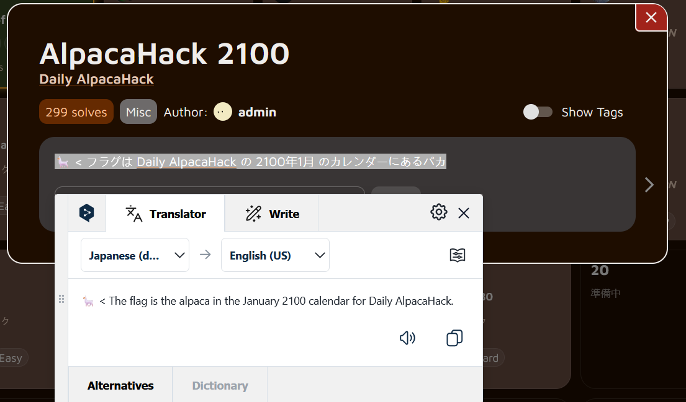

**Hello everyone, welcome to my blog post!**

In this post, I’ll be solving a challenge from the new feature released on AlpacaHack — the **Daily Challenge**. With this feature, we get a fresh challenge to solve every day. For Day 1, we received a **Misc** challenge, so let’s dive in and break it down together!


## Description



### Translation

🦙 < The flag is the alpaca in the January 2100 calendar for Daily AlpacaHack.

### Understanding the challenge

According to the challenge description, the flag is hidden somewhere in the **January 2100 calendar**. Our goal is simply to navigate to that specific time period in the web app to retrieve it.

## Solution

First, we move to the next month to observe how the URL parameters change.


We can see that the month is controlled through a URL parameter:

```bash
https://alpacahack.com/daily?month=2026-01
```

To jump directly to **January 2100**, we just update the parameter:

```bash
https://alpacahack.com/daily?month=2100-01
```

And just like that, we got the flag.


## Flag

`Alpaca{brought_AGI_to_humanity..._yes,_Alpaca*GentleIntelligence.}*`