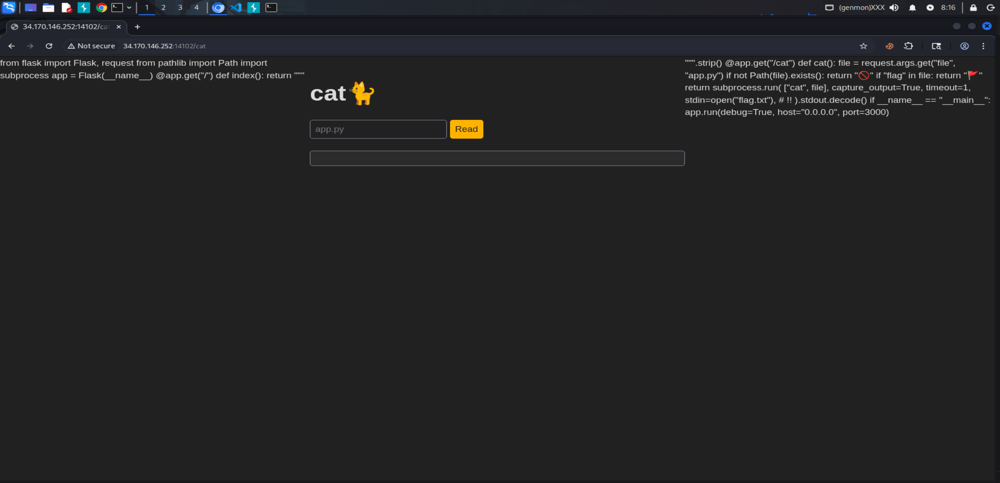

## Description

```bash
Nyan Cat!

http://34.170.146.252:14102
```

### Initial Analysis

We are provided with source code files. Let's extract and examine them:

```bash
┌──(chjwoo㉿hackbox)-[~/…/ctfs/alpacahack/web/cat]
└─$ tar -zxvf cat.tar.gz 
cat/
cat/web/
cat/web/requirements.txt
cat/web/Dockerfile
cat/web/flag.txt
cat/web/app.py
cat/compose.yaml
```

From the extracted files, we can identify the important components:

- `Dockerfile` - Container configuration
- `requirements.txt` - Python dependencies
- `app.py` - Main application code
- `flag.txt` - The flag we need to capture
- `compose.yaml` - Docker compose configuration

Let’s start by checking the Dockerfile:

```bash
FROM python:3.14.0-slim

WORKDIR /app

COPY requirements.txt .
RUN pip install -r requirements.txt

COPY . .

USER 404:404
CMD ["gunicorn", "--workers", "8", "--bind", "0.0.0.0:3000", "app:app"]
```

This confirms that the challenge runs a Flask application behind Gunicorn, listening on port 3000.

Now let’s focus on `app.py`, where the real logic lives.

```python
from flask import Flask, request
from pathlib import Path
import subprocess

app = Flask(__name__)

@app.get("/")
def index():
    return """
<head>
  <link rel="stylesheet" href="https://cdnjs.cloudflare.com/ajax/libs/simpledotcss/2.3.7/simple.min.css" integrity="sha512-taVA0VISClRMNshgWnlrG4lcEYSjwpgpI8vaoT0zGoPf9c74DA95SXMngcgjaWTrEsUbKmfKqmQ7toiXNc2l+A==" crossorigin="anonymous" referrerpolicy="no-referrer" />
</head>
<body>
  <main>
    <h1>cat🐈</h1>
    <form action="/" method="get">
      <input name="file" placeholder="app.py" required>
      <button type="submit">Read</button>
    <form>
    <pre><code id="code"></code></pre>
  </main>
  <script>
    const file = new URLSearchParams(location.search).get("file");
    if (file) {
      fetch("/cat?file=" + encodeURIComponent(file))
        .then((r) => r.text())
        .then((text) => document.getElementById("code").textContent = text);
    }
  </script>
</body>
    """.strip()

@app.get("/cat")
def cat():
    file = request.args.get("file", "app.py")
    if not Path(file).exists():
        return "🚫"
    if "flag" in file:
        return "🚩"

    return subprocess.run(
        ["cat", file],
        capture_output=True,
        timeout=1,
        stdin=open("flag.txt"),  # !!
    ).stdout.decode()

if __name__ == "__main__":
    app.run(debug=True, host="0.0.0.0", port=3000)

```

The `/cat` endpoint accepts a `file` parameter and has the following security checks:

1. **Path existence check**: Returns 🚫 if the file doesn't exist
2. **Keyword blacklist**: Returns 🚩 if the string "flag" appears in the filename

This blacklist mechanism prevents direct access to `flag.txt` by filtering any request containing the word "flag". The vulnerability lies in this code:

```python
    return subprocess.run(
        ["cat", file],
        capture_output=True,
        timeout=1,
        stdin=open("flag.txt"),  # !!
    ).stdout.decode()
```

The application runs the `cat` command using `subprocess.run()`, but it also **redirects `flag.txt` into the process’s standard input (stdin)**.

In Unix-like systems:

- **stdin** is file descriptor **0 (fd 0)**
- It can be accessed via `/dev/stdin`

This means that even if we are blocked from reading `flag.txt` *by name*, its contents are still being fed into the process via stdin. If we can convince `cat` to read from stdin instead of a normal file, we can leak the flag without triggering the blacklist.

## Solution

First, let's open Burp Suite and send a request to `http://34.170.146.252:14102/cat` without any parameters:



Somehow, even without specifying a file parameter, we can read the source code of `app.py` (this is because the default value is `"app.py"` in the code). Let's send this request to Repeater for further testing.


Now let's try accessing `flag.txt` directly by modifying the request in Repeater:


As expected, the blacklist filter blocks any filename containing "flag".

Before exploiting stdin, let’s confirm whether this endpoint is vulnerable to **Local File Inclusion (LFI)** by reading `/etc/passwd`.


Yep, LFI confirmed. Since `flag.txt` is being passed as stdin to the `cat` command, all we need to do is tell `cat` to read from **file descriptor 0**.

We do this by requesting `/dev/stdin`:

```bash
/?file=/dev/stdin
```


And just like that, we got the flag 🎉

## Flag

`Alpaca{https://http.cat/100}`