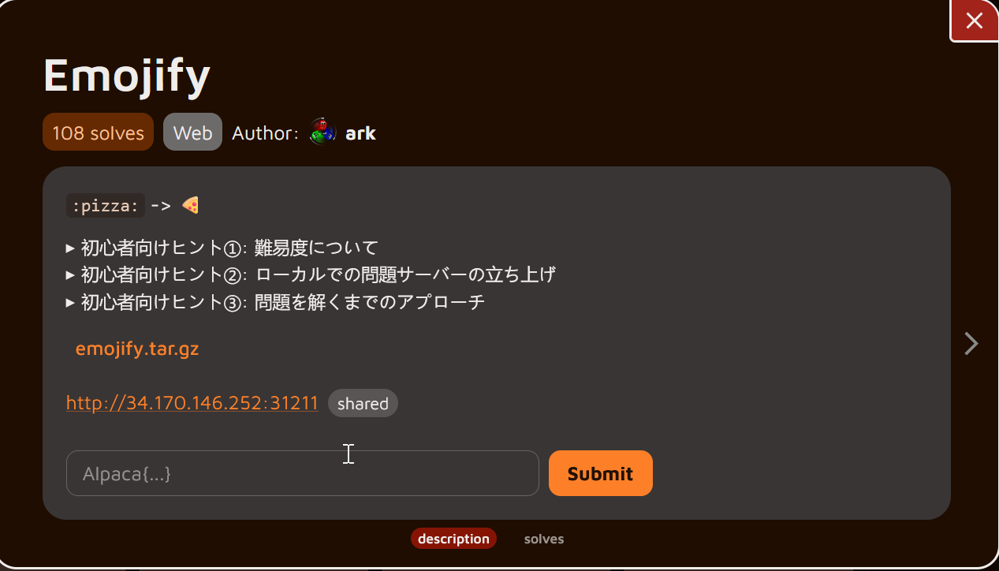

**Hello guys, welcome back!**

In this post, I’ll be solving today’s Daily AlpacaHack challenge. For today, the daily challenge falls under the **Web** category — so let’s jump right into it and see what we’re dealing with!


## Description



### Translation

```bash
:pizza: -> 🍕
Beginner's Tip #1: About Difficulty

    This problem is in the Web category, meaning it's about web applications.
    Also, unlike yesterday's easy problem, this one is rated medium difficulty.
    Daily AlpacaHack currently rates problems on a four-tier scale: easy, medium, hard, and very-hard.
    Medium is one step harder than easy, and especially for those new to CTFs through Daily AlpacaHack, solving it independently may be challenging.
    Therefore, if you get stuck, we recommend using AI tools as needed to find clues for the solution.
    Even if you can't solve it, be sure to review the solutions (called writeups) shared by other players after the contest ends.
    The writeup tab will appear in the tab list below 24 hours after the challenge is released.

Beginner Tip #2: Running the Challenge Server Locally

    Unzip the attached file to find three service directories alongside compose.yaml and Dockerfile.
    In modern CTFs, it's common for the attachment to include a Docker Compose file, allowing players to recreate the remote environment locally.
    Try running `docker compose up` in the root directory of the distributed files.
    With default settings, the challenge server will start at `http://localhost:3000/`.
    This server can be used to investigate vulnerabilities and test the functionality of your created solver.

Beginner Tip #3: Approach to Solving the Challenge

    Start by reading the source code to understand what kind of web service is running.
    Reading while observing the behavior of the locally launched problem server will help you grasp it faster.
    Once you have a general understanding of the service's behavior, we recommend confirming what the goal is.
    Consider where the flag is located and what actions are required to obtain it. You'll realize that achieving those “required actions” is the purpose of this problem.
    Also, this problem server is written in JavaScript.
    To experiment with the finer details of JavaScript functions, having an interactive environment where you can execute JavaScript is convenient.
Run the node command in your terminal and try various experiments.
It's also effective to look up the specifications of the JavaScript functions being used.
The MDN documentation (https://developer.mozilla.org/ja/docs/Web) is a useful resource due to its high accuracy and comprehensive coverage.
```

### Understanding the challenge

To begin the analysis, we first download the source code package provided by the challenge and extract it to inspect its contents.

```bash
┌──(chjwoo㉿hackbox)-[~/…/ctfs/alpacahack/web/emojify]
└─$ wget https://alpacahack-prod.s3.ap-northeast-1.amazonaws.com/5bad030b-a894-4111-900d-43332caf6bf6/emojify.tar.gz      
--2025-12-03 15:39:21--  https://alpacahack-prod.s3.ap-northeast-1.amazonaws.com/5bad030b-a894-4111-900d-43332caf6bf6/emojify.tar.gz
Resolving alpacahack-prod.s3.ap-northeast-1.amazonaws.com (alpacahack-prod.s3.ap-northeast-1.amazonaws.com)... 3.5.155.239, 52.219.199.170, 3.5.157.108, ...
Connecting to alpacahack-prod.s3.ap-northeast-1.amazonaws.com (alpacahack-prod.s3.ap-northeast-1.amazonaws.com)|3.5.155.239|:443... connected.
HTTP request sent, awaiting response... 200 OK
Length: 23232 (23K) [binary/octet-stream]
Saving to: ‘emojify.tar.gz’

emojify.tar.gz             100%[=======================================>]  22.69K  --.-KB/s    in 0.002s  

2025-12-03 15:39:21 (10.6 MB/s) - ‘emojify.tar.gz’ saved [23232/23232]

                                                                                                           
┌──(chjwoo㉿hackbox)-[~/…/ctfs/alpacahack/web/emojify]
└─$ tar -zxvf emojify.tar.gz      
emojify/
emojify/frontend/
emojify/frontend/index.html
emojify/frontend/index.js
emojify/frontend/package-lock.json
emojify/frontend/package.json
emojify/Dockerfile
emojify/backend/
emojify/backend/index.js
emojify/backend/package-lock.json
emojify/backend/package.json
emojify/compose.yaml
emojify/secret/
emojify/secret/index.js
emojify/secret/package-lock.json
emojify/secret/package.json

```

Once extracted, we see that the project is separated into three main components:

- **frontend/**
- **backend/**
- **secret/**
- compose.yaml
- Dockerfile

This layout already hints that the application is running as a multi-service environment, most likely using Docker networking to communicate internally.

Next, we spin up the entire application using Docker Compose:

```bash
┌──(chjwoo㉿hackbox)-[~/…/alpacahack/web/emojify/emojify]
└─$ docker compose up -d   

┌──(chjwoo㉿hackbox)-[~/…/alpacahack/web/emojify/emojify]
└─$ docker ps
CONTAINER ID   IMAGE              COMMAND                  CREATED          STATUS          PORTS                                         NAMES
0d3087880dcf   emojify-frontend   "docker-entrypoint.s…"   40 seconds ago   Up 39 seconds   0.0.0.0:3000->3000/tcp, [::]:3000->3000/tcp   emojify-frontend-1
29bfbac6f8c0   emojify-secret     "docker-entrypoint.s…"   40 seconds ago   Up 39 seconds                                                 emojify-secret-1
0fa9e174b463   emojify-backend    "docker-entrypoint.s…"   40 seconds ago   Up 39 seconds                                                 emojify-backend-1

```

As expected, we now have **three running containers**, each serving a different part of the application:

1. **frontend** – the UI that the user interacts with
2. **backend** – the API responsible for processing requests from the frontend
3. **secret** – a hidden internal service that immediately catches our attention

Before even diving into the code, we take a look at the `compose.yaml` file to understand how these services communicate with each other. This file reveals something very important:

```docker
services:
  frontend:
    build:
      dockerfile: ../Dockerfile
      context: ./frontend
    restart: unless-stopped
    init: true
    ports:
      - ${PORT:-3000}:3000
  backend:
    build:
      dockerfile: ../Dockerfile
      context: ./backend
    restart: unless-stopped
    init: true
  secret:
    build:
      dockerfile: ../Dockerfile
      context: ./secret
    restart: unless-stopped
    init: true
    environment:
      - FLAG=Alpaca{REDACTED}

```

So, the **flag is literally injected into the secret container as an environment variable**. That means if we manage to make the backend communicate with the secret service, we can retrieve the flag without ever directly accessing it from the browser.

Let's inspect the `secret/index.js` file to see what functionality this container exposes:

```jsx
import express from "express";

const FLAG = process.env.FLAG ?? "Alpaca{REDACTED}";

express()
  // http://secret:1337/flag
  .get("/flag", (req, res) => res.send(FLAG))
  .listen(1337);

```

This confirms that:

- The flag is accessible at **`http://secret:1337/flag`**
- The “secret” service runs only inside Docker (on the internal Docker network)
- It is **not exposed externally**, meaning we cannot curl it from our host machine or browser

This setup is *very* typical for challenges involving **SSRF (Server-Side Request Forgery)**, where one service must be tricked into making an internal request on our behalf.

To confirm this intuition, we now look at the **frontend** to see how user input is handled.

Opening `frontend/index.html`, we see a simple input form and a small JavaScript snippet:

```html
<!DOCTYPE html>
<html>
  <body>
    <main>
      <h1>Emojify</h1>
      <form action="/" method="get">
        <input type="text" name="text" placeholder="pizza" required />
        <button type="submit">Show</button>
      </form>
      <div id="result" style="font-size: 24em; text-align: center"></div>
    </main>
    <script>
      document.forms[0].onsubmit = (event) => {
        event.preventDefault();

        const text = event.target.text.value;
        fetch("/api?path=/emoji/" + encodeURIComponent(text))
          .then((r) => r.text())
          .then((emoji) => (result.textContent = emoji));
      };
    </script>
  </body>
</html>

```

This shows that:

- The frontend **never talks directly to the secret service**
- Everything goes through the backend using a single endpoint: **`/api?path=...`**

The value of the `path` parameter is fully controlled by the user (after URL encoding), which makes this endpoint a potential gateway for SSRF — *depending* on how the backend handles the value.

At this point, we have a strong suspicion:

**If the backend fetches the URL provided in `path` without proper sanitization, we can make it request `http://secret:1337/flag` and leak the flag.**

Before jumping into the backend, it’s important to understand exactly how the frontend handles user input. The file `frontend/index.js` contains a small Express server that serves the HTML page and proxies API requests to the backend:

```jsx
import express from "express";
import fs from "node:fs";

const waf = (path) => {
  if (typeof path !== "string") throw new Error("Invalid types");
  if (!path.startsWith("/")) throw new Error("Invalid 1");
  if (!path.includes("emoji")) throw new Error("Invalid 2");
  return path;
};

express()
  .get("/", (req, res) => res.type("html").send(fs.readFileSync("index.html")))
  .get("/api", async (req, res) => {
    try {
      const path = waf(req.query.path);
      const url = new URL(path, "http://backend:3000");
      const emoji = await fetch(url).then((r) => r.text());
      res.send(emoji);
    } catch (err) {
      res.send(err.message);
    }
  })
  .listen(3000);

```

From this code, we can observe a few important points.

#### The WAF Function

The `waf()` function acts as a basic filter for the `path` query parameter. It performs three checks:

1. The value must be a string.
2. The path must start with a forward slash (`/`).
3. The path must contain the substring `emoji`.

These checks are very weak. The only real requirement we must satisfy is that the path contains the word `emoji` somewhere. It does not validate the full structure or ensure that the request stays within a specific directory or endpoint. This already suggests a potential path for bypassing the intended restrictions.


After the path passes the WAF, the frontend constructs a new URL like this:

```jsx
const url = new URL(path, "http://backend:3000");
```

This means the base URL is fixed to `http://backend:3000`, and whatever path we supply is appended to it. For regular usage, that results in something like:

```
http://backend:3000/emoji/<text>
```

The important detail is that the request to the backend is performed server-side from within the Docker network. That means the frontend container can reach internal services such as `backend` and potentially the `secret` container, depending on how the backend handles the incoming path.

So, the next logical step is to inspect the backend code (`backend/index.js`) to see whether it uses the path in a way that can be exploited to reach the `secret` service.

```jsx
import express from "express";
import * as emoji from "node-emoji";

express()
  .get("/emoji/:text", (req, res) =>
    res.send(emoji.get(req.params.text) ?? "❓")
  )
  .listen(3000);

```

At first glance, it does not seem to perform any network requests or interact with other services. It simply takes whatever string appears after `/emoji/` and attempts to fetch an emoji from the `node-emoji` library. If it doesn't exist, it returns a question mark emoji.

#### Summary So Far

- The backend itself is not vulnerable.
- The frontend is the real target.
- The WAF is very weak and can be bypassed easily.
- The vulnerability revolves around how `new URL()` resolves paths combined with crafted inputs.
- Our objective is to manipulate the `path`

## Solution

To begin, I opened Burp Suite so I could inspect and modify the requests more easily.


I sent the request to Repeater to experiment with different payloads.


My initial attempts focused on manipulating the `path` parameter to target the `secret` service. I tried payloads such as:

- `/emoji//secret:1337/flag`
- `/emoji/../../../secret:1337/flag`
- `/secret:1337/flag`
- `//secret:1337/flag`

Unfortunately, none of these worked. Every attempt was either rejected by the WAF or failed to reach the expected endpoint.

At this point, I revisited the challenge description and noticed the hint encouraging us to look deeper into the JavaScript functions used — specifically pointing to MDN documentation. That reminded me to inspect the `URL()` constructor in `/frontend/index.js`:

```jsx
const url = new URL(path, "http://backend:3000");
```

[URL: URL() constructor - Web APIs | MDN](https://developer.mozilla.org/en-US/docs/Web/API/URL/URL)

After reading through the documentation, I found something interesting. When a URL begins with `//`, the browser treats it as a URL with a **new host**, inheriting the protocol from the base URL. That behavior could potentially allow us to override the hostname and redirect the request to the `secret` service.


With that in mind, I retried using `//secret:1337/flag` . This time, the payload actually worked — but not completely.


The WAF blocked it because the path didn’t include the string `"emoji"`, resulting in the error *invalid 2*. I attempted to bypass this check using a null-byte injection:


However, this approach didn’t work.

Eventually, I discovered that simply appending the required keyword in the **query string** bypassed the check cleanly. For example:

```jsx
 //secret:1337/flag?emoji
```


Once I confirmed the technique on the local instance, I repeated the same request against the actual challenge deployment: `http://34.170.146.252:31211/`


With the adjusted payload, the server finally returned the flag.

## Flag

`Alpaca{Sup3r_Speci4l_Rar3_Flag}`

---

