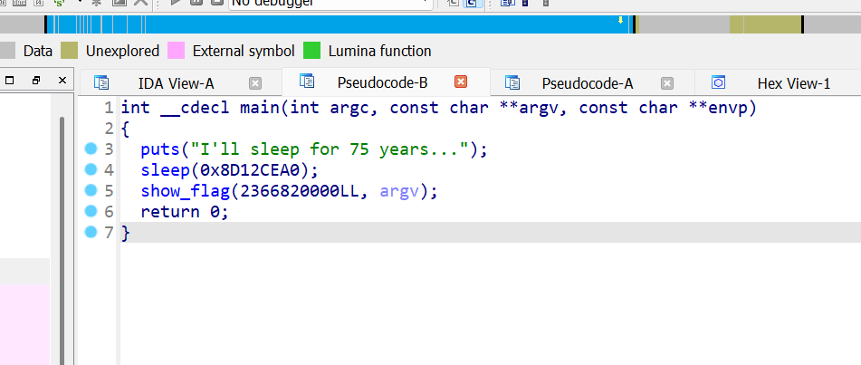

Hello everyone! Today I'm excited to share my solution to a reverse engineering challenge from AlpacaHack's daily CTF series. {'><(((*)>'}

## Description

```bash
This program prints the flag after sleeping for 75 years. It means you have to wait until the year 2100 to get the flag!

Link : https://alpacahack.com/daily/challenges/flag-printer-2100
```

### Initial Analysis

Let's start by examining what we're working with:

```bash
┌──(chjwoo㉿hackbox)-[/mnt/…/ctfs/alpacahack/rev/flag-printer-2100]
└─$ file print_flag
print_flag: ELF 64-bit LSB pie executable, x86-64, version 1 (SYSV), dynamically linked, interpreter /lib64/ld-linux-x86-64.so.2, BuildID[sha1]=4779e9456734b25b443894084d1ef12e88a94719, for GNU/Linux 3.2.0, not stripped

```

We've been given a 64-bit ELF executable. Running it produces the following output:

```bash
┌──(chjwoo㉿hackbox)-[/mnt/…/ctfs/alpacahack/rev/flag-printer-2100]
└─$ ./print_flag    
I'll sleep for 75 years...
```

Wait…75 years?! Obviously, that's not practical. Time to dig deeper and reverse engineer this binary using IDA Pro to understand the program's execution flow.

### Static Analysis

Upon examining the main function, I discovered two key components: a `sleep` instruction and a `show_flag` function.



The program sleeps for a specific duration before revealing the flag. Let's calculate exactly how long:

```bash
┌──(chjwoo㉿hackbox)-[~/…/ctfs/alpacahack/rev/flag-printer-2100]
└─$ python
Python 3.13.7 (main, Aug 20 2025, 22:17:40) [GCC 14.3.0] on linux
Type "help", "copyright", "credits" or "license" for more information.
>>> 0x8D12CEA0
2366820000
```

That's **2,366,820,000 seconds,** roughly 75 years! Nobody has time for that. The good news? Once the sleep duration completes, the program reveals the flag automatically.

## Solution

Rather than waiting decades, I opted for binary patching. The strategy was simple: modify the sleep duration from 2,366,820,000 seconds to just 5 seconds.


Select the sleep instruction in IDA Pro, then navigate to `Edit > Patch program > Assemble`. A dialog box will appear showing the selected sleep instruction.


Change the hex value from `8D12CEA0h` to `5` (or `0x5` in hexadecimal).


Click OK, then close the confirmation popup. Your patched instruction should now reflect the new 5-second sleep duration.


Save the modified binary by selecting `Edit > Patch program > Apply patches to input file...`


A dialog box will prompt you to name the patched file. I renamed mine to `print_flag_mod`.

Now for the moment of truth, run the patched executable and wait just 5 seconds. We got the flag!

```bash
┌──(chjwoo㉿hackbox)-[/mnt/…/ctfs/alpacahack/rev/flag-printer-2100]
└─$ ./print_flag_mod
I'll sleep for 75 years...
Alpaca{G00d_Morning_AlpacaH4ck!}

```

## Flag

`Alpaca{G00d_Morning_AlpacaH4ck!}`