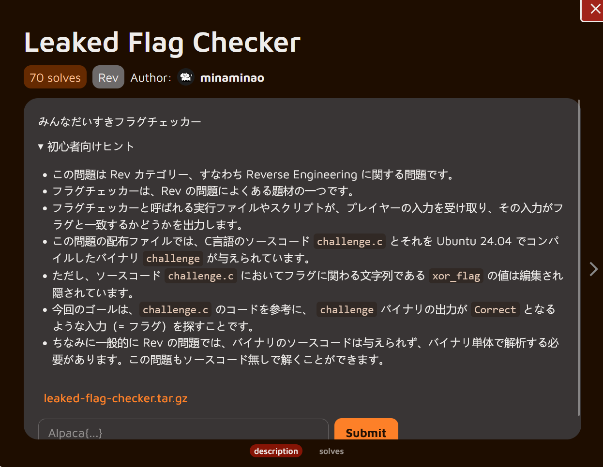

**Hewoo guys!**

Today’s AlpacaHack daily challenge dives into **Reverse Engineering**. I’m still getting comfortable with reversing binaries, so let’s solve it!

## Description



### Translation

```jsx
Everyone's Favorite Flag Checker
Hints for Beginners

    This problem belongs to the Rev category, meaning it's about Reverse Engineering.
    Flag checkers are a common theme in Rev problems.
    An executable file or script called a flag checker takes input from the player and outputs whether that input matches a flag.
    The distributed files for this problem include the C source code challenge.c and the compiled binary challenge for Ubuntu 24.04.
However, the value of xor_flag—the string related to the flag in the source code challenge.c—has been edited and hidden.
    The goal is to find input (i.e., the flag) that makes the challenge binary output “Correct,” using the challenge.c code as a reference.
    Note that in Rev problems, the binary source code is generally not provided, requiring analysis of the binary alone. This problem can also be solved without the source code.
```

### Understanding the challenge

We’re given a downloadable file, so let’s start by grabbing it and extracting its contents:

```bash
┌──(chjwoo㉿hackbox)-[~/…/ctfs/alpacahack/rev/leaked_flag_checker]
└─$ wget https://alpacahack-prod.s3.ap-northeast-1.amazonaws.com/0bbdd0f6-3b81-4c67-9b16-1febd6641ec9/leaked-flag-checker.tar.gz
--2025-12-04 07:20:21--  https://alpacahack-prod.s3.ap-northeast-1.amazonaws.com/0bbdd0f6-3b81-4c67-9b16-1febd6641ec9/leaked-flag-checker.tar.gz
Resolving alpacahack-prod.s3.ap-northeast-1.amazonaws.com (alpacahack-prod.s3.ap-northeast-1.amazonaws.com)... 3.5.159.68, 3.5.157.17, 3.5.155.225, ...
Connecting to alpacahack-prod.s3.ap-northeast-1.amazonaws.com (alpacahack-prod.s3.ap-northeast-1.amazonaws.com)|3.5.159.68|:443... connected.
HTTP request sent, awaiting response... 200 OK
Length: 3131 (3.1K) [binary/octet-stream]
Saving to: ‘leaked-flag-checker.tar.gz’

leaked-flag-checker.tar.gz                     100%[====================================================================================================>]   3.06K  --.-KB/s    in 0s      

2025-12-04 07:20:22 (180 MB/s) - ‘leaked-flag-checker.tar.gz’ saved [3131/3131]

                                                                                                                                                                                            
┌──(chjwoo㉿hackbox)-[~/…/ctfs/alpacahack/rev/leaked_flag_checker]
└─$ tar -zxvf leaked-flag-checker.tar.gz 
leaked-flag-checker/
leaked-flag-checker/challenge.c
leaked-flag-checker/challenge

```

Now we have two files:

- **challenge.c** → likely the source code (nice, this will help a lot!)
- **challenge** → the compiled binary

With the files in place, it’s time to explore how the binary behaves and understand the flag-checking mechanism inside it.

Let’s run the binary to see what it does:

```bash
┌──(chjwoo㉿hackbox)-[~/…/alpacahack/rev/leaked_flag_checker/leaked-flag-checker]
└─$ ./challenge
Enter flag: AAAAAAAAAAAAAAAAAAAAAAAAAAAAAAAAAAAAAAAAAAAAAAAAAAAAAA
Wrong length
                                                                                             
┌──(chjwoo㉿hackbox)-[~/…/alpacahack/rev/leaked_flag_checker/leaked-flag-checker]
└─$ ./challenge
Enter flag: AAAAAAAAAAAAAAAAAAAAAAAAAAAAAAAAAAAAAAAAAAAAAAAAAAAAA 
Wrong length

```

No matter how many characters we input, the program keeps saying `"Wrong length"`. We tried different input lengths but still got the same error. This tells us the flag has a specific length that we need to find.

Let's first review the provided source code to understand the basic validation logic:

```c
// gcc -o challenge challenge.c
#include <stdio.h>
#include <string.h>

int main(void) {
    char input[32];
    const char xor_flag[] = "REDACTED";
    size_t flag_len = strlen(xor_flag);

    printf("Enter flag: ");
    fflush(stdout);
    scanf("%31s", input);

    if(strlen(input) != flag_len) {
        printf("Wrong length\n");
        return 1;
    }
    for(size_t i = 0; i < flag_len; i++) {
        if((input[i] ^ 7) != xor_flag[i]) {
            printf("Wrong at index %zu\n", i);
            return 1;
        }
    }
    printf("Correct\n");
    return 0;
}

```

Each character of the input is XORed with **`7`**, then compared to an encrypted string. Our job is to find that encrypted string inside the binary.

Before opening the binary in a disassembler, let’s identify what kind of file it is:

```bash
┌──(chjwoo㉿hackbox)-[~/…/alpacahack/rev/leaked_flag_checker/leaked-flag-checker]
└─$ file challenge
challenge: ELF 64-bit LSB pie executable, x86-64, version 1 (SYSV), dynamically linked, interpreter /lib64/ld-linux-x86-64.so.2, BuildID[sha1]=5d2c86ed744df49647f3bd9cee8cfc4a90041315, for GNU/Linux 3.2.0, not stripped
```

The binary is a **64-bit PIE ELF**, dynamically linked, and importantly — **not stripped**. This means symbol information is still present, making reverse-engineering significantly easier in tools like IDA Pro or Ghidra.

Since the binary is not stripped, we can open it in IDA Pro and get clean decompiled code. After renaming variable `v5` to `flag` for clarity, here's what we find:


Now we can see what's really happening:

1. **Buffer size**: 54 bytes allocated for `flag`
2. **Encrypted flag**: `"Fkwfdf|krdl~z"` stored at `flag[0]` (13 characters)
3. **User input**: Stored at `flag[14]` (offset 14)
4. **Expected length**: 13 characters (`strlen(&flag[14]) == 13`)
5. **Validation**: Compares `flag[i + 14] ^ 7` with `flag[i]`

The real challenge was inside the binary.

## Solution

To recover the original flag, we simply need to reverse the XOR operation:

```bash
original_flag[i] = encrypted_flag[i] ^ 7
```

Since we have the encrypted flag `"Fkwfdf|krdl~z"`, we can XOR each character with `7` to get the original flag. So this is my solver:

```python
enc = "Fkwfdf|krdl~z"
flag = []

for char in enc:
    flag.append(chr(ord(char) ^ 7))
print("".join(flag))
```

Running this solver gives us the decrypted flag:

```bash
┌──(chjwoo㉿hackbox)-[~/…/alpacahack/rev/leaked_flag_checker/leaked-flag-checker]
└─$ python solver.py
Alpaca{lucky}
```

## Flag

`Alpaca{lucky}`

---

