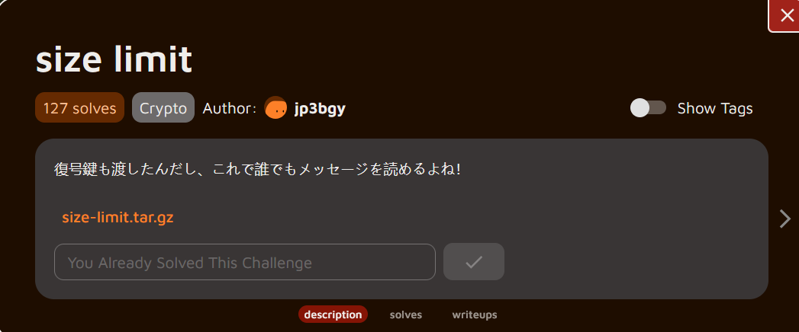

Hey guys!

Welcome back to another shit blog. Today we're tackling crypto challenge from daily AlpacaHack.

## Description



### Translation

```bash
I gave you the decryption key too, so now anyone can read the message, right?
```

### Understanding the challenge

The challenge hints that even though RSA normally relies on keeping the private key secret, this time the private key `d` is given directly. We’re given the following `problem.py`

```bash
#!/usr/bin/python3

from Crypto.Util.number import getPrime, bytes_to_long
import flag 

assert(len(flag.flag) == 131)

p = getPrime(512)
q = getPrime(512)
N = p * q
phi = (p - 1) * (q - 1)
e = 0x10001
d = pow(e, -1, phi)

flag = bytes_to_long(flag.flag)

c = pow(flag, e, N)

print(f'N = {N}')
print(f'e = {e}')
print(f'c = {c}')
print(f'd = {d}')

```

And the output for our encrypted flag:

```bash
N = 65667982563395257456152578363358687414628050739860770903063206052667362178166666380390723634587933595241827767873104710537142458025201334420236653463444534018710274020834864080096247524541536313609304410859158429347482458882414275205742819080566766561312731091051276328620677195262137013588957713118640118673
e = 65537
c = 58443816925218320329602359198394095572237417576497896076618137604965419783093911328796166409276903249508047338019341719597113848471431947372873538253571717690982768328452282012361099369599755904288363602972252305949989677897650696581947849811037791349546750246816657184156675665729104603485387966759433211643
d = 14647215605104168233120807948419630020096019740227424951721591560155202409637919482865428659999792686501442518131270040719470657054982576354654918600616933355973824403026082055356501271036719280033851192012142309772828216012662939598631302504166489383155079998940570839539052860822636744356963005556392864865

```

At first glance, this looks like a straightforward RSA decryption problem. But here’s the catch, The flag is 131 bytes long, while a 1024-bit RSA modulus is only 128 bytes. However, this means the message does not fit into the modulus.

So when the script encrypts the flag with:

```bash
c = pow(flag, e, N)
```

it effectively computes:

```bash
c = flag mod N
```

And when decrypting:

```bash
m = flag mod N
```

So the value we get from decryption (`m`) is **not the actual flag**, but only the flag **reduced modulo N**. To recover the full message, we must reconstruct the original flag using the partial information we have.

We know:

- the **prefix** of the flag (`TSGLIVE{`),
- the **total length** (131 bytes),
- and its **value modulo N** (`m`).

This is enough to rebuild the entire flag.

## Solution

Because RSA only gave us the flag modulo `N`, the real flag must be:

```
flag = k × N + m for some integer k.
```

So what do we do? We search for the **smallest `k`** that makes the reconstructed message start with our known prefix. Once that happens, we know we’ve aligned the flag correctly.

Here’s the solver:

```bash
from Crypto.Util.number import *

N = 65667982563395257456152578363358687414628050739860770903063206052667362178166666380390723634587933595241827767873104710537142458025201334420236653463444534018710274020834864080096247524541536313609304410859158429347482458882414275205742819080566766561312731091051276328620677195262137013588957713118640118673
e = 65537
c = 58443816925218320329602359198394095572237417576497896076618137604965419783093911328796166409276903249508047338019341719597113848471431947372873538253571717690982768328452282012361099369599755904288363602972252305949989677897650696581947849811037791349546750246816657184156675665729104603485387966759433211643
d = 14647215605104168233120807948419630020096019740227424951721591560155202409637919482865428659999792686501442518131270040719470657054982576354654918600616933355973824403026082055356501271036719280033851192012142309772828216012662939598631302504166489383155079998940570839539052860822636744356963005556392864865

flag_prefix = b"TSGLIVE{"
flag_len = 131
m = pow(c, d, N)
flag_tmp = bytes_to_long(flag_prefix + b"\x00" * (flag_len - len(flag_prefix)))
flag = ((flag_tmp - m) // N + 1) * N + m
print(f"Flag : {long_to_bytes(flag).decode()}")
```

**How it works**:

1. **Decrypt normally**: `m = pow(c, d, N)` gives us `flag mod N`
2. **Build a template**: Create `flag_tmp` using the known prefix padded with null bytes to match the expected 131-byte length
3. **Calculate k**: The formula `((flag_tmp - m) // N + 1)` determines how many complete cycles of `N` we need to add back
4. **Reconstruct**: `flag = k × N + m` gives us the original message

The key insight is that since we know the flag format and length, we can estimate where the actual flag value should be numerically, then work backwards to find the correct multiple of `N` to add.

Fire it up and we got the looonggg flagg:

```bash
┌──(chjwoo㉿hackbox)-[~/…/alpacahack/cry/size-limit/size-limit]
└─$ python solver.py
Flag : TSGLIVE{Tttthhhhhiiiiiiisssss iiiiiiiiiisssss aaaaaaaaaaaaaa tooooooooooooooooooooo looooooooooooooooong fllllaaaaaaaaaaaaaaaaaag!}
```

## Flag

`TSGLIVE{Tttthhhhhiiiiiiisssss iiiiiiiiiisssss aaaaaaaaaaaaaa tooooooooooooooooooooo looooooooooooooooong fllllaaaaaaaaaaaaaaaaaag!}`