Hello! Kembali lagi bersama saya di post ke 2 ini. Kali ini saya akan membagikan writeup final round Hackfest0x05. Enjoy!<br/><br/>
*masih cupu nulis beginian, wkwkwk


## Digital Forensics
### seETHe
:::note
Jenis	: Cryptocoin<br/>
Clue	: Smart Contract? thats interesting stuffs..<br/>
Anyway Here's my address : 0x7aA245e2C3C21E2B98F186d9EfEecE0c520ebdd3 (ropsten)<br/>
Sorry but i have to go, Just * call_me * later okay?<br/>
POC	: ropster
:::
Dapat diketahui bahwa 0x7aA245e2C3C21E2B98F186d9EfEecE0c520ebdd3 merupakan alamat dari ropsten etherscan
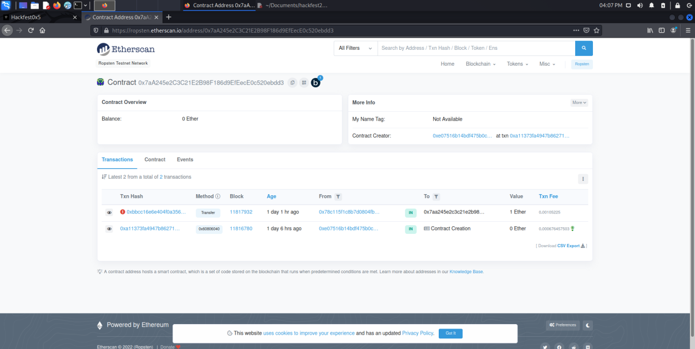
Klik pada Creator TXN Hash, Lalu Click to see More
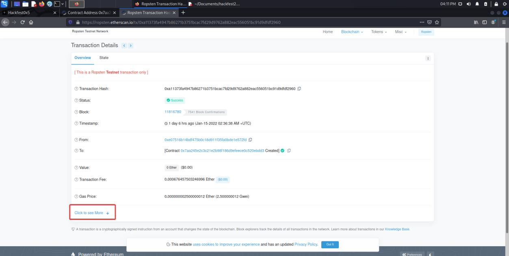
Disini ada kolom Input data yang mana dapat dilihat sbg UTF-08
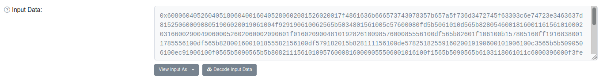
Ketika diubah ke UTF-8 terdapat sebuah flag 
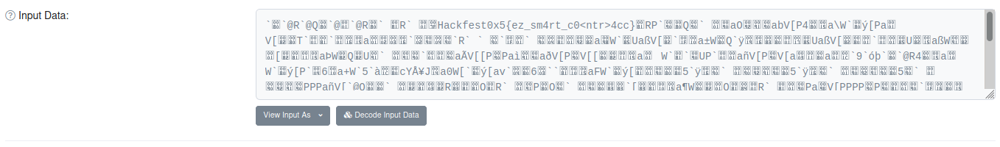
`Hackfest0x5{ez_sm4rt_c0\<ntr\>4cc}`
<br/><br/>

### Logger
:::note
Jenis	: pcap file<br/>
Clue	: Ada yang membajak komputerku, nih. Untung komputerku ada logger keyboardnya. Tolong bantu aku mencari tahu apa yang dilakukan pembajaknya di komputerku.<br/>
POC	: keystroke usb parser
:::

Disediakan sebuah file pcapng, mari kita coba buka menggunakan wireshark.
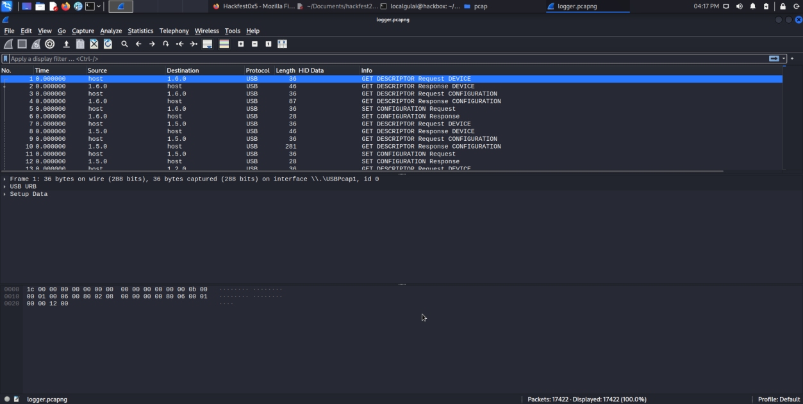
Jika dibuka tampilannya akan seperti ini, dapat diketahui protocol yang digunakan adalah USB & USBHID. Jika kita kembali ke clue terdapat kata keyboard. Saya ber asumsi bahwa ini merupakan keylogger input dari USB Keyboard itu sendiri
Disini saya menggunakan wireshark filter untuk usb keyboard 
https://github.com/carlospolop/hacktricks/blob/master/forensics/basic-forensic-methodology/pcap-inspection/usb-keyboard-pcap-analysis.md
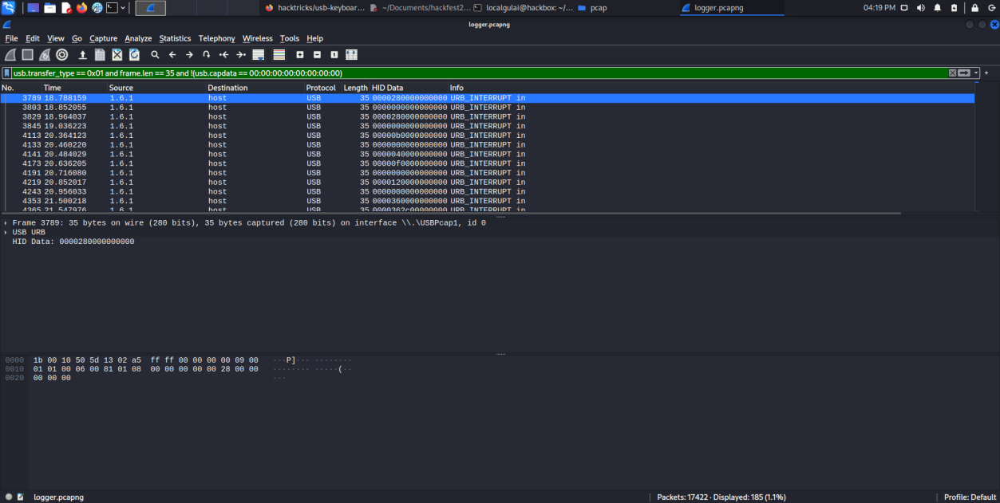
Lalu import semua data yang telah di filter ke dalam file csv
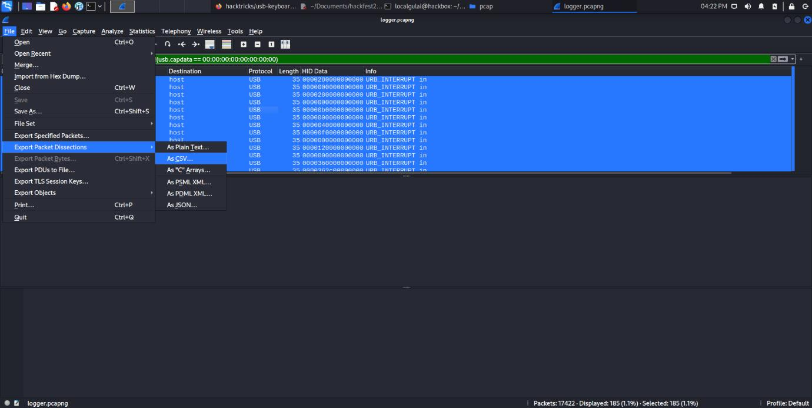
Pada data csv kita ingin mengambil HID Data nya saja
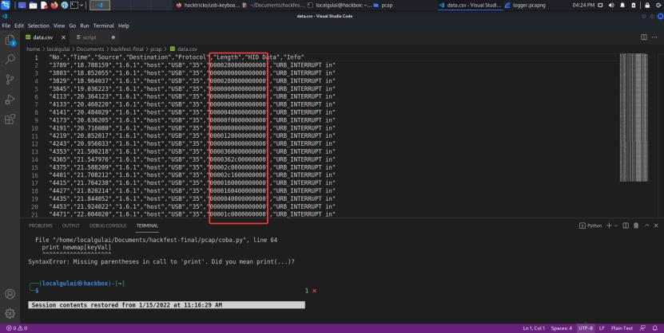
Gunakan Command 
```bash
cat data.csv | cut -d “,” -f 7 | cut -d “\”” -f 2 | grep -vE “HID Data” > hexoutput.txt
``` 
maka hasilnya akan seperti ini
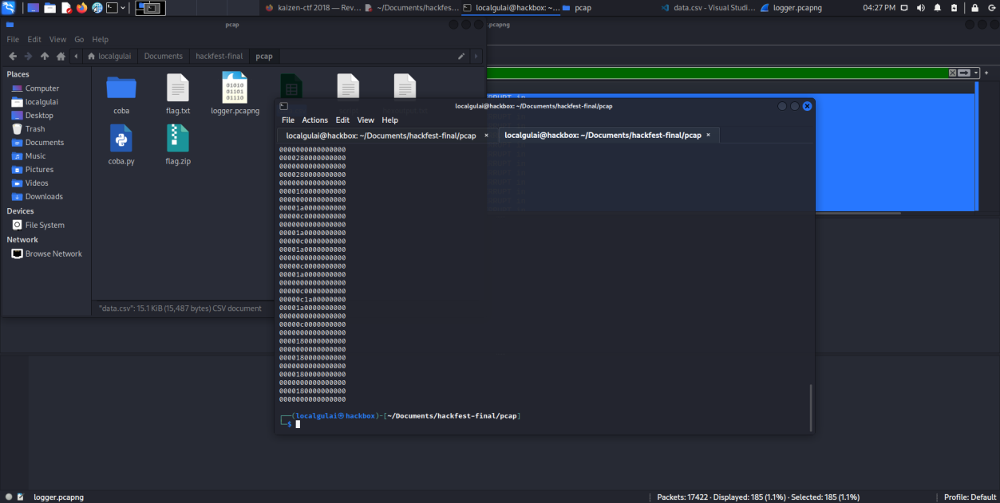
Selanjutnya kita decrypt menggunakan script python 
```py
newmap = {
    2: "PostFail",
    4: "a",
    5: "b",
    6: "c",
    7: "d",
    8: "e",
    9: "f",
    10: "g",
    11: "h",
    12: "i",
    13: "j",
    14: "k",
    15: "l",
    16: "m",
    17: "n",
    18: "o",
    19: "p",
    20: "q",
    21: "r",
    22: "s",
    23: "t",
    24: "u",
    25: "v",
    26: "w",
    27: "x",
    28: "y",
    29: "z",
    30: "1",
    31: "2",
    32: "3",
    33: "4",
    34: "5",
    35: "6",
    36: "7",
    37: "8",
    38: "9",
    39: "0",
    40: "Enter",
    41: "esc",
    42: "del",
    43: "tab",
    44: "space",
    45: "-",
    47: "[",
    48: "]",
    56: "/",
    57: "CapsLock",
    79: "RightArrow",
    80: "LetfArrow"
}

final = ""

myKeys = open('hexoutput.txt')
i = 1
for line in myKeys:
    bytesArray = bytearray.fromhex(line.strip())
    #print "Line Number: " + str(i)
    for byte in bytesArray:
        if byte != 0:
            keyVal = int(byte)

            if keyVal in newmap:
                #print "Value map : " + str(keyVal) + " --> " + newmap[keyVal]
                final+=(newmap[keyVal])
            else:
                print "No map found for this value: " + str(keyVal)
            #print format(byte, '02X')
            i+=1

print(final)
```
Ketika script dijalan kan maka akan keluar hasil seperti ini
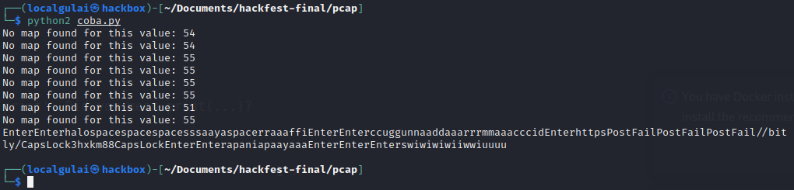
Terdapat sebuah link bit.ly yang mana link tersebut adalah https://bit.ly/3HXKM88 Ketika dibuka akan mengarahkan ke zip file si flag, Coba kita download filenya
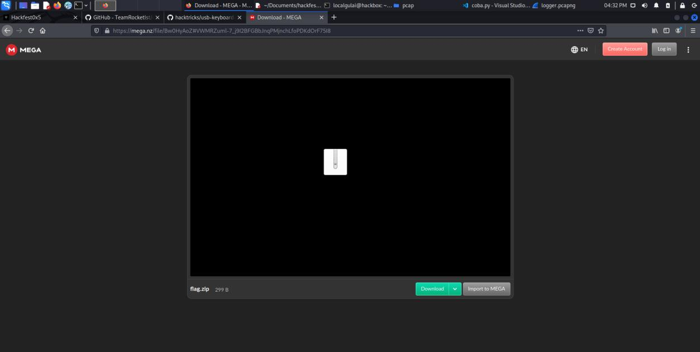
Ketika dibuka ternyata file zip tersebut di password, mari kita kembali lagi ke hasil dari script python yang sudah dijalankan tadi terdapat password untuk zipnya yaitu `apaniapaayaaa`
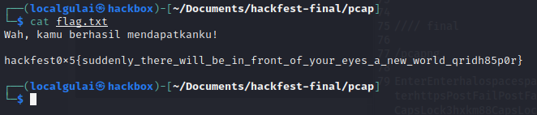
Berhasil di extract dan flagnya adalah<br/>
`hackfest0x5{suddenly_there_will_be_in_front_of_your_eyes_a_new_world_qridh85p0r}`
