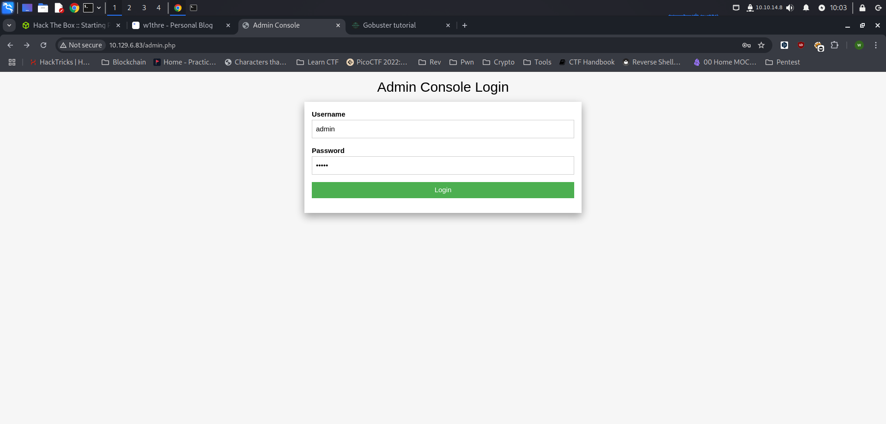

Before diving into the exploitation process, we first need to gather intelligence on our target. In this walkthrough, we will explore a machine from HackTheBox's Starting Point series, named Preignition. Our objective is to enumerate the target, uncover potential vulnerabilities, and ultimately gain access to retrieve the flag.

## Reconnaissance

Before attacking any machine, it's essential to gather as much information as possible. We begin by running an **Nmap** scan to enumerate open ports and services on the target machine.

```bash
└─$ sudo nmap -sV -p- -T5 10.129.6.83 --stats-every=5s  
[sudo] password for w1thre: 
Stats: 0:10:50 elapsed; 0 hosts completed (1 up), 1 undergoing Service Scan
Service scan Timing: About 100.00% done; ETC: 09:55 (0:00:00 remaining)
Nmap scan report for 10.129.6.83
Host is up (0.28s latency).
Not shown: 65457 closed tcp ports (reset), 77 filtered tcp ports (no-response)
PORT   STATE SERVICE VERSION
80/tcp open  http    nginx 1.14.2

Service detection performed. Please report any incorrect results at https://nmap.org/submit/ .
Nmap done: 1 IP address (1 host up) scanned in 652.34 seconds
```

The results indicate that port `80` is open, and the web service is running `nginx 1.14.2`. No other ports appear to be accessible.

Since port `80` is open, we perform directory enumeration using `gobuster` to uncover hidden paths.

```bash
└─$ gobuster dir -u http://10.129.6.83 -w /usr/share/seclists/Discovery/Web-Content/common.txt
===============================================================
Gobuster v3.6
by OJ Reeves (@TheColonial) & Christian Mehlmauer (@firefart)
===============================================================
[+] Url:                     http://10.129.6.83
[+] Method:                  GET
[+] Threads:                 10
[+] Wordlist:                /usr/share/seclists/Discovery/Web-Content/common.txt
[+] Negative Status codes:   404
[+] User Agent:              gobuster/3.6
[+] Timeout:                 10s
===============================================================
Starting gobuster in directory enumeration mode
===============================================================
/admin.php            (Status: 200) [Size: 999]
Progress: 4734 / 4735 (99.98%)
===============================================================                                                            
Finished                                                                                                                   
===============================================================
```

We discover an `admin.php` page, which could be an interesting attack surface.

## Foothold

Navigating to `http://10.129.6.83/admin.php` presents us with a login page. At this point, we can try default credentials, which are often left unchanged in misconfigured systems.



### Trying Default Credentials

We attempt logging in using:

```
Username: admin
Password: admin
```

Surprisingly, the login is **successful**, granting us access the flag.

## Flags

Upon successful authentication, we retrieve our flag:

```bash
Congratulations! Your flag is: 6483bee07c1c1d57f14e5b0717503c73
```