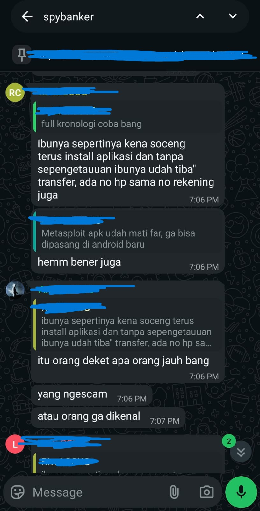
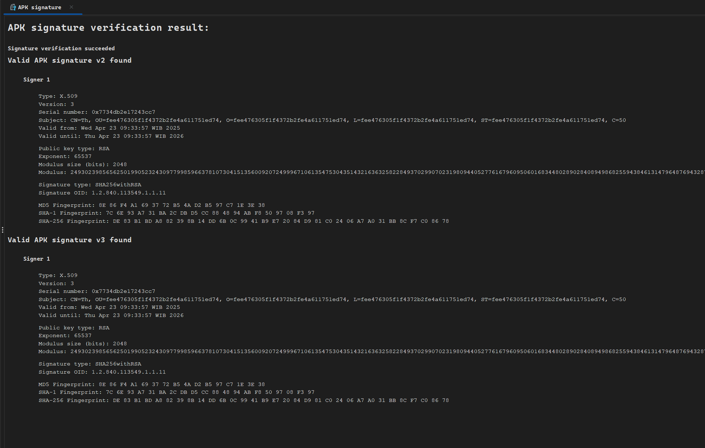

Saya pertama kali tertarik melakukan riset terkait analisis malware Android setelah mengikuti sebuah webinar dari **Merdeka Siber** yang membahas topik *Threat Hunting Malware Analysis*. Dari webinar tersebut, saya jadi penasaran bagaimana proses analisis malware dilakukan secara teknis, khususnya pada platform Android.

Tulisan ini merupakan **pengalaman pertama saya dalam menulis laporan analisis malware**, sehingga masih banyak hal yang perlu dipelajari dan diperbaiki ke depannya. Oleh karena itu, mohon dimaklumi apabila masih terdapat kekurangan dalam penulisan maupun analisis yang disampaikan.

<iframe width="100%" height="450" style="aspect-ratio: 16/9; border-radius: 0.5rem; border: none; margin: 1.5rem 0;" src="https://www.youtube.com/embed/BvQgTFxfyX8" title="Webinar Threat Hunting Malware Analysis" allow="accelerometer; autoplay; clipboard-write; encrypted-media; gyroscope; picture-in-picture" allowfullscreen></iframe>

## Overview

Sebagai konteks, sampel malware yang dianalisis pada tulisan ini berasal dari teman dari teman saya 😂. Orang tua beliau menerima pesan dari seseorang yang tidak dikenal, di mana pelaku meminta korban untuk menginstal sebuah aplikasi yang mengatasnamakan **Identitas Kependudukan Digital**.

Aplikasi tersebut diduga digunakan sebagai media untuk menyebarkan malware dengan menyamar sebagai layanan resmi, sehingga berpotensi menipu korban agar menginstall nya tanpa rasa curiga.



**Identitas Kependudukan Digital (IKD)** merupakan aplikasi resmi yang dikembangkan oleh Direktorat Jenderal Kependudukan dan Pencatatan Sipil (DITJEN DUKCAPIL) Kementerian Dalam Negeri untuk menampilkan data kependudukan, seperti KTP, dalam bentuk digital.

Namun, pada kasus ini aplikasi yang diinstall oleh korban bukanlah aplikasi resmi, melainkan sebuah **malware** yang menyamar sebagai aplikasi IKD. Aplikasi berbahaya tersebut dikemas dalam bentuk aplikasi Android (APK) dan didistribusikan melalui pesan dari pihak yang tidak dikenal.

```bash
┌──(w1thre㉿Access)-[/mnt/d/Cyber Security/research/Malware KTP/malware-spybanker-sample]
└─$ file Identitas\ Kependudukan\ Digital.apk
Identitas Kependudukan Digital.apk: Zip archive data, at least v2.0 to extract, compression method=deflate

┌──(w1thre㉿Access)-[/mnt/d/Cyber Security/research/Malware KTP/malware-spybanker-sample]
└─$ md5sum Identitas\ Kependudukan\ Digital.apk
c24f29b1a3fd5513f8c87943c8178912  Identitas Kependudukan Digital.apk
```

## Static Analysis

Disini saya akan melakukan static analysis menggunakan Jadx:



Bisa kita lihat pada APK signature di assign pada tanggal 23 April 2025 valid hingga 23 April 2026. Ketika saya coba check summarynya


Ternyata aplikasi ini memiliki banyak native library yang terlihat suspicious, dengan berbagai macam versi arsitektur untuk kompatibilitas. Terdapat hanya 8 classes, 37 methods, dan 6 fields.


Pada MainActivity, terdapat string dpt-shell. Ketika saya searching dpt-shell, ini merupakan sebuah **Android Dex protection shell** yang bekerja dengan mengosongkan (hollows out) implementasi metode Dex dan merekonstruksinya saat runtime, sehingga mempersulit proses reverse engineering.

Kita bisa melakukan validasi dengan menggunakan tools APKiD Android Application Identifier for Packers, Protectors, Obfuscators and Oddities. Simplenya untuk mengetahui informasi tentang bagaimana APK ini dibuat.

```bash
┌──(rehan㉿Access)-[D:/Cyber Security/research/Malware KTP/malware-spybanker-sample]-[main]                    54ms  
└─$ apkid '.\Identitas Kependudukan Digital.apk'
[+] APKiD 3.0.0 :: from RedNaga :: rednaga.io
[*] .\Identitas Kependudukan Digital.apk
 |-> protector : DPT Shell
[*] .\Identitas Kependudukan Digital.apk!lib/arm64-v8a/libASDFGHJ.so
 |-> obfuscator : Obfuscator-LLVM version 9.x
[*] .\Identitas Kependudukan Digital.apk!lib/armeabi-v7a/libASDFGHJ.so
 |-> obfuscator : Obfuscator-LLVM version 9.x
[*] .\Identitas Kependudukan Digital.apk!classes.dex
 |-> compiler : r8
 |-> protector : DPT Shell
[*] .\Identitas Kependudukan Digital.apk!assets/vwwwwwvwww/x86_64/libdpt.so
 |-> protector : DPT Shell
[*] .\Identitas Kependudukan Digital.apk!assets/vwwwwwvwww/x86/libdpt.so
 |-> protector : DPT Shell
[*] .\Identitas Kependudukan Digital.apk!assets/vwwwwwvwww/arm/libdpt.so
 |-> protector : DPT Shell
[*] .\Identitas Kependudukan Digital.apk!assets/vwwwwwvwww/arm64/libdpt.so
 |-> anti_hook : syscalls
 |-> protector : DPT Shell
```

Key findings:

- **DPT Shell Protector** - Seluruh APK dibungkus dengan packer dpt-shell untuk menyembunyikan kode asli malware
- **Obfuscator-LLVM v9.x** - Library `libASDFGHJ.so` di-obfuscate dengan Obfuscator-LLVM untuk mempersulit reverse engineering
- **Direct Syscalls Anti-Hook** - `libdpt.so` ARM64 terdapat anti hooking menggunakan syscalls langsung
- **Multi-Architecture Support** - Malware mendukung ARM, ARM64, x86, x86_64 untuk kompabilitas
- **R8 Compiler** - `classses.dex` dikompilasi dengan R8 Android code obfuscator, shrinker, dan optimizer

Malware ini memiliki proteksi berlapis yang memang dirancang untuk mempersulit kita dalam melakukan reverse engineering/static analysis. Kita coba lanjut dulu untuk inspect class yang ada:


Pada class JniBridge ini berfungsi sebagai jembatan antara kode Java dengan kode Native Library (.so file) yang akan di load secara runtime.

```bash
public static void loadShellLibs(String str, String str2) {
        String[] strArr = {"libdpt.so"};
        try {
            String b2 = a.b(str2);
            StringBuilder sb = new StringBuilder();
            sb.append(str);
            String str3 = File.separator;
            sb.append(str3);
            sb.append("dpt-libs");
            sb.append(str3);
            sb.append(b2);
            File[] listFiles = new File(sb.toString()).listFiles();
            if (listFiles != null) {
                for (File file : listFiles) {
                    String absolutePath = file.getAbsolutePath();
                    for (int i = 0; i < 1; i++) {
                        if (absolutePath.endsWith(File.separator + strArr[i])) {
                            System.load(absolutePath);
                        }
                    }
                }
            }
        } catch (Throwable unused) {
        }
    }
```

Method `loadShellLibs()` menggunakan teknik **dynamic loading** dengan `System.load()` yang umum digunakan malware untuk menghindari deteksi static analysis. File native library [libdpt.so](http://libdpt.so) akan diload pada saat runtime. Dari informasi yang kita dapatkan Ini adalah typical **dropper/loader malware** yang menggunakan native code untuk menyembunyikan payload berbahaya dan menghindari deteksi antivirus.


Disini pada saat saya ngecek AndroidManifest.xml ternyata file AndroidManifest nya ikut ter-obfuscate karena file tersebut seharusnya berisi konfigurasi aplikasi, namun hanya berisi selector color dummy. Mungkin ini adalah ciri khas dpt shell dalam melakukan obfuscation. 

Sebenernya kita bisa melakukan checking file AndroidManifest yang asli melalui adb shell, seperti berikut:

```bash
┌──(rehan㉿Access)-[D:/Cyber Security/research/Malware KTP/malware-spybanker-sample]-[main]                     3ms  
└─$ adb shell svc wifi disable
┌──(rehan㉿Access)-[D:/Cyber Security/research/Malware KTP/malware-spybanker-sample]-[main]                   138ms  
└─$ adb shell svc data disable
```

Kita harus disable akses internet pada emulator supaya aman, lalu kita coba install APK malware tersebut.

```bash
┌──(rehan㉿Access)-[D:/Cyber Security/research/Malware KTP/malware-spybanker-sample]-[main]                     1ms  
└─$ adb install '.\Identitas Kependudukan Digital.apk'
Performing Streamed Install
Success
```

Malware berhasil kita install, lalu kita coba check package name nya seperti berikut:

```bash
┌──(rehan㉿Access)-[D:/Cyber Security/research/Malware KTP/malware-spybanker-sample]-[main]                      2s  
└─$ adb shell pm list packages
package:com.google.android.networkstack.tethering
...
package:com.zam.tquroa
...
package:com.google.android.apps.restore
```

Ternyata setelah saya cari-cari, malware ini melakukan rename package nya menjadi `com.zam.tquroa` padahal pada saat kita lakukan static analysis, package nya yaitu `com.nash.dpt` dan `com.nashsiqiu.shell`. 

### AndroidManifest

Lanjut kita coba untuk melihat permission apa saja yang dilakukan oleh malware ini:

```bash
┌──(rehan㉿Access)-[D:/Cyber Security/research/Malware KTP/malware-spybanker-sample]-[main]                     1ms  
└─$ adb shell dumpsys package com.zam.tquroa
Activity Resolver Table:
  Non-Data Actions:
      android.intent.action.MAIN:
        9ba21fd com.zam.tquroa/net.tents.dedrf.ui.SplashActivity filter 149bef2
          Action: "android.intent.action.MAIN"
          Category: "android.intent.category.LAUNCHER"
          Category: "android.intent.category.DEFAULT"
        5c03943 com.zam.tquroa/net.tents.dedrf.service.NoIconActivty filter 11cfbc0
          Action: "android.intent.action.MAIN"
          Category: "android.intent.category.LAUNCHER"
        48be0f9 com.zam.tquroa/net.tents.dedrf.service.NoIconActivty2 filter 7b0d83e
          Action: "android.intent.action.MAIN"
          Category: "android.intent.category.LAUNCHER"
        623269f com.zam.tquroa/net.tents.dedrf.service.NoIconActivty3 filter b613ec
          Action: "android.intent.action.MAIN"
          Category: "android.intent.category.LAUNCHER"
        c2093b5 com.zam.tquroa/org.vkjoi.cfuje.AliasTmpActivity filter 9de3a4a
          Action: "android.intent.action.MAIN"
          Category: "android.intent.category.LAUNCHER"
        89d8dbb com.zam.tquroa/org.vkjoi.cfuje.AliasGoogleActivity filter 5e682d8
          Action: "android.intent.action.MAIN"
          Category: "android.intent.category.LAUNCHER"

Receiver Resolver Table:
  Schemes:
      package:
        e8d4a97 com.zam.tquroa/org.vkjoi.cfuje.PackageReceiver filter 6acf484
          Action: "android.intent.action.PACKAGE_ADDED"
          Action: "android.intent.action.PACKAGE_REMOVED"
          Action: "android.intent.action.PACKAGE_REPLACED"
          Action: "android.intent.action.PACKAGE_FULLY_REMOVED"
          Action: "android.intent.action.PACKAGE_CHANGED"
          Action: "android.intent.action.PACKAGE_DATA_CLEARED"
          Action: "android.intent.action.PACKAGE_INSTALL"
          Action: "android.intent.action.PACKAGE_FIRST_LAUNCH"
          Action: "android.intent.action.PACKAGE_NEEDS_VERIFICATION"
          Action: "android.intent.action.PACKAGE_RESTARTED"
          Action: "android.intent.action.PACKAGE_VERIFIED"
          Action: "android.intent.action.PACKAGES_SUSPENDED"
          Action: "android.intent.action.PACKAGES_UNSUSPENDED"
          Action: "android.intent.action.MANAGE_PACKAGE_STORAGE"
          Action: "android.intent.action.MY_PACKAGE_REPLACED"
          Action: "android.intent.action.MY_PACKAGE_SUSPENDED"
          Action: "android.intent.action.MY_PACKAGE_UNSUSPENDED"
          Scheme: "package"

  Non-Data Actions:
      android.intent.action.SCREEN_OFF:
        751f933 com.zam.tquroa/asd.fgh.thaw.TR filter 846d4f0
          Action: "android.intent.action.SCREEN_OFF"
          Action: "android.intent.action.SCREEN_ON"
      android.intent.action.BATTERY_OKAY:
        b3c859b com.zam.tquroa/androidx.work.impl.background.systemalarm.ConstraintProxy$BatteryNotLowProxy filter a5c4d38
          Action: "android.intent.action.BATTERY_OKAY"
          Action: "android.intent.action.BATTERY_LOW"
      android.intent.action.ACTION_POWER_DISCONNECTED:
        da61095 com.zam.tquroa/androidx.work.impl.background.systemalarm.ConstraintProxy$BatteryChargingProxy filter 100a5aa
          Action: "android.intent.action.ACTION_POWER_CONNECTED"
          Action: "android.intent.action.ACTION_POWER_DISCONNECTED"
      com.sextest.testfg.notification.del.action:
        bf94fd9 com.zam.tquroa/org.vkjoi.cfuje.NotificationRecerver filter a514d9e
          Action: "com.sextest.testfg.notification.del.action"
      com.uhlts.cfdik:
        c400787 com.zam.tquroa/com.uhlts.cfdik.MyPocReceiver filter 2f886b4
          Action: "com.uhlts.cfdik"
      android.intent.action.TIME_TICK:
        78607f com.zam.tquroa/org.vkjoi.cfuje.AutoBootReceiver filter 1e1f84c
          Action: "android.intent.action.BOOT_COMPLETED"
          Action: "android.intent.action.TIME_TICK"
          Action: "android.intent.action.MY_PACKAGE_REPLACED"
          Action: "android.net.conn.CONNECTIVITY_CHANGE"
      android.intent.action.SCREEN_ON:
        751f933 com.zam.tquroa/asd.fgh.thaw.TR filter 846d4f0
          Action: "android.intent.action.SCREEN_OFF"
          Action: "android.intent.action.SCREEN_ON"
      android.intent.action.DEVICE_STORAGE_LOW:
        a242111 com.zam.tquroa/androidx.work.impl.background.systemalarm.ConstraintProxy$StorageNotLowProxy filter 79b7276
          Action: "android.intent.action.DEVICE_STORAGE_LOW"
          Action: "android.intent.action.DEVICE_STORAGE_OK"
      android.net.conn.CONNECTIVITY_CHANGE:
        78607f com.zam.tquroa/org.vkjoi.cfuje.AutoBootReceiver filter 1e1f84c
          Action: "android.intent.action.BOOT_COMPLETED"
          Action: "android.intent.action.TIME_TICK"
          Action: "android.intent.action.MY_PACKAGE_REPLACED"
          Action: "android.net.conn.CONNECTIVITY_CHANGE"
        753e077 com.zam.tquroa/androidx.work.impl.background.systemalarm.ConstraintProxy$NetworkStateProxy filter 2504e4
          Action: "android.net.conn.CONNECTIVITY_CHANGE"
      android.intent.action.LOCKED_BOOT_COMPLETED:
        c3c846d com.zam.tquroa/org.vkjoi.cfuje.SystemListenerReceiver filter f6bc8a2
          Action: "android.intent.action.BOOT_COMPLETED"
          Action: "android.intent.action.LOCKED_BOOT_COMPLETED"
          Action: "android.intent.action.QUICK_CLOCK"
          Action: "android.intent.action.TIMEZONE_CHANGED"
          Action: "android.intent.action.TIME_SET"
          Action: "android.intent.action.MY_PACKAGE_REPLACED"
          Action: "android.appwidget.action.APPWIDGET_UPDATE"
          Action: "miui.appwidget.action.APPWIDGET_UPDATE"
      android.intent.action.DEVICE_STORAGE_OK:
        a242111 com.zam.tquroa/androidx.work.impl.background.systemalarm.ConstraintProxy$StorageNotLowProxy filter 79b7276
          Action: "android.intent.action.DEVICE_STORAGE_LOW"
          Action: "android.intent.action.DEVICE_STORAGE_OK"
      org.cdwxo.close.dialog:
        a13b631 com.zam.tquroa/net.tents.dedrf.ui.GlobalBroadcast filter 6cdb116
          Action: "org.cdwxo.show.dialog"
          Action: "org.cdwxo.close.dialog"
          Category: "android.intent.category.DEFAULT"
      android.intent.action.QUICK_CLOCK:
        c3c846d com.zam.tquroa/org.vkjoi.cfuje.SystemListenerReceiver filter f6bc8a2
          Action: "android.intent.action.BOOT_COMPLETED"
          Action: "android.intent.action.LOCKED_BOOT_COMPLETED"
          Action: "android.intent.action.QUICK_CLOCK"
          Action: "android.intent.action.TIMEZONE_CHANGED"
          Action: "android.intent.action.TIME_SET"
          Action: "android.intent.action.MY_PACKAGE_REPLACED"
          Action: "android.appwidget.action.APPWIDGET_UPDATE"
          Action: "miui.appwidget.action.APPWIDGET_UPDATE"
      android.intent.action.BATTERY_LOW:
        b3c859b com.zam.tquroa/androidx.work.impl.background.systemalarm.ConstraintProxy$BatteryNotLowProxy filter a5c4d38
          Action: "android.intent.action.BATTERY_OKAY"
          Action: "android.intent.action.BATTERY_LOW"
      android.intent.action.TIMEZONE_CHANGED:
        c3c846d com.zam.tquroa/org.vkjoi.cfuje.SystemListenerReceiver filter f6bc8a2
          Action: "android.intent.action.BOOT_COMPLETED"
          Action: "android.intent.action.LOCKED_BOOT_COMPLETED"
          Action: "android.intent.action.QUICK_CLOCK"
          Action: "android.intent.action.TIMEZONE_CHANGED"
          Action: "android.intent.action.TIME_SET"
          Action: "android.intent.action.MY_PACKAGE_REPLACED"
          Action: "android.appwidget.action.APPWIDGET_UPDATE"
          Action: "miui.appwidget.action.APPWIDGET_UPDATE"
        398bd4d com.zam.tquroa/androidx.work.impl.background.systemalarm.RescheduleReceiver filter 8444002
          Action: "android.intent.action.BOOT_COMPLETED"
          Action: "android.intent.action.TIME_SET"
          Action: "android.intent.action.TIMEZONE_CHANGED"
      android.intent.action.TIME_SET:
        c3c846d com.zam.tquroa/org.vkjoi.cfuje.SystemListenerReceiver filter f6bc8a2
          Action: "android.intent.action.BOOT_COMPLETED"
          Action: "android.intent.action.LOCKED_BOOT_COMPLETED"
          Action: "android.intent.action.QUICK_CLOCK"
          Action: "android.intent.action.TIMEZONE_CHANGED"
          Action: "android.intent.action.TIME_SET"
          Action: "android.intent.action.MY_PACKAGE_REPLACED"
          Action: "android.appwidget.action.APPWIDGET_UPDATE"
          Action: "miui.appwidget.action.APPWIDGET_UPDATE"
        398bd4d com.zam.tquroa/androidx.work.impl.background.systemalarm.RescheduleReceiver filter 8444002
          Action: "android.intent.action.BOOT_COMPLETED"
          Action: "android.intent.action.TIME_SET"
          Action: "android.intent.action.TIMEZONE_CHANGED"
      android.intent.action.BOOT_COMPLETED:
        c3c846d com.zam.tquroa/org.vkjoi.cfuje.SystemListenerReceiver filter f6bc8a2
          Action: "android.intent.action.BOOT_COMPLETED"
          Action: "android.intent.action.LOCKED_BOOT_COMPLETED"
          Action: "android.intent.action.QUICK_CLOCK"
          Action: "android.intent.action.TIMEZONE_CHANGED"
          Action: "android.intent.action.TIME_SET"
          Action: "android.intent.action.MY_PACKAGE_REPLACED"
          Action: "android.appwidget.action.APPWIDGET_UPDATE"
          Action: "miui.appwidget.action.APPWIDGET_UPDATE"
        78607f com.zam.tquroa/org.vkjoi.cfuje.AutoBootReceiver filter 1e1f84c
          Action: "android.intent.action.BOOT_COMPLETED"
          Action: "android.intent.action.TIME_TICK"
          Action: "android.intent.action.MY_PACKAGE_REPLACED"
          Action: "android.net.conn.CONNECTIVITY_CHANGE"
        398bd4d com.zam.tquroa/androidx.work.impl.background.systemalarm.RescheduleReceiver filter 8444002
          Action: "android.intent.action.BOOT_COMPLETED"
          Action: "android.intent.action.TIME_SET"
          Action: "android.intent.action.TIMEZONE_CHANGED"
      com.fg.rec.0:
        1462dd com.zam.tquroa/org.vkjoi.cfuje.R0 filter 2bb9e52
          Action: "com.asdfgh.rec"
          Action: "com.fg.rec.0"
          Action: "android.appwidget.action.APPWIDGET_UPDATE"
          Action: "miui.appwidget.action.APPWIDGET_UPDATE"
      com.fg.rec.1:
        98b9523 com.zam.tquroa/org.vkjoi.cfuje.R1 filter 3f15a20
          Action: "com.asdfgh.rec"
          Action: "com.fg.rec.1"
      android.intent.action.ACTION_POWER_CONNECTED:
        da61095 com.zam.tquroa/androidx.work.impl.background.systemalarm.ConstraintProxy$BatteryChargingProxy filter 100a5aa
          Action: "android.intent.action.ACTION_POWER_CONNECTED"
          Action: "android.intent.action.ACTION_POWER_DISCONNECTED"
      miui.appwidget.action.APPWIDGET_UPDATE:
        c3c846d com.zam.tquroa/org.vkjoi.cfuje.SystemListenerReceiver filter f6bc8a2
          Action: "android.intent.action.BOOT_COMPLETED"
          Action: "android.intent.action.LOCKED_BOOT_COMPLETED"
          Action: "android.intent.action.QUICK_CLOCK"
          Action: "android.intent.action.TIMEZONE_CHANGED"
          Action: "android.intent.action.TIME_SET"
          Action: "android.intent.action.MY_PACKAGE_REPLACED"
          Action: "android.appwidget.action.APPWIDGET_UPDATE"
          Action: "miui.appwidget.action.APPWIDGET_UPDATE"
        1462dd com.zam.tquroa/org.vkjoi.cfuje.R0 filter 2bb9e52
          Action: "com.asdfgh.rec"
          Action: "com.fg.rec.0"
          Action: "android.appwidget.action.APPWIDGET_UPDATE"
          Action: "miui.appwidget.action.APPWIDGET_UPDATE"
      com.asdfgh.rec:
        1462dd com.zam.tquroa/org.vkjoi.cfuje.R0 filter 2bb9e52
          Action: "com.asdfgh.rec"
          Action: "com.fg.rec.0"
          Action: "android.appwidget.action.APPWIDGET_UPDATE"
          Action: "miui.appwidget.action.APPWIDGET_UPDATE"
        98b9523 com.zam.tquroa/org.vkjoi.cfuje.R1 filter 3f15a20
          Action: "com.asdfgh.rec"
          Action: "com.fg.rec.1"
      org.cdwxo.show.dialog:
        a13b631 com.zam.tquroa/net.tents.dedrf.ui.GlobalBroadcast filter 6cdb116
          Action: "org.cdwxo.show.dialog"
          Action: "org.cdwxo.close.dialog"
          Category: "android.intent.category.DEFAULT"
      android.appwidget.action.APPWIDGET_UPDATE:
        c3c846d com.zam.tquroa/org.vkjoi.cfuje.SystemListenerReceiver filter f6bc8a2
          Action: "android.intent.action.BOOT_COMPLETED"
          Action: "android.intent.action.LOCKED_BOOT_COMPLETED"
          Action: "android.intent.action.QUICK_CLOCK"
          Action: "android.intent.action.TIMEZONE_CHANGED"
          Action: "android.intent.action.TIME_SET"
          Action: "android.intent.action.MY_PACKAGE_REPLACED"
          Action: "android.appwidget.action.APPWIDGET_UPDATE"
          Action: "miui.appwidget.action.APPWIDGET_UPDATE"
        ca9fa69 com.zam.tquroa/asd.fgh.widget.WidgetLiWu filter 4e1ccee
          Action: "android.appwidget.action.APPWIDGET_UPDATE"
        ea8f58f com.zam.tquroa/asd.fgh.widget.WidgetHongBao filter 45c501c
          Action: "android.appwidget.action.APPWIDGET_UPDATE"
        d5ed425 com.zam.tquroa/asd.fgh.widget.WidgetJinBi filter fa1c9fa
          Action: "android.appwidget.action.APPWIDGET_UPDATE"
        4c95bab com.zam.tquroa/asd.fgh.widget.WidgetFuDai filter 4ec5208
          Action: "android.appwidget.action.APPWIDGET_UPDATE"
        3cd8da1 com.zam.tquroa/asd.fgh.widget.WidgetBaoXiang filter b328bc6
          Action: "android.appwidget.action.APPWIDGET_UPDATE"
        1462dd com.zam.tquroa/org.vkjoi.cfuje.R0 filter 2bb9e52
          Action: "com.asdfgh.rec"
          Action: "com.fg.rec.0"
          Action: "android.appwidget.action.APPWIDGET_UPDATE"
          Action: "miui.appwidget.action.APPWIDGET_UPDATE"
      androidx.work.diagnostics.REQUEST_DIAGNOSTICS:
        f40e149 com.zam.tquroa/androidx.work.impl.diagnostics.DiagnosticsReceiver filter aba5a4e
          Action: "androidx.work.diagnostics.REQUEST_DIAGNOSTICS"
      android.intent.action.MY_PACKAGE_REPLACED:
        c3c846d com.zam.tquroa/org.vkjoi.cfuje.SystemListenerReceiver filter f6bc8a2
          Action: "android.intent.action.BOOT_COMPLETED"
          Action: "android.intent.action.LOCKED_BOOT_COMPLETED"
          Action: "android.intent.action.QUICK_CLOCK"
          Action: "android.intent.action.TIMEZONE_CHANGED"
          Action: "android.intent.action.TIME_SET"
          Action: "android.intent.action.MY_PACKAGE_REPLACED"
          Action: "android.appwidget.action.APPWIDGET_UPDATE"
          Action: "miui.appwidget.action.APPWIDGET_UPDATE"
        78607f com.zam.tquroa/org.vkjoi.cfuje.AutoBootReceiver filter 1e1f84c
          Action: "android.intent.action.BOOT_COMPLETED"
          Action: "android.intent.action.TIME_TICK"
          Action: "android.intent.action.MY_PACKAGE_REPLACED"
          Action: "android.net.conn.CONNECTIVITY_CHANGE"
      androidx.work.impl.background.systemalarm.UpdateProxies:
        41c0d13 com.zam.tquroa/androidx.work.impl.background.systemalarm.ConstraintProxyUpdateReceiver filter b9f8b50
          Action: "androidx.work.impl.background.systemalarm.UpdateProxies"

Service Resolver Table:
  Non-Data Actions:
      android.content.SyncAdapter:
        307aeb9 com.zam.tquroa/asd.fgh.account.SyncService filter d97f2fe
          Action: "android.content.SyncAdapter"
      android.media.MediaRoute2ProviderService:
        bbe7081 com.zam.tquroa/com.uhlts.cfdik.MR2Service filter b236526
          Action: "android.media.MediaRoute2ProviderService"
        847d567 com.zam.tquroa/com.uhlts.cfdik.TempForegroundService filter e456f14
          Action: "android.media.MediaRoute2ProviderService"
        8e093bd com.zam.tquroa/com.uhlts.cfdik.NewProcessService filter 5d0adb2
          Action: "android.media.MediaRoute2ProviderService"
      com.sextest.test.messenger:
        feb7d75 com.zam.tquroa/net.vojrn.rfedw.util.MessengerUtils$ServerService filter 4fc410a
          Action: "com.sextest.test.messenger"
      com.fg.remote:
        a860b8b com.zam.tquroa/com.fg.test.B filter b197468
          Action: "com.fg.remote"
      com.action.myapp.need.switch:
        f2d4905 com.zam.tquroa/net.tents.dedrf.service.RemoteService filter 165cd5a
          Action: "com.action.myapp.need.switch"
          Category: "android.intent.category.DEFAULT"
      android.accounts.AccountAuthenticator:
        8726103 com.zam.tquroa/asd.fgh.account.AuthenticatorService filter d946880
          Action: "android.accounts.AccountAuthenticator"
      android.accessibilityservice.AccessibilityService:
        f30676f com.zam.tquroa/net.tents.dedrf.service.FocusService filter 5fa0c7c permission android.permission.BIND_ACCESSIBILITY_SERVICE
          Action: "android.accessibilityservice.AccessibilityService"
      android.service.wallpaper.WallpaperService:
        4300a5f com.zam.tquroa/asd.fgh.wallpaper.LiveWallpaperService filter 178cac permission android.permission.BIND_WALLPAPER
          Action: "android.service.wallpaper.WallpaperService"

Permissions:
  Permission [com.zam.tquroa.matrix.permission.PROCESS_SUPERVISOR] (2f4ed7b):
    sourcePackage=com.zam.tquroa
    uid=10171 gids=null type=0 prot=signature
    perm=Permission{fda4dd7 com.zam.tquroa.matrix.permission.PROCESS_SUPERVISOR}

Permissions:
  Permission [com.zam.tquroa.backtrace.warmed_up] (ac6c798):
    sourcePackage=com.zam.tquroa
    uid=10171 gids=null type=0 prot=signature
    perm=Permission{ef4d6c4 com.zam.tquroa.backtrace.warmed_up}

Registered ContentProviders:
  com.zam.tquroa/androidx.startup.InitializationProvider:
    Provider{74759ad com.zam.tquroa/androidx.startup.InitializationProvider}
  com.zam.tquroa/com.noober.background.BackgroundContentProvider:
    Provider{f8214e2 com.zam.tquroa/com.noober.background.BackgroundContentProvider}
  com.zam.tquroa/net.vojrn.rfedw.util.UtilsFileProvider:
    Provider{58bf073 com.zam.tquroa/net.vojrn.rfedw.util.UtilsFileProvider}
  com.zam.tquroa/org.acra.attachment.AcraContentProvider:
    Provider{bca9b30 com.zam.tquroa/org.acra.attachment.AcraContentProvider}
  com.zam.tquroa/asd.fgh.account.StubProvider:
    Provider{7ace3a9 com.zam.tquroa/asd.fgh.account.StubProvider}
  com.zam.tquroa/androidx.lifecycle.ProcessLifecycleOwnerInitializer:
    Provider{fb09d2e com.zam.tquroa/androidx.lifecycle.ProcessLifecycleOwnerInitializer}
  com.zam.tquroa/com.lzf.easyfloat.EasyFloatInitializer:
    Provider{dab20cf com.zam.tquroa/com.lzf.easyfloat.EasyFloatInitializer}
  com.zam.tquroa/androidx.core.content.FileProvider:
    Provider{4f63a5c com.zam.tquroa/androidx.core.content.FileProvider}
  com.zam.tquroa/com.uhlts.cfdik.KmContentProvider:
    Provider{1c71165 com.zam.tquroa/com.uhlts.cfdik.KmContentProvider}
  com.zam.tquroa/com.uhlts.cfdik.KKContentProvider:
    Provider{22d5e3a com.zam.tquroa/com.uhlts.cfdik.KKContentProvider}

ContentProvider Authorities:
  [com.zam.tquroa.androidx-startup]:
    Provider{74759ad com.zam.tquroa/androidx.startup.InitializationProvider}
      applicationInfo=ApplicationInfo{ae2faeb com.zam.tquroa}
  [com.zam.tquroa.lifecycle-process]:
    Provider{fb09d2e com.zam.tquroa/androidx.lifecycle.ProcessLifecycleOwnerInitializer}
      applicationInfo=ApplicationInfo{7daa048 com.zam.tquroa}
  [com.zam.tquroa.acra]:
    Provider{bca9b30 com.zam.tquroa/org.acra.attachment.AcraContentProvider}
      applicationInfo=ApplicationInfo{49c5ee1 com.zam.tquroa}
  [com.zam.tquroa.utilcode.fileprovider]:
    Provider{58bf073 com.zam.tquroa/net.vojrn.rfedw.util.UtilsFileProvider}
      applicationInfo=ApplicationInfo{e832406 com.zam.tquroa}
  [com.zam.tquroa.fileprovider]:
    Provider{4f63a5c com.zam.tquroa/androidx.core.content.FileProvider}
      applicationInfo=ApplicationInfo{5745ac7 com.zam.tquroa}
  [com.zam.tquroa.backgroundLibrary]:
    Provider{f8214e2 com.zam.tquroa/com.noober.background.BackgroundContentProvider}
      applicationInfo=ApplicationInfo{31d78f4 com.zam.tquroa}
  [com.zam.tquroa.kk.account.provider]:
    Provider{22d5e3a com.zam.tquroa/com.uhlts.cfdik.KKContentProvider}
      applicationInfo=ApplicationInfo{f1f081d com.zam.tquroa}
  [com.zam.tquroa.EasyFloatInitializer]:
    Provider{dab20cf com.zam.tquroa/com.lzf.easyfloat.EasyFloatInitializer}
      applicationInfo=ApplicationInfo{81d7a92 com.zam.tquroa}
  [com.zam.tquroa.jx.account.provider]:
    Provider{7ace3a9 com.zam.tquroa/asd.fgh.account.StubProvider}
      applicationInfo=ApplicationInfo{ed1dc63 com.zam.tquroa}

Key Set Manager:
  [com.zam.tquroa]
      Signing KeySets: 38

Packages:
  Package [com.zam.tquroa] (28c1347):
    userId=10171
    pkg=Package{8133060 com.zam.tquroa}
    codePath=/data/app/~~05Hogk9mz_4qLST-0qjhLA==/com.zam.tquroa-AYNysvXKXo6-rYtmpQJNoA==
    resourcePath=/data/app/~~05Hogk9mz_4qLST-0qjhLA==/com.zam.tquroa-AYNysvXKXo6-rYtmpQJNoA==
    legacyNativeLibraryDir=/data/app/~~05Hogk9mz_4qLST-0qjhLA==/com.zam.tquroa-AYNysvXKXo6-rYtmpQJNoA==/lib
    primaryCpuAbi=arm64-v8a
    secondaryCpuAbi=null
    versionCode=2 minSdk=26 targetSdk=32
    versionName=2.0
    splits=[base]
    apkSigningVersion=3
    applicationInfo=ApplicationInfo{8133060 com.zam.tquroa}
    flags=[ HAS_CODE ALLOW_CLEAR_USER_DATA ALLOW_BACKUP ]
    privateFlags=[ PRIVATE_FLAG_ACTIVITIES_RESIZE_MODE_RESIZEABLE_VIA_SDK_VERSION ALLOW_AUDIO_PLAYBACK_CAPTURE PRIVATE_FLAG_REQUEST_LEGACY_EXTERNAL_STORAGE PARTIALLY_DIRECT_BOOT_AWARE PRIVATE_FLAG_ALLOW_NATIVE_HEAP_POINTER_TAGGING ]
    forceQueryable=false
    queriesPackages=[]
    dataDir=/data/user/0/com.zam.tquroa
    supportsScreens=[small, medium, large, xlarge, resizeable, anyDensity]
    timeStamp=2025-12-26 16:31:10
    firstInstallTime=2025-12-26 16:31:10
    lastUpdateTime=2025-12-26 16:31:10
    signatures=PackageSignatures{3290919 version:3, signatures:[885d3a2d], past signatures:[]}
    installPermissionsFixed=true
    pkgFlags=[ HAS_CODE ALLOW_CLEAR_USER_DATA ALLOW_BACKUP ]
    declared permissions:
      com.zam.tquroa.backtrace.warmed_up: prot=signature, INSTALLED
      com.zam.tquroa.matrix.permission.PROCESS_SUPERVISOR: prot=signature, INSTALLED
    requested permissions:
      android.permission.READ_SMS: restricted=true
      android.permission.BIND_ACCESSIBILITY_SERVICE
      android.permission.RECORD_AUDIO
      android.permission.REQUEST_DELETE_PACKAGES
      android.permission.QUERY_ALL_PACKAGES
      android.permission.GET_INSTALLED_APPS
      android.permission.WRITE_EXTERNAL_STORAGE: restricted=true
      android.permission.READ_EXTERNAL_STORAGE: restricted=true
      android.permission.GRANT_RUNTIME_PERMISSIONS
      android.permission.READ_PRIVILEGED_PHONE_STATE
      android.permission.DISABLE_KEYGUARD
      android.permission.WAKE_LOCK
      android.permission.REQUEST_IGNORE_BATTERY_OPTIMIZATIONS
      android.permission.RECEIVE_BOOT_COMPLETED
      android.permission.SYSTEM_ALERT_WINDOW
      android.permission.FOREGROUND_SERVICE
      android.permission.ACCESS_NETWORK_STATE
      android.permission.ACCESS_WIFI_STATE
      android.permission.USE_FULL_SCREEN_INTENT
      android.permission.INTERNET
      android.permission.BATTERY_STATS
      android.permission.REORDER_TASKS
      android.permission.ACCESS_COARSE_LOCATION
      android.permission.ACCESS_FINE_LOCATION
      android.permission.ACCESS_BACKGROUND_LOCATION: restricted=true
      android.permission.CAMERA
      android.permission.READ_CONTACTS
      android.permission.SCHEDULE_EXACT_ALARM
      android.permission.SYSTEM_OVERLAY_WINDOW
      android.permission.USE_EXACT_ALARM
      android.permission.FOREGROUND_SERVICE_DATA_SYNC
      android.permission.MOUNT_UNMOUNT_FILESYSTEMS
      android.permission.MANAGE_EXTERNAL_STORAGE
      com.zam.tquroa.backtrace.warmed_up
      com.zam.tquroa.manual.dump
      com.zam.tquroa.matrix.permission.PROCESS_SUPERVISOR
      android.permission.READ_PHONE_STATE
    install permissions:
      android.permission.FOREGROUND_SERVICE: granted=true
      android.permission.RECEIVE_BOOT_COMPLETED: granted=true
      android.permission.REQUEST_IGNORE_BATTERY_OPTIMIZATIONS: granted=true
      android.permission.INTERNET: granted=true
      android.permission.REORDER_TASKS: granted=true
      android.permission.USE_FULL_SCREEN_INTENT: granted=true
      android.permission.ACCESS_NETWORK_STATE: granted=true
      android.permission.DISABLE_KEYGUARD: granted=true
      android.permission.REQUEST_DELETE_PACKAGES: granted=true
      com.zam.tquroa.matrix.permission.PROCESS_SUPERVISOR: granted=true
      android.permission.ACCESS_WIFI_STATE: granted=true
      android.permission.QUERY_ALL_PACKAGES: granted=true
      com.zam.tquroa.backtrace.warmed_up: granted=true
      android.permission.WAKE_LOCK: granted=true
    User 0: ceDataInode=147469 installed=true hidden=false suspended=false distractionFlags=0 stopped=false notLaunched=false enabled=0 instant=false virtual=false
    overlay paths:
      /product/overlay/EmulationPixel5/EmulationPixel5Overlay.apk
      gids=[3003]
      runtime permissions:
        android.permission.READ_SMS: granted=false, flags=[ USER_SENSITIVE_WHEN_GRANTED|USER_SENSITIVE_WHEN_DENIED|RESTRICTION_INSTALLER_EXEMPT]
        android.permission.ACCESS_FINE_LOCATION: granted=false, flags=[ USER_SENSITIVE_WHEN_GRANTED|USER_SENSITIVE_WHEN_DENIED]
        android.permission.READ_EXTERNAL_STORAGE: granted=false, flags=[ USER_SENSITIVE_WHEN_GRANTED|USER_SENSITIVE_WHEN_DENIED|RESTRICTION_INSTALLER_EXEMPT]
        android.permission.ACCESS_COARSE_LOCATION: granted=false, flags=[ USER_SENSITIVE_WHEN_GRANTED|USER_SENSITIVE_WHEN_DENIED]
        android.permission.READ_PHONE_STATE: granted=false, flags=[ USER_SENSITIVE_WHEN_GRANTED|USER_SENSITIVE_WHEN_DENIED]
        android.permission.CAMERA: granted=false, flags=[ USER_SENSITIVE_WHEN_GRANTED|USER_SENSITIVE_WHEN_DENIED]
        android.permission.WRITE_EXTERNAL_STORAGE: granted=false, flags=[ USER_SENSITIVE_WHEN_GRANTED|USER_SENSITIVE_WHEN_DENIED|RESTRICTION_INSTALLER_EXEMPT]
        android.permission.RECORD_AUDIO: granted=false, flags=[ USER_SENSITIVE_WHEN_GRANTED|USER_SENSITIVE_WHEN_DENIED]
        android.permission.READ_CONTACTS: granted=false, flags=[ USER_SENSITIVE_WHEN_GRANTED|USER_SENSITIVE_WHEN_DENIED]
        android.permission.ACCESS_BACKGROUND_LOCATION: granted=false, flags=[ USER_SENSITIVE_WHEN_GRANTED|USER_SENSITIVE_WHEN_DENIED|RESTRICTION_INSTALLER_EXEMPT]

Queries:
  system apps queryable: false
  queries via package name:
  queries via intent:
  queryable via interaction:
    User 0:
      com.zam.tquroa:
        [com.android.location.fused,com.android.wallpaperbackup,com.android.dynsystem,com.android.localtransport,android,com.android.emulator.multidisplay,com.android.providers.settings,com.android.settings,com.android.server.telecom,com.android.inputdevices,com.android.keychain]
        [com.android.calllogbackup,com.android.providers.blockednumber,com.android.providers.userdictionary,com.android.providers.contacts]

Package Changes:
  Sequence number=27
  User 0:
    seq=0, package=com.google.android.apps.wellbeing
    seq=7, package=com.qinquang.calc
    seq=13, package=com.google.android.gms
    seq=21, package=com.android.settings
    seq=24, package=com.example.nshk_poc
    seq=25, package=com.android.carrierdefaultapp
    seq=26, package=com.zam.tquroa

Dexopt state:
  [com.zam.tquroa]
    path: /data/app/~~05Hogk9mz_4qLST-0qjhLA==/com.zam.tquroa-AYNysvXKXo6-rYtmpQJNoA==/base.apk
      x86_64: [status=speed-profile] [reason=install]

Compiler stats:
  [com.zam.tquroa]
     base.apk - 1560

APEX session state:

Active APEX packages:

Inactive APEX packages:

Factory APEX packages:
```

### Permissions

Disini kita fokus terlebih dahulu pada permission yang diminta oleh si malware, terdapat permission yang terbagi menjadi beberapa kategori berdasarkan tingkat bahaya dan fungsinya:

**Kategori 1: Spying & Data Theft**

- `READ_SMS` — Intercept SMS OTP dari bank
- `READ_CONTACTS` — Mencuri seluruh daftar kontak untuk spam/phishing lanjutan
- `READ_PHONE_STATE` — Mengambil IMEI, nomor telepon, dan informasi device untuk device fingerprinting
- `READ_PRIVILEGED_PHONE_STATE` — Izin tingkat sistem untuk mengakses identitas perangkat sensitif pada Android 10 ke atas
- `CAMERA` — Mengakses fungsi kamera
- `RECORD_AUDIO` — Merekam percakapan atau suara korban
- `ACCESS_FINE_LOCATION` — Mengakses lokasi korban secara presisi
- `ACCESS_COARSE_LOCATION` — Mengakses lokasi korban secara approximate
- `ACCESS_BACKGROUND_LOCATION` — Mengakses lokasi saat aplikasi di background state
- `BATTERY_STATS` — Monitoring penggunaan battery

**Kategori 2: Overlay Attack & UI Manipulation**

- `SYSTEM_ALERT_WINDOW` — Mengizinkan aplikasi berjalan di lapisan paling atas (Always on Top). Digunakan untuk overlay attack.
- `SYSTEM_OVERLAY_WINDOW` — Alternative permission untuk overlay attack
- `DISABLE_KEYGUARD` — Bypass lockscreen untuk akses tanpa sepengetahuan user
- `USE_FULL_SCREEN_INTENT` — Menampilkan fullscreen notification

**Kategori 3: Persistence & Stealth Operations**

- `RECEIVE_BOOT_COMPLETED` — Menerima notifikasi ketika Android selesai di booting untuk menjalankan malware secara otomatis
- `REQUEST_IGNORE_BATTERY_OPTIMIZATIONS` — Bypass battery optimization agar tidak di-kill sistem ketika background state
- `FOREGROUND_SERVICE` — Menjalankan service di foreground dengan prioritas tinggi
- `FOREGROUND_SERVICE_DATA_SYNC` — Specific foreground service untuk data synchronization
- `WAKE_LOCK` — Menjaga CPU tetap berjalan saat sleep atau layar mati. Memastikan proses jahat tidak terhenti oleh mekanisme power saving oleh sistem.
- `REORDER_TASKS` — Manipulasi urutan tasks
- `SCHEDULE_EXACT_ALARM` & `USE_EXACT_ALARM` — Scheduling tasks dengan waktu presisi

**Kategori 4: Storage & File Access**

- `READ_EXTERNAL_STORAGE` — Membaca file dari storage korban
- `WRITE_EXTERNAL_STORAGE` — Menulis file ke storage korban
- `MANAGE_EXTERNAL_STORAGE` — Full access ke seluruh storage korban tanpa batasan scoped storage
- `MOUNT_UNMOUNT_FILESYSTEMS` — Mount/unmount filesystem

**Kategori 5: Network & Data Exfiltration**

- `INTERNET` — Mengakses internet untuk mengirim data curian ke C2 server
- `ACCESS_NETWORK_STATE` — Monitor status koneksi internet
- `ACCESS_WIFI_STATE` — Mengakses informasi wifi network

**Kategori 6: Package & App Management**

- `QUERY_ALL_PACKAGES` — Mendeteksi semua aplikasi yang terinstall
- `GET_INSTALLED_APPS` — Alternative method untuk list installed apps
- `REQUEST_DELETE_PACKAGES` — Dapat melakukan request untuk uninstall aplikasi lain

**Kategori 7: Dangerous System-Level Permissions**

- `BIND_ACCESSIBILITY_SERVICE` — Aplikasi dapat bertindak sebagai Accessibility Service , Bisa Full control UI, bisa baca semua text, inject input, auto-click, screenshot
- `GRANT_RUNTIME_PERMISSIONS` — Self-grant permissions tanpa user approval (requires system privileges)

**Kategori 8: Custom Permissions**

- `com.zam.tquroa.backtrace.warmed_up` — Custom permission untuk internal component communication
- `com.zam.tquroa.manual.dump` — Custom permission untuk debugging/data dumping
- `com.zam.tquroa.matrix.permission.PROCESS_SUPERVISOR` — Process supervisor untuk multi-process coordination

Kombinasi permissions ini menunjukkan malware memiliki capability lengkap untuk SMS interception, overlay attack, accessibility abuse, data exfiltration, location tracking, file theft, persistent background operation, dan anti-removal mechanism seperti malware jenis **SpyBanker** yang menargetkan kredensial perbankan dan data identitas korban.

### Components

Selain permission yang diminta, hasil analisis menggunakan `dumpsys package` juga mengungkap keberadaan berbagai **komponen aplikasi berbahaya**. Komponen-komponen ini memperlihatkan bagaimana malware dirancang untuk **stealth, persistence, monitoring sistem, dan remote control**.

**1. Activities**

Komponen activity digunakan sebagai entry point dan mekanisme stealth untuk menjalankan payload malware tanpa menarik perhatian user.

Berikut activity yang teridentifikasi di AndroidManifest:

- **`SplashActivity`** — Entry point activity
- **`NoIconActivty`**, **`NoIconActivty2`**, **`NoIconActivty3`** — Activity tanpa icon launcher dengan asumsi untuk eksekusi tersembunyi (stealth mode).
- **`AliasTmpActivity`** — Activity alias sementara dengan asumsi untuk memuat payload atau transisi antar komponen.
- **`AliasGoogleActivity`** — Activity dengan asumsi yang menyamar sebagai aplikasi Google untuk mengelabui korban.

**2. Broadcast Receivers**

Broadcast receiver memungkinkan malware bereaksi otomatis terhadap berbagai event sistem, sehingga meningkatkan persistence dan monitoring.

Berikut broadcast receiver berbahaya yang ditemukan:

- **`PackageReceiver`** — Memonitor instalasi, penghapusan, dan perubahan aplikasi (deteksi banking/security apps).
- **`AutoBootReceiver`** — Menjalankan malware otomatis setelah device reboot.
- **`SystemListenerReceiver`** — Memonitor system-wide events (boot, perubahan waktu dan timezone).
- **`TR`** – Mendeteksi status layar ON/OFF untuk mengetahui aktivitas user.
- **`NotificationReceiver`** — Mengintersep notifikasi, biasanya untuk mencuri OTP perbankan.
- **`GlobalBroadcast` —** Menangkap pesan sistem global (system-wide intents) agar malware dapat bereaksi terhadap perubahan kondisi perangkat (seperti status koneksi jaringan atau level baterai).
- **`R0`**, **`R1`** — Receiver ter-obfuscate asumsi untuk komunikasi internal malware.
- **`ConstraintProxy Receivers`** – Monitoring kondisi battery, network, dan storage untuk task scheduling.

**3. Services**

Service digunakan untuk menjalankan operasi malware secara terus-menerus di background dan menerima perintah jarak jauh.

Berikut service berbahaya yang teridentifikasi:

- `FocusService` (AccessibilityService) — Full UI control (auto-click, input injection, screen reading, bypass overlay detection)
- `RemoteService` — Primary remote control service untuk C2 command execution.
- `MR2Service`, `TempForegroundService`, `NewProcessService` — Menyamar sebagai MediaRoute2ProviderService (media casting). Digunakan untuk maintain foreground priority dan avoid battery optimization killing.
- `SyncService` — Memanfaatkan Android SyncAdapter framework untuk melakukan eksfiltrasi data secara berkala di latar belakang.
- `AuthenticatorService` — Menanam akun ke dalam Android Account Manager untuk menjaga persistensi dan mengaktifkan sinkronisasi data curian.
- `LiveWallpaperService` — Menyamar sebagai live wallpaper.
- `MessengerUtils$ServerService` — IPC service untuk mendistribusikan data dan perintah antar-komponen malware secara real-time.

**4. Content Providers**

Content provider digunakan sebagai mekanisme penyimpanan data internal dan persistence awal saat aplikasi diluncurkan.

Berikut content provider mencurigakan yang ditemukan:

- **`StubProvider`**, **`KmContentProvider`**, **`KKContentProvider`** — Stub Providers. Komponen dummy yang wajib ada agar SyncService dapat berjalan (syarat sistem untuk persistensi).
- **`UtilsFileProvider`**, **`FileProvider`** — Mem-bypass restriksi keamanan sistem (FileUriExposedException) untuk menginstal payload APK baru atau mengakses file log.
- **`AcraContentProvider`** – Crash reporting yang berpotensi disalahgunakan untuk exfiltration log.
- **`InitializationProviders`** – Memastikan malware aktif sejak awal lifecycle aplikasi.

**5. Widgets**

Widget digunakan sebagai elemen tambahan untuk decoy UI dan trigger tersembunyi.

Berikut widget palsu yang terdaftar:

- **`WidgetLiWu`**
- **`WidgetHongBao`**
- **`WidgetJinBi`**
- **`WidgetFuDai`**
- **`WidgetBaoXiang`**

## Analysis dpt-shell packer

Dikarenakan pada saat static analysis kita tahu bahwa malware ini di pack  menggunakan dpt-shell,  jadi saya coba buka source code dpt-shell di GitHub untuk memahami mekanisme packing-nya.

### Apa itu dpt-shell?

dpt-shell adalah sebuah Android Dex protection shell yang dirancang untuk menyembunyikan kode aplikasi asli dengan cara mengenkripsi DEX files dan code items, kemudian memuatnya secara dinamis pada saat runtime. Dengan protection ini, static analysis menjadi sangat sulit dilakukan karena payload asli tidak terlihat pada saat membuka APK dengan tools seperti JADX.

### **How it Works: Alur Obfuscation**

Proses obfuscation dpt-shell terbagi menjadi dua fase:

- **Packing Phase** (saat build APK)
- **Unpacking Phase** (saat aplikasi dijalankan di device).

### Phase 1: Packing

Pada fase ini, attacker menggunakan dpt-shell untuk mengenkripsi dan menyembunyikan kode asli dari malware.

**Entry Point & Configuration**

Proses packing dimulai dari command line tool dengan main entry point di `Dpt.java`:

```java
public class Dpt {
    public static void main(String[] args) {
        try {
            AndroidPackage androidPackage = parseOptions(args);
            if(androidPackage == null) {
                return;
            }
            androidPackage.protect();
        } catch (Exception e){
            e.printStackTrace();
        }
    }
    ...
}
```

Command yang dijalankan seperti:

```java
java -jar dpt.jar -f Identitas\ Kependudukan\ Digital.apk -o output_dir

```

Tool ini akan mem-parse arguments dan memanggil method `protect()` yang merupakan orchestrator utama dari keseluruhan packing process.

**Configuration & Rules Processing**

Sebelum packing dimulai, dpt-shell melakukan inisialisasi konfigurasi di `AndroidPackage.java`:

```java
public void protect() throws IOException {
    String path = "shell-files";
    File shellFiles = new File(FileUtils.getExecutablePath() + File.separator + path);
    if(!shellFiles.exists()) {
        String msg = "Cannot find directory: shell-files!" + shellFiles;
        LogUtils.error(msg);
        throw new FileNotFoundException(msg);
    }

    File willProtectFile = new File(getFilePath());

    if(! willProtectFile.exists()){
        String msg = String.format(Locale.US, "File not exists: %s", getFilePath());
        throw new FileNotFoundException(msg);
    }

    processRuleFile();                              // [1] Load exclude rules
    processProtectConfigFile();                     // [2] Init configuration
    JunkCodeGenerator.generateJunkCodeDex(new File(getJunkCodeDexPath())); // [3] Generate junk code
}
```

Method `processProtectConfigFile()` menginisialisasi shell configuration:

```java
private void processProtectConfigFile() {
    String randomPackageName = StringUtils.generateIdentifier(10);
    
    if(org.apache.commons.lang3.StringUtils.isBlank(getProtectConfigFile())) {
        ShellConfig. getInstance().init(randomPackageName);
        return;
    }

    try {
        LogUtils.info("Read config file: %s", getProtectConfigFile());
        byte[] bytes = IoUtils.readFile(getProtectConfigFile());
        String configData = new String(bytes, StandardCharsets.UTF_8);
        ShellConfig shellConfigFromFile = JSON.parseObject(configData, ShellConfig.class);

        if(shellConfigFromFile != null) {
            ShellConfig shellConfig = ShellConfig.getInstance();
            if("<random>".equals(shellConfigFromFile.getShellPackageName())) {
                shellConfigFromFile.setShellPackageName(randomPackageName);
            }

            LogUtils.info("Use config:  %s", shellConfigFromFile);
            shellConfig.init(shellConfigFromFile);
        }
        else {
            ShellConfig.getInstance().init(randomPackageName);
        }
    } catch (Exception e) {
        LogUtils.error("Read config file error");
        ShellConfig.getInstance().init(randomPackageName);
    }
}

```

Method `processProtectConfigFile()` bertanggung jawab untuk **menginisialisasi konfigurasi shell global (`ShellConfig`) yang digunakan selama proses packing APK**.

Method ini membaca file konfigurasi (jika tersedia) dan memuatnya ke dalam instance `ShellConfig`. Jika konfigurasi tidak tersedia, gagal diparse, atau mengandung nilai kosong, shell akan menggunakan **fallback default** dengan **shell package name acak**.

```java
//ShellConfig.java
public class ShellConfig {
    private static final ShellConfig INSTANCE = new ShellConfig();
    private String applicationName;
    private String appComponentFactoryName;

    @JSONField(name = "signature")
    private SignatureConfig signatureConfig;

    @JSONField(name = "shellPkgName")
    private String shellPackageName;
```

Placeholder `<random>` pada field `shellPkgName` memungkinkan shell untuk menghasilkan **package shell berbeda pada setiap build**, yang efektif untuk menghindari signature-based detection.

Pada tahap ini, hanya **parameter inti shell** yang diinisialisasi, yaitu:

- `shellPackageName` (identitas package shell)
- `signatureConfig` (konfigurasi signing APK)

**AndroidManifest Manipulation**
Langkah pertama dalam dpt-shell adalah memanipulasi `AndroidManifest.xml`. File ini menentukan entry point aplikasi Android, termasuk class `Application` yang akan dijalankan saat startup.

Pada tahap ini, dpt-shell mengganti nilai `android:name` pada tag `<application>` menjadi sebuah **ProxyApplication** milik shell.

```java
// Aab.java

@Override
public void writeProxyAppName(String manifestDir) {
    String inManifestPath = manifestDir + File.separator + "AndroidManifest.xml";
    String outManifestPath = manifestDir + File.separator + "AndroidManifest_new.xml";
    ApkManifestEditor.writeApplicationName(inManifestPath, outManifestPath, 
                                          getProxyApplicationName());

    File inManifestFile = new File(inManifestPath);
    File outManifestFile = new File(outManifestPath);

    inManifestFile.delete();
    
    outManifestFile.renameTo(inManifestFile);
Langkah pertama dalam dpt-shell adalah memanipulasi AndroidManifest.xml. File ini menentukan entry point aplikasi Android, termasuk class Application yang akan dijalankan saat startup.
```

Method ini **melakukan overwrite AndroidManifest.xml**, memastikan bahwa class `Application` yang direferensikan oleh Android **bukan lagi Application asli**, melainkan Application milik proxy shell itu.

Nama `ProxyApplication` dibangun secara dinamis menggunakan **shell package name** yang telah diinisialisasi sebelumnya.

```java
// AndroidPackage.java
public String getProxyApplicationName() {
    return String.format(Locale.US, "%s.%s", 
            ShellConfig.getInstance().getShellPackageName(), "ProxyApplication");
}
```

Dengan pendekatan ini, `ProxyApplication` dapat berada pada **package acak** (jika `shellPkgName` diset `<random>`), sehingga menyulitkan deteksi berbasis signature.

Perubahan ini memastikan bahwa **Application asli tidak pernah dijalankan langsung saat startup**. Seluruh lifecycle awal aplikasi dikendalikan oleh shell melalui `ProxyApplication`, yang bertindak sebagai entry point baru.

Desain ini memungkinkan shell untuk melakukan **persiapan runtime**, seperti payload extraction, decryption, dan dynamic DEX loading, sebelum aplikasi asli dieksekusi.

Dari perspektif malware dev, teknik ini efektif karena:

- Manifest yang sebenarnya ter-obfuscate, jadi sulit dianalisis secara statis
- Application asli tidak direferensikan secara eksplisit di manifest
- Informasi aplikasi asli disimpan secara terpisah dan hanya direkonstruksi saat runtime

**DEX Code Extraction**
Setelah manipulasi manifest, dpt-shell melanjutkan ke tahap **ekstraksi kode pada level method** dari seluruh DEX file aplikasi.

```java
public void extractDexCode(String packageDir, String dexCodeSavePath) {
    List<File> dexFiles = getDexFiles(getDexDir(packageDir));
    Map<Integer,List<Instruction>> instructionMap = new HashMap<>();
    String appNameNew = Const.KEY_CODE_ITEM_STORE_NAME;
    String dataOutputPath = dexCodeSavePath + File. separator + appNameNew;

    CountDownLatch countDownLatch = new CountDownLatch(dexFiles.size());
    
    for(File dexFile :  dexFiles) {
        ThreadPool.getInstance().execute(() -> {
            final int dexNo = DexUtils.getDexNumber(dexFile. getName());
            
            // Extract method instructions dari DEX
            List<Instruction> ret = DexUtils.extractAllMethods(dexFile, extractedDexFile, 
                    getPackageName(), isDumpCode(), obfuscate);
            instructionMap.put(dexNo, ret);
            
            countDownLatch.countDown();
        });
    }

    ThreadPool.getInstance().shutdown();
    countDownLatch.await();

    // Reconstruct code items menjadi MultiDexCode format
    MultiDexCode multiDexCode = MultiDexCodeUtils.makeMultiDexCode(instructionMap);
    MultiDexCodeUtils.writeMultiDexCode(dataOutputPath, multiDexCode);
}
```

Proses ini mengekstrak implementasi method (`code_item`) dari setiap DEX, menghapus logic asli dari file DEX, lalu menyimpannya dalam custom binary container bernama `MultiDexCode`. DEX yang tersisa hanya berisi struktur kelas dan method stub, sehingga analisis statis terhadap aplikasi menjadi tidak bermakna.

**DEX Compression & Combination**
Setelah proses ekstraksi code item, DEX asli yang sudah kehilangan implementasi method dikompresi dan dikemas ulang.

```java
public void compressDexFiles(String packageDir) {
        Map<String, CompressionMethod> rulesMap = new HashMap<>();
        rulesMap.put("classes\\d*.dex", CompressionMethod.STORE);
        String unalignedFilePath = getOutAssetsDir(packageDir).getAbsolutePath() + File.separator + Const.KEY_DEXES_STORE_UNALIGNED_NAME;
        String alignedFilePath = getOutAssetsDir(packageDir).getAbsolutePath() + File.separator + Const.KEY_DEXES_STORE_NAME;
        ZipUtils.compress(getDexFiles(getDexDir(packageDir))
                , unalignedFilePath
                , rulesMap
        );
        RandomAccessFile randomAccessFile = null;
        FileOutputStream out = null;
        boolean isAligned = false;
        try {
            randomAccessFile = new RandomAccessFile(unalignedFilePath, "r");
            out = new FileOutputStream(alignedFilePath);
            // Align ZIP untuk optimization
            ZipAlign.alignZip(randomAccessFile, out);
            IoUtils.close(randomAccessFile);
            IoUtils.close(out);
            org.apache.commons.io.FileUtils.forceDelete(new File(unalignedFilePath));
            LogUtils.info("zip aligned: " + alignedFilePath);
            isAligned = true;
        }
        catch (Exception e) {
            LogUtils.warn("WARNING: ZipAlign failed: %s", unalignedFilePath);
        }
        finally {
            IoUtils.close(randomAccessFile);
            IoUtils.close(out);
        }

        if(!isAligned) {
            try {
                Files.move(Paths.get(unalignedFilePath), Paths.get(alignedFilePath), StandardCopyOption.REPLACE_EXISTING);
            }
            catch (Exception e1) {
                e1.printStackTrace();
            }
        }
    }
```

Pada tahap ini, seluruh file `classes.dex`, `classes1.dex`, `classes2.dex`, dan seterusnya **dikemas menjadi satu ZIP** yang disimpan di direktori assets. DEX tersebut tidak lagi berisi logic asli, melainkan hanya struktur class dan method stub.

DEX ZIP hasil kompresi kemudian **digabungkan** dengan DEX milik shell (wrapper DEX), membentuk satu `classes.dex` baru.

```java
 /**
 * Combine the compressed dex file with the shell dex to create a new dex file.
 */
protected void combineDexZipWithShellDex(String packageMainProcessPath) {
    try {
        File shellDexFile = new File(getProxyDexPath());
        File renameDexFile = new File(getRenameDexPath());

        ShellConfig shellConfig = ShellConfig.getInstance();

        boolean needRename = !org.apache.commons.lang3.StringUtils.isBlank(shellConfig.getShellPackageName())
                && !Const.DEFAULT_SHELL_PACKAGE_NAME.equals(shellConfig.getShellPackageName());

        if(needRename) {
            DexUtils.renamePackageName(shellDexFile, renameDexFile, shellConfig.getSlashShellPackageName());
        }

        File originalDexZipFile = new File(getOutAssetsDir(packageMainProcessPath).getAbsolutePath() + File.separator + Const.KEY_DEXES_STORE_NAME);
        byte[] zipData = com.android.dex.util.FileUtils.readFile(originalDexZipFile);// Read the zip file as binary data
        byte[] unShellDexArray =  com.android.dex.util.FileUtils.readFile(!needRename ? shellDexFile : renameDexFile); // Read the dex file as binary data
        int zipDataLen = zipData.length;
        int unShellDexLen = unShellDexArray.length;
        LogUtils.info("Dexes zip file size: %s", zipDataLen);
        LogUtils.info("Proxy dex file size: %s", unShellDexLen);
        int totalLen = zipDataLen + unShellDexLen + 4;// An additional 4 bytes are added to store the length
        byte[] newDexBytes = new byte[totalLen]; // Allocate the new length

        // Add the shell code
        System.arraycopy(unShellDexArray, 0, newDexBytes, 0, unShellDexLen);// First, copy the dex content
        // Add the unencrypted zip data
        System.arraycopy(zipData, 0, newDexBytes, unShellDexLen, zipDataLen); // Then copy the APK content after the dex content
        // Add the length of the shell data
        System.arraycopy(FileUtils.intToByte(zipDataLen), 0, newDexBytes, totalLen - 4, 4);// The last 4 bytes are for the length

        // Modify the DEX file size header
        FileUtils.fixFileSizeHeader(newDexBytes);
        // Modify the DEX SHA1 header
        FileUtils.fixSHA1Header(newDexBytes);
        // Modify the DEX CheckSum header
        FileUtils.fixCheckSumHeader(newDexBytes);

        String targetDexFile = getDexDir(packageMainProcessPath) + File.separator + "classes.dex";

        File file = new File(targetDexFile);
        if (!file.exists()) {
            file.createNewFile();
        }

        // Output the new dex file
        FileOutputStream localFileOutputStream = new FileOutputStream(targetDexFile);
        localFileOutputStream.write(newDexBytes);
        localFileOutputStream.flush();
        localFileOutputStream.close();
        LogUtils.info("New Dex file generated: " + targetDexFile);
        // Delete the dex zip package
        FileUtils.deleteRecurse(originalDexZipFile);
        FileUtils.deleteRecurse(renameDexFile);
    }catch (Exception e){
        e.printStackTrace();
    }

}
```

Hasil dari tahap ini adalah:

- `classes.dex` baru berisi:

```java
[Shell DEX wrapper]
+ [Compressed Original DEX ZIP]
+ [4-byte length marker]
```

- DEX yang berada di dalam ZIP:
    - Berisi struktur class dan method signature
    - Tidak mengandung code_item / logic asli
    - Digunakan agar class dan method tetap terdaftar di runtime
- Implementasi method asli (payload):
    - Tidak berada di DEX
    - Disimpan terpisah dalam file MultiDexCode
    - Dimuat dan direstore secara dinamis oleh shell saat runtime
- Header `classes.dex` sudah diperbaiki agar valid:
    - file size
    - SHA1
    - checksum

Dengan struktur ini, Android hanya “melihat” Shell DEX sebagai DEX yang valid, sementara logic asli aplikasi tersembunyi di luar struktur DEX standard.

**Configuration Encryption**

dpt-shell menyimpan metadata penting aplikasi dalam bentuk JSON terenkripsi yang akan digunakan oleh shell saat runtime.

```java
public void writeConfig(String packageDir, byte[] key) {
        File configFile = new File(getOutAssetsDir(packageDir).getAbsolutePath() + File.separator + Const.KEY_SHELL_CONFIG_STORE_NAME);
        ShellConfig shellConfig = ShellConfig.getInstance();
        String json = shellConfig.toJson();
        LogUtils.info("Write config: " + json);
        byte[] iv = KeyUtils.generateIV(key);
        byte[] secData = CryptoUtils.aesEncrypt(key, iv, json.getBytes(StandardCharsets.UTF_8));
        IoUtils.writeFile(configFile.getAbsolutePath(), secData);
    }
```

Metadata seperti application name, AppComponentFactory, dan JNI base class name dikonversi menjadi JSON melalui `ShellConfig.toJson()`, kemudian dienkripsi menggunakan AES sebelum disimpan di direktori assets.

**Native Library Packaging**

dpt-shell juga mengemas native library utama (`libdpt.so`) yang berfungsi sebagai runtime loader dan executor.

```java
public void copyNativeLibs(String packageDir) {
    File sourceDirRoot = new File(FileUtils.getExecutablePath(), "shell-files" + File.separator + "libs");
    File destDirRoot = new File(getOutAssetsDir(packageDir).getAbsolutePath(), Const.KEY_LIBS_DIR_NAME);

    if (!destDirRoot.exists()) {
        destDirRoot.mkdirs();
    }

    File[] abiDirs = sourceDirRoot.listFiles();
    if (abiDirs == null) {
        return;
    }

    for (File abiDir : abiDirs) {
        if (!abiDir.isDirectory()) {
            continue;
        }

        String abiName = abiDir.getName();

        if (excludedAbi != null && excludedAbi.contains(abiName)) {
            LogUtils.info("Skipping excluded ABI: " + abiName);
            continue;
        }

        File destAbiDir = new File(destDirRoot, abiName);
        if (!destAbiDir.exists()) {
            destAbiDir.mkdirs();
        }

        File[] libFiles = abiDir.listFiles();
        if (libFiles == null) {
            continue;
        }

        for (File libFile : libFiles) {
            if (libFile.isFile() && libFile.getName().endsWith(".so")) {
                File destFile = new File(destAbiDir, libFile.getName());
                try {
                    Files.copy(libFile.toPath(), destFile.toPath(),
                            java.nio.file.StandardCopyOption.REPLACE_EXISTING);
                } catch (IOException e) {
                    LogUtils.error("Failed to copy library: " + e.getMessage());
                }
            }
        }
    }
}
```

Pada tahap ini, library native shell (`libdpt.so`) disalin ke dalam direktori `assets` dan dipisahkan berdasarkan ABI, bukan ke `lib/` standar APK.

Konfigurasi global terkait native loader didefinisikan di `Global.java`:

```java
public static final String APACHE_HTTP_LIB = "/system/framework/org.apache.http.legacy.jar";
public static final String ZIP_LIB_DIR = "vwwwwwvwww";
public static final String LIB_DIR = "dpt-libs";
public static final String SHELL_SO_NAME = BuildConfig.SO_NAME;
```

Library ini di-copy ke folder `assets/vwwwwwvwww/[ABI]/` untuk setiap arsitektur:

- `assets/vwwwwwvwww/arm/libdpt.so`
- `assets/vwwwwwvwww/arm64/libdpt.so`
- `assets/vwwwwwvwww/x86/libdpt.so`
- `assets/vwwwwwvwww/x86_64/libdpt.so`

Library tidak ditempatkan di `lib/` standar, sehingga tidak akan otomatis di-load oleh Android runtime.

**SO File Encryption**

dpt-shell juga menerapkan enkripsi parsial pada native library (`.so`), bukan pada keseluruhan file.

```java
public void encryptSoFiles(String packageOutDir, byte[] rc4Key){
    File obfDir = new File(getOutAssetsDir(packageOutDir).getAbsolutePath() + File.separator, Const.KEY_LIBS_DIR_NAME);
    File[] soAbiDirs = obfDir.listFiles();
    if(soAbiDirs == null) {
        return;
    }

    for (File soAbiDir : soAbiDirs) {
        File[] soFiles = soAbiDir.listFiles();
        if(soFiles == null) {
            continue;
        }

        for (File soFile : soFiles) {
            if(!soFile.getAbsolutePath().endsWith(".so")) {
                continue;
            }
            encryptSoFile(soFile, rc4Key);
            writeSoFileCryptKey(soFile, rc4Key);
        }
    }

}
```

Shell tidak mengenkripsi seluruh file `.so`, melainkan hanya section tertentu yang dipilih secara spesifik.

```java
private void encryptSoFile(File soFile, byte[] rc4Key) {
    try {
        ReadElf readElf = new ReadElf(soFile);
        List<ReadElf.SectionHeader> sectionHeaders = readElf.getSectionHeaders();
        readElf.close();
        for (ReadElf.SectionHeader sectionHeader : sectionHeaders) {
            if(".bitcode".equals(sectionHeader.getName())) {
                LogUtils.info("start encrypt %s section: %s, offset: %s, size: %s",
                        soFile.getAbsolutePath(),
                        sectionHeader.getName(),
                        HexUtils.toHexString(sectionHeader.getOffset()),
                        sectionHeader.getSize()
                );

                byte[] bitcode = IoUtils.readFile(soFile.getAbsolutePath(),
                        sectionHeader.getOffset(),
                        (int)sectionHeader.getSize()
                );

                byte[] enc = CryptoUtils.rc4Crypt(rc4Key, bitcode);
                IoUtils.writeFile(soFile.getAbsolutePath(),enc,sectionHeader.getOffset());
            }
        }
    }
    catch (Exception e) {
        e.printStackTrace();
    }
}
```

Pada tahap ini, section `.bitcode` di dalam `libdpt.so` dienkripsi menggunakan RC4. Section lain pada ELF tetap utuh, sehingga file `.so` masih terlihat valid secara struktural.

> RC4 adalah stream cipher ringan berbasis XOR yang digunakan dpt-shell untuk meng-obfuscate section `.bitcode` pada native library, bukan sebagai proteksi kriptografi kuat.
> 

**APK Building & Signing**

Setelah semua modifikasi selesai, dpt-shell melakukan proses **repackaging APK** dari hasil unpack sebelumnya.

```java
protected void buildPackage(String originPackagePath, String unpackFilePath, 
        String savePath) {
    // ... setup output directories ... 
    
    // [1] ZIP all modified files
    ZipUtils.zip(unpackFilePath, unzipalignPackagePath, isSmaller());
```

Langkah ini mengompresi ulang seluruh file hasil modifikasi (DEX, assets, native libraries, dan config) menjadi APK sementara yang **belum di-align dan belum di-sign**.

```java
    // [2] ZipAlign
    try {
        zipalign(unzipalignPackagePath, unsignedPackagePath);
        zipalignSuccess = true;
        LogUtils.info("zipalign success.");
    } catch (Exception e) {
        LogUtils.error("zipalign failed!");
    }
```

APK kemudian diproses dengan **zipalign** untuk memastikan alignment data sesuai standar Android runtime, yang berdampak pada performa dan kompatibilitas.

```java
    // [3] Sign dengan V1/V2/V3
    if(isSign()) {
        if(shellConfig.getSignatureConfig() == null || 
                !new File(shellConfig.getSignatureConfig().getKeystore()).exists()) {
            LogUtils.info("Use default key store");
            signResult = signPackageDebug(willSignPackagePath, keyStoreFilePath, 
                    signedPackagePath);
        } else {
            LogUtils.info("Use custom key store");
            signResult = sign(willSignPackagePath,
                    shellConfig.getSignatureConfig().getKeystore(),
                    signedPackagePath,
                    shellConfig.getSignatureConfig().getAlias(),
                    shellConfig. getSignatureConfig().getStorePassword(),
                    shellConfig.getSignatureConfig().getKeyPassword());
        }
```

Pada tahap ini APK di-sign ulang. Jika tidak ada konfigurasi keystore khusus, dpt-shell menggunakan default debug keystore. Jika tersedia, keystore custom akan digunakan sesuai konfigurasi.

```java
    } else {
        try {
            if(outputPath != null) {
                Files.copy(Paths.get(willSignPackagePath), Paths.get(signedPackagePath),
                        StandardCopyOption. REPLACE_EXISTING);
            }
        } catch (IOException ignored) {}
    }

    LogUtils.info("protected package output path: " + resultPath + "\n");
}

```

Jika proses signing dinonaktifkan, APK hasil zipalign akan langsung disalin sebagai output akhir tanpa tanda tangan. APK di-sign ulang menggunakan **Signature Scheme V1, V2, dan V3** untuk memastikan **kompatibilitas maksimal** di berbagai versi Android, dari legacy hingga modern.

---

### **Phase 2: Unpacking**

Ketika aplikasi dijalankan di device, proses unpacking dan runtime restoration dilakukan secara otomatis oleh shell.

**ProxyApplication Startup**

Saat aplikasi dijalankan, Android OS akan meluncurkan `ProxyApplication` sebagai entry point berdasarkan hasil manipulasi `AndroidManifest.xml`.

```java
public class ProxyApplication extends Application {
    private static final String TAG = ProxyApplication.class.getSimpleName();
    private String realApplicationName = "";
    private Application realApplication = null;
    
    private void replaceApplication() {
        if (Global.sNeedCalledApplication && !TextUtils.isEmpty(realApplicationName)) {
            // [6] Replace proxy app dengan real app
            realApplication = (Application) JniBridge.ra(realApplicationName);
            Log.d(TAG, "applicationExchange:  " + realApplicationName + 
                    ", realApplication: " + realApplication.getClass().getName());

            // [7] Call attach() dan onCreate() pada real app
            JniBridge.craa(getApplicationContext(), realApplicationName);
            JniBridge.craoc(realApplicationName);
            Global.sNeedCalledApplication = false;
        }
    }
    
    @Override
    public void onCreate() {
        super.onCreate();
        Log.d(TAG, "dpt onCreate");
        replaceApplication();
    }

    @Override
    public Context createPackageContext(String packageName, int flags) 
            throws PackageManager.NameNotFoundException {
        Log.d(TAG, "createPackageContext: " + realApplicationName);
        if(!TextUtils.isEmpty(realApplicationName)){
            replaceApplication();
            return realApplication;
        }
        return super.createPackageContext(packageName, flags);
    }

    @Override
    public String getPackageName() {
        if(! TextUtils.isEmpty(realApplicationName)){
            return "";
        }
        return super.getPackageName();
    }
    
    @Override
    protected void attachBaseContext(Context base) {
        super.attachBaseContext(base);
        Log.d(TAG, "dpt attachBaseContext classloader = " + base.getClassLoader());
        
        if(! Global.sIsReplacedClassLoader) {
            ApplicationInfo applicationInfo = base.getApplicationInfo();
            if(applicationInfo == null) {
                throw new NullPointerException("application info is null");
            }
            
            // [1] Extract native libraries dari assets ke /data/data/[package]/dpt-libs/[ABI]/
            FileUtils.unzipLibs(applicationInfo.sourceDir, applicationInfo.dataDir);
            
            // [2] Load libdpt.so menggunakan System.load()
            JniBridge.loadShellLibs(applicationInfo.dataDir);
            Log.d(TAG, "ProxyApplication init");
            
            // [3] Initialize app dan load code items
            JniBridge.ia();
            
            // [4] Inject decrypted DEX ke ClassLoader
            ClassLoader targetClassLoader = base.getClassLoader();
            JniBridge.cbde(targetClassLoader);
            Global.sIsReplacedClassLoader = true;
        }

        // [5] Get real application name dari native library
        realApplicationName = JniBridge.rapn();
    }
}
```

Method `attachBaseContext()` merupakan titik paling kritikal dalam seluruh lifecycle aplikasi. Semua proses unpacking dan recovery dilakukan sebelum Android memanggil `onCreate()`.

Urutan eksekusi yang terjadi adalah sebagai berikut:

1. Extract native libraries — `libdpt.so` diekstrak dari `assets/vwwwwwvwww/[ABI]/` ke direktori aplikasi `/data/data/[package]/dpt-libs/[ABI]/`.
2. Load native shell library — `libdpt.so` dimuat menggunakan `System.load()`, yang secara otomatis men-trigger `JNI_OnLoad()`.
3. Initialize shell runtime — `JniBridge.ia()` menginisialisasi runtime native, membaca konfigurasi terenkripsi, dan memuat MultiDexCode (payload method implementations).
4. Inject DEX ke ClassLoader — `JniBridge.cbde()` menyuntikkan DEX hasil rekonstruksi ke dalam `PathClassLoader`, sehingga class dan method asli aplikasi tersedia di runtime.
5. Resolve real Application name — `JniBridge.rapn()` membaca nama `Application` asli dari konfigurasi shell yang telah didekripsi.

Setelah `attachBaseContext()` selesai, Android akan memanggil `onCreate()`. Pada tahap ini, method `replaceApplication()` dijalankan untuk:

1. Instantiate Application asli — Application asli dibuat menggunakan reflection melalui native bridge.
2. Transfer lifecycle ke Application asli — Method `attach()` dan `onCreate()` milik Application asli dipanggil, sehingga kontrol lifecycle sepenuhnya berpindah dari `ProxyApplication` ke aplikasi asli.

Override terhadap `createPackageContext()` dan `getPackageName()` digunakan untuk menangani edge case di mana kode aplikasi atau framework memanggil API tersebut sebelum proses replacement selesai, sehingga mencegah crash dan inkonsistensi context.

**Native Library Loading & File Extraction**
Saat runtime, dpt-shell mengekstrak native library (`libdpt.so`) dari APK ke direktori private aplikasi sebelum library tersebut di-load ke memory. .Extract library dilakukan di `FileUtils.java`:

```java
public static void unzipLibs(String sourceDir, String dataDir) {
    String abiName = EnvUtils.getAbiDirName();

    File libsOutDir = new File(dataDir + File.separator + Global.LIB_DIR 
            + File.separator + abiName);
    FileUtils.unzipInNeeded(sourceDir,
            "assets/" + Global.ZIP_LIB_DIR + "/" + abiName + "/" + Global.SHELL_SO_NAME,
            libsOutDir.getAbsolutePath());
}

public static void unzipInNeeded(String zipFilePath, String entryName, String outDir) {
    long start = System.currentTimeMillis();
    File out = new File(outDir);
    if(!out.exists()){
        out.mkdirs();
    }

    long localFileCrc = 0L;
    File entryFile = new File(outDir + File.separator + Global.SHELL_SO_NAME);
    
    // [1] Cek apakah file .so sudah ada di filesystem
    if(entryFile.exists()){
        localFileCrc = getCrc32(entryFile);
    }
    
    try {
        ZipFile zip = new ZipFile(zipFilePath);
        Enumeration<? extends ZipEntry> entries = zip.entries();
        
        while(entries.hasMoreElements()){
            ZipEntry entry = entries.nextElement();

            // [2] Cari entry libdpt.so yang sesuai di dalam APK
            if(!entry.getName().equals(entryName)) {
                continue;
            }

            // [3] Bandingkan CRC32 file lokal dengan CRC32 di APK
            if(localFileCrc != entry.getCrc()) {
                // [4] Jika CRC berbeda, ekstrak ulang libdpt.so ke local storage
                byte[] buf = new byte[4096];
                int len;

                FileOutputStream fos = new FileOutputStream(entryFile);
                BufferedOutputStream bos = new BufferedOutputStream(fos);
                BufferedInputStream bis = new BufferedInputStream(zip.getInputStream(entry));
                
                while ((len = bis.read(buf)) != -1) {
                    bos.write(buf, 0, len);
                }
                
                Log.d(TAG, "unzip '" + entry.getName() + "' success. local = " + 
                        localFileCrc + ", zip = " + entry.getCrc());

                FileUtils.close(bos);
                break;
            } else {
                // [5] Jika CRC sama, skip ekstraksi (optimization)
                Log.w(TAG, "no need unzip");
            }
        }
    } catch (Exception e) {
        e.printStackTrace();
    }
    
    Log.d(TAG, "unzip libs took: " + (System.currentTimeMillis() - start) + "ms");
}
```

Proses ini berjalan sebelum native library di-load, dan berfungsi sebagai tahap validasi serta deployment library shell. Proses extraction ini berjalan dengan urutan berikut:

1. Cek keberadaan libdpt.so di filesystem dan hitung CRC32 jika file sudah ada.
2. Cari entry libdpt.so yang sesuai di dalam APK berdasarkan ABI aktif device.
3. Bandingkan CRC32 lokal dengan CRC32 di ZIP APK untuk mendeteksi perubahan file.
4. Ekstrak ulang libdpt.so jika CRC tidak cocok, memastikan library yang digunakan adalah versi asli dari APK.
5. Skip ekstraksi jika CRC cocok untuk menghindari overhead I/O yang tidak perlu.

Pendekatan ini berfungsi sebagai integrity check sederhana dan anti-tampering ringan, sekaligus optimasi performa agar library tidak selalu diekstrak ulang setiap kali aplikasi dijalankan.

**JNI_OnLoad & Configuration Decryption**
Setelah `libdpt.so` di-load, `JNI_OnLoad()` akan dipanggil secara otomatis oleh Android Runtime sebagai entry point native library.

```java
DPT_ENCRYPT JNIEXPORT jint JNI_OnLoad(JavaVM *vm, void *) {

    JNIEnv *env = nullptr;
    if (vm->GetEnv((void **) &env, JNI_VERSION_1_6) != JNI_OK) {
        DLOGF("GetEnv() fail!");
        return JNI_ERR;
    }

    // [1] Read dan decrypt shell configuration
    read_shell_config(env);

    // [2] Register native methods dengan nama yang di-obfuscate
    if (registerNativeMethods(env) == JNI_FALSE) {
        DLOGF("register native methods fail!");
        return JNI_ERR;
    }

    DLOGI("called!");
    return JNI_VERSION_1_6;
}

```

Pada tahap ini terjadi dua proses utama:

1. Fungsi `read_shell_config(env)` membaca konfigurasi shell yang **sudah di-embed di native layer** (bukan dari Java). Data ini didekripsi lalu disimpan ke struktur global native untuk dipakai sepanjang runtime. Konfigurasi tersebut mencakup metadata yang memang dibutuhkan shell (misalnya nilai string yang nantinya diakses lewat native getter seperti `rapn`, `gdp`, `gap`, dll).
2. Fungsi `registerNativeMethods(env)` mendaftarkan seluruh JNI bridge ke class Java menggunakan **nama method yang sudah di-obfuscate**. Mapping ini menghubungkan method Java (misalnya `ia`, `cbde`, `rapn`, `ra`) ke implementasi native yang menangani proses inisialisasi, dex injection, dan application replacement.

Native methods yang di-register dengan nama obfuscated:

```java
static JNINativeMethod gMethods[] = {
    {"craoc", "(Ljava/lang/String;)V", (void *) callRealApplicationOnCreate},
    {"craa", "(Landroid/content/Context;Ljava/lang/String;)V", 
            (void *) callRealApplicationAttach},
    {"ia", "()V", (void *) init_app},
    {"gap", "()Ljava/lang/String;", (void *) getSourceDirExport},
    {"gdp", "()Ljava/lang/String;", (void *) getCompressedDexesPathExport},
    {"rcf", "()Ljava/lang/String;", (void *) readAppComponentFactory},
    {"rapn", "()Ljava/lang/String;", (void *) readApplicationName},
    {"cbde", "(Ljava/lang/ClassLoader;)V", (void *) combineDexElements},
    {"rde", "(Ljava/lang/ClassLoader;Ljava/lang/String;)V", 
            (void *) removeDexElements},
    {"ra", "(Ljava/lang/String;)Ljava/lang/Object;", 
            (void *) replaceApplication}
};
```

Nama method di-obfuscate menjadi `craoc`, `craa`, `ia`, `rapn`, `cbde`, `ra`, dll untuk menghindari pattern matching dan static analysis.

**Code Item Loading & DEX Reconstruction**

Pada saat `init_app()` dipanggil, native shell mulai memuat dan merekonstruksi **code item** serta DEX payload secara bertahap.

```java
DPT_ENCRYPT void init_app(JNIEnv *env, jclass __unused) {
    DLOGD("called!");
    clock_t start = clock();

    void *package_addr = nullptr;
    size_t package_size = 0;
    load_package(env, &package_addr, &package_size);

    if(!g_codeItemFileData. has_value()) {
        auto entry_data = read_zip_file_entry(package_addr, package_size, 
                AY_OBFUSCATE(CODE_ITEM_NAME_IN_ZIP));
        if(entry_data. has_value()) {
            g_codeItemFileData = std::move(entry_data);
        }
        printTime("read codeitem data took =", start);

    } else {
        DLOGD("no need read codeitem from zip");
    }
    
    auto [entry_data, entry_size] = g_codeItemFileData. value();
    readCodeItem((uint8_t *)entry_data, entry_size);

    pthread_mutex_lock(&g_write_dexes_mutex);
    extractDexesInNeeded(env, package_addr, package_size);
    pthread_mutex_unlock(&g_write_dexes_mutex);

    unload_package(package_addr, package_size);
    printTime("read package data took =", start);
}
```

Fungsi ini bertanggung jawab untuk:

1. Memuat APK ke memory melalui `load_package()` agar isi ZIP dapat diakses langsung secara in-memory.
2. Membaca file **CodeItem payload** dari APK (hanya sekali, lalu disimpan di `g_codeItemFileData`).
3. Melakukan parsing CodeItem melalui `readCodeItem()`, yang membangun mapping method → CodeItem ke dalam struktur `dexMap`.
4. Mengekstrak DEX yang diperlukan melalui `extractDexesInNeeded()` dengan proteksi mutex untuk mencegah race condition saat penulisan.

Setelah data *code item* berhasil diambil oleh `init_app()`, proses dilanjutkan ke fungsi `readCodeItem()` untuk melakukan parsing dan rekonstruksi struktur internal code item.

```java
DPT_ENCRYPT void readCodeItem(uint8_t *data, size_t data_len) {

    if (data != nullptr && data_len >= 0) {
        data::MultiDexCode *dexCode = data::MultiDexCode::getInst();

        dexCode->init(data, data_len);
        DLOGI("version = %d, dexCount = %d", dexCode->readVersion(),
              dexCode->readDexCount());
        int indexCount = 0;
        uint32_t *dexCodeIndex = dexCode->readDexCodeIndex(&indexCount);
        dexMap.reserve(indexCount);
        for (int i = 0; i < indexCount; i++) {
            DLOGI("dexCodeIndex[%d] = %d", i, *(dexCodeIndex + i));
            uint32_t dexCodeOffset = *(dexCodeIndex + i);
            uint16_t methodCount = dexCode->readUInt16(dexCodeOffset);

            DLOGD("dexCodeOffset[%d] = %d, methodCount[%d] = %d", i, dexCodeOffset, 
                    i, methodCount);
            auto codeItemVec = new std::vector<data::CodeItem *>(65536);
            uint32_t codeItemIndex = dexCodeOffset + 2;
            for (int k = 0; k < methodCount; k++) {
                data::CodeItem *codeItem = dexCode->nextCodeItem(&codeItemIndex);
                uint32_t methodIdx = codeItem->getMethodIdx();
                codeItemVec->at(methodIdx) = codeItem;
            }
            dexMap.emplace(i, codeItemVec);
        }
        DLOGD("map size = %lu", (unsigned long)dexMap.size());
    }
}
```

Proses ini:

1. Menginisialisasi parser `MultiDexCode` menggunakan buffer *code item* yang sudah dimuat ke memory.
2. Membaca metadata payload seperti versi format dan jumlah DEX (`dexCount`).
3. Membaca tabel index code item untuk setiap DEX yang diproteksi.
4. Melakukan iterasi setiap DEX dan membangun mapping antara `methodIdx` dan `CodeItem`.
5. Menyusun hasil parsing ke dalam struktur `dexMap`, yang digunakan pada tahap runtime untuk recovery method implementation.

**DEX Injection & ClassLoader Replacement**
Setelah DEX payload diekstrak dan struktur code item selesai direkonstruksi, proses dilanjutkan dengan penyuntikan DEX ke dalam `ClassLoader` aplikasi.

```java
DPT_ENCRYPT void combineDexElements(JNIEnv* env, jclass klass, 
        jobject targetClassLoader) {
    char compressedDexesPathChs[256] = {0};
    getCompressedDexesPath(env, compressedDexesPathChs, 
            ARRAY_LENGTH(compressedDexesPathChs));

    combineDexElement(env, klass, targetClassLoader, compressedDexesPathChs);

#ifndef DEBUG
    junkCodeDexProtect(env);
#endif
    DLOGD("success");
}
```

Setelah tahap ini, seluruh class dan method asli aplikasi sudah tersedia di runtime meskipun APK awalnya terproteksi.

**Real Application Replacement**

Pada tahap akhir lifecycle `ProxyApplication.onCreate()`, shell akan menggantikan proxy dengan `Application` asli.

```java
DPT_ENCRYPT jobject replaceApplication(JNIEnv *env, jclass klass, 
        jstring realApplicationClassName){

    jobject appInstance = getApplicationInstance(env, realApplicationClassName);
    if (appInstance == nullptr) {
        DLOGW("getApplicationInstance fail!");
        return nullptr;
    }
    replaceApplicationOnLoadedApk(env, klass, appInstance);
    replaceApplicationOnActivityThread(env, klass, appInstance);
    DLOGD("replace application success");
    return appInstance;
}
```

Proses instansiasi Application asli dilakukan melalui fungsi berikut:

```java
DPT_ENCRYPT jobject getApplicationInstance(JNIEnv *env, 
        jstring applicationClassName) {
    if (g_realApplicationInstance == nullptr) {
        const char *applicationClassNameChs = env->GetStringUTFChars(
                applicationClassName, nullptr);

        size_t len = strnlen(applicationClassNameChs, 128) + 1;
        char *appNameChs = static_cast<char *>(calloc(len, 1));
        parseClassName(applicationClassNameChs, appNameChs);

        DLOGD("getApplicationInstance %s -> %s", applicationClassNameChs, appNameChs);

        jclass appClass = getRealApplicationClass(env, appNameChs);
        jmethodID _init = env->GetMethodID(appClass, "<init>", "()V");
        jobject appInstance = env->NewObject(appClass, _init);
        if (env->ExceptionCheck() || nullptr == appInstance) {
            env->ExceptionClear();
            DLOGW("getApplicationInstance fail!");
            return nullptr;
        }
        g_realApplicationInstance = env->NewGlobalRef(appInstance);

        free(appNameChs);
        DLOGD("getApplicationInstance success!");
    }
    return g_realApplicationInstance;
}
```

Tahapan yang terjadi:

1. Nama `Application` asli dibaca dari konfigurasi shell yang telah didekripsi sebelumnya.
2. Class `Application` asli di-resolve dan di-instantiate menggunakan JNI.
3. Instance disimpan sebagai global reference agar tidak di-GC.
4. Proxy application digantikan di `LoadedApk` dan `ActivityThread`.
5. Kontrol lifecycle sepenuhnya berpindah ke aplikasi asli.

Setelah proses ini selesai, aplikasi berjalan seolah-olah tidak pernah menggunakan `ProxyApplication`, sementara seluruh mekanisme proteksi telah dieksekusi di tahap awal startup.

## Mencoba unpack malware IKD

Saya menemukan sebuah video YouTube yang dapat dijadikan referensi untuk melakukan proses **unpacking** pada malware IKD:

[https://youtu.be/EWdl_9mln60?si=qKom9lHxHN7be-L8](https://youtu.be/EWdl_9mln60?si=qKom9lHxHN7be-L8)

### Metode 1: Menggunakan dptdumper.py

Sebelum melakukan proses extraction, kita perlu menyiapkan dua file utama yang digunakan oleh dpt-shell, yaitu:

- `classes.dex`
- File payload bernama `OoooooOooo` (nama dapat berbeda tergantung config)

Pada percobaan ini, saya mencoba mengekstrak APK menggunakan **apktool** untuk mendapatkan file-file tersebut.

```java
┌──(rehan㉿Access)-[D:/Cyber Security/research/Malware KTP/malware-spybanker-sample]-[main]                     2ms  
└─$ apktool d '.\Identitas Kependudukan Digital.apk'
I: Using Apktool 2.11.0 on Identitas Kependudukan Digital.apk with 8 threads
I: Loading resource table...
I: Baksmaling classes.dex...
W: Skipping unknown chunk data of size 264
W: Multiple types detected! plurals ignored!
Exception in thread "main" java.lang.ArrayIndexOutOfBoundsException: Index 65616 out of bounds for length 6
        at brut.androlib.res.data.value.ResPluralsValue.<init>(SourceFile:0)
        at brut.androlib.res.decoder.ARSCDecoder.readResourceTable(SourceFile:0)
        at brut.androlib.res.decoder.ARSCDecoder.decode(SourceFile)
        at brut.androlib.res.data.ResTable.loadResPackagesFromApk(SourceFile)
        at brut.androlib.res.ResourcesDecoder.decodeResources(SourceFile:0)
        at brut.androlib.ApkDecoder.decodeResources(SourceFile:0)
        at brut.androlib.ApkDecoder.decode(SourceFile:0)
        at brut.apktool.Main.main(SourceFile:0)
Press any key to continue . . .
```

Namun, proses decompile tidak berjalan dengan sempurna. Apktool gagal mendekode resource table dan berhenti dengan error `ArrayIndexOutOfBoundsException`. Kondisi ini mengindikasikan adanya resource corruption atau intentional malformed resource, yang umum digunakan sebagai teknik anti-reversing.

```java
┌──(rehan㉿Access)-[D:/Cyber Security/research/Malware KTP/malware-spybanker-sample/Identitas Kependudukan Digital]-[main]                                                                                                              2ms  
└─$ tree .
Folder PATH listing for volume Data
Volume serial number is 1250-E14B
D:\CYBER SECURITY\RESEARCH\MALWARE KTP\MALWARE-SPYBANKER-SAMPLE\IDENTITAS KEPENDUDUKAN DIGITAL
└───smali
    ├───a
    ├───androidx
    │   └───annotation
    ├───b
    └───com
        ├───nash
        │   └───dpt
        └───nashsiqiu
            └───shell
```

Meskipun terjadi error, direktori output tetap terbentuk. Setelah diperiksa, struktur hasil ekstraksi hanya berisi folder `smali`, tanpa keberadaan file `classes.dex` maupun file payload `OoooooOooo`.

Alternatif lainnya kita bisa menggunakan unzip untuk mendapatkan file-file tersebut:

```java
┌──(w1thre㉿Access)-[/mnt/d/Cyber Security/research/Malware KTP/malware-spybanker-sample]
└─$ unzip Identitas\ Kependudukan\ Digital.apk -d ikd_extract
Archive:  Identitas Kependudukan Digital.apk
  inflating: ikd_extract/lib/arm64-v8a/libVPhLfFBC.so
  inflating: ikd_extract/lib/arm64-v8a/libASDFGHJ.so
  inflating: ikd_extract/lib/arm64-v8a/libEECIdyNQ.so
  inflating: ikd_extract/lib/arm64-v8a/libconscrypt_jni.so
  inflating: ikd_extract/lib/arm64-v8a/libwechatbacktrace.so
  inflating: ikd_extract/lib/arm64-v8a/libtrace-canary.so
  inflating: ikd_extract/lib/arm64-v8a/libfZKfZJfW.so
  inflating: ikd_extract/lib/arm64-v8a/libc++_shared.so
  inflating: ikd_extract/lib/armeabi-v7a/libVPhLfFBC.so
  inflating: ikd_extract/lib/armeabi-v7a/libASDFGHJ.so
  inflating: ikd_extract/lib/armeabi-v7a/libEECIdyNQ.so
  inflating: ikd_extract/lib/armeabi-v7a/libconscrypt_jni.so
  inflating: ikd_extract/lib/armeabi-v7a/libwechatbacktrace.so
  inflating: ikd_extract/lib/armeabi-v7a/libtrace-canary.so
  inflating: ikd_extract/lib/armeabi-v7a/libfZKfZJfW.so
  inflating: ikd_extract/lib/armeabi-v7a/libc++_shared.so
  inflating: ikd_extract/classes.dex
  inflating: ikd_extract/META-INF/services/org.acra.collector.Collector
  inflating: ikd_extract/META-INF/services/org.acra.startup.StartupProcessor
  inflating: ikd_extract/META-INF/services/�+�.���
  inflating: ikd_extract/META-INF/services/org.acra.sender.ReportSenderFactory
  inflating: ikd_extract/META-INF/services/javax.annotation.processing.Processor
  inflating: ikd_extract/META-INF/services/��.���
  inflating: ikd_extract/META-INF/services/sun.net.spi.nameservice.NameServiceDescriptor
.....
```

Nah kita berhasil mendapatkan `classes.dex` dan untuk file `OoooooOooo` berada di folder assets. Setelah kedua file tersebut tersedia, proses extraction payload dapat dilakukan menggunakan perintah berikut:

```java
┌──(rehan㉿Access)-[D:/Cyber Security/research/Malware KTP/malware-spybanker-sample/dpt-dumper]-[main]         63ms  
└─$ python dptdumper.py classes.dex OoooooOooo olddpt
```

Perintah ini akan mengekstrak dan merekonstruksi payload DEX asli yang sebelumnya disembunyikan oleh dpt-shell

```java
┌──(rehan㉿Access)-[D:/Cyber Security/research/Malware KTP/malware-spybanker-sample/dpt-dumper/olddpt/dex]-[main]                                                                                                                 0ms  
└─$ ls

    Directory: D:\Cyber Security\research\Malware KTP\malware-spybanker-sample\dpt-dumper\olddpt\dex

Mode                 LastWriteTime         Length Name
----                 -------------         ------ ----
-a---          29/12/2025    21:51        9159272 classes.dex
-a---          29/12/2025    21:51        8099752 classes2.dex
-a---          29/12/2025    21:51           4688 classes3.dex
```

### Metode 2: File i11111i111.zip

Kita bisa mendapatkan file dex yang di enkripsi pada `/data/data/com.zam.tquroa/code_cache`

```java
┌──(rehan㉿Access)-[D:/Cyber Security/research/Malware KTP/malware-spybanker-sample]-[main]                      1s  
└─$ adb shell
emulator64_x86_64_arm64:/ # cd /data/data/com.zam.tquroa/
emulator64_x86_64_arm64:/data/data/com.zam.tquroa # ls
cache  code_cache  dpt-libs
emulator64_x86_64_arm64:/data/data/com.zam.tquroa # cd code_cache/
emulator64_x86_64_arm64:/data/data/com.zam.tquroa/code_cache # ls
i11111i111.zip

┌──(rehan㉿Access)-[D:/Cyber Security/research/Malware KTP/malware-spybanker-sample]-[main]                                                                 15s  
└─$ adb pull /data/data/com.zam.tquroa/code_cache/i11111i111.zip 'D:\Cyber Security\research\Malware KTP\malware-spybanker-sample\dex-extracted'
/data/data/com.zam.tquroa/code_cache/i11111i111.zip: 1 file pulled, 0 skipped. 67.1 MB/s (5129903 bytes in 0.073s)
```

Lalu tinggal extract, dan kita bisa melanjutkan analisis.

Terlihat bahwa payload berhasil direkonstruksi menjadi beberapa file DEX, yang mengindikasikan penggunaan **MultiDex** pada aplikasi tersebut. File-file ini selanjutnya dapat dianalisis kembali menggunakan **JADX** untuk melakukan static analysis.


Ketika saya buka menggunakan jadx masih terdapat beberapa package dan class yang tetap ter-obfuscate.


Setelah dilakukan eksplorasi lebih lanjut, ditemukan indikasi bahwa malware ini menggunakan **OkHttp** sebagai library untuk komunikasi jaringan. OkHttp digunakan bersama **WebSocket**, yang memungkinkan komunikasi dua arah secara real-time. Pola ini umum digunakan untuk **Command & Control (C2)** atau mekanisme data exfiltration yang bersifat real-time.


Selain itu, juga ditemukan penggunaan **Retrofit**, yang mengindikasikan adanya komunikasi berbasis **REST API** antara aplikasi dan server backend. Fokus analisis selanjutnya adalah mengidentifikasi endpoint mana yang digunakan untuk pengiriman data sensitif atau perintah dari server.


Salah satu temuan menarik terdapat pada class `HttpDnsHelper2`, yang berisi konstanta berikut:

```java
private static final String ALIYUN_DNS_URL = "http://203.107.1.1/d?host=";
```

Kemungkinan ini merupakan custom DNS resolver yang digunakan untuk bypass DNS-based blocking dan melakukan C2 server resolution.

[https://www.virustotal.com/gui/ip-address/203.107.1.1/details](https://www.virustotal.com/gui/ip-address/203.107.1.1/details)


Berdasarkan hasil pencarian di VirusTotal, IP `203.107.1.1` teridentifikasi sebagai milik Alibaba dan memiliki keterkaitan dengan banyak sampel APK lain yang memiliki pola serupa. Hal ini mengindikasikan kemungkinan reuse infrastruktur atau shared tooling antar malware family.

[https://www.virustotal.com/graph/203.107.1.1](https://www.virustotal.com/graph/203.107.1.1)


Saat melakukan analisis lebih lanjut terhadap hasil dekompilasi DEX, saya menemukan sebuah class hasil obfuscation yang merepresentasikan `BuildConfig`, namun dengan nama package dan class yang telah disamarkan:


Terdapat field field seperti:

- **APPLICATION_ID**: `com.sextest.test` — Application ID lainnya yang berbeda dari nama APK yang kita install, mengindikasikan repackaging atau penggunaan template project lain.
- **BUILD_TYPE**: `release` — Menunjukkan APK dibuild dalam mode release, bukan debug.
- **VERSION_NAME / VERSION_CODE**: `2.0 / 2` — Versi internal aplikasi yang tertanam di dalam payload.
- **bTime**: `Rebuild-202504230042` — Timestamp rebuild, kemungkinan menunjukkan waktu repackaging atau build ulang malware.
- **FLAVOR / FLAVOR_MAIN / FLAVOR_TEXT**: Kombinasi product flavor Android (`IdnAc2IdentitasTextEncrypt`) yang mengindikasikan varian build khusus dengan modul enkripsi teks.
- **BaseAddress**: `6shEI5KPHv5mVlQARcCJAA==` — String Base64, kemungkinan alamat server atau seed konfigurasi yang masih terenkripsi. Saya coba untuk decode base64 hasilnya gibberish string.
- **JsonStr**: String Base64 panjang — Payload konfigurasi terenkripsi (kemungkinan JSON) yang dapat berisi endpoint, credential, atau aturan runtime.
- **encryptionKey**: `JJrXM3f2Jhb899t90071d8ZiRWDMsBWm` — Key simetris yang kemungkinan digunakan untuk mendekripsi `JsonStr` atau data komunikasi.
- **schema**: `https` — Skema komunikasi HTTP yang digunakan untuk koneksi API.
- **wsSchema**: `wss` — Skema WebSocket Secure, menguatkan indikasi penggunaan komunikasi real-time.
- **serverPort**: `9000` — Kemungkinan port server C2.
- **loginApi**: `x/login` — Endpoint login relatif, kemungkinan digabung dengan base URL hasil dekripsi.
- **launchActivityPath**: `net.tents.dedrf.ui.SplashActivity` — Entry activity asli aplikasi setelah shell dilewati.
- **serviceNum**: `1` — Indikasi jumlah service background yang dijalankan.
- **hideApp**: `null` — Flag untuk menyembunyikan icon aplikasi (belum diaktifkan pada build ini).
- **needRemoteService**: `null` — Flag kontrol penggunaan remote service (kemungkinan feature toggle).
- **serverAddr**: `null` — Alamat server tidak di-hardcode, besar kemungkinan diambil dari `JsonStr`.

Saya mencoba decrypt JsonStr nya namun tidak bisa dan karena skill issue juga. Jadi saya moving on ke part selanjutnya.

## Analysis Native Library

Dari hasil analisis DEX sejauh ini, tidak ditemukan informasi tambahan yang signifikan terkait endpoint C2 atau mekanisme exfiltration yang lebih spesifik. Oleh karena itu, tahap analisis selanjutnya yang lebih menjanjikan adalah melakukan reverse engineering terhadap native library (`.so`), karena kemungkinan besar logic kritikal atau konfigurasi sensitif disembunyikan di sisi native untuk menghindari static analysis.


Saya coba untuk reverse engineering native library menggunakan Ghidra.


Native library nya di obfuscate menggunakan Obfuscator LLVM clang version 9.0.1.


Pada potongan kode ini logika untuk memanipulasi tampilan ikon aplikasi di *launcher* korban (`FUN_0010239c`).

1. Malware mengecek `SDK_INT`. Jika berjalan di atas Android 9 (API 29+), ia menyesuaikan taktiknya karena pembatasan keamanan Android yang lebih baru terkait penyembunyian ikon.
2. Kode mempersiapkan string `asd.fgh.component.AliasGoogleActivity`. Ini memvalidasi malware menggunakan fitur Activity Alias di Android Manifest.
3. Melalui JNI, malware memanggil fungsi Java `AppIconUtil.enableComponent` untuk mengaktifkan ikon palsu (menyamar sebagai aplikasi Google System) dan `AppIconUtil.disableComponent` untuk mematikan ikon asli *dropper*.

**Dampak:** Korban akan kesulitan menemukan dan menghapus aplikasi karena ikon dan namanya di menu aplikasi telah berubah menjadi aplikasi sistem yang terlihat valid (Google).

Pada `libEECIdyNQ.so` saya menemukan serangkaian fungsi yang sangat spesifik ditujukan untuk berbagai manufaktur smartphone (OEM). Fungsi-fungsi tersebut antara lain: `setupHuaWeiWindowLayout`, `setupSamsungWindowLayout`, `setupOppoWindowLayout`, `setupVivoWindowLayout`, hingga `setupXiaomiWindowLayout`.


Kode ini menunjukkan bahwa malware memiliki mekanisme **adaptif** untuk bertahan hidup (persistence) di ekosistem Android

- **Abuse WindowManager & LayoutParams:**
Malware memanipulasi objek `WindowManager.LayoutParams` lewat JNI. Tujuannya adalah membuat overlay window yang tidak terlihat (transparan) atau tersamar.
- **Teknik Whitelist "Screen Recorder":**
Hampir semua fungsi (Huawei, Oppo, Vivo, Xiaomi) memiliki pola yang sama: mereka mengubah judul window (`setTitle`) menjadi nama yang menyerupai proses sistem, spesifiknya **Screen Recorder**.
    - Contoh Huawei: `setTitle("ScreenRecorderTimer")`
    - Contoh Oppo: `setTitle("com.oplus.screenrecorder.FloatView")`
    
    **Tujuannya:** Mengeksploitasi algoritma penghemat baterai (Battery Optimization) bawaan vendor. Biasanya, sistem operasi tidak akan mematikan paksa aplikasi yang sedang melakukan "perekaman layar", sehingga malware bisa terus berjalan di background.
    

Pada `libfZKfZJfW.so` banyak terdapat function yang berkaitan dengan RTMP dan juga terdapat library Ant Media.


Berdasarkan keberadaan modul Ant Media dan RTMP tersebut, library native ini kemungkinan besar digunakan untuk **Screen Casting** (perekaman layar secara live). Hal ini memungkinkan penyerang untuk mengintai aktivitas korban secara *real-time*, seperti saat korban mengetik PIN atau menerima kode OTP, dengan jeda waktu (latensi) yang sangat minim.

> Ant Media menyediakan **WebRTC Android SDK** yang memungkinkan pengembang untuk membangun aplikasi Android dengan kemampuan *live streaming* dan komunikasi real-time (WebRTC) berlatensi sangat rendah.
> 

> RTMP (Real-Time Messaging Protocol) adalah protokol jaringan yang digunakan untuk streaming audio, video, dan data secara real-time melalui internet, dikembangkan awalnya untuk Adobe Flash Player tetapi tetap menjadi standar penting untuk mengirimkan konten dari encoder (seperti OBS) ke platform streaming (YouTube, Twitch, Facebook Live) karena latensi rendah dan koneksi stabilnya. Protokol ini bekerja di atas TCP untuk transmisi data yang andal dan memiliki variasi untuk keamanan seperti RTMPS (SSL/TLS) dan RTMPT (HTTP tunneling).
> 

Pada library `libtrace-canary.so` terdapat function getApiLevel


Fungsi ini bertugas mengambil properti sistem (`ro.build.version.sdk`) untuk mengetahui versi Android korban. Informasi ini krusial agar malware dapat memilih teknik *evasion* yang spesifik dan bekerja optimal pada versi Android tersebut.

Pada `libVPhLfFBC.so` saya menemukan beberapa function dengan nama d[x] dan brand manufaktur smartphone. 


Pada function d1 terdapat string JSON yang berisi konfigurasi serangan spesifik.


Fungsi `d1` berisi *hardcoded rules* untuk menargetkan aplikasi **Bangkok Bank** (`com.bbl.mobilebanking`). JSON tersebut mendefinisikan:

1. **Target Package:** `com.bbl.mobilebanking`.
2. **Trigger:** `listenMethod: "listenClick"`.
3. **Keymapping:** Memetakan ID tombol (contoh: `:id/number1`) menjadi output teks (`"1"`).

Konfigurasi ini mengindikasikan bahwa malware menggunakan **Accessibility Services** untuk melakukan Keylogging presisi. Dengan memetakan ID elemen UI, malware dapat mencuri PIN atau Password korban secara akurat tanpa perlu menebak koordinat layar.

Adanya pola penamaan fungsi `d[x]` (d1, d2, dst) menunjukkan malware ini bersifat Multi-Target. Berdasarkan analisis fungsi selanjutnya, berikut adalah daftar target perbankan yang diincar:

- Bank Bangkok — com.bbl.mobilebanking
- Rocket Mobile Banking App — com.dbbl.mbs.apps
- CIMB THAI — com.cimbthai.digital.mycimb
- MyMo by GSB — com.mobilife.gsb.mymo
- SCB EASY — com.scb.phone
- ttb touch — com.TMBTOUCH.PRODUCTION
- VietinBank iPay — com.vietinbank.ipay
- Krungthai Next — ktbcs.netbank
- Yape — com.bcp.innovacxion.yapeapp

Fungsi `getStrategyData` bertindak sebagai *router* utama serangan. Fungsi ini membandingkan package name aplikasi yang sedang dibuka korban dengan daftar variabel target internal (kita sebut saja `d0`, `d1`, `d2`, dst).


Jika package name cocok dengan salah satu fungsi d[x], fungsi ini akan mengembalikan konfigurasi JSON yang sesuai. Ini membuktikan bahwa malware ini sangat terorganisir. Malware ini hanya mengaktifkan script keylogger yang spesifik untuk aplikasi yang sedang berjalan.

Pada fungsi `getPhoneData`, ditemukan konfigurasi JSON yang sangat masif. Berbeda dengan fungsi sebelumnya yang menargetkan aplikasi bank, konfigurasi ini menargetkan *package* **`com.android.systemui`**.


`com.android.systemui` adalah proses sistem yang menangani tampilan Status Bar, Navigasi, dan yang paling krusial: Layar Kunci (Lock Screen). JSON ini berisi database Resource ID untuk tombol PIN dan Pattern View dari berbagai merk HP. Malware menggunakan Accessibility Services untuk merekam saat user membuka kunci HP mereka.

1. **Target Utama:** `com.android.systemui` (UI Sistem Android).
2. **Tipe Serangan:**
    - **PIN:** Memetakan ID tombol angka (misal: `com.android.systemui:id/key1` → "1") pada layar kunci.
    - **Pattern:** Merekam pola garis pada `lockPatternView`.

Malware ini sangat canggih karena memiliki konfigurasi spesifik untuk antarmuka (UI) unik setiap pabrikan, antara lain:

- **Samsung** (One UI)
- **Xiaomi** (MIUI)
- **Oppo/Realme** (ColorOS)
- **Vivo** (Funtouch OS)
- **Huawei/Honor** (HarmonyOS/EMUI)
- **OnePlus** (HydrogenOS)
- **Infinix**
- **Meizu**
- **Motorola**

Salah satu contoh pada fungsi `xiaomi` mengembalikan konfigurasi JSON yang dirancang khusus untuk antarmuka **MIUI**.


Malware dapat melakukan:

1. PIN Stealing
2. Password Stealing
3. Pattern Stealing

Disini cukup aneh, saya tidak menemukan list bank yang ada di Indonesia seperti Mandiri, BCA, BRI, dll. Padahal yang menjadi target adalah WNI. Saya mencoba untuk menjalankan APK nya di Android API Level 27, 30, 31, 34 via AVD alhasil aplikasi crash. Jadi saya sudahi dulu untuk malware analysis kali ini. Karena saya tidak punya device lagi untuk dynamic analysis :v

***To be continued…***


---

## References

[https://github.com/w1thre/malware-spybanker-sample](https://github.com/w1thre/malware-spybanker-sample)

[https://youtu.be/EWdl_9mln60?si=qKom9lHxHN7be-L8](https://youtu.be/EWdl_9mln60?si=qKom9lHxHN7be-L8)

[https://nikkoenggaliano.my.id/read.php?id=46](https://nikkoenggaliano.my.id/read.php?id=46)

[https://jasyohuang.id/taspen-apk-malware](https://jasyohuang.id/taspen-apk-malware)

[https://abekweng.medium.com/android-malware-analysis-reverse-engineering-uncovering-how-malware-steals-data-and-operates-099c6831c8c2](https://abekweng.medium.com/android-malware-analysis-reverse-engineering-uncovering-how-malware-steals-data-and-operates-099c6831c8c2)

[https://github.com/rednaga/APKiD](https://github.com/rednaga/APKiD)

[https://github.com/luoyesiqiu/dpt-shell](https://github.com/luoyesiqiu/dpt-shell)